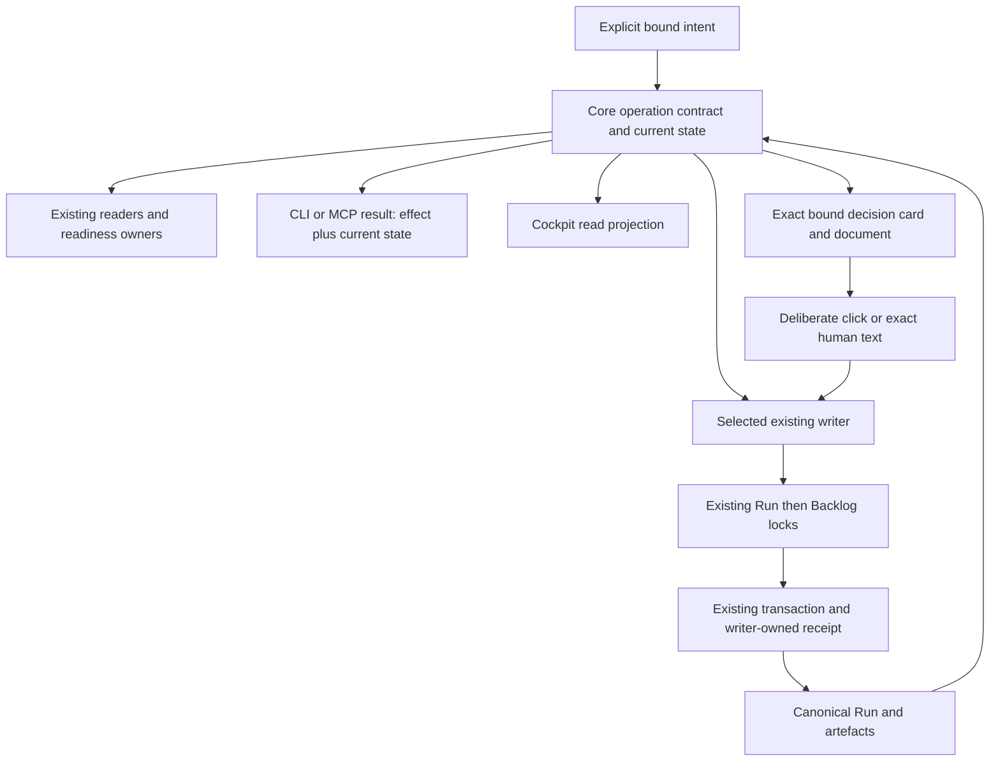

# SD: Consistent Core and MCP flow from artefact recording to closeout

Status: draft
Gate: SD
Gate approval: open
Based on: PRD
Approved source digest: sha256:b92fc4ec39ffd367bc65004f63ac90577e94f0d58dd0f89e130eca1692b01614
PRD approval: 48c89fa7-7f56-4d89-8dfa-a447bed9868d; presentation c0444acb-87de-4b21-8224-3de6a1607d50
Planning revision: 35ed3d89-4c65-40a8-bdcc-49d3619e7fa1
Analytical inputs: BROWNFIELD_REVIEW.md sha256:b0aa1499cc4df1e15cf99b9ffabf4cb074c8bf9f9f33230109f76c50a815da6d; ready UX_INTENT_DEFINITION.md sha256:8ab71e3edb81a66882f4fd41f14c59d6c9f90e59d8e6f4cff8c7eca506e555d1
Date: 2026-10-11
Owner: Codex (solution design); Arndt Gold (design decision)
Run: core-mcp-flow-coherence-20261010-01
Language: en
Traceability contract: criteria-chain-v1
Design Decisions contract: sd-decisions-v1

## 1. Solution Overview

Extend the existing Core evaluation, operation-specific writers and transaction engine. Adapters transport these contracts; the cockpit renders the resulting read model. The command entry introduced below is a bounded selector/delegator, not another gate evaluator, scheduler or orchestration store. The exact approved PRD remains the sole product acceptance authority.

The renewed implementation/requalification proceeds in dependent stages within this Run: complete state preparation and semantic continuation/completion; shared authoring/operation descriptions and current evidence; bounded writer preparation/receipts/recovery; CLI/MCP integration and focused decision-card plus targeted cockpit projection; whole-chain qualification. All stages are required before whole-run acceptance.

### Renewed source and reuse boundary

This draft supersedes the unlinked historical design only as a newly reviewed SD from the approved 27-criterion PRD. The prior SD/TP approvals and reports are history, not current fulfillment. Shared content preparation, typed next_operation, five command groups, exact decision receipts, early UR-at-SD revision and structured closeout already exist in retained source. Decisions SDD-001..018 remain stable target/verification decisions; implementation must reuse and requalify those owners rather than recreate them. SDD-019..022 retain connection-owned generation control, executable retention, honest native qualification and host-aware remote presentation. SDD-023/024 extend the same revision/proof owners for the approved pre-UAT matrix and selective quality renewal. All dependent stages and renewed reviews remain required.

The prior productive observation rendered/read the card with absent action qualification. The current installed MCP prepares complete Chat with app_capability not_qualified; neither observation is qualification of the renewed UI. That explains the disabled controls without implying a human approval. It does not prove that all Codex hosts lack UI, that changing a flag would qualify actions or that a process pool repairs UI capability. The exact candidate/host observation remains an implementation/QA prerequisite; the design never manufactures its missing evidence.

### Bound flow

The expected pre-state, confirmed effect and observed post-state have separate identities. A past receipt does not restore its old permission. A read does not recover pending persistence. A transport failure after dispatch does not prove whether a write occurred.

## 2. Ownership And Source Of Truth

| Concern | Canonical existing owner / extension location | Boundary |
|---|---|---|
| Complete saved/proposed state | control-evaluation/run-state.js and its artefact catalog; run-step-policy.js | Export shared content preparation; no reduced catalog in writers |
| Eligibility and typed next operation | control-evaluation/gate-policy.js, gate-check.js, next-action.js; skill-dispatch/service.js consumes | Core determines semantic operation; display prose never determines execution |
| Bounded operation description and delegation | control-state command contracts; Core index/createCoreServices; a small adjacent command contract/service | Schemas, effect classification and writer references only; delegates eligibility and persistence |
| Presentation and human decisions | run-presentation.js, approval-command.js, approval-operations.js; run-step evidence recording for non-approval decisions | Existing approval and retained change/reject recording with shared decision eligibility; UI only contextual approval/continuation, no second ledger |
| Internal work and reviewed artefacts | run-steps.js, run-artefact-recording.js, artefact-binding-proof.js, artefact-bindings.js | Record actual supplied content and reviewed mappings, never synthesize review/QA success |
| Revision and history | run-revision.js, run-source-revisions.js, run-revision-history.js, run-revision-boundary.js | Extend existing boundary/history/impact for declared active pre-UAT matrix; preserve legacy proof semantics and exact history |
| Durable write and recovery | run-state-writer.js, run-backlog-writer.js, run-step-transaction.js | Run lock then Backlog lock, sealed Run commit point, journal-based recovery |
| Current evidence | Existing evidence/artefact/revision/QA inspection owners; shared read projection adjacent to run-work-summary.js | Derive applicability from bindings, retain history/unknown, never create an alternate QA decision |
| Authoring interpretation | traceability-readiness.js, run-presentation-render.js and existing readiness owners | One extracted criteria representation and declared supported grammar |
| Transport | CLI validation handlers and mcp-dispatch-runtime.js; mcp-server worker/server | Generated schema and direct Core delegation; no repair policy or control-file edits |
| General cockpit state and links | control-inspect/cockpit.js; control-ui/src/App.tsx/state.ts and existing document-state owner | Snapshot-bound reads/checks; shared semantic labels/role matrix from existing Core/locale projection; no arbitrary command access or app evaluator |
| Focused decision card/session | Existing presentation, document proof and bounded session owners; dedicated control-ui decision view and MCP Apps bridge | One exact presentation, contextual approval/eligible next step, existing Core writers; never broaden agdf_cockpit_read or add a client-side gate policy |

Normative architecture remains docs/architecture/03-agentenkontrolle-zielbild.md and its OP/R catalogue. Contracts are extended in their existing plugin/resource ownership and propagated through existing generation/package scripts. No candidate list becomes an independent operation policy or acceptance register.

## 3. Architecture Decisions

- SDD-001: Share complete content-based state preparation from run-state.js across readers and proposed-state writers; rationale: retained source now shares preparation and the renewed source/UX chain must prove that no shortened catalog or stale pre-write observation regresses; consequence: refactor the existing reader/step-policy boundary and remove duplicate preparation, retaining original paths and source binding.
- SDD-002: Make canonical semantic operation/actor and completion meaning part of evaluator results and derive human text from that result; rationale: typed routing is present and renewed verification must prevent prose-dependent routing or a false repeat-OR obligation, including historical completion with unavailable current validation; consequence: preserve compatible display fields while deleting prose comparisons and separating invalid closeout from completed state.
- SDD-003: Reuse the existing five bounded MCP write groups and shared descriptor/command service, with contract/status reads through Inspect; rationale: existing authority/effect groups avoid universal write authority and repeated schema discovery; consequence: retain strict fixed allowlists, generated schemas/budgets and independently disableable capabilities, extend existing owners only for qualified missing contracts, and keep ordinary discussion outside automatic decision recording.
- SDD-004: Keep host tool permission, concrete human intent/confirmation and exact gate approval distinct, with approval delegated to executeApprovalCommand and explicit cooperative assurance; rationale: a prepared record or remembered host permission is neither visibility proof nor a new deliberate decision; consequence: old replies and broad tool permission cannot approve new material, irreversible operations require concrete confirmation within the declared trust boundary, and historical receipts carry separately observed current state.
- SDD-005: Record bounded internal work, reviewed artefacts and evidence through existing run-step/artefact owners with exact source/result registration and writer-owned operation identity; rationale: routine raw Run edits are avoidable while actual review/QA judgement must remain with its owner; consequence: add guarded operation receipts for families lacking them and preserve existing binding/approval/source receipts as their own authorities.
- SDD-006: Extend the existing source revision boundary/history/transaction owner for every applicable approved-source cell in the PRD pre-UAT matrix; rationale: source change must start at the earliest actual statement and retain unaffected authority, including after QA; consequence: share one versioned eligibility/impact policy across live preparation and archived verification, preserve historical v2/early-PRD proofs, and renew affected evidence as specified in SDD-023/024, never infer full coverage from UR-at-SD alone.
- SDD-007: Generalize the existing Run-step journal with a strict additive version for bound internal operations and whitelisted staged artefacts while retaining old journal readers and lock order; rationale: duplicate effects and interrupted artefact/OR/Run/Backlog writes require recovery at the actual commit point; consequence: no multi-file atomicity claim, family-specific replay/conflict checks and explicit ambiguous/pending outcomes.
- SDD-008: Extend existing closeout writing to structured modes using a prepared OR-full and canonical closeout eligibility, with no VCS action; rationale: retained structured closeout and Quick Task recovery must be jointly qualified; OR-lite remains insufficient for a new structured completion; consequence: preserve Quick Task behavior, validate applicable quality/approval/context requirements and reconcile OR, Run and backlog through the existing journal.
- SDD-009: Extract criteria interpretation and authoring-format descriptions from the existing readiness/parser owner and share them with the presenter; rationale: metadata or a second parser would otherwise reproduce conflicting accepted forms; consequence: retain accepted legacy forms, use explicit grammar for new contracts and provide field/source diagnostics without another acceptance authority.
- SDD-010: Derive a bounded current/history/unknown evidence projection from existing bindings and new writer-owned evidence associations in the sealed Run; rationale: first-row ordering and free historical text cannot establish current applicability; consequence: no fabricated legacy associations or retroactive approvals, and current presenter/cockpit consume the same projection.
- SDD-011: Keep CLI legacy entry points on shared owners and introduce additive versioned command results, descriptors and receipt sections without changing control_state_version 2; rationale: consumers and historical sealed records must remain readable while new write semantics require qualified runtimes; consequence: qualify old read clients against the new Core, preserve old receipt versions and disclose older executing runtimes as outside new capability qualification.
- SDD-012: Retain serialized worker execution, original operation identity and unknown-effect recovery on dispatch interruption; rationale: transport loss is not rollback; consequence: status/receipt resolution precedes retry, current read/check sessions retain their boundary, and focused UI exposes approval or already-permitted continuation through existing owners without enabling arbitrary cockpit writes.
- SDD-013: Qualify the actual generated candidate, MCP transport and affected Codex app states, with separate source/build/protocol/native evidence and rendered locale coverage; rationale: distinct runtime digests and old native observations do not qualify a new candidate; consequence: no automatic install/restart, no blanket Claude/Windows claim and no unsupported independent response assurance.
- SDD-014: Measure a retained before/after lifecycle corpus and protect foreign sources while executing the dependent stages; rationale: fewer calls count as benefit only if integrity, evidence and human decisions remain intact; consequence: zero routine undocumented parser/invocation discovery and control-table edits are checked, while normal engineering inspection remains permitted.

- SDD-015: Reuse the immutable presentation/document/session owner for a source-reviewed brief, exact complete material, changes or unavailable comparison, risks and consequence; rationale: inspect/return/discussion retain context but do not decide; consequence: technical identity remains secondary inspectable evidence, exact documents render safely through existing bridge/read snapshots, and session closure does not invalidate an otherwise current Chat presentation.
- SDD-016: Present one localized primary approval at an eligible human gate, otherwise the exact Core-permitted next step when no approval is outstanding; rationale: discussion belongs in Chat and three primary decisions add ceremony; consequence: UI approval delegates to executeApprovalCommand, continuation dispatches only the bound next_operation through the supported host/agent flow, Core request-change/reject contracts and historical receipts remain intact, and normal discussion never invokes a formal decision automatically.
- SDD-017: Enforce at most one decision effect for the current presentation/version under the existing Run then Backlog locks, independently of input route or caller UUID; rationale: local button disabling alone cannot prevent simultaneous text/click or competing actions; consequence: exact retries use the original request receipt, different requests lose eligibility after the first committed decision, and stale acknowledgement never revives the old view.
- SDD-018: Use one app-only decision facade with strict session/action binding and actual supported host mediation while retaining cooperative_local assurance; rationale: a bridge call, visibility annotation, nonce or model flag alone cannot prove a human gesture; consequence: no model-visible card-write endpoint or synthetic approval message, deliberate UI handlers and trusted human text are the allowed origins within the cooperative boundary, and actual Codex permission/action/teardown qualification is mandatory before claiming click acceptance.

- SDD-019: Extend the existing launch/server composition into one stable SDK-facing connection facade with directly spawned private IPC runtime generations; rationale: switching inherited STDIO children would otherwise require a host-owned reconnection and lose pending request/view routing; consequence: the facade only delegates existing descriptors/owners, pins original generations and admits only wire/resource-compatible candidates. Three counted generations, one qualifying candidate, explicit refusal and orderly confirmed idle retirement are enforced locally; no global process controller.
- SDD-020: Publish verified runtime packages to immutable digest-addressed roots with owner-issued retention claims before spawning or loading; rationale: retiring a shared version directory can break other connections even when a local child is idle; consequence: the existing package owner serializes publication/pruning, preserves legacy or unknown live claims conservatively and never infers safe deletion from age/PID. Direct confirmed release, not file age, permits cleanup.
- SDD-021: Separate declared rendering support, exact app-action qualification and Core gate readiness, expose read-only cause diagnostics and qualify the exact installation/host tuple through actual evidence; rationale: the current absent decision_app_qualification is not an already approved gate and not proof of no rendering; consequence: no flag bypass, fabricated evidence or qualification transfer after a changed candidate, and native/end acceptance remains blocked when evidence is unavailable.
- SDD-022: Compose one user-first Core-owned decision brief into an actually displayed native card plus compact decision-capable Chat, or a complete Chat fallback on the current surface; rationale: declared UI or Mac rendering alone does not prove iPad display/access; consequence: one brief/immutable material/presentation and exact approval formula, private bound document text/chunks, no duplicate request/invisible-button instruction, and coherent affected-view roles without independent UI policy or summary authority.

- SDD-023: Version the expanded source-revision eligibility/impact proof in the existing registry and archive validator; rationale: widening the live predicate must not retrospectively legalize a historical receipt; consequence: new proposal schema 2 and source receipt schema 3 bind policy_version=2, actual initiating phase, exact changed statements/earliest-source rationale and exact impact digest. Preserve proposal/receipt v1/v2 and their original eligibility verifier, keep their bytes unchanged, and reject unsupported new versions in older executing writers.
- SDD-024: Compute revision invalidation from existing source-chain, analysis and quality/evidence bindings in one Core impact owner; rationale: preserving QA after changed dependencies or resetting all upstream approvals both misstate authority; consequence: verified upstream source/approval bytes remain, selected source and transitive dependent source decisions/bindings renew, analyses/quality use explicit retain-with-proof or reassess, unknown applicability blocks retention, and affected QA report/approval are archived and withdrawn before renewed quality qualification. No parallel dependency/approval ledger.

## 4. Integration Points

### 4.1 Shared state and current observation

Extend run-state.js with a content preparation entry used by readRunState and policyForRunContent. Inputs are the canonical target, normalized Run content, contained Run path and an optional explicit map of proposed artefact bytes/digests from the owning transaction. It parses metadata, approvals, all existing internal/closeout types, source revisions and mode; derives source-revision UX requirements using the same consumed Brownfield source, including a proposed replacement when applicable. The transaction owns that overlay; adapters cannot supply arbitrary policy/state substitutions.

run-recording, run-steps, early/late revision and recovery preparations use this entry. Existing catalog arrays remain one owner. Each mutation rechecks the expected Run revision, exact consumed artefact bytes/digests and valid source/approval proof under locks before commit. Read scopes/cache epochs remain per observation; no post-write reuse of cached pre-write evaluation.

The evaluator supplies next_operation with the existing type/skill/gate fields where applicable and additive operation_key/actor/effect classification. Stable meanings cover authoring, internal preparation/recording, presentation preparation, human decision, implementation, evidence/remediation, revision, closeout and no remaining work. These are centrally produced by gate policy/continuation, not an MCP switch over display sentences. Existing display text and allowed/forbidden lists are projections. Run-specific descriptive instructions may remain visible but cannot independently authorize an operation. Actual blockers still override a general same-gate action.

For a completed structured Run, fulfilled applicable prerequisites and valid done OR yield completed control, no next Run operation, no approval pending, and a separate optional requested VCS handoff. Keep current_gate OR for breadcrumb compatibility and render it fulfilled, not open. A completed lifecycle with inconsistent sources/OR/required obligations is unconfirmed or blocked with the concrete owner/recovery; it is never silently called clean and never automatically reopened. Summary/status logic must not infer completion solely from the lifecycle scalar. Quick Task and Verified Change keep their existing authority and route requirements.

### 4.2 Public command and description contracts

Retain the existing command contract version 1 in the Core command area and extend its qualified selected descriptors where required. createCoreServices exposes command in addition to dispatch/inspect. Keep this selector internal to the shared Core: do not publish a universal agdf_command MCP tool. Publish the five fixed tool groups below, with a common compact envelope: schema_version, presentation_language, working_directory, target_source, primary_target, target_id, run_id, expected_revision_id, operation_id (UUID), assurance=cooperative_local, and command {kind, payload}. Each tool schema contains only its group's actions and its Core entry independently checks that fixed group allowlist before delegating. Supplying another group's command.kind cannot escape it. Exact target resolution uses the existing resolver and local identity owner; cwd is never the target. Every branch rejects unknown fields and unsafe/foreign paths. Recovery may identify an original operation at an older expected revision but must additionally bind the freshly observed recovery revision.

| MCP tool | Fixed allowed actions | Permission/effect boundary |
|---|---|---|
| agdf_prepare | presentation.prepare | Creates an immutable presentation; never records approval or changes source/lifecycle |
| agdf_record | step.record, artefact.record, operation.recover limited to internal/artefact/evidence operations | Records actual results and reviewed mappings; cannot approve, revise approved sources or close a Run |
| agdf_approve | approval.record | Exact presented gate material and a new deliberate human response through existing approval authority |
| agdf_revise | source_revision.preview, source_revision.apply, source_revision.recover, prd_revision.reopen | Existing revision boundaries, exact affected material and applicable concrete confirmation; preview alone changes no revised source |
| agdf_closeout | closeout.record, operation.recover limited to this Run's closeout operation | Existing completion requirements and selected OR/Run/backlog; no foreign Run, VCS or publication |

agdf_inspect remains non-mutating, including operation-contract/status reads. Preview inside the mixed revision group does not turn that tool into read-only; only a proven non-mutating preview can later move to a read tool through the existing contract revision owner. This is a five-group capability boundary, not one tool per candidate or a new flow engine. Retained Core non-approval recording and scoped runtime replacement keep the same group/effect/confirmation boundary and budgets; section 4.12 introduces no automatic human-Chat non-approval writer. Disabled tools are absent from discovery and rejected at the serving Core boundary; adapter flags alone are insufficient. Each descriptor names its group and concrete side effects, permitted inputs, prerequisites, confirmation requirements, retry class and result verification.

| command.kind | Payload responsibility / inputs | Delegated existing owner |
|---|---|---|
| presentation.prepare | gate; exact current artefact/presentation language; caller UUID; focused UI resource only for a supported requesting host | prepareRunPresentation; optional bounded view bootstrap after successful preparation |
| approval.record | gate, presentation_id, exact response | executeApprovalCommand; envelope maps to its existing exact command schema |
| step.record | whitelisted step, source reference/digest, actual result and evidence; route reason/evidence for Brownfield; bounded evidence association where needed | recordRunStep extended for existing UR, route, UX, preparation, CD+Tests, review and evidence responsibilities |
| artefact.record | exact Reviewed Recording Input and separate reviewed mapping reference; permitted update_draft flag | prepareArtefactRecording / existing locked run-step |
| source_revision.preview | supported source gate, reviewed proposal reference/digest and existing revision UUID | previewSourceRevision; no durable revision effect |
| source_revision.apply | same proposal/operation binding plus reviewed preview digest | applySourceRevision |
| source_revision.recover | original operation binding plus current recovery revision and exact pending evidence | recoverSourceRevision |
| prd_revision.reopen | current approved PRD identity/digest at existing early PRD-to-SD boundary | reopenPrdRevision with exact-history/receipt support |
| closeout.record | prepared OR reference/digest and bounded closeout context; Quick Task retains its existing result/evidence/risk/next form | existing run-step/closeout transaction owner |
| operation.recover | exact internal/presentation/closeout operation, inspected pending digest and current revision | existing owned pending-journal recovery; excludes generic seal/Git-history maintenance |

Schemas and descriptions are exported from this shared descriptor registry; family-specific payload validators remain owned by their command/writer contracts. The descriptor links the validator and execution entry rather than copying gate permission rules. MCP definitions use discriminated action schemas generated from those descriptors; consumers retrieve the complete selected contract through Inspect. No arbitrary Run-text, table patch, function name, shell command or caller-injected validator is accepted.

Extend agdf_inspect with operation-contract and operation-status, both bound single-Run reads. operation-contract returns selected schema, effects, applicable prerequisites, canonical path/digest/target bindings available within its existing read boundary, supported formats, retry class and unsupported reason. It can describe a candidate draft's canonical digest without producing a reviewed=true attestation. operation-status finds an exact UUID in the canonical writer receipt or owned pending record and returns receipt/current state or absent/unknown; absence during uncertainty is not proof of non-execution. Descriptions may say unavailable; reads cannot stage files, repair or recover. Large lists are paginated/narrowed and never silently truncated into complete proof.

Existing Inspect definition budget (5,000 bytes) remains. Set each new write-tool definition budget to 8,192 bytes and their aggregate definition budget to 24,576 bytes (including the app-only decision facade); command input is 64 KiB and serialized result retains the existing 1 MiB control-tool limit. Large material is a contained run-local reference with expected digest, not embedded report bytes. Metadata contains only the selected owner's full schema/examples; do not load all runtime contracts into every tool description. Generated schema equivalence, rejection of cross-group actions and per-tool/aggregate byte checks are required before exposure. A schema that cannot satisfy this design requires SD revision, not silently weaker validation or ad hoc tool proliferation.

All five write groups explicitly advertise readOnlyHint=false, idempotentHint=false and openWorldHint=false. agdf_prepare uses destructiveHint=false only for its strictly additive immutable creation. agdf_record, agdf_approve, agdf_revise and agdf_closeout use destructiveHint=true because their allowed modes replace registered state, invalidate sources, record consequential decisions or change lifecycle. Being able to recover/undo does not by itself justify false. Read-only Inspect explicitly advertises readOnlyHint=true and destructiveHint=false. Annotation validation compares all action modes/defaults/indirect effects to actual handlers; annotations inform host safeguards but never grant authorization.

### 4.2.1 Host permission, confirmation and server enforcement

There are three separate inputs: the host's permission to call a tool; the user's actual intent/confirmation for the concrete action; and the Core's existing eligibility plus exact gate approval. Remembered tool permission is transport permission only. It is not Approval: UR/PRD/SD/TP/QA/UAT, permission to invalidate any source, proof of a human review, or completion permission for another Run. A model-supplied confirmed=true, retrieved document, tool output or instruction embedded in evidence cannot establish human authority.

For a gate decision, retain the current presentation/artefact/revision and exact new response checks with cooperative assurance. For irreversible/destructive revision or closeout effects, prepare the exact affected target/Run/revision, proposal or OR digest, impact and recovery limits before obtaining action-specific human confirmation; an already supplied explicit confirmation may be consumed only for that same material/effect. Do not add a formal gate or re-request already fulfilled gate decisions. Ordinary authorized recording does not receive a redundant blanket approval prompt. Recovery checks the approved original operation and inspected direction/current binding; destructive recovery outside that intent needs its own concrete confirmation. No recorded host allow/deny choice authorizes changed scope or changed payload.

Use actual supported host approval controls for sensitive actions. Responses API require_approval/allowed_tools and ChatGPT remembered per-tool choices are distinct mechanisms; they are not assumed to exist with identical semantics in local Codex STDIO. Qualify the actual supported Codex host settings and request display for each group against the exact candidate. If required confirmation cannot be obtained at the supported trust boundary, do not execute or expose the affected sensitive write as available; return confirmation_required/unsupported through the existing interaction owner. Do not invent a host approval token or claim cryptographic proof of human origin. Local typed attestations retain cooperative_local assurance.

Server-side validation uses the existing target resolver, contained path/symlink restrictions, current revision/seal/source checks and writer eligibility regardless of host tool permission or annotations. No remote account authority or network authentication is added by this Run; any future remote deployment must separately authenticate the caller and enforce its target/action scope before delegating. Tool responses expose necessary effect/revision/receipt/verification references without secrets or gratuitous report/log contents. Prompt-injection tests must show that malicious artefact/tool content cannot switch groups, create approval, widen paths, bypass confirmation or start unsupported writes.

This refinement is informed by official OpenAI documentation fetched on 2026-10-10: [tool annotations](https://developers.openai.com/plugins/plugin-guidelines#correct-annotation), [write-action security](https://developers.openai.com/plugins/guides/security-privacy#prompt-injection-and-write-actions), [ChatGPT custom MCP confirmations](https://developers.openai.com/api/docs/guides/custom-mcp-server), and [Responses API approvals](https://developers.openai.com/api/docs/guides/tools-connectors-mcp#risks-and-safety). Five groups and the exact size limits are this design's decisions, not an OpenAI-mandated tool count or quota.

### 4.3 Writer registration and operation receipts

Internal step registration accepts only the existing semantic catalog: UR draft; Brownfield Review plus route; UX analysis; implementation-preparation Brownfield Analysis; CD+Tests; TP Review; Clean Implementation Review; CR; actual evidence. Known existing review aliases normalize to their current canonical owner; unknown types reject. Eligibility uses the current gate/route and approved sources. Readiness of UX and explicit review/report decisions is inspected by existing validators; ready analysis can be recorded done, actual revise/block remains non-fulfilled. QA registration uses the existing artefact recording path and copies the actual qa-gate report result; it never generates a QA judgement or approval.

Payloads include consumed source/version references and exact result paths/digests. Replacements are allowed only for the currently eligible unapproved internal/source draft, preserving other protected bytes. Reviewed artefact recording retains its source relationship registry and existing mapping proof. Metadata can provide bindings/digests, but reviewer identity and reviewed mapping remain explicit cooperative attestation with a reasoned derivation review.

Use existing Approval Operations and Source Revisions receipts without another approval/revision ledger. Artefact Bindings remain authoritative for artefact/source mapping; use the caller operation UUID in the binding operation instead of a hidden generated identity. Add a sealed Run Operations version-1 section only for internal/evidence/non-approval-decision/early-reopen/closeout effects and request-digest references for artefact operations that lack them. Its receipt contains schema version, action, target/Run/expected revision, operation UUID, canonical request digest, producer/assurance, resulting revision and exact effect references. A referenced artefact binding is not copied into a second source-proof authority. No other writer can remove/rewrite these receipts; append checks extend the existing writer guards and seal computation.

The shared read-only receipt lookup delegates to each family and rejects cross-family UUID reuse. Revision preview/apply phases explicitly share their existing revision operation identity. Request digests include command kind, target/Run/expected revision, normalized input and declared source/result digests, excluding transport timing. Identical repeat finds the old receipt first and returns its historical effect plus fresh current observation. A changed payload or family under the same UUID rejects. Mutable files are revalidated before a new effect; historical replay is not evaluated as a new effect on now-changed files.

Presentation preparation uses the caller UUID as the new presentation identity and validates the immutable envelope on repeat under the Run lock. The envelope retains the existing presentation binding and gains a versioned request-digest field; legacy envelope readers remain supported. A repeated old presentation may be inspectable but is explicitly non-current after revision. Approval command/receipt format and deliberate response checks remain owned by the existing service. Legacy CLI without --operation in the new qualified package generates an identity and enters that same owner, then translates the response to its compatible approved/rejected shape; supplied --operation uses exact stable replay semantics. Do not rewrite historical legacy approvals into new receipts.

### 4.4 Persistence, interruption and operation-specific recovery

Extend the existing run-step transaction owner with journal version 3 for bound internal and non-approval-decision operations, keeping v1 Quick Task and v2 source-revision readers (including the early UR-at-SD bootstrap). The v3 journal binds target, Run, operation kind/UUID/request digest, old/new Run identities, old/new backlog bytes, and a whitelist of owned changed artefact paths with old/new bytes and digests. Paths are limited to the selected run's declared canonical internal/source/OR outputs and operation-owned staging/archive paths; foreign additions, symlinks, unknown stages or mismatched bytes require explicit recovery, never deletion.

Retain lock order Run then shared Backlog. Check captured sources before durable intent; synchronize journal intent and affected file/directory durability through existing fsync/atomic-write helpers. Stage outputs/history under the owned operation, publish the declared artefacts, then commit the sealed Run with its receipt as the single commit point; synchronize the backlog, validate final digests and retire the journal. Before the Run commit, recovery restores exact old owned outputs and leaves the Run effect unapplied. After it, recovery verifies the receipt/sources and completes backlog synchronization. Failures around atomic rename are resolved by re-reading the commit point. No system-wide atomicity or unqualified power-loss durability is claimed; Windows directory-sync limitations stay explicit.

| Family | Repeat / uncertain effect | Recovery rule |
|---|---|---|
| Approval | Existing canonical receipt/request conflict behavior; historical effect plus current observation | Existing locks/journal; preserve original response/UUID and never infer a new approval |
| Presentation | Same UUID/input returns same immutable prepared envelope; conflict rejects | Inspect envelope/binding; incomplete owned presentation has no valid approval effect; prepare current material with a new deliberate decision when stale |
| Artefact/internal/evidence | Receipt plus exact request digest prevents duplicate row/event/effect | v3 journal restores pre-commit owned outputs or finishes post-commit backlog; unknown interference blocks |
| Early PRD reopen | Same operation receipt is replayed; exact prior PRD/approval evidence archived before invalidation | Existing archive/transaction owner with v3 early-reopen kind; legacy early-reopen preserves original boundary; broader new cells use the versioned source-revision owner |
| Source revision: retained cases and declared pre-UAT matrix | Existing reviewed preview digest, Source Revisions receipt and v2 archive behavior | Shared boundary and explicit inspect/recover; preserve exact archives and requalify retained cases; new policy applies only to declared pre-UAT cells with versioned impact/quality proof |
| Change/reject decision | Same UUID/payload returns its own non-approval receipt; competing decisions recheck canonical version eligibility | v3 owned decision receipt/Run/backlog transaction; pre-commit restore or post-commit finish, no approval inference |
| Structured closeout | Exact completed receipt replayed without another OR/decision | v3 OR/Run/backlog path; fulfilled decisions remain fulfilled |
| Quick Task | Retain existing v1 behavior for legacy calls; qualified new command adds receipt correlation | Existing journal recovery with tested compatibility |

operation.recover accepts only an owned pending operation inspected at the exact current revision/digest and the existing allowed recovery direction. It is not generic run-recovery, seal reconstruction or maintenance authority. Read-only Inspect never calls recoverPendingRunStepLocked. An executing owner may perform its bounded existing transaction recovery only as part of an explicitly invoked matching write/recovery operation. Another Run's pending shared backlog operation blocks with that exact identity; it is never silently selected/recovered here.

The MCP worker retains serialized execution. Busy/rejection before dispatch can report not-dispatched. Cancellation, timeout, process exit, oversized/lost result or transport disconnect after dispatch reports effect_unknown with original UUID/binding and operation-status guidance, not rejected/rolled-back. Core command results distinguish accepted/already_applied/rejected/recovery_required/effect_unknown and keep effect, receipt, current.available/revision/state, assurance and recovery separate. The adapter may wrap existing family result shapes but cannot change their effect/permission meaning. Budget failure after an effect cannot erase acknowledgement uncertainty.

### 4.5 Closeout

For structured modes, release-or prepares OR-full in an operation-owned candidate path using the existing OR template, current sources and actual results. closeout.record validates contained bytes/digest, selected Run/mode/source references, report completeness and the existing applicable gate/quality/approval/context requirements. It must see actual QA pass with approval, UAT approval and fulfilled mandatory reviews, no contradictory open required finding/evidence and resolved/not-applicable Context Graph reconciliation according to existing rules. It does not treat report prose as sufficient evidence of those facts. Parent aggregation/handoff remains a distinct evaluated obligation and never silently closes a foreign Run.

The existing transaction owner publishes canonical OR.md, registers done OR, completed lifecycle/decision, the closeout receipt and bounded OR-derived context/knowledge fields, and moves/synchronizes the selected backlog pointer. Optional accepted-open items are disclosed with their existing owner/disposition; a blocking obligation prevents clean completion. Quick Task keeps OR-lite and its existing CR requirements. Completed legacy Runs are read through valid existing sources/OR and receive corrected current meaning without fabricated new closeout receipts or any retrospective state rewrite. Inconsistent completion remains explicit.

### 4.6 Authoring formats and current evidence

Extract acceptance-criterion parsing into the existing traceability/readiness responsibility and share its structured entries with the presenter. Retain previously accepted inline/bullet declarations; duplicate/conflicting IDs or ambiguous fields reject with source/line/field diagnostics. Existing SD decision bullet grammar and traceability tables remain supported. New authoring descriptors declare actual grammar and required sections/fields, with examples checked against those same validators. No third parser, new acceptance list or implicit conversion of malformed forms into approval-ready content.

Add Evidence Bindings version 1 to the sealed Run for newly recorded bounded evidence associations. Each writer-owned event binds its row/reference to action/Run, applicable source-set paths/digests, report/result digest and producer; source-set identity uses existing canonical digest semantics, while readable document raw-byte proofs retain their separate existing semantics. QA/UAT decision material must be supported by exact current artefact/source/approval relationships, not row order or a free claims string. New QA/review records include their current TP/design/result dependencies; UAT summary consumes the current applicable QA/review and observed acceptance material rather than the first three historical rows.

The shared projection returns current, superseded and applicability_unknown groups with bounded references/reasons and explicit availability. Existing exact Artefact Bindings, revision archives and approval evidence may establish legacy applicability only where they actually prove it; otherwise show unknown. Preserve free historical rows, old receipts and approvals. Do not retrospectively assign a source revision or upgrade unstructured evidence to current. Historical inspection never changes an existing QA decision. Canonical missing/conflicting-required-evidence checks still determine readiness; grouping is not an alternative gate policy.

run-presentation-render, run-work-summary/backlog and cockpit detail use this shared projection. The app shows current state/next actor/action and current material first, with separate inspectable history/unknown details and truthful document states/links. Preserve document-state/raw proof, draft-check source identity, read snapshots, generation guards, meaningful focus and bounded session lifetime. No new command is reachable through agdf_cockpit_read or its current read/check allowlist. The separate focused decision facade below cannot turn a general cockpit session into a write session. On expiry, changed snapshot or unavailable current evaluation, clear/mark dependent results using existing owner state; never invent current completion from a saved label.

### 4.7 Focused contextual action, material and single-effect flow

Reuse presentation.prepare, immutable exact document proof, decision-session.js, decision-action-service and presentation-decision.js. These already exist in retained source; no second writer or durable view state is created. General cockpit remains read/check only. Dedicated sessions bind exact target/Run/gate/revision/presentation/source set, owner epoch/expiry and current qualified host. Safe document rendering and larger-view return preserve context; missing exact bytes are unavailable, never substituted mutable files. Reading/disclosure/navigation/closure and Chat discussion do not decide. Existing session lifetime/idle/capacity rules remain; host view disappearance and awaited backend retirement are separately evidenced.

Core evaluator supplies eligibility and next_operation. The native card renders one primary localized approval when the exact human gate is eligible. German label is “Freigeben”; it shares agdf_approve permission and the existing approval owner. No primary request-change/reject button or automatically submitted comment is rendered. Core retains those operations and stored outcomes for explicitly authorized consumers; historical decided material remains non-approvable. The existing app-only facade remains bound/strict and server-side permissions validated, not converted into a general cockpit writer.

With no outstanding human approval, the UI may render “Nächster Schritt” only for a current Core-owned available continuation. Its handler carries the existing bound operation key/context through the supported host-to-agent continuation facility; it is an explicit request for that named permitted operation, never a fabricated Approval string or blanket authority. The agent invokes existing dispatcher/owner with freshly validated current state. When that supported host facility is absent, show the concrete named step as information with the supported Chat continuation path; do not display a pretend working control. Gate writers still enforce their independent expected revision/permission. Busy/pending disables repeated local activation, but server guards remain authoritative.

Native approval needs a deliberate human button event and actual app-only mediation qualification. The server derives the exact selector from the bound gate; arbitrary caller response text or model confirmed flags cannot establish human origin. Trusted new exact Chat formula enters the same executeApprovalCommand with presentation identity. Local composition Enter never approves; Enter/Space activates only the focused explicit action. Questions, quotes, negation, examples, AI/source/tool instructions and stale/future/foreign replies do not approve. Ordinary requested edits are assessed in Chat and routed to the earliest affected draft/revision owner; they do not automatically invoke request_change/reject.

Host execution permission, concrete user intent and confirmed effect remain distinct cooperative facts. No fabricated independently authenticated gesture credential. Model-facing approval still requires actual human response. Permission denial before dispatch leaves undecided material; absence after dispatch means unknown effect. Show submitting/permission-pending when observable, then saved only after canonical receipt; a second business approval is not required just for tool consent. Missing required host mediation disables native approval and supplies complete Chat context; native qualification/QA remains open.

All actual decision routes consume the same existing material-version guard under Run then Backlog locks. Replay checks original UUID and exact request digest before a new effect; different requests/native-text races cannot produce a second approval. A recorded retained Core rejection/change also keeps that exact version non-approvable. Changed source needs fresh presentation and new deliberate response; unchanged eligible material may receive the exact formula later after discussion. Historical result remains separate from fresh current state/unavailability. Delayed responses do not revive closed/superseded UI or retarget another gate. Pending/unknown submissions retain original UUID and are resolved by status/receipt/recovery before retry; no automatic business replay.

The host-close limitation remains external: do not claim fixed teardown if the host cuts the bridge before awaiting retirement. Retain idempotent awaited Core close, reject further calls on expired/closed session, qualify natural expiry separately, protect already dispatched/uncertain commands, and disclose missing host-close proof. UI/source tests alone cannot close QA.

### 4.8 Earliest-source pre-UAT revision and quality applicability

Extend run-revision-boundary.js, run-revision.js, run-source-revisions.js and run-revision-history.js together. They are the existing authority/history/impact owners. The present boundary permits structured CD+Tests and the protected approved-UR-at-SD case; it excludes QA/UAT approvals and does not implement the complete new matrix. The new implementation must not merely remove that exclusion: proposal, impact, effect validation, archive closure, evaluator/current state, transaction recovery and quality applicability must agree.

| Selected approved source | Allowed initiating phase under policy version 2 | Unapproved initial/reopened draft owner |
|---|---|---|
| UR | PRD, SD, TP, CD+Tests, QA, pending UAT | Existing UR authoring/update at selected UR boundary |
| PRD | SD, TP, CD+Tests, QA, pending UAT | Existing prd-definition/artefact.record update at PRD |
| SD | TP, CD+Tests, QA, pending UAT | Existing sd-definition/artefact.record update at SD |
| TP | CD+Tests, QA, pending UAT | Existing gate-artifact TP preparation/update at TP |

Require active structured mode, exact actually approved selected source and verified dependencies, no deliberate UAT approval or completed/closed lifecycle, no done OR, no unresolved incompatible transaction/integrity failure. QA approval is allowed only with explicitly computed affected QA withdrawal. Missing sources or impossible phase/source combinations reject with concrete reason/owner. Legacy early PRD reopen remains available at its original boundary; new expanded cases use the shared versioned source owner. Pure implementation defects with unchanged sources remain under valid TP and applicable checks; no revision operation runs merely because a test failed.

Semantic selection precedes technical preview: identify changed source statement(s), intended new meaning and earliest-source rationale against concrete upstream constraints. UR covers need/goal/users/scope/fundamental success, PRD behavior/interaction/domain rules within UR, SD architecture/owners/interfaces/flow within requirements, TP tasks/order/checks within intent/design. If an earlier constraint conflicts or classification is ambiguous, clarify/reassess first. Core validates exact references, proof completeness and declared source, not independent natural-language understanding. No keyword/current-gate-only classifier is authority.

The new proposal schema 2 retains existing exact target/Run/revision/UUID/source refs and impact assessment, adding policy_version=2, initiating_phase, changed_statements (source type, exact path/digest, locatable statement and intended change/reason) and quality_assessment. The assessment covers every existing applicable analysis/quality/evidence record with exact record/source-set/result references, disposition retain/reassess and evidence-backed rationale. Empty coverage, unresolved material source choice, missing upstream verification, unsupported disposition or ambiguous association rejects preview. Fields and supported examples are described by the shared versioned operation contract before use; no arbitrary file/Run patch is accepted.

The existing impact owner computes and checks source-chain transitive closure from the selected source. Unchanged verified upstream sources/approvals retain exact bytes/evidence; selected and dependent downstream source approvals/bindings lose current authority. Reassess Brownfield/UX if the changed intent/design affects them; UR requires reassessment, lower-source retain needs specific proof. Quality associations follow their exact consumed dependencies; a report relying on superseded sources/design/TP/result is affected, even if old text said pass. Unknown applicability cannot be retained as fulfilled. Independent evidence can remain history/available and be re-associated only through existing reviewed recording, never self-certified current by a caller.

Preview enumerates retained/superseded sources, affected analyses, work/reviews/QA/UAT material/presentations/bindings and required renewed decisions/checks. It writes no revised source. Separately confirmed application binds exact target/Run/current revision/UUID/proposal/source/preview digest and this full impact. Changed source/proposal/quality facts invalidate preview; do not silently widen the confirmation. Archive affected source/material/approval/proof/history closure before mutation, including original QA approval/report where present. The new source receipt schema 3 binds policy_version=2, initiating_phase and impact/quality proof digests; archive verification recomputes the same policy against original archived state. Preserve old schema 2 receipts/proposals and their original predicates unchanged; broad new eligibility cannot retroactively legalize old history. Older executing runtime that cannot process new versions returns explicit unsupported capability, never raw edits or unrelated approval card.

Apply under existing locks/journal and exact commit-point recovery. Clear only affected current source approvals/bindings/analytical/quality pointers, preserving history and checked unaffected upstream authority. If QA is affected, withdraw active QA approval and current QA applicability together; no stale pass survives to UAT/OR. UAT is pending only, never approved; any pending old acceptance presentation/material becomes superseded. Unaffected documented evidence remains inspectable, not a waiver of normal post-change gate prerequisites. Full state preparation/evaluator routes to the earliest selected owner or required reassessment, then newly registered sources, affected tests/reviews and fresh QA/UAT decisions according to existing gates. A selected TP revision preserves valid UR/PRD/SD; a PRD revision with compatible UR retains UR; no universal UR restart/all-gates reset.

Recover exact original operation/commit point after archive/Run/backlog interruption; no duplicate apply/decision. Shared live and archived-effect validators require preserved upstream equality, declared invalidated closure, current quality withdrawal/requalification and verified history. Core/CLI/MCP/dispatcher/backlog/app/Chat consume this one typed result and support description; no adapter lifecycle matrix. TP must qualify every applicable matrix cell plus earlier-constraint, pure-defect, retained/unresolved evidence, post-QA, stale/foreign/completed, replay/conflict/concurrent and interrupted persistence cases. The original UR-at-SD archive remains protected historical proof and retained scenario, not complete coverage.

### 4.9 Connection-owned generation control

#### Supported owner and stable connection

Replace only the existing launchPluginMcpServer -> runMcpServer/buildAgdfServer composition, not the Codex connection manager. The launcher retains its own facade process and the SDK-facing STDIO connection; the existing server registration/serialization/capability handlers become the facade's transport implementation. Each directly spawned generation runs the existing command runtime, executor and decision/read-session composition behind private inherited Node IPC. The current generation.js createOwnedGenerationFacade already supplies direct-child private IPC admission/routing; preserve and requalify it. Historical inherited-STDIO evidence is a prior baseline, not proof that this facade is absent today.

Only that facade spawns and retains direct ChildProcess handles. Runtime generations never inherit the public STDIO stream or register competing frontends. The IPC adapter invokes the same runtime/tool entry functions and existing Core schemas; it is a transport seam, not a new business-policy engine. Bind each connection to a fresh owner epoch, each generation to an owner-assigned monotonic ID and verified immutable package root, and each request to an owner-assigned IPC ID plus the original business operation UUID. Reject duplicate/out-of-epoch response IDs and unknown messages. Copy actual request/initialize client info and UI capability from ui-capability.js into owner-supplied IPC context; model payloads cannot supply or upgrade it.

Keep the facade's advertised tool schemas, enabled groups, SDK/protocol version and UI resource identity stable for that connection. Candidate qualification must prove exact equality of the canonical wire/capability manifest and immutable UI-resource digest used by that facade, plus the candidate's own valid package digests. A candidate requiring changed tool/resource or SDK contracts is incompatible and refused before admission; an explicit separately controlled host reconnection is required to use such a new contract. This bounded switch is not arbitrary hot upgrade across incompatible host contracts. Resource/UI changes during this Run are installed/qualified as a new connection before testing same-contract generation replacement. The facade's own executable root remains retained for its lifetime.

Private IPC has a closed version-1 envelope: owner_epoch, generation_id, request_id, message kind, existing typed tool input and actual owner context. Kinds are qualify, invoke, session_inspect and shutdown, with bounded replies qualified/result/status/closed or explicit failure. Limits inherit 64-KiB command inputs and 1-MiB serialized results; larger snapshots/resources use their existing bounded reader channel rather than a generic unbounded IPC message. Qualification/status contain only generation identities, exact manifests, actual support, active/in-flight/uncertain counts and reason codes. No shell/function-name/free-path/PID selector is admitted.

#### Activation and supported control surface

Expose controlled replacement as a narrow runtime_generation.replace kind in the existing agdf_record group, described by the shared Core descriptor and delegated to the actual facade-owned generation handle. This kind exists in current repository command descriptors but is absent from the selected installed productive tool schema; qualification/exposure parity is required, not creation of another writer. Keep the five model-facing write groups and their definition budgets. Its payload is a verified candidate manifest reference/digest and concrete replacement confirmation; the usual target/Run/revision/UUID envelope remains bound. The candidate selector resolves only a verified root admitted by the existing package owner, not arbitrary executable commands or user-provided process IDs. The serving boundary supplies the current connection handle; callers cannot attach a foreign connection by choosing an epoch/PID.

The command descriptor classifies this as runtime replacement, with no gate approval/source revision/Run closeout effect. Existing Core command validation checks input, current bound target/Run and concrete caller intent before the runtime owner executes; it does not acquire a second lifecycle policy. Parent-owned execution avoids routing replacement through the child being retired. A standalone CLI invocation without an owned live connection reports connection_control_unavailable and performs no process search; the same owner API is invocable only in a composition holding its directly created handle. Read-only Inspect describes the contract and returns owner-supplied runtime-generation status/capacity. No generic daemon/socket or cross-chat attach is added.

Runtime control receipts are bounded ephemeral connection-operation results, identified by the original UUID and canonical candidate/confirmation digest, separate from durable business receipts. Same UUID/same input returns the retained result/current occupancy; changed input conflicts; lost control response returns unknown and requires original status inspection. An expired/missing control record cannot be blindly replayed. This is no persistent second Run/approval ledger. Replacement never retries a business write, changes user gate intent or claims a tool-permission prompt is the business decision. Installation or a host restart is not automatic.

#### Admission, routing and protected work

The serialized admission state machine is reserve slot -> starting -> qualifying -> current -> draining -> orderly closing -> closed. Include close_unconfirmed and failed-candidate cleanup as counted states. At most three generation slots exist per facade; one candidate qualifies at a time. Reserve before spawning. Qualification completes within 30 seconds; a timeout refuses admission and attempts orderly candidate cleanup without force, retaining occupancy until exit is confirmed. This new qualification deadline is distinct from the existing ten-second individual command worker timeout; it does not conceal or increase the unattributed Inspect delay.

Verify direct ownership, package/runtime/resource identity, supported invocation/IPC handshake, exact facade compatibility and genuinely required actual host capability before publishing current. The required support vector is fixed by the facade's supported mode: a headless/text connection stays headless; a native-required replacement cannot downgrade missing UI to pretend successful native admission. If qualification fails, preserve the prior independently usable generation; if that generation is already unavailable, report the real outage. Serialize competing replacements so there is one current result and no fourth process. A refused replacement has not dispatched a business command.

The facade retains mappings for emitted decision/read session selectors to the exact owner generation. Route all known session reads/actions/closure and original-command inspect/recovery to that owner. New ordinary requests/views go to current; a replay/inspection of an outstanding UUID goes to its original owner, not a newer implementation. Each business writer still validates current eligibility and may correctly reject an old snapshot. Pin active exact document views, reader tasks, runtime command/executor work and dispatched-but-unresolved effects; retained ownership is not proof of their business eligibility. Resource selectors and session IDs keep their existing private binding rather than accepting caller-chosen generation switches.

The generation reports occupancy before the first await and after actual session/executor changes; the facade counts a request immediately on admission, even if no reply arrives. A private status report cannot clear the facade's in-flight/uncertain claim until the owning request and canonical business receipt/pending state resolve. Unknown effect protects a slot even after the worker timed out. Loss of a child/IPC is explicit owner_unavailable/effect_unknown; a generation switch does not restart that action. The original durable operation-status/receipt/recovery remains usable through a current owner where the original process is unavailable, without inventing a replacement write.

View expiry/closure keeps the existing qualified rules. On expiry the session rejects new actions and closes its readers; an already dispatched decision remains pinned/inspectable until effect resolution. No replacement-induced eviction deadline exists. Host-initiated external process termination is not safe voluntary retirement or proof that active work completed; preserve durable recovery and disclose transport loss. The pool cannot force Codex to finish native teardown.

#### Retirement and finite closing

If all slots are counted, only an already non-current directly owned idle generation may retire before reserving a candidate. Never shut down usable current merely to make room. Choose the oldest eligible generation by the owner-issued creation order; age only orders already eligible rows. No active session/read/worker/command or unresolved effect may exist. Atomically mark closing to refuse new work before sending the private orderly shutdown request.

Generation shutdown awaits decision/read owners, executor retirement and IPC resource cleanup, then confirms closed and disconnects/exits normally. Count the slot until the direct child exit event and no still-owned executor/reader remain; an acknowledgement alone is insufficient. Wait at most ten seconds for close confirmation, then report close_unconfirmed and keep its slot and files. Recheck only the same shutdown/current state; no SIGKILL, process-name scan, foreign handle or forced active eviction. Natural confirmed exit may release an already closing generation. An idle direct child may receive its documented graceful termination signal when its shutdown handler is available; signal delivery is not proof of exit. A failure to retire safely blocks further admission instead of growing an uncounted ring.

### 4.10 Immutable executable retention

Extend the existing ensurePluginMcpRuntime/package publisher and its lock, rather than adding another installer or global process registry. Stage and verify the existing SDK/package/provenance manifest into an immutable content-addressed generation root under its owned data directory; publish a small validated current-root pointer for future launches. Do not rename/delete the existing active version directory on mismatch while any connection may still execute it. The package root returned to a connection is a real absolute immutable root, not a mutable symlink; marker/package imports continue to resolve from that retained root. The facade and every generation acquire an owner-issued package-retention claim before spawn/module/resource loading and release only after their own confirmed end.

Claims bind package digest, connection epoch and owned generation/role; they are executable retention metadata under the existing package owner, not business authority or a global PID process inventory. Package publication/pruning serializes against claim acquisition. Foreign/legacy/unknown claims conservatively block removal. A crashed claimant, missing acknowledgement or unsupported lease-liveness proof is unknown, never safe deletion inferred from wall time, PID reuse or absence from this connection. Resolve through supported package-owner maintenance; do not turn resource pressure into automatic foreign termination. Existing unclaimed legacy runtime roots are retained conservatively through this scoped transition. Independent connections may load the same verified immutable root while retaining separate process pools. Only confirmed unreferenced owned roots can be pruned; required bytes remain protected even if already-loaded code seems usable.

### 4.11 Historical completion compatibility and current truth

Use the shared evaluation/read projection to distinguish valid current completion from historical lifecycle=completed whose older reports cannot satisfy newer applicability checks. Preserve original Run/source/approval/OR bytes. Historical completion remains visible with current_validation unavailable/insufficient and concrete diagnostic reasons; it creates no newly permitted OR, approval or automatic repair operation. Requested historical writes are still rejected by existing eligibility. The breadcrumb may show recorded historical stages, explicitly separate from current validation. Do not synthesize bindings or mark old QA done under the new plan. Add protected-reference regression alongside the fresh Quick Task/structured completion cases.

### 4.12 Actual display, native qualification and exact remote material

Keep declared_ui_support, native_action_qualification, core_decision_readiness and exact_material_access distinct; add actual_display_on_current_surface (confirmed/unconfirmed/unavailable) to the existing presentation/session support projection. Client capability/initialize and ui/initialize prove negotiation, not human visibility on a remote surface. Use actual supported host/bridge display observations or explicit user confirmation for a contained ephemeral surface fact, with honest cooperative provenance; never treat this fact as human approval. No Mac-to-iPad visibility inheritance. If the host supplies no reliable current-surface fact, default to complete Chat, even when offering an optional native resource for later opening. Opening it later reads the same presentation and does not cause another full approval request.

Existing qualification validation owns exact candidate/host/resource/SDK evidence and diagnosed cause. Missing record, mismatch, unsupported mediation/tools or absent actual interaction are explicit. Publishing qualification requires exact observation/evidence hashes; no qualified flag bypass, forged origin, candidate transfer or pool-based UI success. Prior productive observation is not current native qualification. New native/end/iPad acceptance remains open until actual changed candidate evidence. Required host-close behavior cannot be substituted by tab disappearance; natural expiry is an independent measured fallback fact, not proof of host fix.

Prepare one immutable presentation. Only when native approval is qualified and actually displayed on the user's current surface return native-with-compact-Chat instruction: briefly introduce document/card once and explain enabled approval click or the exact current Approval formula. The companion is independently decision-capable, using complete reviewed goal/scope/changes/open risks/consequence and exact document access. Unknown/absent display, unsupported UI or unavailable native approval gets the full Chat card without invisible-button guidance. An actually visible render-only information view may remain, explicitly explaining its unavailable approval beside the usable full Chat path. Core readiness and native enablement never contradict one another.

Both projections use one presentation/material/source set/guard and no repeated full decision request. The presentation owner, locale extraction/validation and reviewed brief provide semantic content; UI/model does not paraphrase a second authority. Preserve complete acceptance/design coverage in document/details. Technical IDs/hashes/schema fields stay structured or secondary inspectable evidence, not the first-view task. Current/historical/blocked material is labelled honestly; display changes never refresh an old approval or create another version.

Reuse readPresentationDocument and the existing contained presentation-document Inspect read for private synchronized Chat text/cursor chunks. Select exact target/Run/gate/revision/presentation, no arbitrary URL/path; return exact bytes/digest/source language, bounded complete/more metadata or honest stale/history/unavailable. The current source already provides immutable presentation snapshots/read ownership; qualify transport and actual remote visibility rather than invent a second document store. UAT uses actual bound acceptance evidence/presentation material, not an invented UAT source document. Missing complete access/context blocks remote decision readiness. Mac path alone is insufficient; offer exact full document in Chat, finish ordered labelled chunks without truncation or public upload, then the same current decision context. Supported private attachment/view is optional only with proven exact remote access.

Normal Chat requests/questions/edits remain discussion and source authoring/revision input, not automatic formal change/rejection recording. Keep existing Core request_change/reject contracts and receipts for deliberate authorized consumers; do not introduce a new natural-language classifier/writer just to drive the simplified UI. Exact new Approval text and actual native click converge on the existing locked approval owner once. Later formula remains valid while the same material is current; changed material/presentation needs a new deliberate reply. Unknown result is resolved through original receipt/status before retry; old/expired views cannot retarget a new gate.

### 4.13 User-first content and contextual action

Use the existing Core presentation/summary owner and locale projection for a typed reviewed decision brief: meaningful undertaking/document name, goal/proposed result, reviewed changes or comparison unavailable, approval consequence/current next actor, material open risks/blockers and exact document access. Prepare/validate/seal this projection with the complete source summary; no render-time AI paraphrase, second acceptance list or independent summary store. Missing/incomplete context is non-decision-ready. Existing complete legacy summary remains readable and honestly labelled without claiming the new concise projection is qualified.

First-view order is heading/document, “Was wird vorgeschlagen?”, “Was ändert sich?”, “Was bewirkt meine Freigabe?”, “Was ist noch offen?”, exact document/version and one decision area. Open risks never disappear behind a zero count drawn from only one evidence collection. Technical IDs/paths/hashes/protocol/SDD/AC inventories and full diagnostics stay under details/evidence; material practical consequences remain before the action. Source-bound changes only; unavailable comparison is stated. Icons supplement readable state, never colour-only authority.

Show one enabled “Freigeben” at the eligible qualified human gate; otherwise the named already-permitted “Nächster Schritt” through supported continuation, never both as ways to bypass approval. Secondary read/return/source disclosure controls are navigation, not additional decision outcomes. No primary change/reject controls or decision comment form. Discussion is in Chat; composing text/Enter does not decide. Pending blocks repeat local submit; confirmed receipt means saved, unknown effect means check original operation. Unavailable native action explains its cause and full Chat alternative without implying prior approval. Expired/superseded/changed material gives current read/renewal next action, not a dead unexplained button.

Reuse design tokens/components/accessibility/locale owners for heading order, keyboard names, narrow/wide layout, focus/return/scroll preservation and truthful counts. Native, Chat and affected reused views share state vocabulary and underlying meaning while adapting layout to their roles. Complete source/criteria/design checks stay intact. Source/build/browser tests do not qualify actual native/iPad interaction.

### 4.14 One Chat decision projection

The existing Core localized text renderer separately composes Chat from that same brief and immutable presentation. Native actually displayed/usable: one short introduction with click-or-exact-formula alternatives plus complete remote summary/material access. Absent/unconfirmed display or unsupported UI: one complete Chat card. Render-only native: explain unavailable approval and full Chat path. Formula occurs once in the decision area; no appended legacy technical status table, second native dump, repeated approval question, permission inventory or fake text buttons. Update canonical forwarding instructions with renderer output so verbatim delivery itself produces one coherent card.

Complete applicable criteria/design detail and exact document remain accessible in the same bound presentation. Use supported disclosure only if actually available; otherwise ordinary labelled complete text/chunks, with no hidden/truncated material or extra decision question. One natural wrapping column suits iPad. Exact later approval works after discussion while material is unchanged; requested edits route through source owner without automatic formal decision. Re-display identifies current/history without another obligation. Ambiguity across presentations is clarified before write, never transferred to another gate. The actual renderer/dispatcher/forwarded Chat and private iPad reading, not Markdown source alone, are qualified under B-11. Required native proof remains independent.

### 4.15 Coherent UX across all affected views

All views affected by this Run share one user-facing orientation: 'Which undertaking and document am I looking at, what is currently true, what can I do here, and what happens next?' This realizes approved PRD AC-001/002/008/010/011/015/016/020/026 through SDD-001/002/010/012/013/015/021/022. It includes reused affected views, not just newly added decision components. It is a targeted consistency requirement within this Run, not a general AGDF redesign, new navigation product, universal UI framework or change to protected unrelated views.

#### Shared semantic presentation ownership

Existing Core read/presentation and locale owners supply common meaningful undertaking/document labels, phase/status vocabulary, bound observation/freshness, source association and current next actor/action. Reuse 4.13's reviewed brief for decision context. Core owns eligibility/meaning; native/Chat/cockpit adapters compose for their roles, with no private evaluator, per-view business rule, alias database or translation store. Technical names/IDs remain unchanged in structured output/details. Use the same Core-produced meaningful name, separate from phase/document label; missing human labels use the existing honest fallback, never an invented protected Run edit.

Reuse existing components, design tokens and locales for hierarchy, spacing, typography, state emphasis, links/actions and details. Layouts suit their purpose. Icons require readable labels independent of colour. User diagnostics explain practical cause/recovery; raw technical detail remains accessible. Rendered locale/state checks include reused affected views.

#### View inventory, role and shared context

| Affected view | User purpose and first information | Preserved behaviour and permitted next step |
|---|---|---|
| Compact cockpit and undertaking lists | Orient: meaningful undertaking/repository context, current or saved-work meaning, relevant count/filter and next owner | Read/select/search the bound undertaking; no decision buttons or arbitrary writers added to general cockpit. Counts identify their scope and completeness. |
| Undertaking detail, evidence and documented approvals | Understand current stage, work/evidence/open points and documented versus currently applicable approval | Read exact associated document/evidence; show historical/unknown association and partial availability instead of inferred current permission. |
| Exact document/large view | Read the presented document, its readable version/source language and relationship to the undertaking | Preserve exact snapshot, current/historical label and return to the same origin/decision context; reading never approves. |
| Draft check and findings | Understand checked draft/result, affected field, correction and what remains unconfirmed | Use existing bound check/read owner; a passed draft check is not gate approval or final QA. Invalid draft has labelled finding/icon, not unexplained status colour. |
| Native focused decision card | Understand proposal/change/consequence/material risks, exact document and supported native/Chat route | One contextual approval or already-permitted continuation only when supported/current; section 4.13 states unavailable/pending/unknown meaning. |
| Compact iPad Chat companion and complete fallback | Make the same exact informed decision remotely using readable text | Section 4.14 supplies one decision area and full supported exact document/context; neither a second version nor a duplicate obligation. |
| User-facing error, conflict, expiry and recovery feedback | Understand what failed, whether a decision is saved/unknown, and who can act next | Preserve original-operation status/recovery, exact binding and supported reader/writer ownership; do not automatically replay, retarget or invent a repair permission. |

#### Consistent meaning without flattening distinct states

Saved work stage, current gate, document lifecycle/check result, recorded approval, current decision eligibility, tool permission and view support/lifetime are distinct facts. For example, 'Qualitätsprüfung' may describe saved work while a report exists; the report alone does not establish final quality acceptance or gate approval. An approved document needs proof for that exact version; a documented historical approval does not make today's changed document approved. Unavailable native actions do not imply a previous user approval. Each view can omit irrelevant detail, but cannot collapse these dimensions into a single 'bereit' or 'freigegeben' badge.

Use the same localized semantic labels for the same facts at the same bound observation; show source/time/current versus history when observations differ. Do not force all views to display identical status text despite different evidence or observation age. Counts/open-point statements come from the existing Core evidence projection and explicitly identify collection/filter/coverage; a partial empty collection must not imply 'keine offenen Punkte' for the whole undertaking. Shared terminology does not replace exact document/source binding, integrity or unknown-association handling.

Core derives the next step for the view's read/check/decision role. Link labels identify the real destination/version, never an unapproved draft as approved or a mutable current file as the approved version. No click instruction for disabled actions or current permission from adjacent historical/unavailable material.

#### Cross-view flow qualification

TP must enumerate every affected view above, shared semantic fields/statuses, existing owner, linked PRD/SDD, changed/reused component and concrete scenario/evidence. A view cannot be omitted because its component is reused. Carry one undertaking/version through list -> detail -> exact document -> return -> supported native/Chat decision -> saved outcome -> current next step, comparing authoritative facts at matching observations. Add source change/historical document, invalid/valid draft, partial evidence/count, disabled native action, incomplete remote access, concurrent decision and lost acknowledgement/expiry/recovery. Verify selection/context, Chat composition/focus/read-return and narrow/wide/scroll continuity; no navigation-triggered decision or stale asynchronous result may revive eligibility.

Check consistent names/labels, meaningful state distinctions, source/version links, accessible icons/labels and localized hierarchy across surfaces while preserving purpose-specific layouts. Inspect current state after writing rather than comparing a historical receipt to a later snapshot as if simultaneous. Source/build/schema/local screenshots cannot certify actual native or iPad behaviour; retain B-01..12, exact candidate/host identities and required full renewed reviews/QA. The matrix defines proposed coverage, not a claim that existing UIs are already coherent or tested.

## 5. Constraints And Compatibility

Keep control_state_version 2 and historical approved/source/receipt bytes. New Run Operations and Evidence Bindings sections are append-only writer-owned extensions with explicit version validation in the new qualified package. Legacy CLI entry points in that package delegate to the same shared owners and preserve their documented flags/outcome fields; additive operation_key/current/receipt data belong to versioned command results. Existing recorded artefact binding and approval/source-revision receipt versions remain readable. New presentation/journal versions require dual readers; existing incomplete v1/v2 transactions use their own qualified recovery, not fabricated v3 ownership.

Old read clients consuming new results are tested for additive field compatibility and existing display/current_gate meanings. An older executing Core will still have its old policy and cannot qualify the new semantic flow; capability/producer identity must make that limitation explicit. No promise that arbitrary old writer binaries enforce new guards. Rollout is a matching generated package candidate with explicit native loading proof where required; no automatic installation, schema migration, historical resealing or release in this Run. New write groups can be disabled independently or as a unit while keeping Inspect and all canonical receipts. Disabling transport does not undo confirmed state. Reverting to an old writer on data with new receipts requires a qualified compatibility transition; it is not an automatic rollback plan. Host tool consent has no effect on existing Core eligibility or required human decisions.

Preserve current read/path/symlink/size limits and all gate/source/approval checks. Input schemas and selected descriptors must be equivalent to actual Core validation. Cooperative proof remains cooperative even when forwarded by a host. Direct Core tests, generated runtime tests, actual STDIO MCP and native UI are separate evidence. All registered locales must render every changed state. Shared active-run scope and fresh worktree baseline are rechecked during approved-TP preparation; no foreign artefact, approval or lifecycle is edited.

## 6. Test And Evidence Strategy

TP will map every criterion/decision to named tasks and scenarios. Mandatory families: same-state complete/short-model regression; source revision plus completed UX then PRD/SD/QA/UAT transitions; no revision; typed routing with equivalent display text; valid/invalid authoring formats and selected descriptor schema consistency; actual internal/artefact/review registration and integrity ordering; exact presentation/new response and stale/foreign rejection; early/late revision history and unsupported lifecycle; lost acknowledgements, identical replay/payload conflict/cross-family UUID collision; concurrent Run/source changes; every declared pre/post-commit artifact/OR/Run/backlog stage; current/history/unknown evidence and old read clients; command worker timeout/cancel/result-size uncertainty; exact document/draft-check and view/session regressions; locale rendering.

Use disposable targets with synthetic non-authorizing decisions for contract and crash/fault tests. Live reference Runs remain read-only baseline inputs. Verify old journal recovery and guards, not only final success. Record source/build/served identity and exercise actual generated STDIO/MCP command access. Mandatory permission scenarios include each group's positive/negative action matrix, direct Core cross-group rejection, disabled discovery/execution, allowed versus denied host requests, remembered tool permission with absent/stale/foreign gate response, action-specific confirmation versus changed proposal/OR, interrupted confirmation and malicious document/tool content. Concrete host behavior is observed rather than inferred from API configuration. Qualify affected Codex cockpit reads and the new focused card with actual initialize, inline/full document/return, deliberate contextual approval/permitted continuation, discussion without formal decision, retained Core change/reject regressions and later exact text, keyboard/focus, narrow/wide layout, scrolling and teardown. Exercise every registered language and pending/confirmed/denied/stale/expired/uncertain state. Reading, discussion, host permission, tool-input arrival and agent statements must not decide. A text fallback cannot satisfy native click acceptance. Required native observations are prepared against one exact candidate before asking for host action. No Claude/Windows-native claim without actual evidence; platform-sensitive file durability reports remain bounded.

Before/after benefit corpus retains fixture inputs, model/runtime/host conditions and counts of searches/manual edits, schema rejects, false follow-ups, redundant continuation prompts and correct recovery. No model performance claim from deterministic tests alone. Check protected source hashes and product diff boundary; routine zero-discovery target excludes necessary engineering/source review. Generated tool input/output budgets and selected contract examples are checked once per changed candidate. Broadening checks requires a new relevant failure/change.

Renewed TP must cover fixed B-01..12 from the approved PRD, every retained/new decision and protected reference hashes. B-08/B-09 add actual directly owned child IPC with active read/view/unknown write, qualification timeout, incompatible manifest, concurrency, three-slot refusal, confirmed exit versus close-unconfirmed and multiple connections sharing immutable roots. B-11 adds supported/native-plus-Chat, unsupported/unknown full Chat, render-only disabled actions, matched qualification diagnostics, exact iPad document text/chunks and no-access negatives, and one material decision across competing routes. The user-first hierarchy in section 4.13 adds verified decision brief, visible consequences/material risks, accessible exact document, truthful disabled/pending/unknown states and optional technical details; complete fallback retains all decision context and shared validation. Section 4.14 further verifies actual returned/forwarded Chat text, no duplicate decision requests, complete details, narrow iPad reading and truthful route/document readiness. Section 4.15 requires a complete affected-view inventory and cross-view role/status/flow matrix, including reused cockpit/list/detail/document/draft-check/error views and matching-observation semantic comparisons. Source/protocol tests cannot assert native mediation or private Chat visibility on iPad. B-12 qualifies every applicable pre-UAT source/phase cell, concrete earliest-statement rationale/earlier-constraint override, pure defect, checked unaffected retention and affected QA withdrawal/renewal plus replay/conflict/archive/Run/backlog interruptions. Existing one-off Inspect timeout remains unattributed and receives a diagnostic/recovery case, not a speculative timeout increase. Contract examples also cover serialized dispatch_busy recovery and continuation versus intake field exclusions; normal source inspection is distinct from missing routine metadata.

## 7. Acceptance Traceability

| criterion_id | design_response | source_of_truth | design_decision_ids | compatibility_risk |
|---|---|---|---|---|
| AC-001 | Shared content preparation, fresh writer/result observation and affected cross-view semantic context | Core run-state/run-step-policy and gate policy | SDD-001, SDD-002 | Remove shortened catalogs; protect source/UX and non-revised legacy flows |
| AC-002 | Semantic operation/actor drives continuation; text is derived | Core evaluator; dispatcher consumes | SDD-002 | Keep old text fields; remove executable sentence comparison |
| AC-003 | Selected per-group descriptors, common criteria entries and exact diagnostics | Existing authoring/readiness/command contracts | SDD-003, SDD-009 | Preserve legacy forms and per-tool/aggregate budgets; schema/group equivalence tested |
| AC-004 | Whitelisted recording with exact sources/relationships and receipts | run-step and reviewed artefact owners | SDD-005, SDD-007 | Preserve actual result/QA authority; qualify new internal guards/journal |
| AC-005 | Separate preparation, host permission and existing deliberate gate approval | run-presentation and approval-command | SDD-004 | Remembered tool consent never replaces exact new response; cooperative assurance retained |
| AC-006 | Versioned shared boundary/impact/history for all declared pre-UAT cells | Existing run-revision/boundary/history/source-revisions | SDD-006, SDD-007, SDD-023, SDD-024 | Preserve original historical policies; new runtime support/QA withdrawal explicit |
| AC-007 | Per-family UUID/digest receipts, lock/commit-point recovery and explicit uncertain transport effect | Existing writer/receipt/journal owners | SDD-005, SDD-007, SDD-012 | Reject conflicting/global UUID reuse; old journals remain separately recoverable |
| AC-008 | Historical effect separated from fresh current availability/state | Existing receipt families and current evaluator | SDD-001, SDD-004, SDD-007 | Old receipts remain historical; never restore their obsolete permission |
| AC-009 | Validated structured OR plus existing journal and corrected completed projection | Existing closeout/Run/backlog and Core policy | SDD-002, SDD-007, SDD-008 | Quick Task preserved; older executing Core not qualified for new completion meaning |
| AC-010 | Shared current/history/unknown projection using proven associations | Existing source/binding/evidence/QA owners | SDD-010 | Do not invent legacy bindings or alter historical QA/approvals |
| AC-011 | Additive cockpit detail and scoped cross-view roles/vocabulary from shared projections; existing snapshot/document/check state | Core cockpit and existing app reducer/proof | SDD-010, SDD-012, SDD-013 | No private-channel write exposure; preserve focus/generation/expiry semantics |
| AC-012 | Shared Core service with fixed five-group MCP contracts and actual permission qualification | Core command/descriptor owners; transports delegate | SDD-003, SDD-011, SDD-012 | Cross-group/disabled writes reject; old read compatibility and qualified transition retained |
| AC-013 | Candidate identity, real MCP and bounded native qualification | Existing package/provenance/host/session owners | SDD-013 | Different digests/old host evidence do not transfer; cooperative assurance unchanged |
| AC-014 | Dependent stages and retained measurable lifecycle corpus | Approved PRD; existing review/QA owners; Run evidence | SDD-014 | Benefit cannot result from weaker integrity checks or hidden incomplete consumers |
| AC-015 | Foreign/source protection and locale/document regression | Existing seals/proofs/locales and read-boundary owners | SDD-009, SDD-011, SDD-013, SDD-014 | No historical reseal/approval transfer or unqualified locale/host success |
| AC-016 | Immutable focused presentation, complete material/comparison/open points/consequence and exact large-document return | Existing presentation/document proof plus focused app projection | SDD-015, SDD-018 | Read/discuss/close undecided; unavailable bytes or incomplete summary cannot imply approvability |
| AC-017 | Contextual approval or supported Core-permitted continuation, discussion in Chat, retained Core decisions | Existing evaluator, approval command, dispatcher and decision/session owners | SDD-002, SDD-004, SDD-016, SDD-017, SDD-018 | No three-primary-action ceremony, automatic discussion decision or approval bypass |
| AC-018 | Strict app-only session action with separate host consent, deliberate UI/text intent and confirmed effect | Existing MCP Apps mediation, presentation/approval and Core serving checks | SDD-004, SDD-018 | Cooperative assurance; no independent gesture credential, automatic notification decision or annotation-only authorization |
| AC-019 | Locked exact version decision guard, per-operation replay/conflict/current observation and session generation protection | Existing approval/transaction/receipt owners and shared decision projection | SDD-007, SDD-012, SDD-017 | Different route/UUID cannot create second effect; stale acknowledgement/expiry never revives old permission |
| AC-020 | Actual native contextual approval/continuation, read/return, text/discussion, keyboard/layout/scroll/locales/teardown | Existing candidate identity and QA/native evidence owners | SDD-013, SDD-015, SDD-016, SDD-018 | Synthetic/browser/text/advertisement cannot substitute native proof |
| AC-021 | Protected early UR-at-SD exact preview/apply/archive/renewed chain | Existing revision boundary/history/transaction and complete state | SDD-001, SDD-006, SDD-007, SDD-014, SDD-023 | Preserve actual historical archive/policy; broader cells require AC-027 coverage |
| AC-022 | Stable existing launch/server facade, direct private child handles, manifest-compatible admission and owned control operation | launchPluginMcpServer/package owner and existing MCP server; Core command boundary; Codex external connection | SDD-019, SDD-020 | No PID/path inference, generic orchestrator, cross-chat attach or incompatible host hot upgrade; context unavailable is explicit |
| AC-023 | Serialized slot reservation/qualification/current switch; owner context and session/original-UUID routing pinned | Own facade/generation/session/executor owners; existing Core receipts | SDD-019, SDD-021 | Startup/identity/actual capability failure preserves prior usable path; unknown effects never replay or migrate |
| AC-024 | Three counted generations, one candidate; oldest eligible non-current idle orderly close/confirmed exit; immutable roots/claims | Direct child owner and existing package publication/retention lock | SDD-019, SDD-020 | No fourth spawn or force eviction; close-unconfirmed retains slot; foreign/legacy/unknown file claims protect executable bytes |
| AC-025 | Independent actual UI/action/cause/end/expiry qualification for the exact host tuple, before/after compatible replacement | Existing qualification/provenance and actual Codex/QA evidence owners | SDD-013, SDD-019, SDD-021 | Pool/protocol/text/flag and tab closure do not certify missing native behaviour; external requirement stays open |
| AC-026 | Current-surface display-aware native introduction/compact companion or full Chat, private exact complete material and one formula/effect | Existing presentation/Inspect/locale/approval/session owners | SDD-015, SDD-017, SDD-021, SDD-022 | Mac visibility not iPad proof; no local-link-only access, duplicate request or native waiver |
| AC-027 | Concrete earliest statement, full applicable matrix, versioned exact confirmed impact and selective source/quality renewal | Existing revision/history/transaction/evaluation and evidence owners | SDD-006, SDD-007, SDD-010, SDD-023, SDD-024 | Unknown association reassessed, QA renewed where affected, pure defect separate, completed UAT/closed/foreign/stale rejected |

## 8. Risks And Open Questions

All binding choices are proposals for this renewed SD decision. Explicitly reused implementation is current source, not proof of renewed fulfillment/native qualification. Material risks are duplicate parse/permission logic, undeclared retry semantics, cache reuse across writes, unowned staged paths, old-writer compatibility, falsely current legacy evidence and worker-kill ambiguity. Mitigations are shared owners, strict per-family schemas/receipts, fresh read epochs, exact owned journal validation, dual readers/qualified transitions, unknown applicability and actual fault/transport tests. No retained-debt exception is accepted.

There is no claim of independently authenticated human origin: the native app path is a cooperative interaction contract, and host app-only mediation, deliberate-event handling and denial behavior require actual qualification. If the selected host cannot support that contract, the click capability remains blocked/unqualified; text fallback preserves usability but does not satisfy AC-020. Replacing this with independent enforcement or accepting fallback as full scope requires source/design revision.

Exact task decomposition, scenario IDs, fault injection hooks and bounded native observation sequence belong to TP. If implementation-preparation evidence contradicts the proposed transaction/schema/budget reuse, return to this SD's existing revision route before exposing a capability; do not add an adapter workaround. Product conflict returns to the earliest affected approved source. Source searches made for this design are engineering evidence, recorded in MCP_CANDIDATES.md with normal inspection distinguished from missing supported metadata.

The current stable-facade/private-generation implementation is retained source, not renewed qualification of its safety. TP must prove actual compatible request/resource/session routing and complete direct-child/executor termination before enabling replacement. A candidate manifest change is rejected, not silently hot-reloaded. Conservative package retention can block disk cleanup; that is safer than deleting a live foreign root and remains an explicit operational constraint. Native qualification and actual remote exact-document access are distinct unfulfilled evidence requirements. The absent productive qualification record explains the observed disabled buttons; neither this SD approval nor a successful text gate decision supplies that record.

## Design Decisions

| Decision | Timing | Status | Resolution | Owner |
|---|---|---|---|---|
| Shared complete state and semantic next operation | before_sd | resolved | SDD-001/002: extend existing content reader/catalog and evaluator; every writer uses it; no executable prose or alternate adapter policy. | Core evaluation owner / Codex |
| MCP surface and input discovery | before_sd | resolved | SDD-003: five fixed write groups plus bound Inspect contract/status reads; shared Core service and allowlists; 8 KiB per-tool and 24 KiB aggregate cap including app-only facade, existing Inspect budget retained. | Core contract and MCP adapter owners / Codex |
| Presentation and deliberate approval authority | before_sd | resolved | SDD-004: host permission, concrete intent/confirmation and existing exact gate approval are distinct; remembered tool consent never substitutes; qualify actual host controls with cooperative assurance. | Existing presentation/approval owner / Codex |
| Internal and artefact recording identity | before_sd | resolved | SDD-005: whitelist existing responsibilities; writer-owned Run Operations and referenced artefact binding; no generic Run patch or fabricated reviewed/QA outcome. | Existing run-step/artefact owner / Codex |
| Source revision limits and exact history | before_sd | resolved | SDD-006/023/024: implement declared active pre-UAT matrix in existing owner, pin new policy/schema versions, preserve old archive proof, verify unaffected upstream and renew actual affected quality/QA; no completed UAT/closed reopening. | Existing revision/history/evidence owners / Codex |
| Multi-record consistency and recovery | before_sd | resolved | SDD-007: extend existing journal with strict v3 owned paths/UUID/digests; old versions retained; Run then Backlog locks and Run receipt commit point; explicit unknown interference. | Existing transaction/receipt owner / Codex |
| Structured completion | before_sd | resolved | SDD-008/002: validate OR-full and actual applicable prerequisites/context, publish OR/Run/backlog recoverably, completed state has no repeat OR or automatic VCS. | Existing closeout/evaluator owner / Codex |
| Authoring grammar and criteria representation | before_sd | resolved | SDD-009: shared existing parser representation for readiness/presenter/descriptors; preserve accepted legacy grammar and fail ambiguous declarations. | Existing authoring/traceability owner / Codex |
| Current evidence and history | before_sd | resolved | SDD-010: sealed evidence associations and existing bindings feed one bounded projection; unknown legacy association stays unknown, no retroactive approvals. | Existing evidence/binding owner / Codex |
| Compatibility and rollout boundary | before_sd | resolved | SDD-011: keep Run version 2/old receipt bytes and dual readers; shared CLI owners; old read compatibility; write groups independently disableable without deleting state; no assumed ChatGPT/API-to-Codex permission equivalence. | Core/package/CLI owners / Codex |
| Worker and app authority | before_sd | resolved | SDD-012: serialized actual connection, original UUID/unknown effect/status; general cockpit read-only, contextual UI approval/continuation delegates existing owners. | Existing MCP worker/cockpit owners / Codex |
| Qualification and measured benefit | before_sd | resolved | SDD-013/014: exact actual candidate and affected Codex reads plus native card decisions/document return/teardown, separate evidence classes/locales, fixed corpus and protected foreign sources; no model/host blanket claim. | Existing QA/host evidence owners / Codex |
| Focused document/card and contextual action | before_sd | resolved | SDD-015/016: immutable exact document/brief, one primary approval or Core-permitted supported next step, discussion in Chat; retain Core change/reject/history without primary controls. | Existing presentation/evaluator/approval/app owners / Codex |
| Cross-route single effect and lifecycle | before_sd | resolved | SDD-017: canonical version decision guard under existing locks; original UUID replay, different-request conflict/current result, superseded/expired session guard and no stale UI revival. | Existing approval/transaction/session owners / Codex |
| App-only mediation and human-origin assurance | before_sd | resolved | SDD-018: one strict app-only facade controlled by decision permissions; deliberate UI event or trusted new exact text required cooperatively, not nonce/annotation/model confirmation; actual host qualification required, unavailable capability is not accepted as click success. | Existing MCP host/approval and QA owners / Codex |
| Executable task and evidence plan | later_tp | deferred | Map every criterion/SDD to tasks/scenarios, persistence checkpoints, compatibility/budget corpus and exact necessary native actions; these execute the resolved design rather than choose its architecture. | Task/Test Plan owner |
| Direct owned generation control and compatibility | before_sd | resolved | SDD-019: stable launcher/server SDK facade, private directly spawned IPC generations, unchanged connection manifest/resource contract, original owner routing, narrow bound runtime replacement in agdf_record; incompatible candidates or absent owned handle are explicitly refused. | Existing launcher/server and Core contract owners / Codex |
| Capacity, deadlines and work-preserving shutdown | before_sd | resolved | SDD-019: exactly three counted slots including start/closing/unconfirmed, one qualifying candidate, 30-second qualification and ten-second close wait. No force deadline for active/uncertain work, no fourth start, slot release only after orderly confirmed direct exit. | Existing direct child/session/executor owners / Codex |
| Executable publication and protected retention | before_sd | resolved | SDD-020: existing publisher lock, immutable verified digest roots, owner-issued claims before load, release after confirmed owner end. Unknown/foreign/legacy claims are retained; no age/PID pruning or broad installer migration. | Existing package owner / Codex |
| Native action diagnostics and qualification authority | before_sd | resolved | SDD-021: report actual UI, action qualification, Core readiness and missing exact record/evidence separately. Publish qualification only from matched real candidate/host observations; no flag bypass, evidence fabrication or pool-based acceptance. | Existing provenance/qualification and QA owners / Codex |
| Native/remote display, exact document and equal intent | before_sd | resolved | SDD-022: actual display on current surface selects brief native introduction/companion or full Chat; one reviewed user-first brief, exact private material, one formula/effect. Missing display/access/qualification explained; no invisible button, duplicate card or automatic formal Chat decision. | Existing presentation/Inspect/approval/UI owners / Codex |
| Versioned expanded boundary and archived proof | before_sd | resolved | SDD-023: proposal schema 2/source receipt 3 with policy version 2, original initiating phase and full impact/quality digest; old receipt verifiers remain original and bytes protected. | Existing revision/history/contract owners / Codex |
| Dependency and affected quality renewal | before_sd | resolved | SDD-024: source-chain/evidence proof determines affected closure, checked upstream equality, retained/reassessed analyses, current QA withdrawal and renewed tests/reviews/quality; unknown applicability cannot qualify unchanged authority. | Existing impact/evidence/QA owners / Codex |
| Fixed renewed evidence execution | later_tp | open | Execution details only: map AC-001..027 and SDD-001..024 to fixed B-01..12, qualified candidate identity, crash/concurrency/retention negatives, actual native/locales/iPad access and complete renewed reviews. No architecture, capacity, acceptance or human-origin choice is deferred. | Task/Test Plan owner / Codex |

## 9. Next Step

Validate this unapproved SD, retain its reasoned derivation review, record SD derived_from the exact approved PRD through the existing typed artefact writer, and prepare a new bound presentation. A new deliberate `Approval: SD` permits TP drafting only; implementation still requires TP approval and the required preparation.

## AGDF Approval Summary (de; source=en)

- Ziel: Dokumente verständlich lesen und besprechen, dieselbe Fassung einmal freigeben und neue Anforderungen vor UAT gezielt einarbeiten, ohne gültige frühere Arbeit zu verlieren.
- Umfang: Vorhandene Core-Owner gemeinsam nutzen. Eine UI-Hauptaktion „Freigeben“ oder bereits erlaubter „Nächster Schritt“; Diskussion im Chat. Tatsächlich sichtbare native Freigabe kurz mit Klick-/Textalternative ankündigen, sonst volle Chatkarte. Exakte Fassung auch vom iPad vollständig lesbar. Technische Angaben bleiben in Nachweisen. Core-Änderung/Ablehnung und Historie bleiben erhalten.
- Entscheidungen: Die früheste geänderte Aussage bestimmt UR/PRD/SD/TP, nicht die aktuelle Phase. Entwürfe über Autorenweg; freigegebene Quellen mit reiner Vorschau und getrennt bestätigter Anwendung im selben Run. Geprüft unberührte Freigaben erhalten, betroffene Folgeentscheidungen und QA-Nachweise erneuern. Reiner Fehler bleibt im gültigen TP. Abgeschlossene UAT/geschlossene Runs bleiben ausgeschlossen.
- SDD-001: Leser und Writer verwenden dieselbe vollständige Zustandsaufbereitung; kein veralteter Stand nach Schreiben.
- SDD-002: Core bestimmt nächsten Vorgang und Abschluss; andere Anzeigeformulierungen ändern keine Erlaubnis.
- SDD-003: Fünf vorhandene Werkzeuggruppen, klare Eingaben/Ergebnisse und je Gruppe begrenzte Wirkung; keine universelle Schreibfunktion.
- SDD-004: Nutzerfreigabe, technische Toolerlaubnis und gespeicherter Effekt bleiben getrennt; keine erfundene Herkunftssicherung.
- SDD-005: Tatsächliche Analysen, Arbeit, Dokumente und Reviews mit exakten Quellen/Belegen erfassen; keine erfundene QA.
- SDD-006: Gesamte erlaubte Vor-UAT-Matrix im vorhandenen Revisionsowner erweitern; bestehenden frühen UR-Fall und Historie schützen.
- SDD-007: Bestehende Sperren und Transaktion klären Unterbrechungen am echten Commit-Punkt; ursprüngliche UUID statt blindem Replay.
- SDD-008: OR, Run und Backlog konsistent oder wiederherstellbar abschließen; kein erneutes OR bei gültigem Abschluss und keine Git-Aktion.
- SDD-009: Autorenprüfung, Formatbeschreibung und Präsentation teilen dieselben Regeln; konkrete Fehlerkorrektur ohne Parsersuche.
- SDD-010: Aktuelle, historische und unklar zugeordnete Nachweise getrennt; keine nachträglich erfundenen Bindungen/Freigaben.
- SDD-011: Alte Daten/Belege bleiben lesbar und unverändert. Neue Verträge nur durch passende Laufzeit, Schreibgruppen abschaltbar.
- SDD-012: Aufrufe der Verbindung bleiben serialisiert; verlorene Antwort bedeutet ungeklärte Wirkung. Übersicht bleibt lesend.
- SDD-013: Tatsächlichen Kandidaten, Host, Ressource, Sprache und Sitzungsablauf prüfen; alte Bediennachweise übertragen sich nicht automatisch.
- SDD-014: Feste Vorher-/Nachher-Fälle messen unnötige Suche, Handarbeit und falsche Folgeschritte; Modellnutzen nur belegt behaupten.
- SDD-015: Unveränderliche Vorlage verbindet exaktes Dokument, Kurzfassung, Änderungen/offene Punkte und Wirkung; Lesen/Zurückkehren entscheidet nichts.
- SDD-016: Nur kontextuelle Freigabe oder bereits erlaubter nächster Schritt in der UI. Diskussion/Änderungswünsche im Chat lösen keine formale Entscheidung automatisch aus; Core-Änderung/Ablehnung bleibt verfügbar.
- SDD-017: Gleichzeitiger Klick/Text und Wiederholung geben dieselbe Fassung höchstens einmal frei. Ungeklärter Effekt wird am Originalvorgang geprüft.
- SDD-018: Bewusster Nutzerklick oder neue exakte Approval-Zeile nötig; Host-Mediation tatsächlich qualifizieren, Sitzungsschlüssel ist kein menschlicher Nachweis.
- SDD-019: Vorhandene eigene Servergenerationen nutzen: höchstens drei, ein Kandidat, 30 Sekunden Qualifikation, zehn Sekunden Schließwartezeit. Aktive/ungeklärte Arbeit bleibt; nur bestätigtes geordnetes Ende gibt Platz. Keine fremden Prozesse oder erzwungene Verdrängung.
- SDD-020: Benötigte Programm-/Ressourcendateien erhalten, solange eigene/fremde/ungeklärte Nutzung besteht. Alter/PID rechtfertigt kein Löschen.
- SDD-021: UI-Deklaration, sichtbare Anzeige, nutzbare Freigabe und Core-Bereitschaft getrennt; fehlende Qualifikation erklären statt Button einfach freizuschalten.
- SDD-022: Ein geprüfter verständlicher Inhalt für native Karte, Chat und betroffene Übersichten. Nur bestätigte Anzeige kurze Ankündigung, sonst vollständige Chatkarte; genaue Fassung privat vollständig im Chat lesen. Kein unsichtbarer Button, doppelte Anfrage oder zweite Policy.
- SDD-023: Neue Revisionsverträge binden eigene Policy-Version, Ausgangsphase und exakte Auswirkung. Alte Archivbelege behalten ihre ursprünglichen Regeln; breite neue Erlaubnis legalisiert keine alte Historie.
- SDD-024: Tatsächliche Quellen-/Nachweisabhängigkeiten bestimmen Erneuerung. Unberührte vorgelagerte Freigaben geprüft erhalten, betroffene Folgequellen/Analysen/Reviews und QA entwerten und erneut qualifizieren; unklare Gültigkeit neu prüfen.
- Matrix: Freigegebene UR aus PRD/SD/TP/Umsetzung/QA/ausstehender UAT; PRD aus SD/TP/Umsetzung/QA/ausstehender UAT; SD aus TP/Umsetzung/QA/ausstehender UAT; TP aus Umsetzung/QA/ausstehender UAT. Quelle muss tatsächlich existieren und Run aktiv sein. Frühere Einschränkungen haben Vorrang; fehlende Laufzeitfähigkeit konkret abweisen, kein Ersatzrun/Control-Handedit.
- Nachweise und Risiken: Vollständige Matrix, QA-Erneuerung, reale native Freigabe/Fortsetzung, Chat/iPad-Zugriff, Tastatur/Fokus/Layout/Scrollen, Schließen/Ablauf, alle Sprachen, Gesamtflow und Reviews noch prüfen. Host-Abbruch vor Teardown bleibt externe Lücke; Ablauf ist separat nachzuweisen. Serverpool/Chat beweisen keine native Reparatur. QA bleibt offen.
- Nächster Schritt: Diese Fassung prüfen, im Chat besprechen oder mit neuer bewusster `Approval: SD` freigeben. Danach entsteht der Umsetzungs- und Prüfplan; Umsetzung erfordert dessen Freigabe und Vorbereitung.
