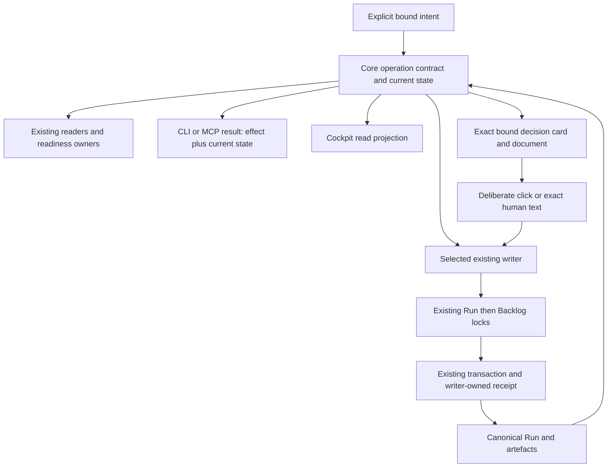

# SD: Consistent Core and MCP flow from artefact recording to closeout

Status: draft
Gate: SD
Gate approval: open
Based on: PRD
Approved source digest: sha256:e79d198d9bc6041bb0a855d021271745f104f34ba5e1f724d1d6025867e08a6d
PRD approval: da360983-fe52-462d-aa56-3fc9d9976b64; presentation 0b8be1f0-5a9d-4c4e-aff8-755c5c884a3d
Planning revision: 8d584c6b-cdec-4616-9a70-4a849dd1372a
Analytical inputs: renewed BROWNFIELD_REVIEW.md and ready UX_INTENT_DEFINITION.md
Date: 2026-10-11
Owner: Codex (solution design); Arndt Gold (design decision)
Run: core-mcp-flow-coherence-20261010-01
Language: en
Traceability contract: criteria-chain-v1
Design Decisions contract: sd-decisions-v1

## 1. Solution Overview

Extend the existing Core evaluation, operation-specific writers and transaction engine. Adapters transport these contracts; the cockpit renders the resulting read model. The command entry introduced below is a bounded selector/delegator, not another gate evaluator, scheduler or orchestration store. The exact approved PRD remains the sole product acceptance authority.

The renewed implementation/requalification proceeds in dependent stages within this Run: complete state preparation and semantic continuation/completion; shared authoring/operation descriptions and current evidence; bounded writer preparation/receipts/recovery; CLI/MCP integration and focused decision-card plus targeted cockpit projection; whole-chain qualification. All stages are required before whole-run acceptance.

### Renewed source and reuse boundary

This draft supersedes the unlinked historical design only as a newly reviewed SD from the approved 26-criterion PRD. The prior SD/TP approvals and reports are history, not current fulfillment. Shared content preparation, typed next_operation, five command groups, exact decision receipts, early UR-at-SD revision and structured closeout already exist in retained source. Decisions SDD-001..018 remain stable target/verification decisions; implementation must reuse and requalify those owners rather than recreate them. Added SDD-019..022 specify connection-owned generation control, executable retention, honest native qualification and host-aware remote presentation. All dependent stages and renewed reviews remain required.

The actual productive card can render/read but its action qualification record is absent. That explains the disabled controls without implying a human approval. It does not prove that all Codex hosts lack UI, that changing a flag would qualify actions or that a process pool repairs UI capability. The exact candidate/host observation remains an implementation/QA prerequisite; the design never manufactures its missing evidence.

### Bound flow

The expected pre-state, confirmed effect and observed post-state have separate identities. A past receipt does not restore its old permission. A read does not recover pending persistence. A transport failure after dispatch does not prove whether a write occurred.

## 2. Ownership And Source Of Truth

| Concern | Canonical existing owner / extension location | Boundary |
|---|---|---|
| Complete saved/proposed state | control-evaluation/run-state.js and its artefact catalog; run-step-policy.js | Export shared content preparation; no reduced catalog in writers |
| Eligibility and typed next operation | control-evaluation/gate-policy.js, gate-check.js, next-action.js; skill-dispatch/service.js consumes | Core determines semantic operation; display prose never determines execution |
| Bounded operation description and delegation | control-state command contracts; Core index/createCoreServices; a small adjacent command contract/service | Schemas, effect classification and writer references only; delegates eligibility and persistence |
| Presentation and human decisions | run-presentation.js, approval-command.js, approval-operations.js; run-step evidence recording for non-approval decisions | Existing approval authority; add bounded change/reject recording and one shared decision eligibility projection, not a second approval ledger |
| Internal work and reviewed artefacts | run-steps.js, run-artefact-recording.js, artefact-binding-proof.js, artefact-bindings.js | Record actual supplied content and reviewed mappings, never synthesize review/QA success |
| Revision and history | run-revision.js, run-source-revisions.js, run-revision-history.js, run-revision-boundary.js | Supported early UR-at-SD, early PRD and late CD+Tests boundaries and source invalidation; retain exact historical bytes |
| Durable write and recovery | run-state-writer.js, run-backlog-writer.js, run-step-transaction.js | Run lock then Backlog lock, sealed Run commit point, journal-based recovery |
| Current evidence | Existing evidence/artefact/revision/QA inspection owners; shared read projection adjacent to run-work-summary.js | Derive applicability from bindings, retain history/unknown, never create an alternate QA decision |
| Authoring interpretation | traceability-readiness.js, run-presentation-render.js and existing readiness owners | One extracted criteria representation and declared supported grammar |
| Transport | CLI validation handlers and mcp-dispatch-runtime.js; mcp-server worker/server | Generated schema and direct Core delegation; no repair policy or control-file edits |
| General cockpit state and links | control-inspect/cockpit.js; control-ui/src/App.tsx/state.ts and existing document-state owner | Snapshot-bound reads and draft checks; no arbitrary command access or app evaluator |
| Focused decision card/session | Existing presentation, document proof and bounded session owners; dedicated control-ui decision view and MCP Apps bridge | One exact presentation, three actions, existing Core writers; never broaden agdf_cockpit_read or add a client-side gate policy |

Normative architecture remains docs/architecture/03-agentenkontrolle-zielbild.md and its OP/R catalogue. Contracts are extended in their existing plugin/resource ownership and propagated through existing generation/package scripts. No candidate list becomes an independent operation policy or acceptance register.

## 3. Architecture Decisions

- SDD-001: Share complete content-based state preparation from run-state.js across readers and proposed-state writers; rationale: retained source now shares preparation and the renewed source/UX chain must prove that no shortened catalog or stale pre-write observation regresses; consequence: refactor the existing reader/step-policy boundary and remove duplicate preparation, retaining original paths and source binding.
- SDD-002: Make canonical semantic operation/actor and completion meaning part of evaluator results and derive human text from that result; rationale: typed routing is present and renewed verification must prevent prose-dependent routing or a false repeat-OR obligation, including historical completion with unavailable current validation; consequence: preserve compatible display fields while deleting prose comparisons and separating invalid closeout from completed state.
- SDD-003: Expose five bounded MCP write groups for preparation, recording, approval, revision and closeout, plus operation-contract and operation-status reads through agdf_inspect, from one shared Core descriptor/command service; rationale: host permissions may be remembered per tool, so a universal selector would unnecessarily couple ordinary recording to decision/revision/completion authority; consequence: fixed action allowlists, independently disableable tools, per-tool generated schemas/budgets; one additional app-only decision facade and the bound human-Chat non-approval action delegate to the same approval/recording owners, with no second eligibility authority or general cockpit writer.
- SDD-004: Keep host tool permission, concrete human intent/confirmation and exact gate approval distinct, with approval delegated to executeApprovalCommand and explicit cooperative assurance; rationale: a prepared record or remembered host permission is neither visibility proof nor a new deliberate decision; consequence: old replies and broad tool permission cannot approve new material, irreversible operations require concrete confirmation within the declared trust boundary, and historical receipts carry separately observed current state.
- SDD-005: Record bounded internal work, reviewed artefacts and evidence through existing run-step/artefact owners with exact source/result registration and writer-owned operation identity; rationale: routine raw Run edits are avoidable while actual review/QA judgement must remain with its owner; consequence: add guarded operation receipts for families lacking them and preserve existing binding/approval/source receipts as their own authorities.
- SDD-006: Reuse the shared revision-boundary owner for existing early PRD reopen, late structured CD+Tests revision and the explicitly approved early UR-at-SD preview/apply/recovery; rationale: one Run must retain exact history without adapters inventing eligibility; consequence: the separately authorized Core bootstrap is requalified in the integrated flow, unsupported states stay rejected, and archived approval never renews changed material.
- SDD-007: Generalize the existing Run-step journal with a strict additive version for bound internal operations and whitelisted staged artefacts while retaining old journal readers and lock order; rationale: duplicate effects and interrupted artefact/OR/Run/Backlog writes require recovery at the actual commit point; consequence: no multi-file atomicity claim, family-specific replay/conflict checks and explicit ambiguous/pending outcomes.
- SDD-008: Extend existing closeout writing to structured modes using a prepared OR-full and canonical closeout eligibility, with no VCS action; rationale: retained structured closeout and Quick Task recovery must be jointly qualified; OR-lite remains insufficient for a new structured completion; consequence: preserve Quick Task behavior, validate applicable quality/approval/context requirements and reconcile OR, Run and backlog through the existing journal.
- SDD-009: Extract criteria interpretation and authoring-format descriptions from the existing readiness/parser owner and share them with the presenter; rationale: metadata or a second parser would otherwise reproduce conflicting accepted forms; consequence: retain accepted legacy forms, use explicit grammar for new contracts and provide field/source diagnostics without another acceptance authority.
- SDD-010: Derive a bounded current/history/unknown evidence projection from existing bindings and new writer-owned evidence associations in the sealed Run; rationale: first-row ordering and free historical text cannot establish current applicability; consequence: no fabricated legacy associations or retroactive approvals, and current presenter/cockpit consume the same projection.
- SDD-011: Keep CLI legacy entry points on shared owners and introduce additive versioned command results, descriptors and receipt sections without changing control_state_version 2; rationale: consumers and historical sealed records must remain readable while new write semantics require qualified runtimes; consequence: qualify old read clients against the new Core, preserve old receipt versions and disclose older executing runtimes as outside new capability qualification.
- SDD-012: Extend the existing worker error boundary for commands to preserve operation identity and report unknown effect after dispatch interruption; rationale: worker termination or lost transport response is not a transactional rollback; consequence: command-status inspection and explicit recovery precede retry, and the general cockpit retains its read/check session channel; a distinct bounded decision session delegates only its three declared actions.
- SDD-013: Qualify the actual generated candidate, MCP transport and affected Codex app states, with separate source/build/protocol/native evidence and rendered locale coverage; rationale: distinct runtime digests and old native observations do not qualify a new candidate; consequence: no automatic install/restart, no blanket Claude/Windows claim and no unsupported independent response assurance.
- SDD-014: Measure a retained before/after lifecycle corpus and protect foreign sources while executing the dependent stages; rationale: fewer calls count as benefit only if integrity, evidence and human decisions remain intact; consequence: zero routine undocumented parser/invocation discovery and control-table edits are checked, while normal engineering inspection remains permitted.

- SDD-015: Prepare a focused immutable presentation view with exact document proof, complete summary, changes or honest comparison-unavailable, open points and consequence; rationale: reading and discussion must preserve the decision context without deciding; consequence: reuse the existing document renderer and MCP Apps display-mode bridge, keep comment draft in view memory, and retire stale/expired sessions without affecting the text presentation's independent validity.
- SDD-016: Route deliberate app approval to executeApprovalCommand and change/reject to a bounded extension of existing run-step evidence recording with Run Operations receipts; rationale: three outcomes need canonical persistence without a parallel approval ledger; consequence: one shared presentation-decision projection blocks a decided version, routes remediation to the existing owner and never automatically approves, revises upstream sources or closes the Run.
- SDD-017: Enforce at most one decision effect for the current presentation/version under the existing Run then Backlog locks, independently of input route or caller UUID; rationale: local button disabling alone cannot prevent simultaneous text/click or competing actions; consequence: exact retries use the original request receipt, different requests lose eligibility after the first committed decision, and stale acknowledgement never revives the old view.
- SDD-018: Use one app-only decision facade with strict session/action binding and actual supported host mediation while retaining cooperative_local assurance; rationale: a bridge call, visibility annotation, nonce or model flag alone cannot prove a human gesture; consequence: no model-visible card-write endpoint or synthetic approval message, deliberate UI handlers and trusted human text are the allowed origins within the cooperative boundary, and actual Codex permission/action/teardown qualification is mandatory before claiming click acceptance.

- SDD-019: Extend the existing launch/server composition into one stable SDK-facing connection facade with directly spawned private IPC runtime generations; rationale: switching inherited STDIO children would otherwise require a host-owned reconnection and lose pending request/view routing; consequence: the facade only delegates existing descriptors/owners, pins original generations and admits only wire/resource-compatible candidates. Three counted generations, one qualifying candidate, explicit refusal and orderly confirmed idle retirement are enforced locally; no global process controller.
- SDD-020: Publish verified runtime packages to immutable digest-addressed roots with owner-issued retention claims before spawning or loading; rationale: retiring a shared version directory can break other connections even when a local child is idle; consequence: the existing package owner serializes publication/pruning, preserves legacy or unknown live claims conservatively and never infers safe deletion from age/PID. Direct confirmed release, not file age, permits cleanup.
- SDD-021: Separate declared rendering support, exact app-action qualification and Core gate readiness, expose read-only cause diagnostics and qualify the exact installation/host tuple through actual evidence; rationale: the current absent decision_app_qualification is not an already approved gate and not proof of no rendering; consequence: no flag bypass, fabricated evidence or qualification transfer after a changed candidate, and native/end acceptance remains blocked when evidence is unavailable.
- SDD-022: Produce native-plus-compact-Chat or complete Chat from one immutable presentation according to actual host support, with exact material read through the existing Inspect/presentation owner and a narrow human Chat non-approval route; rationale: a remote iPad user needs sufficient context and document bytes without the Mac sidebar, while duplicate full decision requests create ambiguity; consequence: preserve one presentation/material and one effect across routes, expose missing remote access honestly and use no public upload, alternate document authority or decision ledger.

## 4. Integration Points

### 4.1 Shared state and current observation

Extend run-state.js with a content preparation entry used by readRunState and policyForRunContent. Inputs are the canonical target, normalized Run content, contained Run path and an optional explicit map of proposed artefact bytes/digests from the owning transaction. It parses metadata, approvals, all existing internal/closeout types, source revisions and mode; derives source-revision UX requirements using the same consumed Brownfield source, including a proposed replacement when applicable. The transaction owns that overlay; adapters cannot supply arbitrary policy/state substitutions.

run-recording, run-steps, early/late revision and recovery preparations use this entry. Existing catalog arrays remain one owner. Each mutation rechecks the expected Run revision, exact consumed artefact bytes/digests and valid source/approval proof under locks before commit. Read scopes/cache epochs remain per observation; no post-write reuse of cached pre-write evaluation.

The evaluator supplies next_operation with the existing type/skill/gate fields where applicable and additive operation_key/actor/effect classification. Stable meanings cover authoring, internal preparation/recording, presentation preparation, human decision, implementation, evidence/remediation, revision, closeout and no remaining work. These are centrally produced by gate policy/continuation, not an MCP switch over display sentences. Existing display text and allowed/forbidden lists are projections. Run-specific descriptive instructions may remain visible but cannot independently authorize an operation. Actual blockers still override a general same-gate action.

For a completed structured Run, fulfilled applicable prerequisites and valid done OR yield completed control, no next Run operation, no approval pending, and a separate optional requested VCS handoff. Keep current_gate OR for breadcrumb compatibility and render it fulfilled, not open. A completed lifecycle with inconsistent sources/OR/required obligations is unconfirmed or blocked with the concrete owner/recovery; it is never silently called clean and never automatically reopened. Summary/status logic must not infer completion solely from the lifecycle scalar. Quick Task and Verified Change keep their existing authority and route requirements.

### 4.2 Public command and description contracts

Add a command contract version 1 in the existing Core command area. createCoreServices exposes command in addition to dispatch/inspect. Keep this selector internal to the shared Core: do not publish a universal agdf_command MCP tool. Publish the five fixed tool groups below, with a common compact envelope: schema_version, presentation_language, working_directory, target_source, primary_target, target_id, run_id, expected_revision_id, operation_id (UUID), assurance=cooperative_local, and command {kind, payload}. Each tool schema contains only its group's actions and its Core entry independently checks that fixed group allowlist before delegating. Supplying another group's command.kind cannot escape it. Exact target resolution uses the existing resolver and local identity owner; cwd is never the target. Every branch rejects unknown fields and unsafe/foreign paths. Recovery may identify an original operation at an older expected revision but must additionally bind the freshly observed recovery revision.

| MCP tool | Fixed allowed actions | Permission/effect boundary |
|---|---|---|
| agdf_prepare | presentation.prepare | Creates an immutable presentation; never records approval or changes source/lifecycle |
| agdf_record | step.record, artefact.record, operation.recover limited to internal/artefact/evidence operations | Records actual results and reviewed mappings; cannot approve, revise approved sources or close a Run |
| agdf_approve | approval.record | Exact presented gate material and a new deliberate human response through existing approval authority |
| agdf_revise | source_revision.preview, source_revision.apply, source_revision.recover, prd_revision.reopen | Existing revision boundaries, exact affected material and applicable concrete confirmation; preview alone changes no revised source |
| agdf_closeout | closeout.record, operation.recover limited to this Run's closeout operation | Existing completion requirements and selected OR/Run/backlog; no foreign Run, VCS or publication |

agdf_inspect remains non-mutating, including operation-contract/status reads. Preview inside the mixed revision group does not turn that tool into read-only; only a proven non-mutating preview can later move to a read tool through the existing contract revision owner. This is a five-group capability boundary, not one tool per candidate or a new flow engine. The two explicitly scoped agdf_record additions in sections 4.9/4.12 retain the same group boundary and budgets, with separate effect/confirmation descriptors. Disabled tools are absent from discovery and rejected at the serving Core boundary; adapter flags alone are insufficient. Each descriptor names its group and concrete side effects, permitted inputs, prerequisites, confirmation requirements, retry class and result verification.

| command.kind | Payload responsibility / inputs | Delegated existing owner |
|---|---|---|
| presentation.prepare | gate; exact current artefact/presentation language; caller UUID; focused UI resource only for a supported requesting host | prepareRunPresentation; optional bounded view bootstrap after successful preparation |
| approval.record | gate, presentation_id, exact response | executeApprovalCommand; envelope maps to its existing exact command schema |
| step.record | whitelisted step, source reference/digest, actual result and evidence; route reason/evidence for Brownfield; bounded evidence association where needed | recordRunStep extended for existing UR, route, UX, preparation, CD+Tests, review and evidence responsibilities |
| artefact.record | exact Reviewed Recording Input and separate reviewed mapping reference; permitted update_draft flag | prepareArtefactRecording / existing locked run-step |
| source_revision.preview | supported source gate, reviewed proposal reference/digest and existing revision UUID | previewSourceRevision; no durable revision effect |
| source_revision.apply | same proposal/operation binding plus reviewed preview digest | applySourceRevision |
| source_revision.recover | original operation binding plus current recovery revision and exact pending evidence | recoverSourceRevision |
| prd_revision.reopen | current approved PRD identity/digest at existing early PRD-to-SD boundary | reopenPrdRevision with exact-history/receipt support |
| closeout.record | prepared OR reference/digest and bounded closeout context; Quick Task retains its existing result/evidence/risk/next form | existing run-step/closeout transaction owner |
| operation.recover | exact internal/presentation/closeout operation, inspected pending digest and current revision | existing owned pending-journal recovery; excludes generic seal/Git-history maintenance |

Schemas and descriptions are exported from this shared descriptor registry; family-specific payload validators remain owned by their command/writer contracts. The descriptor links the validator and execution entry rather than copying gate permission rules. MCP definitions use discriminated action schemas generated from those descriptors; consumers retrieve the complete selected contract through Inspect. No arbitrary Run-text, table patch, function name, shell command or caller-injected validator is accepted.

Extend agdf_inspect with operation-contract and operation-status, both bound single-Run reads. operation-contract returns selected schema, effects, applicable prerequisites, canonical path/digest/target bindings available within its existing read boundary, supported formats, retry class and unsupported reason. It can describe a candidate draft's canonical digest without producing a reviewed=true attestation. operation-status finds an exact UUID in the canonical writer receipt or owned pending record and returns receipt/current state or absent/unknown; absence during uncertainty is not proof of non-execution. Descriptions may say unavailable; reads cannot stage files, repair or recover. Large lists are paginated/narrowed and never silently truncated into complete proof.

Existing Inspect definition budget (5,000 bytes) remains. Set each new write-tool definition budget to 8,192 bytes and their aggregate definition budget to 24,576 bytes (including the app-only decision facade); command input is 64 KiB and serialized result retains the existing 1 MiB control-tool limit. Large material is a contained run-local reference with expected digest, not embedded report bytes. Metadata contains only the selected owner's full schema/examples; do not load all runtime contracts into every tool description. Generated schema equivalence, rejection of cross-group actions and per-tool/aggregate byte checks are required before exposure. A schema that cannot satisfy this design requires SD revision, not silently weaker validation or ad hoc tool proliferation.

All five write groups explicitly advertise readOnlyHint=false, idempotentHint=false and openWorldHint=false. agdf_prepare uses destructiveHint=false only for its strictly additive immutable creation. agdf_record, agdf_approve, agdf_revise and agdf_closeout use destructiveHint=true because their allowed modes replace registered state, invalidate sources, record consequential decisions or change lifecycle. Being able to recover/undo does not by itself justify false. Read-only Inspect explicitly advertises readOnlyHint=true and destructiveHint=false. Annotation validation compares all action modes/defaults/indirect effects to actual handlers; annotations inform host safeguards but never grant authorization.

### 4.2.1 Host permission, confirmation and server enforcement

There are three separate inputs: the host's permission to call a tool; the user's actual intent/confirmation for the concrete action; and the Core's existing eligibility plus exact gate approval. Remembered tool permission is transport permission only. It is not Approval: UR/PRD/SD/TP/QA/UAT, permission to invalidate any source, proof of a human review, or completion permission for another Run. A model-supplied confirmed=true, retrieved document, tool output or instruction embedded in evidence cannot establish human authority.

For a gate decision, retain the current presentation/artefact/revision and exact new response checks with cooperative assurance. For irreversible/destructive revision or closeout effects, prepare the exact affected target/Run/revision, proposal or OR digest, impact and recovery limits before obtaining action-specific human confirmation; an already supplied explicit confirmation may be consumed only for that same material/effect. Do not add a formal gate or re-request already fulfilled gate decisions. Ordinary authorized recording does not receive a redundant blanket approval prompt. Recovery checks the approved original operation and inspected direction/current binding; destructive recovery outside that intent needs its own concrete confirmation. No recorded host allow/deny choice authorizes changed scope or changed payload.

Use actual supported host approval controls for sensitive actions. Responses API require_approval/allowed_tools and ChatGPT remembered per-tool choices are distinct mechanisms; they are not assumed to exist with identical semantics in local Codex STDIO. Qualify the actual supported Codex host settings and request display for each group against the exact candidate. If required confirmation cannot be obtained at the supported trust boundary, do not execute or expose the affected sensitive write as available; return confirmation_required/unsupported through the existing interaction owner. Do not invent a host approval token or claim cryptographic proof of human origin. Local typed attestations retain cooperative_local assurance.

Server-side validation uses the existing target resolver, contained path/symlink restrictions, current revision/seal/source checks and writer eligibility regardless of host tool permission or annotations. No remote account authority or network authentication is added by this Run; any future remote deployment must separately authenticate the caller and enforce its target/action scope before delegating. Tool responses expose necessary effect/revision/receipt/verification references without secrets or gratuitous report/log contents. Prompt-injection tests must show that malicious artefact/tool content cannot switch groups, create approval, widen paths, bypass confirmation or start unsupported writes.

This refinement is informed by official OpenAI documentation fetched on 2026-10-10: [tool annotations](https://developers.openai.com/plugins/plugin-guidelines#correct-annotation), [write-action security](https://developers.openai.com/plugins/guides/security-privacy#prompt-injection-and-write-actions), [ChatGPT custom MCP confirmations](https://developers.openai.com/api/docs/guides/custom-mcp-server), and [Responses API approvals](https://developers.openai.com/api/docs/guides/tools-connectors-mcp#risks-and-safety). Five groups and the exact size limits are this design's decisions, not an OpenAI-mandated tool count or quota.

### 4.3 Writer registration and operation receipts

Internal step registration accepts only the existing semantic catalog: UR draft; Brownfield Review plus route; UX analysis; implementation-preparation Brownfield Analysis; CD+Tests; TP Review; Clean Implementation Review; CR; actual evidence. Known existing review aliases normalize to their current canonical owner; unknown types reject. Eligibility uses the current gate/route and approved sources. Readiness of UX and explicit review/report decisions is inspected by existing validators; ready analysis can be recorded done, actual revise/block remains non-fulfilled. QA registration uses the existing artefact recording path and copies the actual qa-gate report result; it never generates a QA judgement or approval.

Payloads include consumed source/version references and exact result paths/digests. Replacements are allowed only for the currently eligible unapproved internal/source draft, preserving other protected bytes. Reviewed artefact recording retains its source relationship registry and existing mapping proof. Metadata can provide bindings/digests, but reviewer identity and reviewed mapping remain explicit cooperative attestation with a reasoned derivation review.

Use existing Approval Operations and Source Revisions receipts without another approval/revision ledger. Artefact Bindings remain authoritative for artefact/source mapping; use the caller operation UUID in the binding operation instead of a hidden generated identity. Add a sealed Run Operations version-1 section only for internal/evidence/non-approval-decision/early-reopen/closeout effects and request-digest references for artefact operations that lack them. Its receipt contains schema version, action, target/Run/expected revision, operation UUID, canonical request digest, producer/assurance, resulting revision and exact effect references. A referenced artefact binding is not copied into a second source-proof authority. No other writer can remove/rewrite these receipts; append checks extend the existing writer guards and seal computation.

The shared read-only receipt lookup delegates to each family and rejects cross-family UUID reuse. Revision preview/apply phases explicitly share their existing revision operation identity. Request digests include command kind, target/Run/expected revision, normalized input and declared source/result digests, excluding transport timing. Identical repeat finds the old receipt first and returns its historical effect plus fresh current observation. A changed payload or family under the same UUID rejects. Mutable files are revalidated before a new effect; historical replay is not evaluated as a new effect on now-changed files.

Presentation preparation uses the caller UUID as the new presentation identity and validates the immutable envelope on repeat under the Run lock. The envelope retains the existing presentation binding and gains a versioned request-digest field; legacy envelope readers remain supported. A repeated old presentation may be inspectable but is explicitly non-current after revision. Approval command/receipt format and deliberate response checks remain owned by the existing service. Legacy CLI without --operation in the new qualified package generates an identity and enters that same owner, then translates the response to its compatible approved/rejected shape; supplied --operation uses exact stable replay semantics. Do not rewrite historical legacy approvals into new receipts.

### 4.4 Persistence, interruption and operation-specific recovery

Extend the existing run-step transaction owner with journal version 3 for bound internal and non-approval-decision operations, keeping v1 Quick Task and v2 source-revision readers (including the early UR-at-SD bootstrap). The v3 journal binds target, Run, operation kind/UUID/request digest, old/new Run identities, old/new backlog bytes, and a whitelist of owned changed artefact paths with old/new bytes and digests. Paths are limited to the selected run's declared canonical internal/source/OR outputs and operation-owned staging/archive paths; foreign additions, symlinks, unknown stages or mismatched bytes require explicit recovery, never deletion.

Retain lock order Run then shared Backlog. Check captured sources before durable intent; synchronize journal intent and affected file/directory durability through existing fsync/atomic-write helpers. Stage outputs/history under the owned operation, publish the declared artefacts, then commit the sealed Run with its receipt as the single commit point; synchronize the backlog, validate final digests and retire the journal. Before the Run commit, recovery restores exact old owned outputs and leaves the Run effect unapplied. After it, recovery verifies the receipt/sources and completes backlog synchronization. Failures around atomic rename are resolved by re-reading the commit point. No system-wide atomicity or unqualified power-loss durability is claimed; Windows directory-sync limitations stay explicit.

| Family | Repeat / uncertain effect | Recovery rule |
|---|---|---|
| Approval | Existing canonical receipt/request conflict behavior; historical effect plus current observation | Existing locks/journal; preserve original response/UUID and never infer a new approval |
| Presentation | Same UUID/input returns same immutable prepared envelope; conflict rejects | Inspect envelope/binding; incomplete owned presentation has no valid approval effect; prepare current material with a new deliberate decision when stale |
| Artefact/internal/evidence | Receipt plus exact request digest prevents duplicate row/event/effect | v3 journal restores pre-commit owned outputs or finishes post-commit backlog; unknown interference blocks |
| Early PRD reopen | Same operation receipt is replayed; exact prior PRD/approval evidence archived before invalidation | Existing archive/transaction owner with v3 early-reopen kind; unchanged current early boundary only, no expansion |
| Source revision: early UR-at-SD and late CD+Tests | Existing reviewed preview digest, Source Revisions receipt and v2 archive behavior | Shared boundary and explicit inspect/recover; preserve all affected exact archives and requalify early bootstrap, never generalize lifecycle permission |
| Change/reject decision | Same UUID/payload returns its own non-approval receipt; competing decisions recheck canonical version eligibility | v3 owned decision receipt/Run/backlog transaction; pre-commit restore or post-commit finish, no approval inference |
| Structured closeout | Exact completed receipt replayed without another OR/decision | v3 OR/Run/backlog path; fulfilled decisions remain fulfilled |
| Quick Task | Retain existing v1 behavior for legacy calls; qualified new command adds receipt correlation | Existing journal recovery with tested compatibility |

operation.recover accepts only an owned pending operation inspected at the exact current revision/digest and the existing allowed recovery direction. It is not generic run-recovery, seal reconstruction or maintenance authority. Read-only Inspect never calls recoverPendingRunStepLocked. An executing owner may perform its bounded existing transaction recovery only as part of an explicitly invoked matching write/recovery operation. Another Run's pending shared backlog operation blocks with that exact identity; it is never silently selected/recovered here.

The MCP worker retains serialized execution. Busy/rejection before dispatch can report not-dispatched. Cancellation, timeout, process exit, oversized/lost result or transport disconnect after dispatch reports effect_unknown with original UUID/binding and operation-status guidance, not rejected/rolled-back. Core command results distinguish accepted/already_applied/rejected/recovery_required/effect_unknown and keep effect, receipt, current.available/revision/state, assurance and recovery separate. The adapter may wrap existing family result shapes but cannot change their effect/permission meaning. Budget failure after an effect cannot erase acknowledgement uncertainty.

### 4.5 Closeout

For structured modes, release-or prepares OR-full in an operation-owned candidate path using the existing OR template, current sources and actual results. closeout.record validates contained bytes/digest, selected Run/mode/source references, report completeness and the existing applicable gate/quality/approval/context requirements. It must see actual QA pass with approval, UAT approval and fulfilled mandatory reviews, no contradictory open required finding/evidence and resolved/not-applicable Context Graph reconciliation according to existing rules. It does not treat report prose as sufficient evidence of those facts. Parent aggregation/handoff remains a distinct evaluated obligation and never silently closes a foreign Run.

The existing transaction owner publishes canonical OR.md, registers done OR, completed lifecycle/decision, the closeout receipt and bounded OR-derived context/knowledge fields, and moves/synchronizes the selected backlog pointer. Optional accepted-open items are disclosed with their existing owner/disposition; a blocking obligation prevents clean completion. Quick Task keeps OR-lite and its existing CR requirements. Completed legacy Runs are read through valid existing sources/OR and receive corrected current meaning without fabricated new closeout receipts or any retrospective state rewrite. Inconsistent completion remains explicit.

### 4.6 Authoring formats and current evidence

Extract acceptance-criterion parsing into the existing traceability/readiness responsibility and share its structured entries with the presenter. Retain previously accepted inline/bullet declarations; duplicate/conflicting IDs or ambiguous fields reject with source/line/field diagnostics. Existing SD decision bullet grammar and traceability tables remain supported. New authoring descriptors declare actual grammar and required sections/fields, with examples checked against those same validators. No third parser, new acceptance list or implicit conversion of malformed forms into approval-ready content.

Add Evidence Bindings version 1 to the sealed Run for newly recorded bounded evidence associations. Each writer-owned event binds its row/reference to action/Run, applicable source-set paths/digests, report/result digest and producer; source-set identity uses existing canonical digest semantics, while readable document raw-byte proofs retain their separate existing semantics. QA/UAT decision material must be supported by exact current artefact/source/approval relationships, not row order or a free claims string. New QA/review records include their current TP/design/result dependencies; UAT summary consumes the current applicable QA/review and observed acceptance material rather than the first three historical rows.

The shared projection returns current, superseded and applicability_unknown groups with bounded references/reasons and explicit availability. Existing exact Artefact Bindings, revision archives and approval evidence may establish legacy applicability only where they actually prove it; otherwise show unknown. Preserve free historical rows, old receipts and approvals. Do not retrospectively assign a source revision or upgrade unstructured evidence to current. Historical inspection never changes an existing QA decision. Canonical missing/conflicting-required-evidence checks still determine readiness; grouping is not an alternative gate policy.

run-presentation-render, run-work-summary/backlog and cockpit detail use this shared projection. The app shows current state/next actor/action and current material first, with separate inspectable history/unknown details and truthful document states/links. Preserve document-state/raw proof, draft-check source identity, read snapshots, generation guards, meaningful focus and bounded session lifetime. No new command is reachable through agdf_cockpit_read or its current read/check allowlist. The separate focused decision facade below cannot turn a general cockpit session into a write session. On expiry, changed snapshot or unavailable current evaluation, clear/mark dependent results using existing owner state; never invent current completion from a saved label.

### 4.7 Focused presentation card and decision flow

#### 4.7.1 Material and view lifecycle

presentation.prepare retains its existing immutable bound envelope. For a requesting host with the supported MCP Apps UI capability, attach a dedicated presentation resource and bounded decision-session bootstrap, separate from general cockpit sessions. Opening a view/session is ephemeral preparation and does not record a decision. The capability result distinguishes UI available, unavailable and not qualified; a capability advertisement alone proves none of the native acceptance. No automatic install/restart is part of this flow.

The Core prepares the exact title, gate, target/Run, expected revision, presentation ID and artefact/source-set digests, complete decision-relevant localized summary, current open points, approval consequence and next actor. Compare only an identifiable previous applicable version through existing current/history/raw-document proof; otherwise explicitly state comparison unavailable. Label machine comparison as such, never manufacture a reviewed change account or omit material behind truncation. If bounded limits cannot deliver a complete usable summary, return the existing readiness/size diagnostic instead of showing an approvable incomplete card.

The existing exact document renderer opens the bound version in the larger view via the supported MCP Apps display-mode bridge, including a visible return to the same decision context. Missing immutable bytes/proof produces truthful unavailable, never a current-file substitute labelled as the presented version. The card remains undecided during reading, returning or chat discussion. Use current locale and existing localization owners; raw source language stays explicit. Comments live only in view memory until submission; no URL/local-storage persistence and no source content rendered as executable markup. Closing a view may discard its unsent comment, disclosed where needed, and causes no gate decision.

Bind the ephemeral session to one target/Run/presentation/revision/source set, owner epoch and expiry; reuse existing bounded session capacity, expiry, explicit close and UI lifecycle patterns. Do not create persistent per-view governance state. A session token is delivered in app-only result metadata and never grants arbitrary target/payload authority. Backend close/expiry invalidates further session calls. Host tab closure and backend teardown require separate observations; expiry bounds cleanup when host teardown is absent. A closed/expired view does not invalidate a still-current text presentation, and a text decision does not require the old card session. Any source revision, competing decision or current-integrity blocker prevents further action. Refresh must prepare/rebind current material; no reuse of an old user decision.

#### 4.7.2 Transport, human intent and permission

Add exactly one app-only facade, agdf_decision_action, with MCP Apps _meta.ui.visibility=["app"] and the dedicated resource binding. It is not a sixth model-facing command group. Its strict input contains decision-session ID, operation UUID, exact presentation/revision binding and one action approve/request_change/reject with a bounded optional comment (required and nonblank for request_change; maximum 8 KiB). Reject unknown fields/action, arbitrary paths, target substitutions, response text supplied by the model or attempts to use a general cockpit session. Its serving boundary delegates to the same Core command/writer owners and checks session, current source/eligibility and enabled action before any write. The approve branch uses approval.record; the non-approval branch uses an app-only presentation_decision.record contract classified under recording permission and delegated to the existing run-step writer. This action is not admitted by generic model-facing step.record or an arbitrary caller-supplied origin flag. Section 4.12 defines the distinct narrowly bound actual-human-Chat decision action through the same writer. The shared descriptor documents its facade-only applicability; no sixth model-facing writer group is added. All non-approval comments are data, not dispatcher instructions.

Approve shares the agdf_approve permission capability; request_change/reject share the agdf_record decision-recording capability. The app-only facade is absent if all actions are disabled; discovery describes only enabled actions, and both serving Core and UI revalidate them. Disabling a model tool does not leave its effect available through the app. The fixed facade advertises readOnlyHint=false, destructiveHint=true, idempotentHint=false and openWorldHint=false and fits the common definition/input/result budget; smaller comments remain within the 64-KiB envelope. Existing agdf_cockpit_read, generic reads, resource loading and ui/initialize cannot invoke this writer.

Only a deliberate user event on the labelled enabled action submits a decision. Enter/Space must activate the focused explicit action normally; no approval from rendering, default/preselected choices, text-field Enter, repeated host notification, tool input/output, sendFollowUpMessage or AI-created Approval text. Trusted exact new human chat text still enters executeApprovalCommand through agdf_approve/CLI with its exact selector; the app approve branch derives that same selector from its server-bound gate rather than accepting arbitrary response text. Both carry cooperative_local assurance and declared input route, not an invented independently verified human identity.

Host execution consent, user gate intent and canonical confirmation remain distinct. The app shows submitting/awaiting technical permission when observable, then only confirmed Core effect as saved success; a denied/not-dispatched call leaves the presentation undecided. After dispatch, missing response is uncertainty rather than non-execution. The user is not asked to repeat the same business approval to satisfy an additional technical host prompt. No code claims that the host never prompts: its actual permissions and denial behavior must be observed.

A session token proves session possession, visibility metadata routes a tool, and UI event attestation records the cooperative path; none is independent proof of a human gesture. The model-visible approval tool still requires an actual trusted human response, never confirmed=true or agent invocation alone. App-only discovery/call mediation and the deliberate UI handlers are qualified with the actual supported host. If the host cannot mediate the app-only path or obtain required concrete confirmation, return unsupported/confirmation_required, disable affected card actions, preserve exact text/read alternatives and retain the native acceptance gap. Do not fake a host approval credential or bypass via a model-authored chat message.

Official [OpenAI UI reference](https://developers.openai.com/plugins/reference), read on 2026-10-10, documents app/model visibility and standard bridge preference; ChatGPT can deliver approval-gated tool input after host confirmation. These facts do not establish equivalent Codex behavior or independently authenticated user gestures. This design's separate facade, cooperative decision binding and qualification requirement are architecture choices, not an OpenAI guarantee.

#### 4.7.3 Canonical outcome, remediation and deduplication

Add a small shared presentation-decision projection alongside the current presentation/approval responsibility. It consumes existing Approval Operations and the new non-approval Run Operations receipts; no Decision ledger, alternative gate state or client rule table is introduced. Every presentation/readiness/approval and decision-recording owner consumes this same decision eligibility when applicable. Legacy records without these new receipts keep existing meaning, never gain fabricated rejection history.

| Action | Existing owner and proposed bounded extension | Canonical outcome and next owner |
|---|---|---|
| approve | executeApprovalCommand/Approval Operations with exactly the bound gate selector | One gate approval of exact material, confirmed receipt and fresh evaluator continuation; no approval of another gate or later version |
| request_change | Existing run-step evidence writer, extended with presentation-decision input and Run Operations receipt | Record comment and exact rejected-for-change version without approval; current gate's permitted remediation owner receives the comment, not an executable instruction |
| reject | Same non-approval recording owner with explicit rejected outcome | Reject this version, retaining history and current gate; no Run closeout/cancellation or upstream approval invalidation |

UR/PRD/SD/TP requests route to their existing unapproved source authoring/revision owner. A QA request/rejection routes to qa-gate/remediation; only that owner may judge revise/block from actual evidence. UAT routes to current acceptance/remediation ownership, retaining approved QA until an actual supported revision demands invalidation. Non-approval cannot silently reopen an approved upstream source or broaden revision eligibility. If a requested change affects approved intent, the existing source-revision owner previews/applies only a supported boundary; the comment itself is not application authorization. The evaluator supplies the permitted owner and any blocker; the app cannot select a repair route.

A committed request/rejection makes its exact presentation/version non-approvable through both card and text. Requesting change or rejecting does not approve a replacement. A permitted materially changed source/result must be registered and freshly presented under the existing authoring/revision owner before another deliberate decision; preparing a new envelope over unchanged rejected material must not erase the decision guard. Rejecting is version-scoped, not a new lifecycle scalar. Discussion before a decision leaves later exact Approval text valid while the same presentation/material remains current and eligible.

For all three actions, check operation replay/conflict before a new effect and then recheck current presentation/version, source/approval proof and decision eligibility under the existing Run then Backlog locks. Use canonical target/Run/gate, presented artefact/source-set digests and presentation lineage to detect a version already decided even if another path has a different UUID. UI disabling is convenience only. Same UUID and exact canonical request returns its own receipt plus separately fresh current state; changed action/comment/payload under that UUID conflicts. Different UUIDs or concurrent text/click/actions can commit only the first eligible decision; the loser returns bound already-recorded information where the exact version/receipt is proven, otherwise stale/conflict, and never appends a second approval or contradictory non-approval outcome.

Approval follows the existing approval persistence/recovery owner. Non-approval follows the bounded v3 Run Operations transaction; receipts bind action, presentation, gate/material/source set, comment and resulting revision. Persisting a decision and its remediation meaning is one owned Run effect, followed by recoverable backlog synchronization. A session result is only a projection of this effect, never its durable commit point. Operation-status delegates receipt lookup to its family. Once dispatched, a lost acknowledgement keeps its original UUID/payload for inspect/replay/recovery; no fresh user decision is invented. A post-decision current reader failure leaves historical effect confirmed and current state unavailable.

Keep the same operation UUID for an outstanding local submission/retry. On changed/closed/expired generation ignore delayed results for view state; their canonical effect remains inspectable. Block new submissions while pending/uncertain until original effect is resolved. If a session expires before a new write is dispatched it rejects; expiration after dispatch does not promise cancellation or rollback. A new view reads the canonical decision/current state and never restarts the old pending action automatically. Exact text arriving after another action is checked against that action's version/current permission, not retargeted to the new gate.

### 4.8 Same-Run early UR revision integration

Use the existing shared run-revision-boundary.js predicate and source revision preview/apply/recover owners. Supported added state is active structured SD, exact approved UR/PRD, linked reviewed unapproved SD, with no linked TP, implementation/preparation/review/quality/closeout material. This is an approval-state boundary, not a publication flag. Retain the existing early PRD and late CD+Tests policies; no app/adapter implements its own lifecycle test.

Preview is read-only and names exact affected sources, analyses, source mappings, presentations, approvals and receipts plus renewed obligations. Apply requires the exact target/Run/expected revision/operation/proposal/source/preview identities and current eligibility, archives exact prior bytes through the existing v2 source transaction, invalidates affected active approvals/bindings and returns the same Run to UR. History is non-authorizing. Renewed UR/Brownfield/required UX/PRD/SD work and decisions are enforced by the shared complete state before TP. Only actual new human responses decide renewed material.

The existing bootstrap and the recorded operation cbc55917-ee06-4fc3-b46f-ff8dcca3c30a are prior bounded Core evidence, not integrated QA. Preserve that live case/archive for read-only qualification of history and renewed chain; repeat negative/concurrent/crash/recovery writes only in disposable bound targets. Core/CLI/actual MCP, dispatcher follow-ups and backlog must agree through preview/apply, identical replay, changed payload/preview/source, pending archive/Run/backlog and unsupported states. Do not create a substitute Run or hand-edit/reseal control state to pass this acceptance.

### 4.9 Connection-owned generation control

#### Supported owner and stable connection

Replace only the existing launchPluginMcpServer -> runMcpServer/buildAgdfServer composition, not the Codex connection manager. The launcher retains its own facade process and the SDK-facing STDIO connection; the existing server registration/serialization/capability handlers become the facade's transport implementation. Each directly spawned generation runs the existing command runtime, executor and decision/read-session composition behind private inherited Node IPC. The present inherited-STDIO child strategy remains the pre-change baseline; private generation entry/routing is proposed implementation, not a claimed existing feature.

Only that facade spawns and retains direct ChildProcess handles. Runtime generations never inherit the public STDIO stream or register competing frontends. The IPC adapter invokes the same runtime/tool entry functions and existing Core schemas; it is a transport seam, not a new business-policy engine. Bind each connection to a fresh owner epoch, each generation to an owner-assigned monotonic ID and verified immutable package root, and each request to an owner-assigned IPC ID plus the original business operation UUID. Reject duplicate/out-of-epoch response IDs and unknown messages. Copy actual request/initialize client info and UI capability from ui-capability.js into owner-supplied IPC context; model payloads cannot supply or upgrade it.

Keep the facade's advertised tool schemas, enabled groups, SDK/protocol version and UI resource identity stable for that connection. Candidate qualification must prove exact equality of the canonical wire/capability manifest and immutable UI-resource digest used by that facade, plus the candidate's own valid package digests. A candidate requiring changed tool/resource or SDK contracts is incompatible and refused before admission; an explicit separately controlled host reconnection is required to use such a new contract. This bounded switch is not arbitrary hot upgrade across incompatible host contracts. Resource/UI changes during this Run are installed/qualified as a new connection before testing same-contract generation replacement. The facade's own executable root remains retained for its lifetime.

Private IPC has a closed version-1 envelope: owner_epoch, generation_id, request_id, message kind, existing typed tool input and actual owner context. Kinds are qualify, invoke, session_inspect and shutdown, with bounded replies qualified/result/status/closed or explicit failure. Limits inherit 64-KiB command inputs and 1-MiB serialized results; larger snapshots/resources use their existing bounded reader channel rather than a generic unbounded IPC message. Qualification/status contain only generation identities, exact manifests, actual support, active/in-flight/uncertain counts and reason codes. No shell/function-name/free-path/PID selector is admitted.

#### Activation and supported control surface

Expose controlled replacement as a narrow runtime_generation.replace kind in the existing agdf_record group, described by the shared Core descriptor and delegated to the actual facade-owned generation handle. This is a proposed additive extension; it is absent from today's tool schema. Keep the five model-facing write groups and their definition budgets. Its payload is a verified candidate manifest reference/digest and concrete replacement confirmation; the usual target/Run/revision/UUID envelope remains bound. The candidate selector resolves only a verified root admitted by the existing package owner, not arbitrary executable commands or user-provided process IDs. The serving boundary supplies the current connection handle; callers cannot attach a foreign connection by choosing an epoch/PID.

The command descriptor classifies this as runtime replacement, with no gate approval/source revision/Run closeout effect. Existing Core command validation checks input, current bound target/Run and concrete caller intent before the runtime owner executes; it does not acquire a second lifecycle policy. Parent-owned execution avoids routing replacement through the child being retired. A standalone CLI invocation without an owned live connection reports connection_control_unavailable and performs no process search; the same owner API is invocable only in a composition holding its directly created handle. Read-only Inspect describes the contract and returns owner-supplied runtime-generation status/capacity. No generic daemon/socket or cross-chat attach is added.

Runtime control receipts are bounded ephemeral connection-operation results, identified by the original UUID and canonical candidate/confirmation digest, separate from durable business receipts. Same UUID/same input returns the retained result/current occupancy; changed input conflicts; lost control response returns unknown and requires original status inspection. An expired/missing control record cannot be blindly replayed. This is no persistent second Run/approval ledger. Replacement never retries a business write, changes user gate intent or claims a tool-permission prompt is the business decision. Installation or a host restart is not automatic.

#### Admission, routing and protected work

The serialized admission state machine is reserve slot -> starting -> qualifying -> current -> draining -> orderly closing -> closed. Include close_unconfirmed and failed-candidate cleanup as counted states. At most three generation slots exist per facade; one candidate qualifies at a time. Reserve before spawning. Qualification completes within 30 seconds; a timeout refuses admission and attempts orderly candidate cleanup without force, retaining occupancy until exit is confirmed. This new qualification deadline is distinct from the existing ten-second individual command worker timeout; it does not conceal or increase the unattributed Inspect delay.

Verify direct ownership, package/runtime/resource identity, supported invocation/IPC handshake, exact facade compatibility and genuinely required actual host capability before publishing current. The required support vector is fixed by the facade's supported mode: a headless/text connection stays headless; a native-required replacement cannot downgrade missing UI to pretend successful native admission. If qualification fails, preserve the prior independently usable generation; if that generation is already unavailable, report the real outage. Serialize competing replacements so there is one current result and no fourth process. A refused replacement has not dispatched a business command.

The facade retains mappings for emitted decision/read session selectors to the exact owner generation. Route all known session reads/actions/closure and original-command inspect/recovery to that owner. New ordinary requests/views go to current; a replay/inspection of an outstanding UUID goes to its original owner, not a newer implementation. Each business writer still validates current eligibility and may correctly reject an old snapshot. Pin active exact document views, reader tasks, runtime command/executor work and dispatched-but-unresolved effects; retained ownership is not proof of their business eligibility. Resource selectors and session IDs keep their existing private binding rather than accepting caller-chosen generation switches.

The generation reports occupancy before the first await and after actual session/executor changes; the facade counts a request immediately on admission, even if no reply arrives. A private status report cannot clear the facade's in-flight/uncertain claim until the owning request and canonical business receipt/pending state resolve. Unknown effect protects a slot even after the worker timed out. Loss of a child/IPC is explicit owner_unavailable/effect_unknown; a generation switch does not restart that action. The original durable operation-status/receipt/recovery remains usable through a current owner where the original process is unavailable, without inventing a replacement write.

View expiry/closure keeps the existing qualified rules. On expiry the session rejects new actions and closes its readers; an already dispatched decision remains pinned/inspectable until effect resolution. No replacement-induced eviction deadline exists. Host-initiated external process termination is not safe voluntary retirement or proof that active work completed; preserve durable recovery and disclose transport loss. The pool cannot force Codex to finish native teardown.

#### Retirement and finite closing

If all slots are counted, only an already non-current directly owned idle generation may retire before reserving a candidate. Never shut down usable current merely to make room. Choose the oldest eligible generation by the owner-issued creation order; age only orders already eligible rows. No active session/read/worker/command or unresolved effect may exist. Atomically mark closing to refuse new work before sending the private orderly shutdown request.

Generation shutdown awaits decision/read owners, executor retirement and IPC resource cleanup, then confirms closed and disconnects/exits normally. Count the slot until the direct child exit event and no still-owned executor/reader remain; an acknowledgement alone is insufficient. Wait at most ten seconds for close confirmation, then report close_unconfirmed and keep its slot and files. Recheck only the same shutdown/current state; no SIGKILL, process-name scan, foreign handle or forced active eviction. Natural confirmed exit may release an already closing generation. An idle direct child may receive its documented graceful termination signal when its shutdown handler is available; signal delivery is not proof of exit. A failure to retire safely blocks further admission instead of growing an uncounted ring.

### 4.10 Immutable executable retention

Extend the existing ensurePluginMcpRuntime/package publisher and its lock, rather than adding another installer or global process registry. Stage and verify the existing SDK/package/provenance manifest into an immutable content-addressed generation root under its owned data directory; publish a small validated current-root pointer for future launches. Do not rename/delete the existing active version directory on mismatch while any connection may still execute it. The package root returned to a connection is a real absolute immutable root, not a mutable symlink; marker/package imports continue to resolve from that retained root. The facade and every generation acquire an owner-issued package-retention claim before spawn/module/resource loading and release only after their own confirmed end.

Claims bind package digest, connection epoch and owned generation/role; they are executable retention metadata under the existing package owner, not business authority or a global PID process inventory. Package publication/pruning serializes against claim acquisition. Foreign/legacy/unknown claims conservatively block removal. A crashed claimant, missing acknowledgement or unsupported lease-liveness proof is unknown, never safe deletion inferred from wall time, PID reuse or absence from this connection. Resolve through supported package-owner maintenance; do not turn resource pressure into automatic foreign termination. Existing unclaimed legacy runtime roots are retained conservatively through this scoped transition. Independent connections may load the same verified immutable root while retaining separate process pools. Only confirmed unreferenced owned roots can be pruned; required bytes remain protected even if already-loaded code seems usable.

### 4.11 Historical completion compatibility and current truth

Use the shared evaluation/read projection to distinguish valid current completion from historical lifecycle=completed whose older reports cannot satisfy newer applicability checks. Preserve original Run/source/approval/OR bytes. Historical completion remains visible with current_validation unavailable/insufficient and concrete diagnostic reasons; it creates no newly permitted OR, approval or automatic repair operation. Requested historical writes are still rejected by existing eligibility. The breadcrumb may show recorded historical stages, explicitly separate from current validation. Do not synthesize bindings or mark old QA done under the new plan. Add protected-reference regression alongside the fresh Quick Task/structured completion cases.

### 4.12 Native qualification, truthful display and remote material

Return distinct structured facts: declared_ui_support (supported/unsupported/unconfirmed), native_action_qualification (qualified/unqualified with bounded cause list), core_decision_readiness, and exact_material_access. Existing qualification validation remains the sole owner and receives actual candidate/host/resource/SDK tuples. Expose a read-only Inspect qualification report derived from that validator's diagnosed checks: missing record, host mismatch, candidate/resource mismatch, missing evidence, unsupported mediation or absent required host tools. Reporting the cause never writes a qualification record, bypasses an evidence requirement or approves a gate. The current productive missing record must be reported as such rather than a generic user-approval failure.

The existing installer/runtime provenance owner may publish a qualification tuple only from the actual exact candidate/host observation set and verified evidence hashes. Preserve a tuple across refresh only when every identity still matches; changed runtime/host/resource invalidates applicability. The deliberately bounded disposable decision probe may collect actual user action/permission/visibility/end observations on the exact bytes while protecting live Runs. Probe activation is explicit test authority, not production qualification; record its configuration and do not transfer a mismatched source/host/hash or simulate unavailable denial/teardown. Source/build/protocol observations remain separate. If a required host behaviour cannot be observed, do not publish qualified: affected native acceptance and QA remain open. No implementation task simply writes qualified=true to make buttons work.

The presentation owner prepares one immutable exact presentation before choosing a display projection. The server uses actual request/initialize capability through ui-capability.js; the bridge additionally verifies required serverTools. If UI is genuinely supported, return native resource metadata plus presentation_mode=native_with_chat_companion and one compact, independently decision-capable localized chat projection. If unsupported or unconfirmed, omit native metadata and return presentation_mode=full_chat with the complete decision card. Rendering-only support still permits a native read view and companion Chat, but exposes disabled native actions, reason and the usable Chat route beside them. Do not conflate Core-ready with click-enabled. The top instruction must match the actual route; no generic instruction to click unavailable buttons.

Both projections carry the same presentation_id, gate, revision, material/source-set and document digest. The companion includes goal/scope, relevant criteria/changes or unavailable comparison, open risks, exact-version access, consequence and approve/change/reject routes; the full Chat card includes the full applicable acceptance summary. Shared Core-owned localized summary extraction/validation remains authoritative; no UI/agent invents an independent decision summary. Version display labels do not establish binding by themselves. Preparing a companion is not a second presentation or decision request. One committed outcome resolves other live views; original Chat messages remain historical and cannot authorize changed material.

For exact iPad material access, add a narrow presentation-document read to existing agdf_inspect, backed by validateRunPresentationRecord/decisionMaterial and the existing contained snapshot/document reader. Input selects only the bound target/Run/gate/revision/presentation and a returned cursor for bounded complete text chunks; it accepts no arbitrary path/URL. Return the exact document bytes with digest, byte count, source language and complete/more state, or unavailable/stale/history. A newer mutable PRD.md is not substituted for a presented version. Gate-summary UAT material remains the actual bound presentation evidence summary, not an invented UAT document. Check current source binding before presenting material as eligible; historical reading is labelled non-authorizing.

The supported baseline remote delivery is exact document text in the same private synchronized Chat, obtained through that read and clearly identified by its presentation/digest; a supported host file attachment/view may additionally be used only after actual remote access is evidenced. A Mac filesystem link or the existence of a sidebar is not sufficient. Large material is delivered as complete ordered labelled chunks using the bounded cursor, without hidden truncation. The compact decision summary is separate from document content and does not duplicate the complete native decision card. Do not request remote approval when the exact material/context is still missing; expose 'show exact document in Chat' through the supported conversation route, complete the read, then present its current decision summary. No network upload/public link, new sharing permission, document store or browser persistence is added. Lack of actual iPad synchronized access remains an explicit remote-access qualification gap.

For human Chat request_change/reject, add a narrow presentation_decision.record action to the existing agdf_record group, using the same existing presentation-decision writer as the app facade, with exact presentation/material and the actual new human requested action/comment. This is a proposed equal-text extension, absent from today's model-facing schema. Preserve cooperative_local assurance and mandatory actual user intent; a model confirmation flag is not authority. Approval stays exclusively approval.record with the exact Approval selector. No quoted/example/injected text is parsed as a decision. Host tool consent remains separate. Keep the app-only facade app-only; the human Chat extension does not expose its session IDs as general write authorization and does not remove the app mediation qualification requirement.

Under existing locks, all input routes use the same material-version decision guard and canonical receipts. Same UUID/identical payload follows existing replay; changed payload conflicts. Competing click/text UUIDs cannot create a second effective decision. Old or expired native views never retarget a delayed response to a new gate; a still-current eligible text presentation may remain usable independently of a closed view. Lost acknowledgement inspects the original operation before any retry; never issue a second business decision merely to switch displays or generations.

### 4.13 User-facing decision hierarchy (refinement of SDD-022)

Use progressive disclosure within the existing focused decision card and its Chat projection. The first view answers the user's decision questions in everyday language; the expanded document and evidence retain the complete architecture and binding. This realizes PRD AC-016/017/020/026 and the ready UX intent, adding no new product acceptance criterion, governance gate or general cockpit redesign. All decision-relevant limitations remain visible before a decision.

#### Shared content and authority

Extend the existing Core presentation/summary owner with one typed, localized decision brief, prepared and sealed with the existing exact material. Its semantic fields are undertaking/document name, decision prompt, user goal, proposed result, material changes or unavailable comparison, approval consequence and next actor, material open points/risks, document access and human decision routes. Identity and support/current-state facts remain server-owned. The brief is a projection of the same reviewed source and complete validated approval summary; it is neither an independent requirement nor a second artefact, ledger or client-side policy. Native UI and Chat consume these same semantic fields and eligibility facts rather than independently generating prose or guessing a next gate.

The source authoring owner provides the plain-language decision brief within the same canonical gate artefact/summary preparation. Extend the existing summary validation/extraction responsibility to check the brief's required fields, exact source binding and coverage of material consequences/limitations, retaining the complete current criteria/design-decision checks. A reviewer must check semantic fidelity to the actual source: valid structure is insufficient. No automatic AI paraphrase at render time may omit scope, add a promise or infer permission. Legacy material without a validated brief remains readable through its complete existing summary, explicitly without the new concise projection; it is not retroactively rewritten or labelled newly qualified. Missing or incomplete decision context is non-decision-ready, not an invitation to approve an attractive shortened card. This is a proposed extension of the existing preparation owner, not a claim that today's parser already supports a new field.

#### First-view order and wording

| Position | User-visible content | Realization and retained constraint |
|---|---|---|
| 1 | Clear decision heading, for example 'Lösungsvorschlag prüfen', plus the undertaking's meaningful name | Use the actual gate's localized label; do not require familiarity with PRD/SD/TP or show an internal identifier as the undertaking name. |
| 2 | 'Was wird vorgeschlagen?' with the user goal and concrete result | Short connected sentences describe the approved scope and relevant user changes. A technical architecture explanation is in the document/details. |
| 3 | 'Was ändert sich?' | Show only a source-bound comparison; otherwise 'Ein Vergleich zur vorherigen Fassung liegt nicht vor.' Do not manufacture a change list. |
| 4 | 'Was bewirkt meine Freigabe?' and the actual next step/actor | Say which exact document is approved and what may happen next. For this SD: draft the implementation/test plan; implementation still requires that plan's approval and preparation. Never imply that SD approval implements or approves all later gates. |
| 5 | 'Was ist noch offen?' | Material risks, dependencies, required proof and any decision blocker stay visible here. 'Keine offenen Punkte' requires actual complete source/evidence support. Avoid a misleading zero count from only one evidence collection. |
| 6 | Exact document access, modest version label and one decision area | 'Dokument lesen' opens the exact presented version. A readable version label, document type and undertaking identify the decision; full presentation/revision/digests remain available in details and exact bindings. |

Use sentence case and the existing visual hierarchy/spacing. One clear primary approval action, secondary change action and visibly distinct rejection remain deliberate enabled controls where qualified. German labels are 'Freigeben', 'Änderung anfordern' and 'Ablehnen', with localized equivalents for all registered languages. Do not turn a descriptive status into a document link or decision action. Icons supplement a readable status, never replace its meaning or depend solely on colour. Changes requiring a comment reveal/associate the comment field and its validation with that action; blank required text is rejected before dispatch. Text-field Enter never submits a decision. Reading, returning, discussion and disclosure do not decide.

Technical IDs, hashes, file paths, writer names, transport permissions, generation/IPC/SDK details, criterion/design IDs and diagnostics belong under 'Details und Nachweise'. Keep the complete applicable acceptance/design summary and the exact document accessible there; do not remove required traceability from source or approval validation. If a technical limit affects the decision, explain its practical consequence in the first view and retain its exact values in details. For example, the finite own-server capacity means 'Ein Wechsel wartet, wenn laufende Arbeit noch geschützt werden muss'; it does not promise unlimited seamless upgrades. Accessibility keeps heading/order, keyboard navigation and named disclosure/return controls consistent, including narrow layouts.

#### Honest state and usable next action

| Actual state | Plain-language feedback and available route |
|---|---|
| Eligible exact material and qualified native actions | 'Deine Entscheidung ist noch offen.' Show the three native actions and the equal supported Chat routes for the same version. |
| Rendering/read available but native actions unqualified | 'Entscheiden per Karte ist derzeit nicht verfügbar. Du kannst diese Fassung im Chat freigeben, eine Änderung anfordern oder ablehnen.' State the material's actual Chat readiness. Put the specific action limitation beside disabled controls, with diagnosed technical cause in details; never imply prior approval. |
| Exact remote document/context missing | 'Das Dokument dieser Fassung ist hier noch nicht vollständig verfügbar.' Offer the supported exact-document read/recovery; no remote approval request until complete access/context exists. |
| Submitting or observable technical permission pending | 'Die Entscheidung wird übermittelt.' If the host requests tool permission, explain its execution purpose without asking for a second business approval. Pending is not saved. |
| Confirmed approval/change/rejection | Show the actual outcome in plain language, for example 'Freigabe gespeichert', 'Änderungswunsch gespeichert' or 'Diese Fassung wurde abgelehnt', then the evaluator's current next actor/action. Other live projections cannot decide again. |
| Lost acknowledgement or unresolved effect | 'Es ist noch unklar, ob deine Entscheidung gespeichert wurde.' Expose original-operation status checking; do not instruct 'Freigeben' again or create a new business UUID. |
| Source changed, conflicting outcome, view expired or closed | State the specific known condition and supported re-read/current-view recovery. Preserve history and never retarget the old response to the new version/gate. |

The wording above illustrates states; enablement and next action come from the existing authoritative projection and qualification facts. UI translations cannot change semantics, introduce a success without receipt or implement a second rule table. Comment/validation messages are action-specific and preserve text during supported reading/return; known loss on closing an unsent comment is explained. The technical host's request/denial is distinguished from the user's choice and its saved effect, without exposing execution internals unnecessarily.

#### Native, remote and complete fallback

Supported native presentation and its compact iPad Chat companion share this first-view order, exact material, accessible document and one outcome. Chat names the actual response syntax only once in the decision area, for example the exact 'Approval: SD' for the currently prepared solution proposal, plus an explicit natural-language change/rejection route through the proposed bounded human-Chat recording action. It does not pretend to provide clickable native buttons when the Chat host cannot render them. The exact formula remains deliberately usable after discussion for still-current material. No repeated full decision request is added below the native card.

Without confirmed MCP UI, the one complete Chat card starts with the same understandable decision brief and then supplies the full applicable decision/acceptance context and details in the same presentation. If the Chat host supports disclosure, details may be collapsible; otherwise use a clearly labelled continuation, without hidden/truncated text, unsupported HTML controls or another approval question. All material risks/consequences remain before its decision area. Remote exact material is delivered through section 4.12's private synchronized Chat read/chunks; a local Mac path alone never qualifies access. A compact label resolves to one exact server binding; if a human reply is ambiguous across current presentations, resolve the context without transferring approval.

#### Illustrative first view for this SD

'Lösungsvorschlag prüfen — Verlässlich lesen und entscheiden auf Mac und iPad.' Proposed result: 'Du kannst Dokumente lesen, mit der KI besprechen und dieselbe Fassung einmal freigeben, ändern lassen oder ablehnen. Bei unterstützter Ansicht erscheint die native Karte; im Chat bleibt die Entscheidung auch vom iPad aus möglich.' Consequence: 'Mit deiner Freigabe wird dieser Lösungsvorschlag angenommen. Anschließend entsteht der Umsetzungs- und Prüfplan; die Umsetzung beginnt erst nach dessen Freigabe und Vorbereitung.' Open points: 'Die tatsächliche Bedienung auf Mac und iPad, der unterstützte Serverwechsel und das Verhalten bei Verbindungsproblemen müssen noch am passenden Kandidaten geprüft werden. Laufende oder ungeklärte Arbeit darf beim Wechsel nicht verloren gehen; fehlende Host-Unterstützung wird dadurch nicht automatisch behoben.' Changes: show a reviewed source comparison only if available. Actions/document are projections of the currently prepared exact version, not a decision issued by this illustrative text.

TP must exercise the concise/full projections and every changed state in all registered locales, current/read/history/blocked distinctions, truthful counts, exact read/return, keyboard/focus/comment validation, narrow/wide layout, scrolling, decision consequences and technical-detail disclosure. Include actual iPad exact-document visibility and one-effect concurrent native/text negatives under B-11. Confirm that required source/criteria/design coverage remains available and validated despite presentation hierarchy. This planning decision is not evidence that today's cards already use the new UI.

## 5. Constraints And Compatibility

Keep control_state_version 2 and historical approved/source/receipt bytes. New Run Operations and Evidence Bindings sections are append-only writer-owned extensions with explicit version validation in the new qualified package. Legacy CLI entry points in that package delegate to the same shared owners and preserve their documented flags/outcome fields; additive operation_key/current/receipt data belong to versioned command results. Existing recorded artefact binding and approval/source-revision receipt versions remain readable. New presentation/journal versions require dual readers; existing incomplete v1/v2 transactions use their own qualified recovery, not fabricated v3 ownership.

Old read clients consuming new results are tested for additive field compatibility and existing display/current_gate meanings. An older executing Core will still have its old policy and cannot qualify the new semantic flow; capability/producer identity must make that limitation explicit. No promise that arbitrary old writer binaries enforce new guards. Rollout is a matching generated package candidate with explicit native loading proof where required; no automatic installation, schema migration, historical resealing or release in this Run. New write groups can be disabled independently or as a unit while keeping Inspect and all canonical receipts. Disabling transport does not undo confirmed state. Reverting to an old writer on data with new receipts requires a qualified compatibility transition; it is not an automatic rollback plan. Host tool consent has no effect on existing Core eligibility or required human decisions.

Preserve current read/path/symlink/size limits and all gate/source/approval checks. Input schemas and selected descriptors must be equivalent to actual Core validation. Cooperative proof remains cooperative even when forwarded by a host. Direct Core tests, generated runtime tests, actual STDIO MCP and native UI are separate evidence. All registered locales must render every changed state. Shared active-run scope and fresh worktree baseline are rechecked during approved-TP preparation; no foreign artefact, approval or lifecycle is edited.

## 6. Test And Evidence Strategy

TP will map every criterion/decision to named tasks and scenarios. Mandatory families: same-state complete/short-model regression; source revision plus completed UX then PRD/SD/QA/UAT transitions; no revision; typed routing with equivalent display text; valid/invalid authoring formats and selected descriptor schema consistency; actual internal/artefact/review registration and integrity ordering; exact presentation/new response and stale/foreign rejection; early/late revision history and unsupported lifecycle; lost acknowledgements, identical replay/payload conflict/cross-family UUID collision; concurrent Run/source changes; every declared pre/post-commit artifact/OR/Run/backlog stage; current/history/unknown evidence and old read clients; command worker timeout/cancel/result-size uncertainty; exact document/draft-check and view/session regressions; locale rendering.

Use disposable targets with synthetic non-authorizing decisions for contract and crash/fault tests. Live reference Runs remain read-only baseline inputs. Verify old journal recovery and guards, not only final success. Record source/build/served identity and exercise actual generated STDIO/MCP command access. Mandatory permission scenarios include each group's positive/negative action matrix, direct Core cross-group rejection, disabled discovery/execution, allowed versus denied host requests, remembered tool permission with absent/stale/foreign gate response, action-specific confirmation versus changed proposal/OR, interrupted confirmation and malicious document/tool content. Concrete host behavior is observed rather than inferred from API configuration. Qualify affected Codex cockpit reads and the new focused card with actual initialize, inline/full document/return, deliberate approve/change-comment/reject, later exact text, keyboard/focus, narrow/wide layout, scrolling and teardown. Exercise every registered language and pending/confirmed/denied/stale/expired/uncertain state. Reading, discussion, host permission, tool-input arrival and agent statements must not decide. A text fallback cannot satisfy native click acceptance. Required native observations are prepared against one exact candidate before asking for host action. No Claude/Windows-native claim without actual evidence; platform-sensitive file durability reports remain bounded.

Before/after benefit corpus retains fixture inputs, model/runtime/host conditions and counts of searches/manual edits, schema rejects, false follow-ups, redundant continuation prompts and correct recovery. No model performance claim from deterministic tests alone. Check protected source hashes and product diff boundary; routine zero-discovery target excludes necessary engineering/source review. Generated tool input/output budgets and selected contract examples are checked once per changed candidate. Broadening checks requires a new relevant failure/change.

Renewed TP must cover fixed B-01..11 from the approved PRD, every retained/new decision and protected reference hashes. B-08/B-09 add actual directly owned child IPC with active read/view/unknown write, qualification timeout, incompatible manifest, concurrency, three-slot refusal, confirmed exit versus close-unconfirmed and multiple connections sharing immutable roots. B-11 adds supported/native-plus-Chat, unsupported/unknown full Chat, render-only disabled actions, matched qualification diagnostics, exact iPad document text/chunks and no-access negatives, and one material decision across competing routes. The user-first hierarchy in section 4.13 adds verified decision brief, visible consequences/material risks, accessible exact document, truthful disabled/pending/unknown states and optional technical details; complete fallback retains all decision context and shared validation. Source/protocol tests cannot assert native mediation or private Chat visibility on iPad. Existing one-off Inspect timeout remains unattributed and receives a diagnostic/recovery case, not a speculative timeout increase.

## 7. Acceptance Traceability

| criterion_id | design_response | source_of_truth | design_decision_ids | compatibility_risk |
|---|---|---|---|---|
| AC-001 | Shared content preparation and fresh writer/result observation | Core run-state/run-step-policy and gate policy | SDD-001, SDD-002 | Remove shortened catalogs; protect source/UX and non-revised legacy flows |
| AC-002 | Semantic operation/actor drives continuation; text is derived | Core evaluator; dispatcher consumes | SDD-002 | Keep old text fields; remove executable sentence comparison |
| AC-003 | Selected per-group descriptors, common criteria entries and exact diagnostics | Existing authoring/readiness/command contracts | SDD-003, SDD-009 | Preserve legacy forms and per-tool/aggregate budgets; schema/group equivalence tested |
| AC-004 | Whitelisted recording with exact sources/relationships and receipts | run-step and reviewed artefact owners | SDD-005, SDD-007 | Preserve actual result/QA authority; qualify new internal guards/journal |
| AC-005 | Separate preparation, host permission and existing deliberate gate approval | run-presentation and approval-command | SDD-004 | Remembered tool consent never replaces exact new response; cooperative assurance retained |
| AC-006 | Supported early PRD, late CD+Tests and approved early UR-at-SD with exact history | run-revision/boundary/history/source-revisions | SDD-006, SDD-007 | Only the explicitly approved early extension; retain v2 source journal and other state rejection |
| AC-007 | Per-family UUID/digest receipts, lock/commit-point recovery and explicit uncertain transport effect | Existing writer/receipt/journal owners | SDD-005, SDD-007, SDD-012 | Reject conflicting/global UUID reuse; old journals remain separately recoverable |
| AC-008 | Historical effect separated from fresh current availability/state | Existing receipt families and current evaluator | SDD-001, SDD-004, SDD-007 | Old receipts remain historical; never restore their obsolete permission |
| AC-009 | Validated structured OR plus existing journal and corrected completed projection | Existing closeout/Run/backlog and Core policy | SDD-002, SDD-007, SDD-008 | Quick Task preserved; older executing Core not qualified for new completion meaning |
| AC-010 | Shared current/history/unknown projection using proven associations | Existing source/binding/evidence/QA owners | SDD-010 | Do not invent legacy bindings or alter historical QA/approvals |
| AC-011 | Additive cockpit detail from shared projections; existing snapshot/document/check state | Core cockpit and existing app reducer/proof | SDD-010, SDD-012, SDD-013 | No private-channel write exposure; preserve focus/generation/expiry semantics |
| AC-012 | Shared Core service with fixed five-group MCP contracts and actual permission qualification | Core command/descriptor owners; transports delegate | SDD-003, SDD-011, SDD-012 | Cross-group/disabled writes reject; old read compatibility and qualified transition retained |
| AC-013 | Candidate identity, real MCP and bounded native qualification | Existing package/provenance/host/session owners | SDD-013 | Different digests/old host evidence do not transfer; cooperative assurance unchanged |
| AC-014 | Dependent stages and retained measurable lifecycle corpus | Approved PRD; existing review/QA owners; Run evidence | SDD-014 | Benefit cannot result from weaker integrity checks or hidden incomplete consumers |
| AC-015 | Foreign/source protection and locale/document regression | Existing seals/proofs/locales and read-boundary owners | SDD-009, SDD-011, SDD-013, SDD-014 | No historical reseal/approval transfer or unqualified locale/host success |
| AC-016 | Immutable focused presentation, complete material/comparison/open points/consequence and exact large-document return | Existing presentation/document proof plus focused app projection | SDD-015, SDD-018 | Read/discuss/close undecided; unavailable bytes or incomplete summary cannot imply approvability |
| AC-017 | Approve through existing command; change/reject through bounded evidence recording and shared decision eligibility | Approval Operations, run-step/Run Operations and existing remediation owners | SDD-016, SDD-017 | No parallel ledger, changed-source approval or upstream revision from comment alone; equal later text retained |
| AC-018 | Strict app-only session action with separate host consent, deliberate UI/text intent and confirmed effect | Existing MCP Apps mediation, presentation/approval and Core serving checks | SDD-004, SDD-018 | Cooperative assurance; no independent gesture credential, automatic notification decision or annotation-only authorization |
| AC-019 | Locked exact version decision guard, per-operation replay/conflict/current observation and session generation protection | Existing approval/transaction/receipt owners and shared decision projection | SDD-007, SDD-012, SDD-017 | Different route/UUID cannot create second effect; stale acknowledgement/expiry never revives old permission |
| AC-020 | Actual native focused card and all three human actions, exact text/document return, keyboard/layout/scroll/locales/teardown | Existing candidate identity and QA/native evidence owners | SDD-013, SDD-015, SDD-018 | Source/browser/text-only or capability advertisement cannot replace exact Codex native evidence |
| AC-021 | Shared early UR-at-SD predicate, read-only preview/exact apply/history and renewed same-Run chain | Existing revision boundary/history/Source Revisions/v2 transaction plus complete state | SDD-001, SDD-006, SDD-007, SDD-014 | Requalify bootstrap, retain actual archive; reject other states/foreign/stale/concurrent input without raw edit |
| AC-022 | Stable existing launch/server facade, direct private child handles, manifest-compatible admission and owned control operation | launchPluginMcpServer/package owner and existing MCP server; Core command boundary; Codex external connection | SDD-019, SDD-020 | No PID/path inference, generic orchestrator, cross-chat attach or incompatible host hot upgrade; context unavailable is explicit |
| AC-023 | Serialized slot reservation/qualification/current switch; owner context and session/original-UUID routing pinned | Own facade/generation/session/executor owners; existing Core receipts | SDD-019, SDD-021 | Startup/identity/actual capability failure preserves prior usable path; unknown effects never replay or migrate |
| AC-024 | Three counted generations, one candidate; oldest eligible non-current idle orderly close/confirmed exit; immutable roots/claims | Direct child owner and existing package publication/retention lock | SDD-019, SDD-020 | No fourth spawn or force eviction; close-unconfirmed retains slot; foreign/legacy/unknown file claims protect executable bytes |
| AC-025 | Independent actual UI/action/cause/end/expiry qualification for the exact host tuple, before/after compatible replacement | Existing qualification/provenance and actual Codex/QA evidence owners | SDD-013, SDD-019, SDD-021 | Pool/protocol/text/flag and tab closure do not certify missing native behaviour; external requirement stays open |
| AC-026 | One immutable presentation, shared validated user-first brief with complete details, actual-host display mode and exact remote material read; same guarded human decision writers | Existing presentation/Inspect/summary/decision owners; native UI and agent Chat projections | SDD-015, SDD-017, SDD-021, SDD-022 | Local link alone is insufficient; no blind iPad decision, duplicate full request, separate ledger or native qualification waiver |

## 8. Risks And Open Questions

All binding architecture choices above are proposals for this SD decision, not implemented facts. Material risks are duplicate parse/permission logic, undeclared retry semantics, cache reuse across writes, unowned staged paths, old-writer compatibility, falsely current legacy evidence and worker-kill ambiguity. Mitigations are shared owners, strict per-family schemas/receipts, fresh read epochs, exact owned journal validation, dual readers/qualified transitions, unknown applicability and actual fault/transport tests. No retained-debt exception is accepted.

There is no claim of independently authenticated human origin: the native app path is a cooperative interaction contract, and host app-only mediation, deliberate-event handling and denial behavior require actual qualification. If the selected host cannot support that contract, the click capability remains blocked/unqualified; text fallback preserves usability but does not satisfy AC-020. Replacing this with independent enforcement or accepting fallback as full scope requires source/design revision.

Exact task decomposition, scenario IDs, fault injection hooks and bounded native observation sequence belong to TP. If implementation-preparation evidence contradicts the proposed transaction/schema/budget reuse, return to this SD's existing revision route before exposing a capability; do not add an adapter workaround. Product conflict returns to the earliest affected approved source. Source searches made for this design are engineering evidence, recorded in MCP_CANDIDATES.md with normal inspection distinguished from missing supported metadata.

The stable-facade/private-generation seam is the chosen bounded control design, not existing implemented safety. TP must prove actual compatible request/resource/session routing and complete direct-child/executor termination before enabling replacement. A candidate manifest change is rejected, not silently hot-reloaded. Conservative package retention can block disk cleanup; that is safer than deleting a live foreign root and remains an explicit operational constraint. Native qualification and actual remote exact-document access are distinct unfulfilled evidence requirements. The absent productive qualification record explains the observed disabled buttons; neither this SD approval nor a successful text gate decision supplies that record.

## Design Decisions

| Decision | Timing | Status | Resolution | Owner |
|---|---|---|---|---|
| Shared complete state and semantic next operation | before_sd | resolved | SDD-001/002: extend existing content reader/catalog and evaluator; every writer uses it; no executable prose or alternate adapter policy. | Core evaluation owner / Codex |
| MCP surface and input discovery | before_sd | resolved | SDD-003: five fixed write groups plus bound Inspect contract/status reads; shared Core service and allowlists; 8 KiB per-tool and 24 KiB aggregate cap including app-only facade, existing Inspect budget retained. | Core contract and MCP adapter owners / Codex |
| Presentation and deliberate approval authority | before_sd | resolved | SDD-004: host permission, concrete intent/confirmation and existing exact gate approval are distinct; remembered tool consent never substitutes; qualify actual host controls with cooperative assurance. | Existing presentation/approval owner / Codex |
| Internal and artefact recording identity | before_sd | resolved | SDD-005: whitelist existing responsibilities; writer-owned Run Operations and referenced artefact binding; no generic Run patch or fabricated reviewed/QA outcome. | Existing run-step/artefact owner / Codex |
| Source revision limits and exact early history | before_sd | resolved | SDD-006: retain supported early PRD/late CD+Tests and the approved early UR-at-SD boundary; shared predicate, exact archives and renewed analyses/source decisions; integrated requalification of bootstrap. | Existing revision/history owner / Codex |
| Multi-record consistency and recovery | before_sd | resolved | SDD-007: extend existing journal with strict v3 owned paths/UUID/digests; old versions retained; Run then Backlog locks and Run receipt commit point; explicit unknown interference. | Existing transaction/receipt owner / Codex |
| Structured completion | before_sd | resolved | SDD-008/002: validate OR-full and actual applicable prerequisites/context, publish OR/Run/backlog recoverably, completed state has no repeat OR or automatic VCS. | Existing closeout/evaluator owner / Codex |
| Authoring grammar and criteria representation | before_sd | resolved | SDD-009: shared existing parser representation for readiness/presenter/descriptors; preserve accepted legacy grammar and fail ambiguous declarations. | Existing authoring/traceability owner / Codex |
| Current evidence and history | before_sd | resolved | SDD-010: sealed evidence associations and existing bindings feed one bounded projection; unknown legacy association stays unknown, no retroactive approvals. | Existing evidence/binding owner / Codex |
| Compatibility and rollout boundary | before_sd | resolved | SDD-011: keep Run version 2/old receipt bytes and dual readers; shared CLI owners; old read compatibility; write groups independently disableable without deleting state; no assumed ChatGPT/API-to-Codex permission equivalence. | Core/package/CLI owners / Codex |
| Worker and app authority | before_sd | resolved | SDD-012: interrupted dispatched command retains UUID/effect uncertainty; general cockpit keeps its read/check boundary and snapshot/generation guards; a distinct focused session delegates only three decisions to the existing Core owners. | Existing MCP worker and cockpit owners / Codex |
| Qualification and measured benefit | before_sd | resolved | SDD-013/014: exact actual candidate and affected Codex reads plus native card decisions/document return/teardown, separate evidence classes/locales, fixed corpus and protected foreign sources; no model/host blanket claim. | Existing QA/host evidence owners / Codex |
| Focused document/card and three outcome ownership | before_sd | resolved | SDD-015/016: immutable exact presentation, existing document renderer; approve uses existing approval owner, change/reject use extended run-step evidence with distinct Run Operations receipts and shared gate eligibility, no parallel ledger or automatic revision. | Existing presentation/approval/recording and app owners / Codex |
| Cross-route single effect and lifecycle | before_sd | resolved | SDD-017: canonical version decision guard under existing locks; original UUID replay, different-request conflict/current result, superseded/expired session guard and no stale UI revival. | Existing approval/transaction/session owners / Codex |
| App-only mediation and human-origin assurance | before_sd | resolved | SDD-018: one strict app-only facade controlled by decision permissions; deliberate UI event or trusted new exact text required cooperatively, not nonce/annotation/model confirmation; actual host qualification required, unavailable capability is not accepted as click success. | Existing MCP host/approval and QA owners / Codex |
| Executable task and evidence plan | later_tp | deferred | Map every criterion/SDD to tasks/scenarios, persistence checkpoints, compatibility/budget corpus and exact necessary native actions; these execute the resolved design rather than choose its architecture. | Task/Test Plan owner |
| Direct owned generation control and compatibility | before_sd | resolved | SDD-019: stable launcher/server SDK facade, private directly spawned IPC generations, unchanged connection manifest/resource contract, original owner routing, narrow bound runtime replacement in agdf_record; incompatible candidates or absent owned handle are explicitly refused. | Existing launcher/server and Core contract owners / Codex |
| Capacity, deadlines and work-preserving shutdown | before_sd | resolved | SDD-019: exactly three counted slots including start/closing/unconfirmed, one qualifying candidate, 30-second qualification and ten-second close wait. No force deadline for active/uncertain work, no fourth start, slot release only after orderly confirmed direct exit. | Existing direct child/session/executor owners / Codex |
| Executable publication and protected retention | before_sd | resolved | SDD-020: existing publisher lock, immutable verified digest roots, owner-issued claims before load, release after confirmed owner end. Unknown/foreign/legacy claims are retained; no age/PID pruning or broad installer migration. | Existing package owner / Codex |
| Native action diagnostics and qualification authority | before_sd | resolved | SDD-021: report actual UI, action qualification, Core readiness and missing exact record/evidence separately. Publish qualification only from matched real candidate/host observations; no flag bypass, evidence fabrication or pool-based acceptance. | Existing provenance/qualification and QA owners / Codex |
| Native/remote display, exact document and equal intent | before_sd | resolved | SDD-022: one presentation returns native plus compact decision-capable Chat when supported, otherwise full Chat. Shared validated plain-language brief puts proposal, changes, approval consequence, material risks and exact document before the action; complete traceability/technical bindings remain available in details, with no second summary authority. Exact contained presentation-document read supports private Chat text/chunks; missing access blocks remote readiness. Human Chat non-approval uses a narrow agdf_record action and same writer, exact Approval keeps existing approval owner, one version effect under existing locks. | Existing presentation/Inspect/recording and UI owners / Codex |
| Fixed renewed evidence execution | later_tp | open | Execution details only: map AC-001..026 and SDD-001..022 to fixed B-01..11, qualified candidate identity, crash/concurrency/retention negatives, actual native/locales/iPad access and complete renewed reviews. No architecture, capacity, acceptance or human-origin choice is deferred. | Task/Test Plan owner / Codex |

## 9. Next Step

Validate this unapproved SD, retain its reasoned derivation review, record SD derived_from the exact approved PRD through the existing typed artefact writer, and prepare a new bound presentation. A new deliberate `Approval: SD` permits TP drafting only; implementation still requires TP approval and the required preparation.

## AGDF Approval Summary (de; source=en)

- Ziel: Dokumente verständlich prüfen, mit der KI besprechen und dieselbe Fassung auf Mac oder iPad bewusst einmal entscheiden. Laufende Arbeit bleibt bei einem unterstützten Serverwechsel geschützt.
- Umfang: Bestehende Funktionen für Stand, Erfassung, Freigabe, Änderung und Abschluss gemeinsam verbessern und prüfen. Native Karte und Chat zeigen denselben Stand. Die Karte erklärt zuerst Vorschlag, Änderungen, Freigabewirkung und offene Punkte; vollständige Dokumente und technische Nachweise bleiben erreichbar.
- Entscheidungen: Eine fachliche Freigabe gilt für genau diese Fassung. Lesen und Diskussion entscheiden nichts. Eine technische Toolerlaubnis ersetzt keine Freigabe. Nach Annahme dieses Lösungsvorschlags entsteht der Umsetzungs- und Prüfplan; die Umsetzung erfordert dessen neue Freigabe und Vorbereitung.
- SDD-001: Alle Ansichten und Aufrufe beziehen sich auf denselben aktuellen Stand, auch nach einer Dokumentänderung.
- SDD-002: Der nächste Schritt folgt dem tatsächlichen Stand. Historisch abgeschlossene Vorhaben werden bei fehlender neuer Prüfgrundlage nicht erneut zum Abschluss aufgefordert.
- SDD-003: Die fünf bestehenden Werkzeuggruppen behalten klar begrenzte Aufgaben und überprüfbare Eingabe-/Ergebnisgrenzen.
- SDD-004: Deine Entscheidung, eine technische Ausführungserlaubnis und die tatsächlich gespeicherte Wirkung werden getrennt angezeigt.
- SDD-005: Tatsächliche Arbeit, Dokumente und Prüfungen werden nachvollziehbar erfasst; eine Erfassung erfindet weder Prüfungserfolg noch Freigabe.
- SDD-006: Erlaubte Dokumentänderungen erhalten die Historie. Betroffene Freigaben und Prüfungen werden anschließend erneuert.
- SDD-007: Bei verlorener Antwort wird der ursprüngliche Vorgang geprüft. Es entsteht keine zweite Entscheidung durch blindes Wiederholen.
- SDD-008: Der Abschluss hält Vorhaben und Backlog konsistent oder zeigt den nötigen Wiederherstellungsweg. Er führt keine Git-Aktion aus.
- SDD-009: Fehlerhafte Entwürfe nennen die betroffene Angabe und ihre Korrektur; Prüfung und Präsentation verwenden dieselben Regeln.
- SDD-010: Aktuelle Nachweise, frühere Nachweise und unklare Zuordnungen bleiben erkennbar. Links behaupten keine unbelegte Dokumentfassung.
- SDD-011: Bestehende Historie und Belege bleiben erhalten. Neue Schreibmöglichkeiten lassen sich abschalten, ohne bereits gespeicherte Entscheidungen zu löschen.
- SDD-012: Unterbrochene Aufrufe werden am ursprünglichen Vorgang geklärt. Die Übersicht liest; nur die gebundene Entscheidungskarte übermittelt ihre drei erlaubten Entscheidungen.
- SDD-013: Geprüft wird die tatsächlich verwendete Software, Ansicht und Sprache. Alte Bediennachweise gelten nicht automatisch für eine neue Fassung.
- SDD-014: Feste Vorher-/Nachher-Fälle prüfen weniger unnötiges Suchen, Handarbeit und falsche Folgeschritte. Ein Nutzen für bestimmte KI-Modelle wird nur mit Messung behauptet.
- SDD-015: Dokument, Zusammenfassung, Änderungen und Entscheidungswirkung gehören zu derselben unveränderlichen Vorlage. Lesen und Zurückkehren erteilen keine Freigabe.
- SDD-016: Freigabe, Änderungswunsch mit Kommentar und Ablehnung haben unterschiedliche gespeicherte Ergebnisse. Keine davon genehmigt automatisch eine Ersatzfassung.
- SDD-017: Klick und Chat entscheiden dieselbe Fassung höchstens einmal, auch bei gleichzeitiger Antwort oder Wiederholung. Alte Ansichten erhalten keine neue Entscheidungsbefugnis.
- SDD-018: Nur eine bewusste echte Nutzerentscheidung darf übernommen werden. Tatsächliche Host-Unterstützung wird geprüft; Sitzungsschlüssel beweisen keine menschliche Entscheidung.
- SDD-019: Ein unterstützter Serverwechsel betrifft nur direkt eigene Prozesse. Höchstens drei Generationen, ein neuer Kandidat, 30 Sekunden Qualifikationsfrist und zehn Sekunden Warten auf Schließbestätigung. Laufende oder ungeklärte Arbeit bleibt geschützt; unbestätigtes Ende belegt weiter Platz. Bei fehlender sicherer Möglichkeit wird der Wechsel erklärt abgewiesen, nicht erzwungen.
- SDD-020: Benötigte Programmdateien bleiben erhalten, solange eigene, fremde oder ungeklärte Nutzung besteht. Alter oder Prozessnummer rechtfertigen kein Löschen oder Töten.
- SDD-021: Lesbare Karte und nutzbare Entscheidungsbuttons sind unterschiedliche Fähigkeiten. Gesperrte Aktionen werden erklärt und auf den erlaubten Chatweg verwiesen. Fehlende technische Qualifikation bedeutet keine frühere Nutzerfreigabe; sie wird nur durch passende tatsächliche Nachweise behoben.
- SDD-022: Die Karte beantwortet zuerst: Was wird vorgeschlagen, was ändert sich, was bewirkt meine Freigabe und was ist noch offen? Technische Angaben und vollständige Prüfkriterien stehen in Details und Nachweisen. Bei unterstützter Ansicht gibt es die native Karte plus eigenständig entscheidbaren iPad-Chat, sonst eine vollständige Chatkarte. Beide nutzen dieselbe Fassung. Das genaue Dokument muss remote vollständig lesbar sein; sonst wird dort noch keine Freigabe verlangt. Änderungen und Ablehnung im Chat nutzen denselben Entscheidungsweg, ohne öffentliche Dokumentfreigabe oder zweite Historie.
- Nachweise und Risiken: Tatsächliche Mac-/iPad-Bedienung, Dokumentzugriff, Tastatur/Fokus, Größenwechsel/Scrollen, drei Entscheidungen, Sitzungsende/Ablauf, alle Darstellungssprachen und der vollständige Ablauf samt Fehlerfällen und Reviews sind noch zu prüfen. Laufende Arbeit und benötigte Dateien dürfen beim Wechsel nicht verloren gehen. Fehlende Host-Unterstützung wird durch den Serverpool nicht automatisch repariert. Ein funktionierender Chat ersetzt keinen fehlenden nativen Nachweis. QA bleibt offen.
- Nächster Schritt: Diese geschärfte Fassung prüfen und bewusst mit `Approval: SD` freigeben, eine Änderung verlangen oder ablehnen. Danach wird der Umsetzungs- und Prüfplan erstellt; noch keine Umsetzung.
