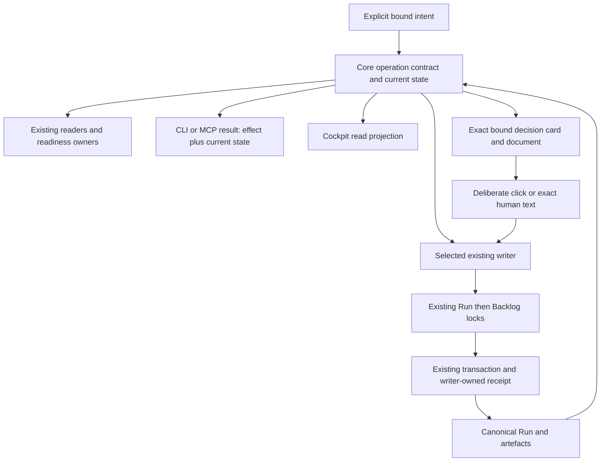

# SD: Consistent Core and MCP flow from artefact recording to closeout

Status: draft
Gate: SD
Gate approval: open
Based on: PRD
Approved source digest: sha256:4d876d26b7bcc207bf2b6067ca5d5a1c0acf81999949044c41eedefca1cce2db
Analytical inputs: renewed BROWNFIELD_REVIEW.md and ready UX_INTENT_DEFINITION.md
Date: 2026-10-10
Owner: Codex (solution design); Arndt Gold (design decision)
Run: core-mcp-flow-coherence-20261010-01
Language: en
Traceability contract: criteria-chain-v1
Design Decisions contract: sd-decisions-v1

## 1. Solution Overview

Extend the existing Core evaluation, operation-specific writers and transaction engine. Adapters transport these contracts; the cockpit renders the resulting read model. The command entry introduced below is a bounded selector/delegator, not another gate evaluator, scheduler or orchestration store. The exact approved PRD remains the sole product acceptance authority.

The implementation proceeds in dependent stages within this Run: complete state preparation and semantic continuation/completion; shared authoring/operation descriptions and current evidence; bounded writer preparation/receipts/recovery; CLI/MCP integration and focused decision-card plus targeted cockpit projection; whole-chain qualification. All stages are required before whole-run acceptance.

### Bound flow

The expected pre-state, confirmed effect and observed post-state have separate identities. A past receipt does not restore its old permission. A read does not recover pending persistence. A transport failure after dispatch does not prove whether a write occurred.

## 2. Ownership And Source Of Truth

| Concern | Canonical existing owner / extension location | Boundary |
|---|---|---|
| Complete saved/proposed state | control-evaluation/run-state.js and its artefact catalog; run-step-policy.js | Export shared content preparation; no reduced catalog in writers |
| Eligibility and typed next operation | control-evaluation/gate-policy.js, gate-check.js, next-action.js; skill-dispatch/service.js consumes | Core determines semantic operation; display prose never determines execution |
| Bounded operation description and delegation | control-state command contracts; Core index/createCoreServices; a small adjacent command contract/service | Schemas, effect classification and writer references only; delegates eligibility and persistence |
| Presentation and human decisions | run-presentation.js, approval-command.js, approval-operations.js; run-step evidence recording for non-approval decisions | Existing approval authority; add bounded change/reject recording and one shared decision eligibility projection, not a second approval ledger |
| Internal work and reviewed artefacts | run-steps.js, run-artefact-recording.js, artefact-binding-proof.js, artefact-bindings.js | Record actual supplied content and reviewed mappings, never synthesize review/QA success |
| Revision and history | run-revision.js, run-source-revisions.js, run-revision-history.js, run-revision-boundary.js | Supported early UR-at-SD, early PRD and late CD+Tests boundaries and source invalidation; retain exact historical bytes |
| Durable write and recovery | run-state-writer.js, run-backlog-writer.js, run-step-transaction.js | Run lock then Backlog lock, sealed Run commit point, journal-based recovery |
| Current evidence | Existing evidence/artefact/revision/QA inspection owners; shared read projection adjacent to run-work-summary.js | Derive applicability from bindings, retain history/unknown, never create an alternate QA decision |
| Authoring interpretation | traceability-readiness.js, run-presentation-render.js and existing readiness owners | One extracted criteria representation and declared supported grammar |
| Transport | CLI validation handlers and mcp-dispatch-runtime.js; mcp-server worker/server | Generated schema and direct Core delegation; no repair policy or control-file edits |
| General cockpit state and links | control-inspect/cockpit.js; control-ui/src/App.tsx/state.ts and existing document-state owner | Snapshot-bound reads and draft checks; no arbitrary command access or app evaluator |
| Focused decision card/session | Existing presentation, document proof and bounded session owners; dedicated control-ui decision view and MCP Apps bridge | One exact presentation, three actions, existing Core writers; never broaden agdf_cockpit_read or add a client-side gate policy |

Normative architecture remains docs/architecture/03-agentenkontrolle-zielbild.md and its OP/R catalogue. Contracts are extended in their existing plugin/resource ownership and propagated through existing generation/package scripts. No candidate list becomes an independent operation policy or acceptance register.

## 3. Architecture Decisions

- SDD-001: Share complete content-based state preparation from run-state.js across readers and proposed-state writers; rationale: the shortened writer catalogs demonstrably drop completed UX and required source-revision context; consequence: refactor the existing reader/step-policy boundary and remove duplicate preparation, retaining original paths and source binding.
- SDD-002: Make canonical semantic operation/actor and completion meaning part of evaluator results and derive human text from that result; rationale: exact sentence routing and open OR on completed Runs contradict the approved product meaning; consequence: preserve compatible display fields while deleting prose comparisons and separating invalid closeout from completed state.
- SDD-003: Expose five bounded MCP write groups for preparation, recording, approval, revision and closeout, plus operation-contract and operation-status reads through agdf_inspect, from one shared Core descriptor/command service; rationale: host permissions may be remembered per tool, so a universal selector would unnecessarily couple ordinary recording to decision/revision/completion authority; consequence: fixed action allowlists, independently disableable tools, per-tool generated schemas/budgets; one additional app-only decision facade delegates to the same approval/recording owners, with no second eligibility authority or general cockpit writer.
- SDD-004: Keep host tool permission, concrete human intent/confirmation and exact gate approval distinct, with approval delegated to executeApprovalCommand and explicit cooperative assurance; rationale: a prepared record or remembered host permission is neither visibility proof nor a new deliberate decision; consequence: old replies and broad tool permission cannot approve new material, irreversible operations require concrete confirmation within the declared trust boundary, and historical receipts carry separately observed current state.
- SDD-005: Record bounded internal work, reviewed artefacts and evidence through existing run-step/artefact owners with exact source/result registration and writer-owned operation identity; rationale: routine raw Run edits are avoidable while actual review/QA judgement must remain with its owner; consequence: add guarded operation receipts for families lacking them and preserve existing binding/approval/source receipts as their own authorities.
- SDD-006: Reuse the shared revision-boundary owner for existing early PRD reopen, late structured CD+Tests revision and the explicitly approved early UR-at-SD preview/apply/recovery; rationale: one Run must retain exact history without adapters inventing eligibility; consequence: the separately authorized Core bootstrap is requalified in the integrated flow, unsupported states stay rejected, and archived approval never renews changed material.
- SDD-007: Generalize the existing Run-step journal with a strict additive version for bound internal operations and whitelisted staged artefacts while retaining old journal readers and lock order; rationale: duplicate effects and interrupted artefact/OR/Run/Backlog writes require recovery at the actual commit point; consequence: no multi-file atomicity claim, family-specific replay/conflict checks and explicit ambiguous/pending outcomes.
- SDD-008: Extend existing closeout writing to structured modes using a prepared OR-full and canonical closeout eligibility, with no VCS action; rationale: the existing Quick Task commit/recovery pattern is reusable but its OR-lite alone is insufficient for structured completion; consequence: preserve Quick Task behavior, validate applicable quality/approval/context requirements and reconcile OR, Run and backlog through the existing journal.
- SDD-009: Extract criteria interpretation and authoring-format descriptions from the existing readiness/parser owner and share them with the presenter; rationale: metadata or a second parser would otherwise reproduce conflicting accepted forms; consequence: retain accepted legacy forms, use explicit grammar for new contracts and provide field/source diagnostics without another acceptance authority.
- SDD-010: Derive a bounded current/history/unknown evidence projection from existing bindings and new writer-owned evidence associations in the sealed Run; rationale: first-row ordering and free historical text cannot establish current applicability; consequence: no fabricated legacy associations or retroactive approvals, and current presenter/cockpit consume the same projection.
- SDD-011: Keep CLI legacy entry points on shared owners and introduce additive versioned command results, descriptors and receipt sections without changing control_state_version 2; rationale: consumers and historical sealed records must remain readable while new write semantics require qualified runtimes; consequence: qualify old read clients against the new Core, preserve old receipt versions and disclose older executing runtimes as outside new capability qualification.
- SDD-012: Extend the existing worker error boundary for commands to preserve operation identity and report unknown effect after dispatch interruption; rationale: worker termination or lost transport response is not a transactional rollback; consequence: command-status inspection and explicit recovery precede retry, and the general cockpit retains its read/check session channel; a distinct bounded decision session delegates only its three declared actions.
- SDD-013: Qualify the actual generated candidate, MCP transport and affected Codex app states, with separate source/build/protocol/native evidence and rendered locale coverage; rationale: distinct runtime digests and old native observations do not qualify a new candidate; consequence: no automatic install/restart, no blanket Claude/Windows claim and no unsupported independent response assurance.
- SDD-014: Measure a retained before/after lifecycle corpus and protect foreign sources while executing the dependent stages; rationale: fewer calls count as benefit only if integrity, evidence and human decisions remain intact; consequence: zero routine undocumented parser/invocation discovery and control-table edits are checked, while normal engineering inspection remains permitted.

- SDD-015: Prepare a focused immutable presentation view with exact document proof, complete summary, changes or honest comparison-unavailable, open points and consequence; rationale: reading and discussion must preserve the decision context without deciding; consequence: reuse the existing document renderer and MCP Apps display-mode bridge, keep comment draft in view memory, and retire stale/expired sessions without affecting the text presentation's independent validity.
- SDD-016: Route deliberate app approval to executeApprovalCommand and change/reject to a bounded extension of existing run-step evidence recording with Run Operations receipts; rationale: three outcomes need canonical persistence without a parallel approval ledger; consequence: one shared presentation-decision projection blocks a decided version, routes remediation to the existing owner and never automatically approves, revises upstream sources or closes the Run.
- SDD-017: Enforce at most one decision effect for the current presentation/version under the existing Run then Backlog locks, independently of input route or caller UUID; rationale: local button disabling alone cannot prevent simultaneous text/click or competing actions; consequence: exact retries use the original request receipt, different requests lose eligibility after the first committed decision, and stale acknowledgement never revives the old view.
- SDD-018: Use one app-only decision facade with strict session/action binding and actual supported host mediation while retaining cooperative_local assurance; rationale: a bridge call, visibility annotation, nonce or model flag alone cannot prove a human gesture; consequence: no model-visible card-write endpoint or synthetic approval message, deliberate UI handlers and trusted human text are the allowed origins within the cooperative boundary, and actual Codex permission/action/teardown qualification is mandatory before claiming click acceptance.

## 4. Integration Points

### 4.1 Shared state and current observation

Extend run-state.js with a content preparation entry used by readRunState and policyForRunContent. Inputs are the canonical target, normalized Run content, contained Run path and an optional explicit map of proposed artefact bytes/digests from the owning transaction. It parses metadata, approvals, all existing internal/closeout types, source revisions and mode; derives source-revision UX requirements using the same consumed Brownfield source, including a proposed replacement when applicable. The transaction owns that overlay; adapters cannot supply arbitrary policy/state substitutions.

run-recording, run-steps, early/late revision and recovery preparations use this entry. Existing catalog arrays remain one owner. Each mutation rechecks the expected Run revision, exact consumed artefact bytes/digests and valid source/approval proof under locks before commit. Read scopes/cache epochs remain per observation; no post-write reuse of cached pre-write evaluation.

The evaluator supplies next_operation with the existing type/skill/gate fields where applicable and additive operation_key/actor/effect classification. Stable meanings cover authoring, internal preparation/recording, presentation preparation, human decision, implementation, evidence/remediation, revision, closeout and no remaining work. These are centrally produced by gate policy/continuation, not an MCP switch over display sentences. Existing display text and allowed/forbidden lists are projections. Run-specific descriptive instructions may remain visible but cannot independently authorize an operation. Actual blockers still override a general same-gate action.

For a completed structured Run, fulfilled applicable prerequisites and valid done OR yield completed control, no next Run operation, no approval pending, and a separate optional requested VCS handoff. Keep current_gate OR for breadcrumb compatibility and render it fulfilled, not open. A completed lifecycle with inconsistent sources/OR/required obligations is unconfirmed or blocked with the concrete owner/recovery; it is never silently called clean and never automatically reopened. Summary/status logic must not infer completion solely from the lifecycle scalar. Quick Task and Verified Change keep their existing authority and route requirements.

### 4.2 Public command and description contracts

Add a command contract version 1 in the existing Core command area. createCoreServices exposes command in addition to dispatch/inspect. Keep this selector internal to the shared Core: do not publish a universal agdf_command MCP tool. Publish the five fixed tool groups below, with a common compact envelope: schema_version, presentation_language, working_directory, target_source, primary_target, target_id, run_id, expected_revision_id, operation_id (UUID), assurance=cooperative_local, and command {kind, payload}. Each tool schema contains only its group's actions and its Core entry independently checks that fixed group allowlist before delegating. Supplying another group's command.kind cannot escape it. Exact target resolution uses the existing resolver and local identity owner; cwd is never the target. Every branch rejects unknown fields and unsafe/foreign paths. Recovery may identify an original operation at an older expected revision but must additionally bind the freshly observed recovery revision.

| MCP tool | Fixed allowed actions | Permission/effect boundary |
|---|---|---|
| agdf_prepare | presentation.prepare | Creates an immutable presentation; never records approval or changes source/lifecycle |
| agdf_record | step.record, artefact.record, operation.recover limited to internal/artefact/evidence operations | Records actual results and reviewed mappings; cannot approve, revise approved sources or close a Run |
| agdf_approve | approval.record | Exact presented gate material and a new deliberate human response through existing approval authority |
| agdf_revise | source_revision.preview, source_revision.apply, source_revision.recover, prd_revision.reopen | Existing revision boundaries, exact affected material and applicable concrete confirmation; preview alone changes no revised source |
| agdf_closeout | closeout.record, operation.recover limited to this Run's closeout operation | Existing completion requirements and selected OR/Run/backlog; no foreign Run, VCS or publication |

agdf_inspect remains non-mutating, including operation-contract/status reads. Preview inside the mixed revision group does not turn that tool into read-only; only a proven non-mutating preview can later move to a read tool through the existing contract revision owner. This is a five-group capability boundary, not one tool per candidate or a new flow engine. Disabled tools are absent from discovery and rejected at the serving Core boundary; adapter flags alone are insufficient. Each descriptor names its group and concrete side effects, permitted inputs, prerequisites, confirmation requirements, retry class and result verification.

| command.kind | Payload responsibility / inputs | Delegated existing owner |
|---|---|---|
| presentation.prepare | gate; exact current artefact/presentation language; caller UUID; focused UI resource only for a supported requesting host | prepareRunPresentation; optional bounded view bootstrap after successful preparation |
| approval.record | gate, presentation_id, exact response | executeApprovalCommand; envelope maps to its existing exact command schema |
| step.record | whitelisted step, source reference/digest, actual result and evidence; route reason/evidence for Brownfield; bounded evidence association where needed | recordRunStep extended for existing UR, route, UX, preparation, CD+Tests, review and evidence responsibilities |
| artefact.record | exact Reviewed Recording Input and separate reviewed mapping reference; permitted update_draft flag | prepareArtefactRecording / existing locked run-step |
| source_revision.preview | supported source gate, reviewed proposal reference/digest and existing revision UUID | previewSourceRevision; no durable revision effect |
| source_revision.apply | same proposal/operation binding plus reviewed preview digest | applySourceRevision |
| source_revision.recover | original operation binding plus current recovery revision and exact pending evidence | recoverSourceRevision |
| prd_revision.reopen | current approved PRD identity/digest at existing early PRD-to-SD boundary | reopenPrdRevision with exact-history/receipt support |
| closeout.record | prepared OR reference/digest and bounded closeout context; Quick Task retains its existing result/evidence/risk/next form | existing run-step/closeout transaction owner |
| operation.recover | exact internal/presentation/closeout operation, inspected pending digest and current revision | existing owned pending-journal recovery; excludes generic seal/Git-history maintenance |

Schemas and descriptions are exported from this shared descriptor registry; family-specific payload validators remain owned by their command/writer contracts. The descriptor links the validator and execution entry rather than copying gate permission rules. MCP definitions use discriminated action schemas generated from those descriptors; consumers retrieve the complete selected contract through Inspect. No arbitrary Run-text, table patch, function name, shell command or caller-injected validator is accepted.

Extend agdf_inspect with operation-contract and operation-status, both bound single-Run reads. operation-contract returns selected schema, effects, applicable prerequisites, canonical path/digest/target bindings available within its existing read boundary, supported formats, retry class and unsupported reason. It can describe a candidate draft's canonical digest without producing a reviewed=true attestation. operation-status finds an exact UUID in the canonical writer receipt or owned pending record and returns receipt/current state or absent/unknown; absence during uncertainty is not proof of non-execution. Descriptions may say unavailable; reads cannot stage files, repair or recover. Large lists are paginated/narrowed and never silently truncated into complete proof.

Existing Inspect definition budget (5,000 bytes) remains. Set each new write-tool definition budget to 8,192 bytes and their aggregate definition budget to 24,576 bytes (including the app-only decision facade); command input is 64 KiB and serialized result retains the existing 1 MiB control-tool limit. Large material is a contained run-local reference with expected digest, not embedded report bytes. Metadata contains only the selected owner's full schema/examples; do not load all runtime contracts into every tool description. Generated schema equivalence, rejection of cross-group actions and per-tool/aggregate byte checks are required before exposure. A schema that cannot satisfy this design requires SD revision, not silently weaker validation or ad hoc tool proliferation.

All five write groups explicitly advertise readOnlyHint=false, idempotentHint=false and openWorldHint=false. agdf_prepare uses destructiveHint=false only for its strictly additive immutable creation. agdf_record, agdf_approve, agdf_revise and agdf_closeout use destructiveHint=true because their allowed modes replace registered state, invalidate sources, record consequential decisions or change lifecycle. Being able to recover/undo does not by itself justify false. Read-only Inspect explicitly advertises readOnlyHint=true and destructiveHint=false. Annotation validation compares all action modes/defaults/indirect effects to actual handlers; annotations inform host safeguards but never grant authorization.

### 4.2.1 Host permission, confirmation and server enforcement

There are three separate inputs: the host's permission to call a tool; the user's actual intent/confirmation for the concrete action; and the Core's existing eligibility plus exact gate approval. Remembered tool permission is transport permission only. It is not Approval: UR/PRD/SD/TP/QA/UAT, permission to invalidate any source, proof of a human review, or completion permission for another Run. A model-supplied confirmed=true, retrieved document, tool output or instruction embedded in evidence cannot establish human authority.

For a gate decision, retain the current presentation/artefact/revision and exact new response checks with cooperative assurance. For irreversible/destructive revision or closeout effects, prepare the exact affected target/Run/revision, proposal or OR digest, impact and recovery limits before obtaining action-specific human confirmation; an already supplied explicit confirmation may be consumed only for that same material/effect. Do not add a formal gate or re-request already fulfilled gate decisions. Ordinary authorized recording does not receive a redundant blanket approval prompt. Recovery checks the approved original operation and inspected direction/current binding; destructive recovery outside that intent needs its own concrete confirmation. No recorded host allow/deny choice authorizes changed scope or changed payload.

Use actual supported host approval controls for sensitive actions. Responses API require_approval/allowed_tools and ChatGPT remembered per-tool choices are distinct mechanisms; they are not assumed to exist with identical semantics in local Codex STDIO. Qualify the actual supported Codex host settings and request display for each group against the exact candidate. If required confirmation cannot be obtained at the supported trust boundary, do not execute or expose the affected sensitive write as available; return confirmation_required/unsupported through the existing interaction owner. Do not invent a host approval token or claim cryptographic proof of human origin. Local typed attestations retain cooperative_local assurance.

Server-side validation uses the existing target resolver, contained path/symlink restrictions, current revision/seal/source checks and writer eligibility regardless of host tool permission or annotations. No remote account authority or network authentication is added by this Run; any future remote deployment must separately authenticate the caller and enforce its target/action scope before delegating. Tool responses expose necessary effect/revision/receipt/verification references without secrets or gratuitous report/log contents. Prompt-injection tests must show that malicious artefact/tool content cannot switch groups, create approval, widen paths, bypass confirmation or start unsupported writes.

This refinement is informed by official OpenAI documentation fetched on 2026-10-10: [tool annotations](https://developers.openai.com/plugins/plugin-guidelines#correct-annotation), [write-action security](https://developers.openai.com/plugins/guides/security-privacy#prompt-injection-and-write-actions), [ChatGPT custom MCP confirmations](https://developers.openai.com/api/docs/guides/custom-mcp-server), and [Responses API approvals](https://developers.openai.com/api/docs/guides/tools-connectors-mcp#risks-and-safety). Five groups and the exact size limits are this design's decisions, not an OpenAI-mandated tool count or quota.

### 4.3 Writer registration and operation receipts

Internal step registration accepts only the existing semantic catalog: UR draft; Brownfield Review plus route; UX analysis; implementation-preparation Brownfield Analysis; CD+Tests; TP Review; Clean Implementation Review; CR; actual evidence. Known existing review aliases normalize to their current canonical owner; unknown types reject. Eligibility uses the current gate/route and approved sources. Readiness of UX and explicit review/report decisions is inspected by existing validators; ready analysis can be recorded done, actual revise/block remains non-fulfilled. QA registration uses the existing artefact recording path and copies the actual qa-gate report result; it never generates a QA judgement or approval.

Payloads include consumed source/version references and exact result paths/digests. Replacements are allowed only for the currently eligible unapproved internal/source draft, preserving other protected bytes. Reviewed artefact recording retains its source relationship registry and existing mapping proof. Metadata can provide bindings/digests, but reviewer identity and reviewed mapping remain explicit cooperative attestation with a reasoned derivation review.

Use existing Approval Operations and Source Revisions receipts without another approval/revision ledger. Artefact Bindings remain authoritative for artefact/source mapping; use the caller operation UUID in the binding operation instead of a hidden generated identity. Add a sealed Run Operations version-1 section only for internal/evidence/non-approval-decision/early-reopen/closeout effects and request-digest references for artefact operations that lack them. Its receipt contains schema version, action, target/Run/expected revision, operation UUID, canonical request digest, producer/assurance, resulting revision and exact effect references. A referenced artefact binding is not copied into a second source-proof authority. No other writer can remove/rewrite these receipts; append checks extend the existing writer guards and seal computation.

The shared read-only receipt lookup delegates to each family and rejects cross-family UUID reuse. Revision preview/apply phases explicitly share their existing revision operation identity. Request digests include command kind, target/Run/expected revision, normalized input and declared source/result digests, excluding transport timing. Identical repeat finds the old receipt first and returns its historical effect plus fresh current observation. A changed payload or family under the same UUID rejects. Mutable files are revalidated before a new effect; historical replay is not evaluated as a new effect on now-changed files.

Presentation preparation uses the caller UUID as the new presentation identity and validates the immutable envelope on repeat under the Run lock. The envelope retains the existing presentation binding and gains a versioned request-digest field; legacy envelope readers remain supported. A repeated old presentation may be inspectable but is explicitly non-current after revision. Approval command/receipt format and deliberate response checks remain owned by the existing service. Legacy CLI without --operation in the new qualified package generates an identity and enters that same owner, then translates the response to its compatible approved/rejected shape; supplied --operation uses exact stable replay semantics. Do not rewrite historical legacy approvals into new receipts.

### 4.4 Persistence, interruption and operation-specific recovery

Extend the existing run-step transaction owner with journal version 3 for bound internal and non-approval-decision operations, keeping v1 Quick Task and v2 source-revision readers (including the early UR-at-SD bootstrap). The v3 journal binds target, Run, operation kind/UUID/request digest, old/new Run identities, old/new backlog bytes, and a whitelist of owned changed artefact paths with old/new bytes and digests. Paths are limited to the selected run's declared canonical internal/source/OR outputs and operation-owned staging/archive paths; foreign additions, symlinks, unknown stages or mismatched bytes require explicit recovery, never deletion.

Retain lock order Run then shared Backlog. Check captured sources before durable intent; synchronize journal intent and affected file/directory durability through existing fsync/atomic-write helpers. Stage outputs/history under the owned operation, publish the declared artefacts, then commit the sealed Run with its receipt as the single commit point; synchronize the backlog, validate final digests and retire the journal. Before the Run commit, recovery restores exact old owned outputs and leaves the Run effect unapplied. After it, recovery verifies the receipt/sources and completes backlog synchronization. Failures around atomic rename are resolved by re-reading the commit point. No system-wide atomicity or unqualified power-loss durability is claimed; Windows directory-sync limitations stay explicit.

| Family | Repeat / uncertain effect | Recovery rule |
|---|---|---|
| Approval | Existing canonical receipt/request conflict behavior; historical effect plus current observation | Existing locks/journal; preserve original response/UUID and never infer a new approval |
| Presentation | Same UUID/input returns same immutable prepared envelope; conflict rejects | Inspect envelope/binding; incomplete owned presentation has no valid approval effect; prepare current material with a new deliberate decision when stale |
| Artefact/internal/evidence | Receipt plus exact request digest prevents duplicate row/event/effect | v3 journal restores pre-commit owned outputs or finishes post-commit backlog; unknown interference blocks |
| Early PRD reopen | Same operation receipt is replayed; exact prior PRD/approval evidence archived before invalidation | Existing archive/transaction owner with v3 early-reopen kind; unchanged current early boundary only, no expansion |
| Source revision: early UR-at-SD and late CD+Tests | Existing reviewed preview digest, Source Revisions receipt and v2 archive behavior | Shared boundary and explicit inspect/recover; preserve all affected exact archives and requalify early bootstrap, never generalize lifecycle permission |
| Change/reject decision | Same UUID/payload returns its own non-approval receipt; competing decisions recheck canonical version eligibility | v3 owned decision receipt/Run/backlog transaction; pre-commit restore or post-commit finish, no approval inference |
| Structured closeout | Exact completed receipt replayed without another OR/decision | v3 OR/Run/backlog path; fulfilled decisions remain fulfilled |
| Quick Task | Retain existing v1 behavior for legacy calls; qualified new command adds receipt correlation | Existing journal recovery with tested compatibility |

operation.recover accepts only an owned pending operation inspected at the exact current revision/digest and the existing allowed recovery direction. It is not generic run-recovery, seal reconstruction or maintenance authority. Read-only Inspect never calls recoverPendingRunStepLocked. An executing owner may perform its bounded existing transaction recovery only as part of an explicitly invoked matching write/recovery operation. Another Run's pending shared backlog operation blocks with that exact identity; it is never silently selected/recovered here.

The MCP worker retains serialized execution. Busy/rejection before dispatch can report not-dispatched. Cancellation, timeout, process exit, oversized/lost result or transport disconnect after dispatch reports effect_unknown with original UUID/binding and operation-status guidance, not rejected/rolled-back. Core command results distinguish accepted/already_applied/rejected/recovery_required/effect_unknown and keep effect, receipt, current.available/revision/state, assurance and recovery separate. The adapter may wrap existing family result shapes but cannot change their effect/permission meaning. Budget failure after an effect cannot erase acknowledgement uncertainty.

### 4.5 Closeout

For structured modes, release-or prepares OR-full in an operation-owned candidate path using the existing OR template, current sources and actual results. closeout.record validates contained bytes/digest, selected Run/mode/source references, report completeness and the existing applicable gate/quality/approval/context requirements. It must see actual QA pass with approval, UAT approval and fulfilled mandatory reviews, no contradictory open required finding/evidence and resolved/not-applicable Context Graph reconciliation according to existing rules. It does not treat report prose as sufficient evidence of those facts. Parent aggregation/handoff remains a distinct evaluated obligation and never silently closes a foreign Run.

The existing transaction owner publishes canonical OR.md, registers done OR, completed lifecycle/decision, the closeout receipt and bounded OR-derived context/knowledge fields, and moves/synchronizes the selected backlog pointer. Optional accepted-open items are disclosed with their existing owner/disposition; a blocking obligation prevents clean completion. Quick Task keeps OR-lite and its existing CR requirements. Completed legacy Runs are read through valid existing sources/OR and receive corrected current meaning without fabricated new closeout receipts or any retrospective state rewrite. Inconsistent completion remains explicit.

### 4.6 Authoring formats and current evidence

Extract acceptance-criterion parsing into the existing traceability/readiness responsibility and share its structured entries with the presenter. Retain previously accepted inline/bullet declarations; duplicate/conflicting IDs or ambiguous fields reject with source/line/field diagnostics. Existing SD decision bullet grammar and traceability tables remain supported. New authoring descriptors declare actual grammar and required sections/fields, with examples checked against those same validators. No third parser, new acceptance list or implicit conversion of malformed forms into approval-ready content.

Add Evidence Bindings version 1 to the sealed Run for newly recorded bounded evidence associations. Each writer-owned event binds its row/reference to action/Run, applicable source-set paths/digests, report/result digest and producer; source-set identity uses existing canonical digest semantics, while readable document raw-byte proofs retain their separate existing semantics. QA/UAT decision material must be supported by exact current artefact/source/approval relationships, not row order or a free claims string. New QA/review records include their current TP/design/result dependencies; UAT summary consumes the current applicable QA/review and observed acceptance material rather than the first three historical rows.

The shared projection returns current, superseded and applicability_unknown groups with bounded references/reasons and explicit availability. Existing exact Artefact Bindings, revision archives and approval evidence may establish legacy applicability only where they actually prove it; otherwise show unknown. Preserve free historical rows, old receipts and approvals. Do not retrospectively assign a source revision or upgrade unstructured evidence to current. Historical inspection never changes an existing QA decision. Canonical missing/conflicting-required-evidence checks still determine readiness; grouping is not an alternative gate policy.

run-presentation-render, run-work-summary/backlog and cockpit detail use this shared projection. The app shows current state/next actor/action and current material first, with separate inspectable history/unknown details and truthful document states/links. Preserve document-state/raw proof, draft-check source identity, read snapshots, generation guards, meaningful focus and bounded session lifetime. No new command is reachable through agdf_cockpit_read or its current read/check allowlist. The separate focused decision facade below cannot turn a general cockpit session into a write session. On expiry, changed snapshot or unavailable current evaluation, clear/mark dependent results using existing owner state; never invent current completion from a saved label.

### 4.7 Focused presentation card and decision flow

#### 4.7.1 Material and view lifecycle

presentation.prepare retains its existing immutable bound envelope. For a requesting host with the supported MCP Apps UI capability, attach a dedicated presentation resource and bounded decision-session bootstrap, separate from general cockpit sessions. Opening a view/session is ephemeral preparation and does not record a decision. The capability result distinguishes UI available, unavailable and not qualified; a capability advertisement alone proves none of the native acceptance. No automatic install/restart is part of this flow.

The Core prepares the exact title, gate, target/Run, expected revision, presentation ID and artefact/source-set digests, complete decision-relevant localized summary, current open points, approval consequence and next actor. Compare only an identifiable previous applicable version through existing current/history/raw-document proof; otherwise explicitly state comparison unavailable. Label machine comparison as such, never manufacture a reviewed change account or omit material behind truncation. If bounded limits cannot deliver a complete usable summary, return the existing readiness/size diagnostic instead of showing an approvable incomplete card.

The existing exact document renderer opens the bound version in the larger view via the supported MCP Apps display-mode bridge, including a visible return to the same decision context. Missing immutable bytes/proof produces truthful unavailable, never a current-file substitute labelled as the presented version. The card remains undecided during reading, returning or chat discussion. Use current locale and existing localization owners; raw source language stays explicit. Comments live only in view memory until submission; no URL/local-storage persistence and no source content rendered as executable markup. Closing a view may discard its unsent comment, disclosed where needed, and causes no gate decision.

Bind the ephemeral session to one target/Run/presentation/revision/source set, owner epoch and expiry; reuse existing bounded session capacity, expiry, explicit close and UI lifecycle patterns. Do not create persistent per-view governance state. A session token is delivered in app-only result metadata and never grants arbitrary target/payload authority. Backend close/expiry invalidates further session calls. Host tab closure and backend teardown require separate observations; expiry bounds cleanup when host teardown is absent. A closed/expired view does not invalidate a still-current text presentation, and a text decision does not require the old card session. Any source revision, competing decision or current-integrity blocker prevents further action. Refresh must prepare/rebind current material; no reuse of an old user decision.

#### 4.7.2 Transport, human intent and permission

Add exactly one app-only facade, agdf_decision_action, with MCP Apps _meta.ui.visibility=["app"] and the dedicated resource binding. It is not a sixth model-facing command group. Its strict input contains decision-session ID, operation UUID, exact presentation/revision binding and one action approve/request_change/reject with a bounded optional comment (required and nonblank for request_change; maximum 8 KiB). Reject unknown fields/action, arbitrary paths, target substitutions, response text supplied by the model or attempts to use a general cockpit session. Its serving boundary delegates to the same Core command/writer owners and checks session, current source/eligibility and enabled action before any write. The approve branch uses approval.record; the non-approval branch uses an app-only presentation_decision.record contract classified under recording permission and delegated to the existing run-step writer. This action is not admitted by model-facing step.record or an arbitrary caller-supplied origin flag. The shared descriptor documents its facade-only applicability; no sixth model-facing writer group is added. All non-approval comments are data, not dispatcher instructions.

Approve shares the agdf_approve permission capability; request_change/reject share the agdf_record decision-recording capability. The app-only facade is absent if all actions are disabled; discovery describes only enabled actions, and both serving Core and UI revalidate them. Disabling a model tool does not leave its effect available through the app. The fixed facade advertises readOnlyHint=false, destructiveHint=true, idempotentHint=false and openWorldHint=false and fits the common definition/input/result budget; smaller comments remain within the 64-KiB envelope. Existing agdf_cockpit_read, generic reads, resource loading and ui/initialize cannot invoke this writer.

Only a deliberate user event on the labelled enabled action submits a decision. Enter/Space must activate the focused explicit action normally; no approval from rendering, default/preselected choices, text-field Enter, repeated host notification, tool input/output, sendFollowUpMessage or AI-created Approval text. Trusted exact new human chat text still enters executeApprovalCommand through agdf_approve/CLI with its exact selector; the app approve branch derives that same selector from its server-bound gate rather than accepting arbitrary response text. Both carry cooperative_local assurance and declared input route, not an invented independently verified human identity.

Host execution consent, user gate intent and canonical confirmation remain distinct. The app shows submitting/awaiting technical permission when observable, then only confirmed Core effect as saved success; a denied/not-dispatched call leaves the presentation undecided. After dispatch, missing response is uncertainty rather than non-execution. The user is not asked to repeat the same business approval to satisfy an additional technical host prompt. No code claims that the host never prompts: its actual permissions and denial behavior must be observed.

A session token proves session possession, visibility metadata routes a tool, and UI event attestation records the cooperative path; none is independent proof of a human gesture. The model-visible approval tool still requires an actual trusted human response, never confirmed=true or agent invocation alone. App-only discovery/call mediation and the deliberate UI handlers are qualified with the actual supported host. If the host cannot mediate the app-only path or obtain required concrete confirmation, return unsupported/confirmation_required, disable affected card actions, preserve exact text/read alternatives and retain the native acceptance gap. Do not fake a host approval credential or bypass via a model-authored chat message.

Official [OpenAI UI reference](https://developers.openai.com/plugins/reference), read on 2026-10-10, documents app/model visibility and standard bridge preference; ChatGPT can deliver approval-gated tool input after host confirmation. These facts do not establish equivalent Codex behavior or independently authenticated user gestures. This design's separate facade, cooperative decision binding and qualification requirement are architecture choices, not an OpenAI guarantee.

#### 4.7.3 Canonical outcome, remediation and deduplication

Add a small shared presentation-decision projection alongside the current presentation/approval responsibility. It consumes existing Approval Operations and the new non-approval Run Operations receipts; no Decision ledger, alternative gate state or client rule table is introduced. Every presentation/readiness/approval and decision-recording owner consumes this same decision eligibility when applicable. Legacy records without these new receipts keep existing meaning, never gain fabricated rejection history.

| Action | Existing owner and proposed bounded extension | Canonical outcome and next owner |
|---|---|---|
| approve | executeApprovalCommand/Approval Operations with exactly the bound gate selector | One gate approval of exact material, confirmed receipt and fresh evaluator continuation; no approval of another gate or later version |
| request_change | Existing run-step evidence writer, extended with presentation-decision input and Run Operations receipt | Record comment and exact rejected-for-change version without approval; current gate's permitted remediation owner receives the comment, not an executable instruction |
| reject | Same non-approval recording owner with explicit rejected outcome | Reject this version, retaining history and current gate; no Run closeout/cancellation or upstream approval invalidation |

UR/PRD/SD/TP requests route to their existing unapproved source authoring/revision owner. A QA request/rejection routes to qa-gate/remediation; only that owner may judge revise/block from actual evidence. UAT routes to current acceptance/remediation ownership, retaining approved QA until an actual supported revision demands invalidation. Non-approval cannot silently reopen an approved upstream source or broaden revision eligibility. If a requested change affects approved intent, the existing source-revision owner previews/applies only a supported boundary; the comment itself is not application authorization. The evaluator supplies the permitted owner and any blocker; the app cannot select a repair route.

A committed request/rejection makes its exact presentation/version non-approvable through both card and text. Requesting change or rejecting does not approve a replacement. A permitted materially changed source/result must be registered and freshly presented under the existing authoring/revision owner before another deliberate decision; preparing a new envelope over unchanged rejected material must not erase the decision guard. Rejecting is version-scoped, not a new lifecycle scalar. Discussion before a decision leaves later exact Approval text valid while the same presentation/material remains current and eligible.

For all three actions, check operation replay/conflict before a new effect and then recheck current presentation/version, source/approval proof and decision eligibility under the existing Run then Backlog locks. Use canonical target/Run/gate, presented artefact/source-set digests and presentation lineage to detect a version already decided even if another path has a different UUID. UI disabling is convenience only. Same UUID and exact canonical request returns its own receipt plus separately fresh current state; changed action/comment/payload under that UUID conflicts. Different UUIDs or concurrent text/click/actions can commit only the first eligible decision; the loser returns bound already-recorded information where the exact version/receipt is proven, otherwise stale/conflict, and never appends a second approval or contradictory non-approval outcome.

Approval follows the existing approval persistence/recovery owner. Non-approval follows the bounded v3 Run Operations transaction; receipts bind action, presentation, gate/material/source set, comment and resulting revision. Persisting a decision and its remediation meaning is one owned Run effect, followed by recoverable backlog synchronization. A session result is only a projection of this effect, never its durable commit point. Operation-status delegates receipt lookup to its family. Once dispatched, a lost acknowledgement keeps its original UUID/payload for inspect/replay/recovery; no fresh user decision is invented. A post-decision current reader failure leaves historical effect confirmed and current state unavailable.

Keep the same operation UUID for an outstanding local submission/retry. On changed/closed/expired generation ignore delayed results for view state; their canonical effect remains inspectable. Block new submissions while pending/uncertain until original effect is resolved. If a session expires before a new write is dispatched it rejects; expiration after dispatch does not promise cancellation or rollback. A new view reads the canonical decision/current state and never restarts the old pending action automatically. Exact text arriving after another action is checked against that action's version/current permission, not retargeted to the new gate.

### 4.8 Same-Run early UR revision integration

Use the existing shared run-revision-boundary.js predicate and source revision preview/apply/recover owners. Supported added state is active structured SD, exact approved UR/PRD, linked reviewed unapproved SD, with no linked TP, implementation/preparation/review/quality/closeout material. This is an approval-state boundary, not a publication flag. Retain the existing early PRD and late CD+Tests policies; no app/adapter implements its own lifecycle test.

Preview is read-only and names exact affected sources, analyses, source mappings, presentations, approvals and receipts plus renewed obligations. Apply requires the exact target/Run/expected revision/operation/proposal/source/preview identities and current eligibility, archives exact prior bytes through the existing v2 source transaction, invalidates affected active approvals/bindings and returns the same Run to UR. History is non-authorizing. Renewed UR/Brownfield/required UX/PRD/SD work and decisions are enforced by the shared complete state before TP. Only actual new human responses decide renewed material.

The existing bootstrap and the recorded operation cbc55917-ee06-4fc3-b46f-ff8dcca3c30a are prior bounded Core evidence, not integrated QA. Preserve that live case/archive for read-only qualification of history and renewed chain; repeat negative/concurrent/crash/recovery writes only in disposable bound targets. Core/CLI/actual MCP, dispatcher follow-ups and backlog must agree through preview/apply, identical replay, changed payload/preview/source, pending archive/Run/backlog and unsupported states. Do not create a substitute Run or hand-edit/reseal control state to pass this acceptance.

## 5. Constraints And Compatibility

Keep control_state_version 2 and historical approved/source/receipt bytes. New Run Operations and Evidence Bindings sections are append-only writer-owned extensions with explicit version validation in the new qualified package. Legacy CLI entry points in that package delegate to the same shared owners and preserve their documented flags/outcome fields; additive operation_key/current/receipt data belong to versioned command results. Existing recorded artefact binding and approval/source-revision receipt versions remain readable. New presentation/journal versions require dual readers; existing incomplete v1/v2 transactions use their own qualified recovery, not fabricated v3 ownership.

Old read clients consuming new results are tested for additive field compatibility and existing display/current_gate meanings. An older executing Core will still have its old policy and cannot qualify the new semantic flow; capability/producer identity must make that limitation explicit. No promise that arbitrary old writer binaries enforce new guards. Rollout is a matching generated package candidate with explicit native loading proof where required; no automatic installation, schema migration, historical resealing or release in this Run. New write groups can be disabled independently or as a unit while keeping Inspect and all canonical receipts. Disabling transport does not undo confirmed state. Reverting to an old writer on data with new receipts requires a qualified compatibility transition; it is not an automatic rollback plan. Host tool consent has no effect on existing Core eligibility or required human decisions.

Preserve current read/path/symlink/size limits and all gate/source/approval checks. Input schemas and selected descriptors must be equivalent to actual Core validation. Cooperative proof remains cooperative even when forwarded by a host. Direct Core tests, generated runtime tests, actual STDIO MCP and native UI are separate evidence. All registered locales must render every changed state. Shared active-run scope and fresh worktree baseline are rechecked during approved-TP preparation; no foreign artefact, approval or lifecycle is edited.

## 6. Test And Evidence Strategy

TP will map every criterion/decision to named tasks and scenarios. Mandatory families: same-state complete/short-model regression; source revision plus completed UX then PRD/SD/QA/UAT transitions; no revision; typed routing with equivalent display text; valid/invalid authoring formats and selected descriptor schema consistency; actual internal/artefact/review registration and integrity ordering; exact presentation/new response and stale/foreign rejection; early/late revision history and unsupported lifecycle; lost acknowledgements, identical replay/payload conflict/cross-family UUID collision; concurrent Run/source changes; every declared pre/post-commit artifact/OR/Run/backlog stage; current/history/unknown evidence and old read clients; command worker timeout/cancel/result-size uncertainty; exact document/draft-check and view/session regressions; locale rendering.

Use disposable targets with synthetic non-authorizing decisions for contract and crash/fault tests. Live reference Runs remain read-only baseline inputs. Verify old journal recovery and guards, not only final success. Record source/build/served identity and exercise actual generated STDIO/MCP command access. Mandatory permission scenarios include each group's positive/negative action matrix, direct Core cross-group rejection, disabled discovery/execution, allowed versus denied host requests, remembered tool permission with absent/stale/foreign gate response, action-specific confirmation versus changed proposal/OR, interrupted confirmation and malicious document/tool content. Concrete host behavior is observed rather than inferred from API configuration. Qualify affected Codex cockpit reads and the new focused card with actual initialize, inline/full document/return, deliberate approve/change-comment/reject, later exact text, keyboard/focus, narrow/wide layout, scrolling and teardown. Exercise every registered language and pending/confirmed/denied/stale/expired/uncertain state. Reading, discussion, host permission, tool-input arrival and agent statements must not decide. A text fallback cannot satisfy native click acceptance. Required native observations are prepared against one exact candidate before asking for host action. No Claude/Windows-native claim without actual evidence; platform-sensitive file durability reports remain bounded.

Before/after benefit corpus retains fixture inputs, model/runtime/host conditions and counts of searches/manual edits, schema rejects, false follow-ups, redundant continuation prompts and correct recovery. No model performance claim from deterministic tests alone. Check protected source hashes and product diff boundary; routine zero-discovery target excludes necessary engineering/source review. Generated tool input/output budgets and selected contract examples are checked once per changed candidate. Broadening checks requires a new relevant failure/change.

## 7. Acceptance Traceability

| criterion_id | design_response | source_of_truth | design_decision_ids | compatibility_risk |
|---|---|---|---|---|
| AC-001 | Shared content preparation and fresh writer/result observation | Core run-state/run-step-policy and gate policy | SDD-001, SDD-002 | Remove shortened catalogs; protect source/UX and non-revised legacy flows |
| AC-002 | Semantic operation/actor drives continuation; text is derived | Core evaluator; dispatcher consumes | SDD-002 | Keep old text fields; remove executable sentence comparison |
| AC-003 | Selected per-group descriptors, common criteria entries and exact diagnostics | Existing authoring/readiness/command contracts | SDD-003, SDD-009 | Preserve legacy forms and per-tool/aggregate budgets; schema/group equivalence tested |
| AC-004 | Whitelisted recording with exact sources/relationships and receipts | run-step and reviewed artefact owners | SDD-005, SDD-007 | Preserve actual result/QA authority; qualify new internal guards/journal |
| AC-005 | Separate preparation, host permission and existing deliberate gate approval | run-presentation and approval-command | SDD-004 | Remembered tool consent never replaces exact new response; cooperative assurance retained |
| AC-006 | Supported early PRD, late CD+Tests and approved early UR-at-SD with exact history | run-revision/boundary/history/source-revisions | SDD-006, SDD-007 | Only the explicitly approved early extension; retain v2 source journal and other state rejection |
| AC-007 | Per-family UUID/digest receipts, lock/commit-point recovery and explicit uncertain transport effect | Existing writer/receipt/journal owners | SDD-005, SDD-007, SDD-012 | Reject conflicting/global UUID reuse; old journals remain separately recoverable |
| AC-008 | Historical effect separated from fresh current availability/state | Existing receipt families and current evaluator | SDD-001, SDD-004, SDD-007 | Old receipts remain historical; never restore their obsolete permission |
| AC-009 | Validated structured OR plus existing journal and corrected completed projection | Existing closeout/Run/backlog and Core policy | SDD-002, SDD-007, SDD-008 | Quick Task preserved; older executing Core not qualified for new completion meaning |
| AC-010 | Shared current/history/unknown projection using proven associations | Existing source/binding/evidence/QA owners | SDD-010 | Do not invent legacy bindings or alter historical QA/approvals |
| AC-011 | Additive cockpit detail from shared projections; existing snapshot/document/check state | Core cockpit and existing app reducer/proof | SDD-010, SDD-012, SDD-013 | No private-channel write exposure; preserve focus/generation/expiry semantics |
| AC-012 | Shared Core service with fixed five-group MCP contracts and actual permission qualification | Core command/descriptor owners; transports delegate | SDD-003, SDD-011, SDD-012 | Cross-group/disabled writes reject; old read compatibility and qualified transition retained |
| AC-013 | Candidate identity, real MCP and bounded native qualification | Existing package/provenance/host/session owners | SDD-013 | Different digests/old host evidence do not transfer; cooperative assurance unchanged |
| AC-014 | Dependent stages and retained measurable lifecycle corpus | Approved PRD; existing review/QA owners; Run evidence | SDD-014 | Benefit cannot result from weaker integrity checks or hidden incomplete consumers |
| AC-015 | Foreign/source protection and locale/document regression | Existing seals/proofs/locales and read-boundary owners | SDD-009, SDD-011, SDD-013, SDD-014 | No historical reseal/approval transfer or unqualified locale/host success |
| AC-016 | Immutable focused presentation, complete material/comparison/open points/consequence and exact large-document return | Existing presentation/document proof plus focused app projection | SDD-015, SDD-018 | Read/discuss/close undecided; unavailable bytes or incomplete summary cannot imply approvability |
| AC-017 | Approve through existing command; change/reject through bounded evidence recording and shared decision eligibility | Approval Operations, run-step/Run Operations and existing remediation owners | SDD-016, SDD-017 | No parallel ledger, changed-source approval or upstream revision from comment alone; equal later text retained |
| AC-018 | Strict app-only session action with separate host consent, deliberate UI/text intent and confirmed effect | Existing MCP Apps mediation, presentation/approval and Core serving checks | SDD-004, SDD-018 | Cooperative assurance; no independent gesture credential, automatic notification decision or annotation-only authorization |
| AC-019 | Locked exact version decision guard, per-operation replay/conflict/current observation and session generation protection | Existing approval/transaction/receipt owners and shared decision projection | SDD-007, SDD-012, SDD-017 | Different route/UUID cannot create second effect; stale acknowledgement/expiry never revives old permission |
| AC-020 | Actual native focused card and all three human actions, exact text/document return, keyboard/layout/scroll/locales/teardown | Existing candidate identity and QA/native evidence owners | SDD-013, SDD-015, SDD-018 | Source/browser/text-only or capability advertisement cannot replace exact Codex native evidence |
| AC-021 | Shared early UR-at-SD predicate, read-only preview/exact apply/history and renewed same-Run chain | Existing revision boundary/history/Source Revisions/v2 transaction plus complete state | SDD-001, SDD-006, SDD-007, SDD-014 | Requalify bootstrap, retain actual archive; reject other states/foreign/stale/concurrent input without raw edit |

## 8. Risks And Open Questions

All binding architecture choices above are proposals for this SD decision, not implemented facts. Material risks are duplicate parse/permission logic, undeclared retry semantics, cache reuse across writes, unowned staged paths, old-writer compatibility, falsely current legacy evidence and worker-kill ambiguity. Mitigations are shared owners, strict per-family schemas/receipts, fresh read epochs, exact owned journal validation, dual readers/qualified transitions, unknown applicability and actual fault/transport tests. No retained-debt exception is accepted.

There is no claim of independently authenticated human origin: the native app path is a cooperative interaction contract, and host app-only mediation, deliberate-event handling and denial behavior require actual qualification. If the selected host cannot support that contract, the click capability remains blocked/unqualified; text fallback preserves usability but does not satisfy AC-020. Replacing this with independent enforcement or accepting fallback as full scope requires source/design revision.

Exact task decomposition, scenario IDs, fault injection hooks and bounded native observation sequence belong to TP. If implementation-preparation evidence contradicts the proposed transaction/schema/budget reuse, return to this SD's existing revision route before exposing a capability; do not add an adapter workaround. Product conflict returns to the earliest affected approved source. Source searches made for this design are engineering evidence, recorded in MCP_CANDIDATES.md with normal inspection distinguished from missing supported metadata.

## Design Decisions

| Decision | Timing | Status | Resolution | Owner |
|---|---|---|---|---|
| Shared complete state and semantic next operation | before_sd | resolved | SDD-001/002: extend existing content reader/catalog and evaluator; every writer uses it; no executable prose or alternate adapter policy. | Core evaluation owner / Codex |
| MCP surface and input discovery | before_sd | resolved | SDD-003: five fixed write groups plus bound Inspect contract/status reads; shared Core service and allowlists; 8 KiB per-tool and 24 KiB aggregate cap including app-only facade, existing Inspect budget retained. | Core contract and MCP adapter owners / Codex |
| Presentation and deliberate approval authority | before_sd | resolved | SDD-004: host permission, concrete intent/confirmation and existing exact gate approval are distinct; remembered tool consent never substitutes; qualify actual host controls with cooperative assurance. | Existing presentation/approval owner / Codex |
| Internal and artefact recording identity | before_sd | resolved | SDD-005: whitelist existing responsibilities; writer-owned Run Operations and referenced artefact binding; no generic Run patch or fabricated reviewed/QA outcome. | Existing run-step/artefact owner / Codex |
| Source revision limits and exact early history | before_sd | resolved | SDD-006: retain supported early PRD/late CD+Tests and the approved early UR-at-SD boundary; shared predicate, exact archives and renewed analyses/source decisions; integrated requalification of bootstrap. | Existing revision/history owner / Codex |
| Multi-record consistency and recovery | before_sd | resolved | SDD-007: extend existing journal with strict v3 owned paths/UUID/digests; old versions retained; Run then Backlog locks and Run receipt commit point; explicit unknown interference. | Existing transaction/receipt owner / Codex |
| Structured completion | before_sd | resolved | SDD-008/002: validate OR-full and actual applicable prerequisites/context, publish OR/Run/backlog recoverably, completed state has no repeat OR or automatic VCS. | Existing closeout/evaluator owner / Codex |
| Authoring grammar and criteria representation | before_sd | resolved | SDD-009: shared existing parser representation for readiness/presenter/descriptors; preserve accepted legacy grammar and fail ambiguous declarations. | Existing authoring/traceability owner / Codex |
| Current evidence and history | before_sd | resolved | SDD-010: sealed evidence associations and existing bindings feed one bounded projection; unknown legacy association stays unknown, no retroactive approvals. | Existing evidence/binding owner / Codex |
| Compatibility and rollout boundary | before_sd | resolved | SDD-011: keep Run version 2/old receipt bytes and dual readers; shared CLI owners; old read compatibility; write groups independently disableable without deleting state; no assumed ChatGPT/API-to-Codex permission equivalence. | Core/package/CLI owners / Codex |
| Worker and app authority | before_sd | resolved | SDD-012: interrupted dispatched command retains UUID/effect uncertainty; general cockpit keeps its read/check boundary and snapshot/generation guards; a distinct focused session delegates only three decisions to the existing Core owners. | Existing MCP worker and cockpit owners / Codex |
| Qualification and measured benefit | before_sd | resolved | SDD-013/014: exact actual candidate and affected Codex reads plus native card decisions/document return/teardown, separate evidence classes/locales, fixed corpus and protected foreign sources; no model/host blanket claim. | Existing QA/host evidence owners / Codex |
| Focused document/card and three outcome ownership | before_sd | resolved | SDD-015/016: immutable exact presentation, existing document renderer; approve uses existing approval owner, change/reject use extended run-step evidence with distinct Run Operations receipts and shared gate eligibility, no parallel ledger or automatic revision. | Existing presentation/approval/recording and app owners / Codex |
| Cross-route single effect and lifecycle | before_sd | resolved | SDD-017: canonical version decision guard under existing locks; original UUID replay, different-request conflict/current result, superseded/expired session guard and no stale UI revival. | Existing approval/transaction/session owners / Codex |
| App-only mediation and human-origin assurance | before_sd | resolved | SDD-018: one strict app-only facade controlled by decision permissions; deliberate UI event or trusted new exact text required cooperatively, not nonce/annotation/model confirmation; actual host qualification required, unavailable capability is not accepted as click success. | Existing MCP host/approval and QA owners / Codex |
| Executable task and evidence plan | later_tp | deferred | Map every criterion/SDD to tasks/scenarios, persistence checkpoints, compatibility/budget corpus and exact necessary native actions; these execute the resolved design rather than choose its architecture. | Task/Test Plan owner |

## 9. Next Step

Validate this unapproved SD, retain its reasoned derivation review, record SD derived_from the exact approved PRD through the existing typed artefact writer, and prepare a new bound presentation. A new deliberate `Approval: SD` permits TP drafting only; implementation still requires TP approval and the required preparation.

## AGDF Approval Summary (de; source=en)

- Ziel: Ein gemeinsamer Core führt den gesamten freigegebenen Ablauf von Erfassung und Quellenrevision bis Freigabe und Abschluss. Alle 21 PRD-Kriterien sind genau einmal auf vorhandene Eigentümer und 18 SDD-Entscheidungen abgebildet. Diese SD ist ein neues Design, keine Umsetzung oder QA.
- Umfang: Fünf modellseitige Schreibgruppen (`agdf_prepare`, `agdf_record`, `agdf_approve`, `agdf_revise`, `agdf_closeout`), lesende Operationsbeschreibung/Status sowie eine eigene gebundene Entscheidungskarte. Das allgemeine Cockpit behält seine Lese-/Entwurfsprüfgrenze. Keine beliebigen Run-/Shellzugriffe, neue Freigabeinstanz, automatische Installation oder Git-Aktion.
- Entscheidungen: Vollständiger gespeicherter/vorgesehener Zustand und maschinenlesbare Operation kommen aus demselben Core. Vorhandene Writer bleiben Eigentümer. Fünf getrennte Werkzeuggruppen und eine nur für die App verfügbare Entscheidungsfassade teilen die Berechtigungsprüfung; 8 KiB je Werkzeug und 24 KiB zusammen einschließlich Fassade, 64 KiB Eingabe und 1 MiB Ergebnis. Unbekannte/fremde Actions bleiben gesperrt.
- Entscheidungskarte: Titel, Gate, Fassung, vollständige Kurzfassung, Änderungen oder ausdrücklich fehlender Vergleich, offene Punkte, Wirkung und nächster Akteur stammen aus gebundenem Material. Exakte Dokumentfassung groß lesen, zurückkehren und diskutieren entscheidet nichts. Ein nicht verfügbarer Nachweis wird nicht durch das heutige Dokument ersetzt. Kommentar bleibt vor Versand nur im Ansichtspeicher.
- Drei Aktionen: „Freigeben“ führt zum bestehenden Freigabebefehl. „Änderung wünschen“ benötigt einen konkreten Kommentar und erfasst einen eigenen Nichtfreigabe-Beleg; „Ablehnen“ verwirft diese Fassung. Beide bleiben beim zuständigen Bearbeitungs-/Prüf-Owner, schließen keinen Run und ändern keine freigegebene Quelle automatisch. Dieselbe abgelehnte Fassung kann nicht durch eine neue Präsentationshülle doch freigegeben werden; geändertes Material wird geprüft, registriert und neu entschieden.
- Text und Klick: `Approval: UR/PRD/SD/TP/QA/UAT` bleibt später im Chat für die noch aktuelle, bereite Präsentation gleichwertig. Fragen, Zitate, alte Antworten, KI-Nachrichten und bloßes Öffnen entscheiden nicht. Unter Run- und danach Backlog-Sperre prüft der Core Fassung und bisherigen Entscheidungseffekt. Doppelklick, verschiedene Vorgangskennungen und gleichzeitiger Text/Klick erzeugen höchstens einen Effekt; der unterlegene Aufruf erhält Beleg/Konflikt oder veralteten Stand.
- Menschliche Absicht und Tool-Erlaubnis: Fachliche Nutzerentscheidung, technische Host-Erlaubnis und gespeicherter Core-Effekt sind getrennt. Ein zusätzlicher technischer Prompt verlangt keine zweite fachliche Entscheidung. App-only-Metadaten, Sitzungsschlüssel oder `confirmed=true` beweisen keine unabhängige menschliche Herkunft. Bewusster UI-Handler beziehungsweise echte neue Nutzerantwort sind die kooperativ abgesicherten Ursprünge. Tatsächliche Codex-Mediation und Ablehnung werden geprüft; fehlt die nötige Unterstützung, bleiben betroffene Aktionen gesperrt und die Klickqualifikation offen.
- Erfassung, Belege und Recovery: Tatsächliche Analysen/Reviews/Artefakte werden mit Quellenbeziehung registriert, ohne erfundene QA. Vorhandene Freigabe-/Quellen-/Artefaktbelege bleiben ihre Autorität. Eigene Erfassungs-, Nichtfreigabe- und Abschlussvorgänge erhalten begrenzte Run-Operations-Belege. Dasselbe UUID-/Nutzlastpaar wird anhand seines Belegs wiederholt; veränderte Nutzlast ist Konflikt. Historischer Effekt und frisch beobachteter Stand bleiben getrennt.
- Speicherung: Das vorhandene Journal bekommt eine streng gebundene v3-Erweiterung für eigene Ausgaben. Ältere v1-/v2-Journale bleiben beim vorhandenen Recovery-Owner. Run-Commit ist der Entscheidungs-/Erfassungs-Commit-Punkt: davor eigene Ausgaben zurücksetzen, danach Backlog fertigstellen. Fremde Zwischenstände bleiben blockiert; keine Atomizitätszusage über mehrere Dateien. Antwortverlust nach Dispatch heißt unbekannte Wirkung mit originaler Vorgangskennung, keine behauptete Rücknahme.
- Quellenrevision: Bestehende frühe PRD- und späte CD+Tests-Revision sowie die ausdrücklich freigegebene UR-Wiederöffnung bei aktivem strukturiertem SD nutzen denselben Boundary-/Archiv-Owner. UR/PRD müssen freigegeben, SD verknüpft und noch nicht freigegeben sein; nachgelagertes TP/Implementierungs-/Review-/Abschlussmaterial verhindert diesen frühen Weg. Vorschau bleibt lesend, Anwendung bindet exakt Wirkung/Quelle/Vorgang. Alte Bytes und Freigaben bleiben Historie; betroffene Bindungen/Freigaben und Analysen werden erneuert. Der bereits ausgeführte Core-Fix und echte Fall werden integriert neu qualifiziert.
- Abschluss und Evidenz: Strukturierter OR-full mit tatsächlich erfüllten Qualitäts-/Freigabe-/Kontextpflichten wird zusammen mit Run/Backlog wiederherstellbar registriert. Quick Task behält OR-lite. Erledigte Runs verlangen keinen OR erneut. Eine gemeinsame Projektion zeigt aktuelle exakt zugeordnete QA-/UAT-Nachweise, ersetzte Historie und unbekannte Zuordnung; keine erfundenen alten Bindungen. Gemeinsame Autorenformate/Parser verhindern widersprüchliche Prüfung und Präsentation.
- Kompatibilität und Sitzungen: Run-Version 2 und alte Belege bleiben erhalten; neue qualifizierte CLI/MCP-Wege nutzen dieselben Owner mit versionierten Ergänzungen. Alte Leser werden geprüft, alte ausführende Core-Versionen erhalten keine neue Qualifikation. Gruppen lassen sich deaktivieren, ohne gespeicherte Effekte zu löschen. Kartenablauf/Schließen sperrt Sitzungsschreibzugriffe, entscheidet nichts und entwertet keine weiterhin gültige Textpräsentation. Veraltete Antworten beleben keine alte Ansicht.
- Nachweise und Risiken: Pflicht sind echte Core-/CLI-/MCP-Ketten, Berechtigungs-/Injection-/Konflikt-/Abbruchfälle, alle Persistenzgrenzen, frühe UR-Historie, geschützte fremde Quellen und gerenderte Sprachen. Die konkrete Codex-Karte wird mit allen drei Nutzeraktionen, Textweg, großer Dokumentansicht/Rückkehr, Tastatur/Fokus, schmaler/breiter Ansicht, Scrollen und tatsächlichem Sitzungsende geprüft. Quellen-, Build-, Protokoll-, Browser- und native Nachweise bleiben getrennt. Textfallback ersetzt keinen Klicknachweis; kein unbeobachteter Host-/Modellnutzen wird behauptet.
- Planung: Ein fester Vorher-/Nachher-Korpus prüft null Routine-Handedits, null undokumentierte Aufruf-/Parser-Suche, keine falschen Folgeschritte und erhaltene Kontrollen. Keine zweite Policy, parallele Freigabehistorie oder technische Schuldausnahme. Nur Aufgaben-/Szenario-/Beobachtungsdetails liegen beim TP-Owner; Widersprüche zur Wiederverwendung oder notwendige stärkere Herkunftssicherung verlangen vorher Design-/Quellenrevision.
- Nächster Schritt: Diese Fassung mit `Approval: SD` freigeben, Änderung verlangen oder ablehnen. Erst danach wird der Aufgaben-/Testplan erstellt; Umsetzung bleibt bis TP-Freigabe und erforderlicher Vorbereitung gesperrt.
