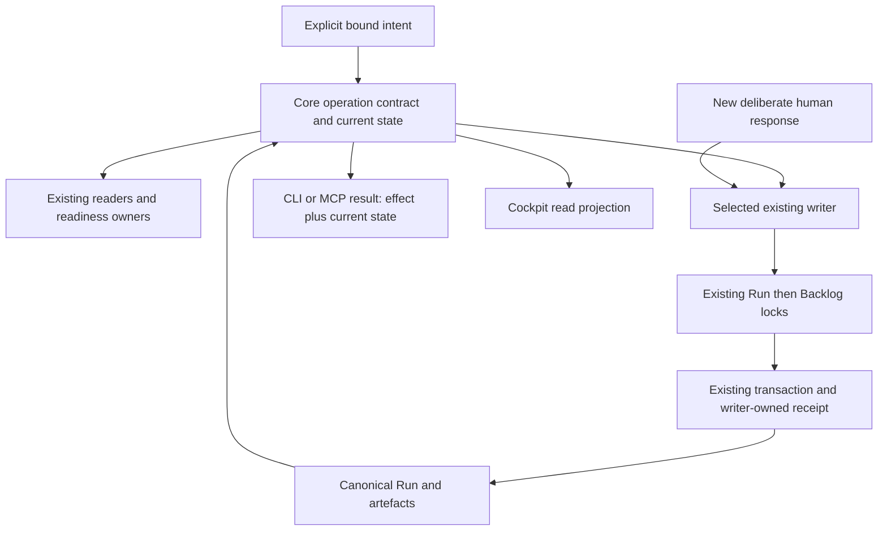

# SD: Consistent Core and MCP flow from artefact recording to closeout

Status: draft
Gate: SD
Gate approval: open
Based on: PRD
Date: 2026-10-10
Owner: Codex (solution design); Arndt Gold (design decision)
Run: core-mcp-flow-coherence-20261010-01
Language: en
Traceability contract: criteria-chain-v1
Design Decisions contract: sd-decisions-v1

## 1. Solution Overview

Extend the existing Core evaluation, operation-specific writers and transaction engine. Adapters transport these contracts; the cockpit renders the resulting read model. The command entry introduced below is a bounded selector/delegator, not another gate evaluator, scheduler or orchestration store. The exact approved PRD remains the sole product acceptance authority.

The implementation proceeds in dependent stages within this Run: complete state preparation and semantic continuation/completion; shared authoring/operation descriptions and current evidence; bounded writer preparation/receipts/recovery; CLI/MCP integration and targeted app projection; whole-chain qualification. All stages are required before whole-run acceptance.

### Bound flow

The expected pre-state, confirmed effect and observed post-state have separate identities. A past receipt does not restore its old permission. A read does not recover pending persistence. A transport failure after dispatch does not prove whether a write occurred.

## 2. Ownership And Source Of Truth

| Concern | Canonical existing owner / extension location | Boundary |
|---|---|---|
| Complete saved/proposed state | control-evaluation/run-state.js and its artefact catalog; run-step-policy.js | Export shared content preparation; no reduced catalog in writers |
| Eligibility and typed next operation | control-evaluation/gate-policy.js, gate-check.js, next-action.js; skill-dispatch/service.js consumes | Core determines semantic operation; display prose never determines execution |
| Bounded operation description and delegation | control-state command contracts; Core index/createCoreServices; a small adjacent command contract/service | Schemas, effect classification and writer references only; delegates eligibility and persistence |
| Presentation and human approval | run-presentation.js, approval-command.js, approval-operations.js | Existing exact response/receipt authority and cooperative assurance |
| Internal work and reviewed artefacts | run-steps.js, run-artefact-recording.js, artefact-binding-proof.js, artefact-bindings.js | Record actual supplied content and reviewed mappings, never synthesize review/QA success |
| Revision and history | run-revision.js, run-source-revisions.js, run-revision-history.js | Existing supported lifecycle boundaries and source invalidation; retain exact historical bytes |
| Durable write and recovery | run-state-writer.js, run-backlog-writer.js, run-step-transaction.js | Run lock then Backlog lock, sealed Run commit point, journal-based recovery |
| Current evidence | Existing evidence/artefact/revision/QA inspection owners; shared read projection adjacent to run-work-summary.js | Derive applicability from bindings, retain history/unknown, never create an alternate QA decision |
| Authoring interpretation | traceability-readiness.js, run-presentation-render.js and existing readiness owners | One extracted criteria representation and declared supported grammar |
| Transport | CLI validation handlers and mcp-dispatch-runtime.js; mcp-server worker/server | Generated schema and direct Core delegation; no repair policy or control-file edits |
| App state and links | control-inspect/cockpit.js; control-ui/src/App.tsx/state.ts/document-state.tsx | Snapshot-bound reads, existing generation checks/proof; no command access or app evaluator |

Normative architecture remains docs/architecture/03-agentenkontrolle-zielbild.md and its OP/R catalogue. Contracts are extended in their existing plugin/resource ownership and propagated through existing generation/package scripts. No candidate list becomes an independent operation policy or acceptance register.

## 3. Architecture Decisions

- SDD-001: Share complete content-based state preparation from run-state.js across readers and proposed-state writers; rationale: the shortened writer catalogs demonstrably drop completed UX and required source-revision context; consequence: refactor the existing reader/step-policy boundary and remove duplicate preparation, retaining original paths and source binding.
- SDD-002: Make canonical semantic operation/actor and completion meaning part of evaluator results and derive human text from that result; rationale: exact sentence routing and open OR on completed Runs contradict the approved product meaning; consequence: preserve compatible display fields while deleting prose comparisons and separating invalid closeout from completed state.
- SDD-003: Add one bounded agdf_command MCP tool plus selected operation-contract and operation-status reads through agdf_inspect, backed by shared Core descriptors and existing writers; rationale: a single typed selector avoids tool-per-candidate proliferation and repeated input discovery; consequence: strict action-specific schemas, bounded metadata and no new eligibility authority or cockpit write access.
- SDD-004: Keep presentation.prepare and approval.record distinct, with approval delegated to executeApprovalCommand and explicit cooperative assurance; rationale: a prepared record is neither human visibility proof nor a deliberate decision; consequence: old replies cannot approve new material and historical receipts must carry separately observed current state.
- SDD-005: Record bounded internal work, reviewed artefacts and evidence through existing run-step/artefact owners with exact source/result registration and writer-owned operation identity; rationale: routine raw Run edits are avoidable while actual review/QA judgement must remain with its owner; consequence: add guarded operation receipts for families lacking them and preserve existing binding/approval/source receipts as their own authorities.
- SDD-006: Retain current early PRD reopen and late structured CD+Tests revision boundaries, exposing existing preview/apply/inspection/recovery and preserving exact early-reopen source history; rationale: usability does not justify widening revision policy or losing old approved bytes; consequence: unsupported lifecycle states stay rejected and new early-reopen transaction history reuses the existing archive/transaction responsibility.
- SDD-007: Generalize the existing Run-step journal with a strict additive version for bound internal operations and whitelisted staged artefacts while retaining old journal readers and lock order; rationale: duplicate effects and interrupted artefact/OR/Run/Backlog writes require recovery at the actual commit point; consequence: no multi-file atomicity claim, family-specific replay/conflict checks and explicit ambiguous/pending outcomes.
- SDD-008: Extend existing closeout writing to structured modes using a prepared OR-full and canonical closeout eligibility, with no VCS action; rationale: the existing Quick Task commit/recovery pattern is reusable but its OR-lite alone is insufficient for structured completion; consequence: preserve Quick Task behavior, validate applicable quality/approval/context requirements and reconcile OR, Run and backlog through the existing journal.
- SDD-009: Extract criteria interpretation and authoring-format descriptions from the existing readiness/parser owner and share them with the presenter; rationale: metadata or a second parser would otherwise reproduce conflicting accepted forms; consequence: retain accepted legacy forms, use explicit grammar for new contracts and provide field/source diagnostics without another acceptance authority.
- SDD-010: Derive a bounded current/history/unknown evidence projection from existing bindings and new writer-owned evidence associations in the sealed Run; rationale: first-row ordering and free historical text cannot establish current applicability; consequence: no fabricated legacy associations or retroactive approvals, and current presenter/cockpit consume the same projection.
- SDD-011: Keep CLI legacy entry points on shared owners and introduce additive versioned command results, descriptors and receipt sections without changing control_state_version 2; rationale: consumers and historical sealed records must remain readable while new write semantics require qualified runtimes; consequence: qualify old read clients against the new Core, preserve old receipt versions and disclose older executing runtimes as outside new capability qualification.
- SDD-012: Extend the existing worker error boundary for commands to preserve operation identity and report unknown effect after dispatch interruption; rationale: worker termination or lost transport response is not a transactional rollback; consequence: command-status inspection and explicit recovery precede retry, and the app retains its existing separate read-only session channel.
- SDD-013: Qualify the actual generated candidate, MCP transport and affected Codex app states, with separate source/build/protocol/native evidence and rendered locale coverage; rationale: distinct runtime digests and old native observations do not qualify a new candidate; consequence: no automatic install/restart, no blanket Claude/Windows claim and no unsupported independent response assurance.
- SDD-014: Measure a retained before/after lifecycle corpus and protect foreign sources while executing the dependent stages; rationale: fewer calls count as benefit only if integrity, evidence and human decisions remain intact; consequence: zero routine undocumented parser/invocation discovery and control-table edits are checked, while normal engineering inspection remains permitted.

## 4. Integration Points

### 4.1 Shared state and current observation

Extend run-state.js with a content preparation entry used by readRunState and policyForRunContent. Inputs are the canonical target, normalized Run content, contained Run path and an optional explicit map of proposed artefact bytes/digests from the owning transaction. It parses metadata, approvals, all existing internal/closeout types, source revisions and mode; derives source-revision UX requirements using the same consumed Brownfield source, including a proposed replacement when applicable. The transaction owns that overlay; adapters cannot supply arbitrary policy/state substitutions.

run-recording, run-steps, early/late revision and recovery preparations use this entry. Existing catalog arrays remain one owner. Each mutation rechecks the expected Run revision, exact consumed artefact bytes/digests and valid source/approval proof under locks before commit. Read scopes/cache epochs remain per observation; no post-write reuse of cached pre-write evaluation.

The evaluator supplies next_operation with the existing type/skill/gate fields where applicable and additive operation_key/actor/effect classification. Stable meanings cover authoring, internal preparation/recording, presentation preparation, human decision, implementation, evidence/remediation, revision, closeout and no remaining work. These are centrally produced by gate policy/continuation, not an MCP switch over display sentences. Existing display text and allowed/forbidden lists are projections. Run-specific descriptive instructions may remain visible but cannot independently authorize an operation. Actual blockers still override a general same-gate action.

For a completed structured Run, fulfilled applicable prerequisites and valid done OR yield completed control, no next Run operation, no approval pending, and a separate optional requested VCS handoff. Keep current_gate OR for breadcrumb compatibility and render it fulfilled, not open. A completed lifecycle with inconsistent sources/OR/required obligations is unconfirmed or blocked with the concrete owner/recovery; it is never silently called clean and never automatically reopened. Summary/status logic must not infer completion solely from the lifecycle scalar. Quick Task and Verified Change keep their existing authority and route requirements.

### 4.2 Public command and description contracts

Add a command contract version 1 in the existing Core command area. createCoreServices exposes command in addition to dispatch/inspect. The new agdf_command tool has a compact common envelope: schema_version, presentation_language, working_directory, target_source, primary_target, target_id, run_id, expected_revision_id, operation_id (UUID), assurance=cooperative_local, and command {kind, payload}. Exact target resolution uses the existing resolver and local identity owner; cwd is never the target. Every branch rejects unknown fields and unsafe/foreign paths. Recovery may identify an original operation at an older expected revision but must additionally bind the freshly observed recovery revision.

| command.kind | Payload responsibility / inputs | Delegated existing owner |
|---|---|---|
| presentation.prepare | gate; expected exact current artefact/presentation language; caller UUID | prepareRunPresentation |
| approval.record | gate, presentation_id, exact response | executeApprovalCommand; envelope maps to its existing exact command schema |
| step.record | whitelisted step, source reference/digest, actual result and evidence; route reason/evidence for Brownfield; bounded evidence association where needed | recordRunStep extended for existing UR, route, UX, preparation, CD+Tests, review and evidence responsibilities |
| artefact.record | exact Reviewed Recording Input and separate reviewed mapping reference; permitted update_draft flag | prepareArtefactRecording / existing locked run-step |
| source_revision.preview | supported source gate, reviewed proposal reference/digest and existing revision UUID | previewSourceRevision; no durable revision effect |
| source_revision.apply | same proposal/operation binding plus reviewed preview digest | applySourceRevision |
| source_revision.recover | original operation binding plus current recovery revision and exact pending evidence | recoverSourceRevision |
| prd_revision.reopen | current approved PRD identity/digest at existing early PRD-to-SD boundary | reopenPrdRevision with exact-history/receipt support |
| closeout.record | prepared OR reference/digest and bounded closeout context; Quick Task retains its existing result/evidence/risk/next form | existing run-step/closeout transaction owner |
| operation.recover | exact internal/presentation/closeout operation, inspected pending digest and current revision | existing owned pending-journal recovery; excludes generic seal/Git-history maintenance |

Schemas and descriptions are exported from this shared descriptor registry; family-specific payload validators remain owned by their command/writer contracts. The descriptor links the validator and execution entry rather than copying gate permission rules. MCP definitions use discriminated action schemas generated from those descriptors; consumers retrieve the complete selected contract through Inspect. No arbitrary Run-text, table patch, function name, shell command or caller-injected validator is accepted.

Extend agdf_inspect with operation-contract and operation-status, both bound single-Run reads. operation-contract returns selected schema, effects, applicable prerequisites, canonical path/digest/target bindings available within its existing read boundary, supported formats, retry class and unsupported reason. It can describe a candidate draft's canonical digest without producing a reviewed=true attestation. operation-status finds an exact UUID in the canonical writer receipt or owned pending record and returns receipt/current state or absent/unknown; absence during uncertainty is not proof of non-execution. Descriptions may say unavailable; reads cannot stage files, repair or recover. Large lists are paginated/narrowed and never silently truncated into complete proof.

Existing Inspect definition budget (5,000 bytes) remains. Set the new command definition budget to 8,192 bytes, command input to 64 KiB and serialized result to the existing 1 MiB control-tool limit. Large material is a contained run-local reference with expected digest, not embedded report bytes. Metadata contains only the selected owner's full schema/examples; do not load all runtime contracts into every tool description. Generated schema equivalence and byte-budget checks are required before exposing the tool. A schema that cannot satisfy this design requires SD revision, not silently weaker validation or tool proliferation. Tool annotations are conservative: command readOnlyHint=false, destructiveHint=true, idempotentHint=false, openWorldHint=false; selected preview/read effects are still described accurately.

### 4.3 Writer registration and operation receipts

Internal step registration accepts only the existing semantic catalog: UR draft; Brownfield Review plus route; UX analysis; implementation-preparation Brownfield Analysis; CD+Tests; TP Review; Clean Implementation Review; CR; actual evidence. Known existing review aliases normalize to their current canonical owner; unknown types reject. Eligibility uses the current gate/route and approved sources. Readiness of UX and explicit review/report decisions is inspected by existing validators; ready analysis can be recorded done, actual revise/block remains non-fulfilled. QA registration uses the existing artefact recording path and copies the actual qa-gate report result; it never generates a QA judgement or approval.

Payloads include consumed source/version references and exact result paths/digests. Replacements are allowed only for the currently eligible unapproved internal/source draft, preserving other protected bytes. Reviewed artefact recording retains its source relationship registry and existing mapping proof. Metadata can provide bindings/digests, but reviewer identity and reviewed mapping remain explicit cooperative attestation with a reasoned derivation review.

Use existing Approval Operations and Source Revisions receipts without another approval/revision ledger. Artefact Bindings remain authoritative for artefact/source mapping; use the caller operation UUID in the binding operation instead of a hidden generated identity. Add a sealed Run Operations version-1 section only for internal/evidence/early-reopen/closeout effects and request-digest references for artefact operations that lack them. Its receipt contains schema version, action, target/Run/expected revision, operation UUID, canonical request digest, producer/assurance, resulting revision and exact effect references. A referenced artefact binding is not copied into a second source-proof authority. No other writer can remove/rewrite these receipts; append checks extend the existing writer guards and seal computation.

The shared read-only receipt lookup delegates to each family and rejects cross-family UUID reuse. Revision preview/apply phases explicitly share their existing revision operation identity. Request digests include command kind, target/Run/expected revision, normalized input and declared source/result digests, excluding transport timing. Identical repeat finds the old receipt first and returns its historical effect plus fresh current observation. A changed payload or family under the same UUID rejects. Mutable files are revalidated before a new effect; historical replay is not evaluated as a new effect on now-changed files.

Presentation preparation uses the caller UUID as the new presentation identity and validates the immutable envelope on repeat under the Run lock. The envelope retains the existing presentation binding and gains a versioned request-digest field; legacy envelope readers remain supported. A repeated old presentation may be inspectable but is explicitly non-current after revision. Approval command/receipt format and deliberate response checks remain owned by the existing service. Legacy CLI without --operation in the new qualified package generates an identity and enters that same owner, then translates the response to its compatible approved/rejected shape; supplied --operation uses exact stable replay semantics. Do not rewrite historical legacy approvals into new receipts.

### 4.4 Persistence, interruption and operation-specific recovery

Extend the existing run-step transaction owner with journal version 3 for bounded internal operations, keeping v1 Quick Task and v2 late revision readers. The v3 journal binds target, Run, operation kind/UUID/request digest, old/new Run identities, old/new backlog bytes, and a whitelist of owned changed artefact paths with old/new bytes and digests. Paths are limited to the selected run's declared canonical internal/source/OR outputs and operation-owned staging/archive paths; foreign additions, symlinks, unknown stages or mismatched bytes require explicit recovery, never deletion.

Retain lock order Run then shared Backlog. Check captured sources before durable intent; synchronize journal intent and affected file/directory durability through existing fsync/atomic-write helpers. Stage outputs/history under the owned operation, publish the declared artefacts, then commit the sealed Run with its receipt as the single commit point; synchronize the backlog, validate final digests and retire the journal. Before the Run commit, recovery restores exact old owned outputs and leaves the Run effect unapplied. After it, recovery verifies the receipt/sources and completes backlog synchronization. Failures around atomic rename are resolved by re-reading the commit point. No system-wide atomicity or unqualified power-loss durability is claimed; Windows directory-sync limitations stay explicit.

| Family | Repeat / uncertain effect | Recovery rule |
|---|---|---|
| Approval | Existing canonical receipt/request conflict behavior; historical effect plus current observation | Existing locks/journal; preserve original response/UUID and never infer a new approval |
| Presentation | Same UUID/input returns same immutable prepared envelope; conflict rejects | Inspect envelope/binding; incomplete owned presentation has no valid approval effect; prepare current material with a new deliberate decision when stale |
| Artefact/internal/evidence | Receipt plus exact request digest prevents duplicate row/event/effect | v3 journal restores pre-commit owned outputs or finishes post-commit backlog; unknown interference blocks |
| Early PRD reopen | Same operation receipt is replayed; exact prior PRD/approval evidence archived before invalidation | Existing archive/transaction owner with v3 early-reopen kind; unchanged current early boundary only, no expansion |
| Late revision | Keep existing reviewed preview digest, Source Revisions receipt and v2 archive behavior | Existing explicit inspect/recover; do not generalize into other lifecycle states |
| Structured closeout | Exact completed receipt replayed without another OR/decision | v3 OR/Run/backlog path; fulfilled decisions remain fulfilled |
| Quick Task | Retain existing v1 behavior for legacy calls; qualified new command adds receipt correlation | Existing journal recovery with tested compatibility |

operation.recover accepts only an owned pending operation inspected at the exact current revision/digest and the existing allowed recovery direction. It is not generic run-recovery, seal reconstruction or maintenance authority. Read-only Inspect never calls recoverPendingRunStepLocked. An executing owner may perform its bounded existing transaction recovery only as part of an explicitly invoked matching write/recovery operation. Another Run's pending shared backlog operation blocks with that exact identity; it is never silently selected/recovered here.

The MCP worker retains serialized execution. Busy/rejection before dispatch can report not-dispatched. Cancellation, timeout, process exit, oversized/lost result or transport disconnect after dispatch reports effect_unknown with original UUID/binding and operation-status guidance, not rejected/rolled-back. Core command results distinguish accepted/already_applied/rejected/recovery_required/effect_unknown and keep effect, receipt, current.available/revision/state, assurance and recovery separate. The adapter may wrap existing family result shapes but cannot change their effect/permission meaning. Budget failure after an effect cannot erase acknowledgement uncertainty.

### 4.5 Closeout

For structured modes, release-or prepares OR-full in an operation-owned candidate path using the existing OR template, current sources and actual results. closeout.record validates contained bytes/digest, selected Run/mode/source references, report completeness and the existing applicable gate/quality/approval/context requirements. It must see actual QA pass with approval, UAT approval and fulfilled mandatory reviews, no contradictory open required finding/evidence and resolved/not-applicable Context Graph reconciliation according to existing rules. It does not treat report prose as sufficient evidence of those facts. Parent aggregation/handoff remains a distinct evaluated obligation and never silently closes a foreign Run.

The existing transaction owner publishes canonical OR.md, registers done OR, completed lifecycle/decision, the closeout receipt and bounded OR-derived context/knowledge fields, and moves/synchronizes the selected backlog pointer. Optional accepted-open items are disclosed with their existing owner/disposition; a blocking obligation prevents clean completion. Quick Task keeps OR-lite and its existing CR requirements. Completed legacy Runs are read through valid existing sources/OR and receive corrected current meaning without fabricated new closeout receipts or any retrospective state rewrite. Inconsistent completion remains explicit.

### 4.6 Authoring formats and current evidence

Extract acceptance-criterion parsing into the existing traceability/readiness responsibility and share its structured entries with the presenter. Retain previously accepted inline/bullet declarations; duplicate/conflicting IDs or ambiguous fields reject with source/line/field diagnostics. Existing SD decision bullet grammar and traceability tables remain supported. New authoring descriptors declare actual grammar and required sections/fields, with examples checked against those same validators. No third parser, new acceptance list or implicit conversion of malformed forms into approval-ready content.

Add Evidence Bindings version 1 to the sealed Run for newly recorded bounded evidence associations. Each writer-owned event binds its row/reference to action/Run, applicable source-set paths/digests, report/result digest and producer; source-set identity uses existing canonical digest semantics, while readable document raw-byte proofs retain their separate existing semantics. QA/UAT decision material must be supported by exact current artefact/source/approval relationships, not row order or a free claims string. New QA/review records include their current TP/design/result dependencies; UAT summary consumes the current applicable QA/review and observed acceptance material rather than the first three historical rows.

The shared projection returns current, superseded and applicability_unknown groups with bounded references/reasons and explicit availability. Existing exact Artefact Bindings, revision archives and approval evidence may establish legacy applicability only where they actually prove it; otherwise show unknown. Preserve free historical rows, old receipts and approvals. Do not retrospectively assign a source revision or upgrade unstructured evidence to current. Historical inspection never changes an existing QA decision. Canonical missing/conflicting-required-evidence checks still determine readiness; grouping is not an alternative gate policy.

run-presentation-render, run-work-summary/backlog and cockpit detail use this shared projection. The app shows current state/next actor/action and current material first, with separate inspectable history/unknown details and truthful document states/links. Preserve document-state/raw proof, draft-check source identity, read snapshots, generation guards, meaningful focus and bounded session lifetime. No new command tool is reachable through the private cockpit channel or ui/call-tool allowlist. On expiry, changed snapshot or unavailable current evaluation, clear/mark dependent results using existing owner state; never invent current completion from a saved label.

## 5. Constraints And Compatibility

Keep control_state_version 2 and historical approved/source/receipt bytes. New Run/Evidence Operations sections are append-only writer-owned extensions with explicit version validation in the new qualified package. Legacy CLI entry points in that package delegate to the same shared owners and preserve their documented flags/outcome fields; additive operation_key/current/receipt data belong to versioned command results. Existing recorded artefact binding and approval/source-revision receipt versions remain readable. New presentation/journal versions require dual readers; existing incomplete v1/v2 transactions use their own qualified recovery, not fabricated v3 ownership.

Old read clients consuming new results are tested for additive field compatibility and existing display/current_gate meanings. An older executing Core will still have its old policy and cannot qualify the new semantic flow; capability/producer identity must make that limitation explicit. No promise that arbitrary old writer binaries enforce new guards. Rollout is a matching generated package candidate with explicit native loading proof where required; no automatic installation, schema migration, historical resealing or release in this Run. New command exposure can be disabled as a unit while keeping Inspect and all canonical receipts. Disabling transport does not undo confirmed state. Reverting to an old writer on data with new receipts requires a qualified compatibility transition; it is not an automatic rollback plan.

Preserve current read/path/symlink/size limits and all gate/source/approval checks. Input schemas and selected descriptors must be equivalent to actual Core validation. Cooperative proof remains cooperative even when forwarded by a host. Direct Core tests, generated runtime tests, actual STDIO MCP and native UI are separate evidence. All registered locales must render every changed state. Shared active-run scope and fresh worktree baseline are rechecked during approved-TP preparation; no foreign artefact, approval or lifecycle is edited.

## 6. Test And Evidence Strategy

TP will map every criterion/decision to named tasks and scenarios. Mandatory families: same-state complete/short-model regression; source revision plus completed UX then PRD/SD/QA/UAT transitions; no revision; typed routing with equivalent display text; valid/invalid authoring formats and selected descriptor schema consistency; actual internal/artefact/review registration and integrity ordering; exact presentation/new response and stale/foreign rejection; early/late revision history and unsupported lifecycle; lost acknowledgements, identical replay/payload conflict/cross-family UUID collision; concurrent Run/source changes; every declared pre/post-commit artifact/OR/Run/backlog stage; current/history/unknown evidence and old read clients; command worker timeout/cancel/result-size uncertainty; exact document/draft-check and view/session regressions; locale rendering.

Use disposable targets with synthetic non-authorizing decisions for contract and crash/fault tests. Live reference Runs remain read-only baseline inputs. Verify old journal recovery and guards, not only final success. Record source/build/served identity and exercise actual generated STDIO/MCP command access. Qualify the affected Codex app read states and actual initialize/interaction/teardown only where changed/claimed; no new app approval path. Required native observations are prepared against one exact candidate before asking for host action. No Claude/Windows-native claim without actual evidence; platform-sensitive file durability reports remain bounded.

Before/after benefit corpus retains fixture inputs, model/runtime/host conditions and counts of searches/manual edits, schema rejects, false follow-ups, redundant continuation prompts and correct recovery. No model performance claim from deterministic tests alone. Check protected source hashes and product diff boundary; routine zero-discovery target excludes necessary engineering/source review. Generated tool input/output budgets and selected contract examples are checked once per changed candidate. Broadening checks requires a new relevant failure/change.

## 7. Acceptance Traceability

| criterion_id | design_response | source_of_truth | design_decision_ids | compatibility_risk |
|---|---|---|---|---|
| AC-001 | Shared content preparation and fresh writer/result observation | Core run-state/run-step-policy and gate policy | SDD-001, SDD-002 | Remove shortened catalogs; protect source/UX and non-revised legacy flows |
| AC-002 | Semantic operation/actor drives continuation; text is derived | Core evaluator; dispatcher consumes | SDD-002 | Keep old text fields; remove executable sentence comparison |
| AC-003 | Selected descriptors, common criteria entries and exact diagnostics | Existing authoring/readiness/command contracts | SDD-003, SDD-009 | Preserve accepted legacy forms and definition budgets; schema equivalence tested |
| AC-004 | Whitelisted recording with exact sources/relationships and receipts | run-step and reviewed artefact owners | SDD-005, SDD-007 | Preserve actual result/QA authority; qualify new internal guards/journal |
| AC-005 | Separate bound preparation and existing deliberate approval command | run-presentation and approval-command | SDD-004 | Dual presentation readers; legacy CLI translation preserves exact checks |
| AC-006 | Existing early/late revision boundaries plus retained exact history | run-revision/history/source-revisions | SDD-006, SDD-007 | No policy expansion; retain v2 late journal/history and qualify early extension |
| AC-007 | Per-family UUID/digest receipts, lock/commit-point recovery and explicit uncertain transport effect | Existing writer/receipt/journal owners | SDD-005, SDD-007, SDD-012 | Reject conflicting/global UUID reuse; old journals remain separately recoverable |
| AC-008 | Historical effect separated from fresh current availability/state | Existing receipt families and current evaluator | SDD-001, SDD-004, SDD-007 | Old receipts remain historical; never restore their obsolete permission |
| AC-009 | Validated structured OR plus existing journal and corrected completed projection | Existing closeout/Run/backlog and Core policy | SDD-002, SDD-007, SDD-008 | Quick Task preserved; older executing Core not qualified for new completion meaning |
| AC-010 | Shared current/history/unknown projection using proven associations | Existing source/binding/evidence/QA owners | SDD-010 | Do not invent legacy bindings or alter historical QA/approvals |
| AC-011 | Additive cockpit detail from shared projections; existing snapshot/document/check state | Core cockpit and existing app reducer/proof | SDD-010, SDD-012, SDD-013 | No private-channel write exposure; preserve focus/generation/expiry semantics |
| AC-012 | Shared command service and strict generated MCP/CLI contracts | Core command/descriptor owners; transports delegate | SDD-003, SDD-011, SDD-012 | Old read compatibility, explicit qualified writer transition and disableable transport |
| AC-013 | Candidate identity, real MCP and bounded native qualification | Existing package/provenance/host/session owners | SDD-013 | Different digests/old host evidence do not transfer; cooperative assurance unchanged |
| AC-014 | Dependent stages and retained measurable lifecycle corpus | Approved PRD; existing review/QA owners; Run evidence | SDD-014 | Benefit cannot result from weaker integrity checks or hidden incomplete consumers |
| AC-015 | Foreign/source protection and locale/document regression | Existing seals/proofs/locales and read-boundary owners | SDD-009, SDD-011, SDD-013, SDD-014 | No historical reseal/approval transfer or unqualified locale/host success |

## 8. Risks And Open Questions

All binding architecture choices above are proposals for this SD decision, not implemented facts. Material risks are duplicate parse/permission logic, undeclared retry semantics, cache reuse across writes, unowned staged paths, old-writer compatibility, falsely current legacy evidence and worker-kill ambiguity. Mitigations are shared owners, strict per-family schemas/receipts, fresh read epochs, exact owned journal validation, dual readers/qualified transitions, unknown applicability and actual fault/transport tests. No retained-debt exception is accepted.

Exact task decomposition, scenario IDs, fault injection hooks and bounded native observation sequence belong to TP. If implementation-preparation evidence contradicts the proposed transaction/schema/budget reuse, return to this SD's existing revision route before exposing a capability; do not add an adapter workaround. Product conflict returns to the earliest affected approved source. Source searches made for this design are engineering evidence, recorded in MCP_CANDIDATES.md with normal inspection distinguished from missing supported metadata.

## Design Decisions

| Decision | Timing | Status | Resolution | Owner |
|---|---|---|---|---|
| Shared complete state and semantic next operation | before_sd | resolved | SDD-001/002: extend existing content reader/catalog and evaluator; every writer uses it; no executable prose or alternate adapter policy. | Core evaluation owner / Codex |
| MCP surface and input discovery | before_sd | resolved | SDD-003: one agdf_command plus bound Inspect contract/status reads, strict generated selected schemas, existing Inspect budget and 8 KiB command definition cap. | Core contract and MCP adapter owners / Codex |
| Presentation and deliberate approval authority | before_sd | resolved | SDD-004: separate preparation and existing typed approval; versioned envelope replay; exact response and cooperative assurance unchanged. | Existing presentation/approval owner / Codex |
| Internal and artefact recording identity | before_sd | resolved | SDD-005: whitelist existing responsibilities; writer-owned Run Operations and referenced artefact binding; no generic Run patch or fabricated reviewed/QA outcome. | Existing run-step/artefact owner / Codex |
| Source revision limits and exact early history | before_sd | resolved | SDD-006: retain supported early PRD and late CD+Tests boundaries; reuse archive owner for early exact source/approval retention and replay. | Existing revision/history owner / Codex |
| Multi-record consistency and recovery | before_sd | resolved | SDD-007: extend existing journal with strict v3 owned paths/UUID/digests; old versions retained; Run then Backlog locks and Run receipt commit point; explicit unknown interference. | Existing transaction/receipt owner / Codex |
| Structured completion | before_sd | resolved | SDD-008/002: validate OR-full and actual applicable prerequisites/context, publish OR/Run/backlog recoverably, completed state has no repeat OR or automatic VCS. | Existing closeout/evaluator owner / Codex |
| Authoring grammar and criteria representation | before_sd | resolved | SDD-009: shared existing parser representation for readiness/presenter/descriptors; preserve accepted legacy grammar and fail ambiguous declarations. | Existing authoring/traceability owner / Codex |
| Current evidence and history | before_sd | resolved | SDD-010: sealed evidence associations and existing bindings feed one bounded projection; unknown legacy association stays unknown, no retroactive approvals. | Existing evidence/binding owner / Codex |
| Compatibility and rollout boundary | before_sd | resolved | SDD-011: keep Run version 2/old receipt bytes and dual readers; new package CLI delegates shared owners; old read consumers tested, old executing Core not newly qualified; command access disableable without deleting state. | Core/package/CLI owners / Codex |
| Worker and app authority | before_sd | resolved | SDD-012: interrupted dispatched command retains UUID/effect uncertainty; private cockpit remains read-only and keeps snapshot/generation guards. | Existing MCP worker and cockpit owners / Codex |
| Qualification and measured benefit | before_sd | resolved | SDD-013/014: exact actual candidate and affected Codex read states, separate evidence classes/locales, fixed corpus and protected foreign sources; no model/host blanket claim. | Existing QA/host evidence owners / Codex |
| Executable task and evidence plan | later_tp | deferred | Map every criterion/SDD to tasks/scenarios, persistence checkpoints, compatibility/budget corpus and exact necessary native actions; these execute the resolved design rather than choose its architecture. | Task/Test Plan owner |

## 9. Next Step

Validate this unapproved SD, retain its reasoned derivation review, record SD derived_from the exact approved PRD through the existing typed artefact writer, and prepare a new bound presentation. A new deliberate `Approval: SD` permits TP drafting only; implementation still requires TP approval and the required preparation.

## AGDF Approval Summary (de; source=en)

- Ziel und Grundlage: Das Lösungsdesign setzt die freigegebenen Produktanforderungen mit einem gemeinsamen Core-Zustand und vorhandenen Writern um. Alle 15 PRD-Kriterien sind jeweils genau einmal zu bestehenden Eigentümern und verbindlichen SDD-Entscheidungen zugeordnet. Brownfield und UX bleiben analytische Eingaben; noch keine Umsetzung oder QA.
- Gemeinsamer Core: Vollständige Aufbereitung gespeicherter und vorgesehener Zustände einschließlich UX/Quellenrevision ersetzt verkürzte Writer-Modelle. Der Evaluator bestimmt Operation, Akteur und Abschluss; Anzeigetext steuert keine Ausführung. Ein gültig erledigter Run fordert keinen OR erneut, ein widersprüchlicher Abschluss bleibt konkret unbestätigt/blockiert.
- MCP und Verträge: Ein begrenztes `agdf_command` delegiert an bestehende Writer. `agdf_inspect` ergänzt gebundene Operationsbeschreibung und Beleg-/Statusprüfung. Action-spezifische Schemas und Beschreibungen stammen aus denselben Core-Owners; kein beliebiger Run-Text, Shellaufruf oder Adapter-Policy. Bestehendes Inspect-Budget bleibt; das neue Command-Schema ist auf 8 KiB begrenzt, Eingaben auf 64 KiB und Ergebnisse auf das bestehende 1-MiB-Limit.
- Freigabe und Erfassung: Präsentation vorbereiten und neue bewusste Antwort erfassen sind getrennt. Der vorhandene typisierte Freigabebefehl bleibt zuständig und Herkunft bleibt kooperativ. Interne Schritte, Artefakte und Nachweise werden mit exakten Quellen/Ergebnissen aufgezeichnet; QA wird nicht erfunden. Vorhandene Freigabe-/Revisionsbelege bleiben maßgeblich; neue Writer-Belege ergänzen nur fehlende Operationsidentität und Wiederholungsprüfung.
- Revision und Recovery: Frühe PRD-Wiederöffnung sowie späte CD+Tests-Revision behalten ihre bestehenden Grenzen. Alte freigegebene Bytes werden erhalten. Das vorhandene Journal erhält eine streng gebundene Erweiterung für eigene gestagte Artefakte/Operationen; ältere Journalversionen bleiben lesbar. Run-Sperre vor Backlog-Sperre, Run-Revision als Commit-Punkt: vorher eigene Ausgaben zurücksetzen, danach Backlog fertigstellen. Keine behauptete Atomizität mehrerer Dateien; fremde oder unbekannte Zwischenstände bleiben blockiert.
- Verlorene Antwort: Jede Schreibfamilie besitzt ausdrückliche UUID-/Nutzlast-/Belegregeln. Historischer Effekt und frisch beobachteter Stand sind getrennt. Abbruch/Timeout nach Dispatch bedeutet unbekannte Wirkung mit Status-/Recovery-Pfad, keinesfalls automatisch Rollback oder neue Freigabe.
- Strukturierter Abschluss: Ein vorbereiteter OR-full und tatsächlich erfüllte Qualitäts-/Freigabe-/Kontextpflichten werden geprüft; OR, Lebenszyklus und Backlog anschließend wiederherstellbar registriert. Quick Task behält OR-lite. Erfüllte Entscheidungen werden nicht wiederholt; Git/Veröffentlichung bleibt ein eigener Auftrag.
- Autorenformate und Evidenz: Bestehende Kriterieninterpretation wird mit Presenter/Metadaten geteilt, gültige ältere Formen bleiben unterstützt. Eine gemeinsame Projektion zeigt aktuelle exakt zuordenbare QA-/UAT-Nachweise, ersetzte Historie und unbekannte Zuordnung. Historische Bindungen/Freigaben werden nicht erfunden. Die App nutzt diese Core-Projektion und bewahrt Dokument-/Entwurfsprüfung, Snapshot und Fokus; sie erhält keinen Schreib-/Freigabezugang.
- Kompatibilität und Nachweise: Run-Version 2 und alte Belege bleiben erhalten; neue qualifizierte CLI/MCP-Wege verwenden dieselben Owner. Alte lesende Clients werden geprüft, alte ausführende Core-Versionen erhalten keine neue Qualifikation. Neue MCP-Schreibzugriffe sind deaktivierbar; bereits bestätigter Zustand wird dadurch nicht rückgängig. Exakte Paket-/Ressourcenkennung, echtes MCP, betroffene Codex-Ansichten und alle registrierten Sprachen werden qualifiziert; keine automatische Installation oder unbeobachtete Host-/Modellzusage.
- Risiken und Planung: Keine akzeptierte zweite Policy, Parserwahrheit oder technische Schuldausnahme. Pflichtprüfungen umfassen Quellen-/UX-Ketten, Fehler, Wiederholung/Konflikt/Konkurrenz, alle Persistenzgrenzen, Historie, Kompatibilität, Budget und geschützte fremde Quellen. Ein fester Vorher-/Nachher-Korpus misst Routine-Suche, Handedits, falsche Folgeschritte und Recovery bei erhaltenen Kontrollen. Nur konkrete Aufgaben-/Szenario-/Beobachtungsdetails verbleiben beim TP-Owner; Widersprüche zur Wiederverwendung führen vor Umsetzung zur SD-Revision.
- Nächster Schritt: Diese neue SD-Fassung prüfen und mit `Approval: SD` freigeben, Änderung verlangen oder ablehnen. Danach folgt der Aufgaben-/Testplan; Implementierung bleibt bis dessen Freigabe und notwendiger Brownfield-Vorbereitung gesperrt.
