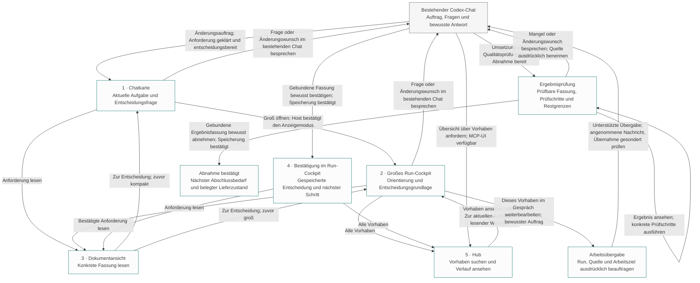
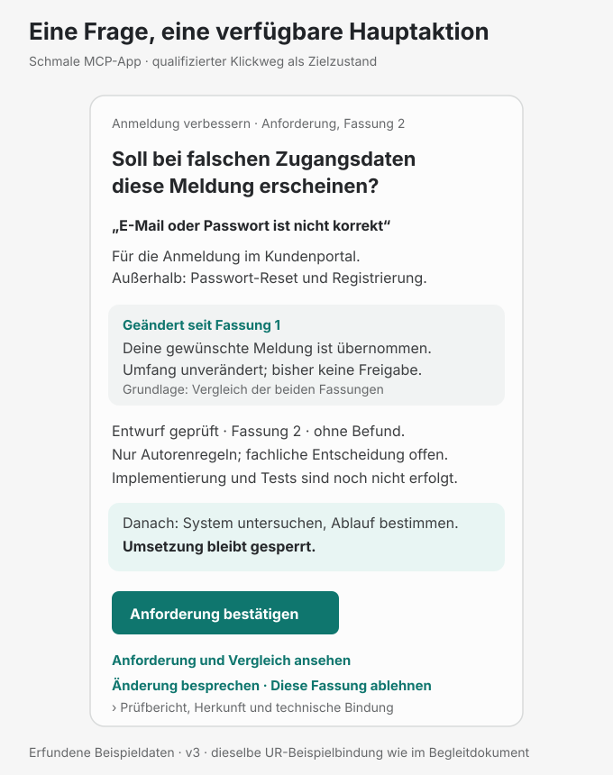
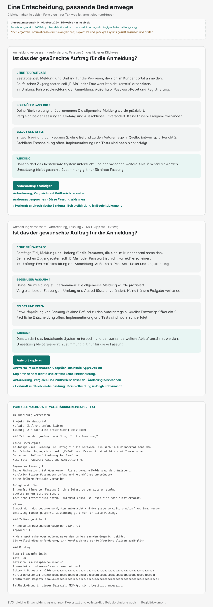
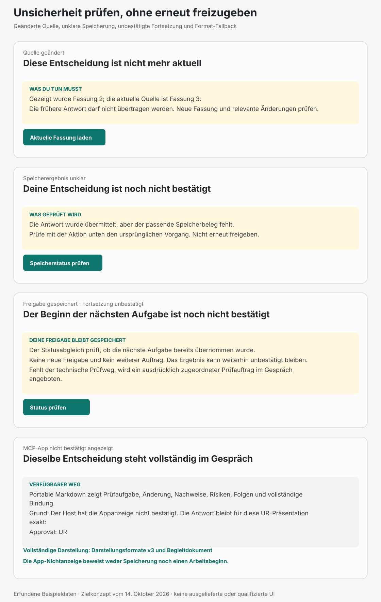

# AGDF Hub und Run Cockpit

**„Ich weiß sofort, worum es geht, was sich geändert hat und was jetzt von mir gebraucht
wird.“** Das ist das angestrebte Anwendererlebnis.

AGDF wird als Plugin im vorhandenen KI-Host verwendet. Zum vorgesehenen Lieferumfang gehören
der MCP-Server und die über ihn bereitgestellten MCP-App-Ressourcen. Das **Run-Cockpit**
zeigt den verständlichen Stand eines Vorhabens, seine Dokumente, Nachweise und Entscheidungen.
Der **Hub** ermöglicht Überblick und Wiederaufnahme innerhalb derselben App.
Das Cockpit erscheint als Karte im bestehenden Gespräch oder größer in einer vom Host
angebotenen Appfläche. Position und verfügbare Darstellung bestimmt der Host.

Der Mensch sitzt im Cockpit. Er bestimmt die Richtung, klärt Anforderungen und trifft die
erforderlichen Entscheidungen. Die KI führt die jeweils zulässige Arbeit aus. AGDF hält
verständlich sichtbar, was vereinbart ist, was bereits belegt wurde und was jetzt passieren
muss, damit das Vorhaben weiterkommt.

**Dokumentrolle: Weiterentwicklung der vorhandenen MCP-App, abgeglichen am 14. Oktober 2026.**
Die Entscheidungskarte, Dokumenteinordnung, Quellenbindung, Kontextübergabe und wesentliche
Status- und Fehlerzustände sind bereits implementiert. Dieses Konzept beschreibt ihre
gezielte Ergänzung und Verbindung. Die [Cockpit-Referenz](06-agdf-cockpit.md) beschreibt
die vorhandene Leseintegration. Der [Befehlsfluss](core-mcp-command-flow.md) beschreibt die
Entscheidungsoperationen und ihre aktuelle Qualifizierung. Die verbindlichen Regeln bleiben
in den [Runtime-Verträgen](../../plugins/agdf/meta/contracts/) und ihren Core-Diensten.

**So ist das Konzept zu lesen:** **Bestand** bezeichnet im Quellcode vorhandene Fähigkeiten,
**Ergänzung** den noch benötigten Funktions- oder Integrationsumfang. **Nachweis offen** bedeutet,
dass ein Verhalten am konkreten Host noch zu qualifizieren ist; daraus folgt kein automatischer
Neubau. [Kapitel 9](#9-bestand-und-erforderliche-weiterentwicklung) ordnet jede Fähigkeit ihren
bestehenden Komponenten und den verbleibenden Ergänzungen zu. Die Nutzerwege beschreiben das
gemeinsame Zielbild, nicht ausschließlich neue Arbeit.

Die [UI-Richtlinien](08-ui-richtlinien.md) ergänzen dieses Konzept um gemeinsame Anforderungen
an Sprache, Orientierung, Entscheidungen, Gestaltung und Bedienbarkeit. Jede Richtlinie
enthält ein Beispiel und ein prüfbares Kriterium für die Weiterentwicklung der Ansichten.

Der Maßstab für die Bedienung ist die Entlastung des Anwenders: weniger suchen, zuordnen und
vergleichen, gezielt entscheiden und das gelieferte Ergebnis selbst überprüfen können. Ein
sichtbarer Verfahrensschritt allein erfüllt dieses Ziel nicht. Jede Entscheidung bereitet die
konkrete Prüfaufgabe vor; jeder Wechsel erhält oder klärt den tatsächlichen Arbeitsgegenstand.

## Lesepfade durch das Konzept

Beginne mit dem nummerierten Nutzerweg. Technische Entscheidungen, Praxisreferenzen und
historische Mockups stehen anschließend als Vertiefung. Der redaktionelle Umzug vom
26. Oktober 2026 ändert keine Produktanforderung und keinen Qualifikationsstand.

| Du möchtest … | Lies … |
|---|---|
| Den durchgehenden Nutzerweg verstehen | [Einstieg](#1-nutzerabsicht-und-einstieg), [Hub](#2-hub-für-überblick-und-wiederaufnahme) und [Run-Cockpit](#3-run-cockpit-als-gemeinsamer-arbeitsbereich) |
| Entscheidungen und Dokumentarbeit gestalten | [Entscheidungskarte](#5-entscheidungskarte-und-menschliche-entscheidung), [Dokumente](#6-dokumente-und-nachweise-im-arbeitszusammenhang) und [UI-Richtlinien](08-ui-richtlinien.md) |
| Bestand und geplante Ergänzung unterscheiden | [Bestandsabgleich](#9-bestand-und-erforderliche-weiterentwicklung), danach die [technische Referenz](06-agdf-cockpit.md) |
| Den Entwurf prüfen | [Beobachtbare Nutzererlebnisse](#10-beobachtbare-nutzererlebnisse) und [Praxisfälle](#verbindliche-praxisfälle-für-konzept--und-implementierungsreview) |
| Die Host-Architekturentscheidung nachvollziehen | [Gemeinsame Host-Schnittstelle](#architekturentscheidung-zur-gemeinsamen-host-schnittstelle) und [Codex-Integration](#integration-in-den-bestehenden-codex-chat) |
| Beispiele und frühere Darstellungen vergleichen | [Vier echte Vorhaben](#praxisreferenz-vier-echte-vorhaben-in-derselben-mcp-app) und [historische fünf Ansichten](#nutzerweg-und-historische-fünf-ansichten) |

## 1 Nutzerabsicht und Einstieg

Der normale Einstieg ist ein Auftrag im Gespräch, zum Beispiel: „Verbessere die Anmeldung.“
AGDF ordnet den Änderungswunsch dem richtigen Projekt und Arbeitsumfang zu. Bei einem neuen
Vorhaben klärt und formuliert es die Anforderung. Sobald sie zur Entscheidung bereitsteht,
erscheint das Run-Cockpit mit der Frage „Haben wir deinen Wunsch richtig verstanden?“ im Chat.
Der Anwender muss vorher keinen Run in einer Übersicht suchen und keine Abkürzungen lernen.

Solange Angaben fehlen, benennt AGDF die konkrete Frage. Eine noch unvollständige Anforderung
wird als Klärungsstand gezeigt; eine Freigabeaktion setzt die bestehenden Voraussetzungen voraus.
Passt der Auftrag eindeutig zu einem bestehenden Run, führt der Einstieg zu dessen aktuellem
Schritt. Ist die Zuordnung unklar, wird sie vor einer Entscheidung geklärt.

Der Hub ist der zweite Einstieg. Er dient dem Wiederaufnehmen, Vergleichen und Nachlesen
vorhandener Arbeit. Beide Einstiege führen in denselben Arbeitsbereich für das ausgewählte
Vorhaben.

### Welche Aktion führt zu welcher Ansicht?

Die Kästen zeigen die sichtbaren Ansichten; die Pfeile benennen die auslösende Aktion oder
die erforderliche bestätigte Rückmeldung. Die Nummern entsprechen den [fünf historischen Mockups](#nutzerweg-und-historische-fünf-ansichten).
Der graue Kasten ist der vorhandene Codex-Chat. Die anderen Kästen sind AGDF-Inhalte.



Die Dokumentansicht kehrt zur auslösenden Darstellung und deren aktuellem Inhalt zurück.
Nach dem Lesen einer bestätigten Anforderung ist das die Bestätigung beziehungsweise die
nächste Aufgabe, keine erneute Entscheidung über dieselbe alte Fassung. Ein überarbeiteter
Vorschlag erscheint ebenfalls in der bisher verwendeten Cockpit-Darstellung; der Flow zeigt
den Einstieg über die Chatkarte exemplarisch.

| Aktion des Anwenders | Ausgangspunkt | Sichtbares Ergebnis | Wirkung und Voraussetzung |
|---|---|---|---|
| Änderungswunsch formulieren | Bestehender Codex-Chat | Chatkarte mit „Haben wir deinen Wunsch richtig verstanden?“ — Ansicht 1 | Erst nach notwendiger Klärung und gebundener Entscheidungsbereitschaft; fehlende Angaben führen zunächst zu einer konkreten Rückfrage |
| Groß öffnen | Chatkarte | Großes Run-Cockpit — Ansicht 2 | Host muss den angebotenen Modus bestätigen; ohne Unterstützung bleibt die kompakte Karte verfügbar |
| Anforderung lesen | Chatkarte oder großes Cockpit | Dokumentansicht — Ansicht 3 | Liest die konkret zugeordnete Fassung innerhalb der App; ein erforderlicher größerer Anzeigemodus bleibt hostabhängig |
| Zur Entscheidung | Dokumentansicht | Auslösende Chatkarte oder großes Cockpit — Ansicht 1 beziehungsweise 2 | Erhält Vorhaben, Fassung und Zusammenhang; bei inzwischen geänderter Quelle wird der aktuelle Stand erklärt |
| Frage stellen oder Änderung nötig | Aktuelle Entscheidung oder Dokument | Diskussion im bestehenden Codex-Chat; danach überarbeitete Entscheidungskarte | Öffnet keinen eigenen Chat. Im gezeigten Zustand erfolgt der Änderungswunsch direkt im bestehenden Gespräch; eine Ersatzfassung benötigt erneut eine Entscheidung |
| Entscheidung bewusst bestätigen | Bestehender Codex-Chat; künftig auch qualifizierte Klickaktion | Bestätigung und nächste Aufgabe im Cockpit — Ansicht 4 | Erst nach bestätigter Erfassung; „So stimmt es“ ist in den historischen v4-Mocks deaktiviert. Ist der Chat der einzige Weg, steht die exakte Antwort direkt beim Handlungshinweis; bei qualifiziertem Klickweg darf das Protokoll in Details stehen |
| Bestätigte Anforderung lesen | Bestätigung | Dokumentansicht — Ansicht 3 | Zeigt die bestätigte historische Fassung mit ihrem belegten Status; zurück geht es zum auslösenden Aufgabenstand |
| Alle Vorhaben oder Übersicht anfordern | Großes Cockpit oder bestehender Chat | Hub — Ansicht 5 | Zeigt den definierten Projektumfang; Darstellung über MCP-UI setzt die entsprechende Host-Fähigkeit voraus |
| Suchen, filtern oder Verlauf aufklappen | Hub | Treffer und Verlauf innerhalb des Hubs — Ansicht 5 | Ändert die Leseauswahl; bestätigt keine Fassung und beauftragt keine Arbeit |
| Vorhaben ansehen oder Zur aktuellen Aufgabe | Hub | Aktueller Aufgabenstand im großen Cockpit — Ansicht 2 beziehungsweise 4 | Lesender Wechsel zum ausgewählten Run; erhält den bestehenden Codex-Chat und startet keine automatische Fortsetzung |
| Dieses Vorhaben im Gespräch weiterbearbeiten | Geöffneter Run oder Dokument | Gebundene Arbeitsübergabe mit Run, Quelle und Arbeitsziel | Bewusster Auftrag; Annahme der Nachricht und tatsächliche Übernahme bleiben getrennt. Fehlende Fähigkeit bietet einen ausdrücklich zugeordneten Textauftrag. |
| Ergebnis ansehen und prüfen | Abnahmebereites Run-Cockpit | Zugeordnete Ergebnisfassung mit Umgebung und Prüfschritten | Technische Nachweise erklären Aussagebereich und Grenzen; das Öffnen nimmt nichts ab. |
| Ergebnis abnehmen | Abnahmebereites Cockpit oder exakter Chatweg | Bestätigte Abnahme und nächste Abschlussverpflichtung | Erst mit passendem Speicherbeleg; keine Behauptung von Integration oder Veröffentlichung. |
| Änderung oder Unterbrechung verlangen | Aktuell beauftragter Run | Gebundener Änderungswunsch oder unterstützte Unterbrechungsanforderung | Neue Freigabebedarfe werden geprüft; Halt wird erst nach Hostbestätigung behauptet. |
| Aktuellen Stand laden | Cockpit mit veralteter oder bewusst manuell zu aktualisierender Beobachtung | Frisch gelesener Aufgabenstand in derselben Darstellung | Erscheint nur bei erforderlicher bewusster Neuladung; kann Inhalt und Handlungserwartung ändern, erzeugt aber keine Entscheidung und keinen neuen Chat |

Die große Ansicht kann je nach Host rechts, bildschirmfüllend oder in einem anderen
angebotenen Modus erscheinen. Der Flow beschreibt die Navigation innerhalb des Konzepts,
keine garantierte Codex-Fensteraufteilung. Bei fehlender MCP-App-UI bleiben die gebundenen
Informationen und der unterstützte Entscheidungsweg vollständig als Portable Markdown im
bestehenden Chat verfügbar.

## 2 Hub für Überblick und Wiederaufnahme

Der Hub beantwortet: **„Was läuft, wo werde ich gebraucht und was ist bisher passiert?“**
Er macht die Runs des ausdrücklich ausgewählten Projekts auffindbar. Das Projekt steht
sichtbar im Kopf; ein Projektwechsel ist bewusst. Eine projektübergreifende Gesamtübersicht
benötigt einen gesondert definierten Umfang.

Die Übersicht unterscheidet aktive Runs, abgeschlossene Runs und historische abgelöste oder
abgebrochene Arbeit entsprechend dem gespeicherten Lebenszyklus. Geplante Backlog-Vorhaben
ohne eigenen Run können daneben erscheinen und sind ausdrücklich als geplant erkennbar.
Sie erhalten keine erfundenen Gate-, Freigabe- oder Verlaufsangaben.

### Einträge und Suchmöglichkeiten

Ein Run-Eintrag führt mit dem verständlichen Namen des Vorhabens. Dazu zeigt er den aktuellen
Schritt, den gespeicherten Lebenszyklus, einen möglichen Klärungsbedarf und die nächste
erwartete Handlung. Der letzte verfügbare Datenstand ist zugänglich. Technische IDs und
Quellenpfade stehen in den Herkunftsangaben, damit ähnliche Vorhaben unterscheidbar bleiben.

Die Suche umfasst Namen und Run-ID; Filter helfen nach Lebenszyklus, Schritt und erforderlicher
Aufmerksamkeit. „Meine Entscheidung erforderlich“ und „Klärung erforderlich“ bieten direkte
Zugänge. Ihre Bedeutung wird aus aktuellen Core-Angaben abgeleitet. Ein gespeicherter
Backlog-Status allein bestätigt keine aktuelle Entscheidungsbereitschaft.

Der Einstieg priorisiert „Meine Entscheidung erforderlich“, „Klärung erforderlich“ und
blockierte Vorhaben; zuletzt bearbeitete Runs unterstützen die Wiederaufnahme. „Meine“ wird
nur aus einer belegten Zuordnung zur Person abgeleitet. Fehlt diese, heißt der Zugang neutral
„Entscheidung erforderlich“. Die gesamte Run-Liste bleibt erreichbar. Die Priorisierung
nennt die tatsächliche nächste Handlung und verwandelt einen geplanten Eintrag nicht in
einen entscheidungsreifen Run.

Der Hub muss auch Runs ohne Backlog-Eintrag auffindbar machen. Die vorhandene
Masterbacklog-Projektion wird dafür durch einen gesondert definierten, begrenzten Run-Leseumfang
ergänzt. Inventar, Suchabdeckung und Aktualisierung müssen zusammenpassen. Wurde nur ein Teil
gelesen, wird dieser Umfang genannt; „keine Treffer“ darf dann keine vollständige Projektsuche
behaupten. Dieses Ziel erweitert die heutige, zunächst auf Backlog-Einträge begrenzte Übersicht.

### Statuskonflikte und offene Arbeit einordnen

Der gespeicherte Lebenszyklus, die aktuelle Bewertung und beobachtete Agentenarbeit werden
nicht zu einem einzigen Fortschrittsindikator zusammengezogen. Eine historische offene
QA-Aufforderung in einem abgeschlossenen Run erzeugt keine Aufgabe im Hub. Ein Backlog-Eintrag
mit „Awaiting UAT“ überstimmt keine dokumentierte Rücksetzung. Ein Abschluss mit angenommenen
Abweichungen bleibt als Abschluss sichtbar und trägt seine Nutzungsgrenze.

Bei abweichenden Angaben führt der Eintrag mit dem belegten Stand und einer verständlichen
Begründung. Details zeigen die abweichende Quelle, deren Zeitbezug und den kanonischen Bezug.
Die App bereinigt diese Quelldaten nicht eigenständig. Fehlt eine aktuelle Auswertung, darf
„gespeichert offen“ nicht in „deine Entscheidung jetzt erforderlich“ umbenannt werden.

### Öffnen und Zurückkehren

Das Öffnen eines Eintrags lädt das Run-Cockpit mit dem aktuellen Stand dieses Runs. Historische
Runs öffnen zunächst ihren Abschluss und Verlauf; daraus entsteht keine neue Arbeitsfreigabe.
Die Rückkehr zum Hub erhält Suche, Filter und Listenposition. Der Anwender kann zwischen
Vorhaben wechseln, ohne seine Orientierung in der Übersicht zu verlieren.

## 3 Run Cockpit als gemeinsamer Arbeitsbereich

Das Run-Cockpit verbindet drei Aufgaben: **Orientierung behalten, den aktuellen Gegenstand
bearbeiten und den bisherigen Verlauf nachvollziehen.** Die vorbereitete Entscheidung mit dem relevanten Dokumentausschnitt ist sein zentraler
Inhalt, wenn eine menschliche Entscheidung ansteht. Während interner Arbeit zeigt derselbe
Bereich die laufende Aufgabe, das letzte bestätigte Ergebnis und mögliche Hindernisse.

Die kompakte und die große Darstellung verwenden dieselbe Run-Identität, dieselbe
Entscheidungsgrundlage und dieselbe Bedeutung der Zustände. Mehr Platz verändert die
Darstellungstiefe. Er erzeugt keine zusätzliche Freigabe, keinen zweiten Run und keine
abweichende Gate-Policy.

### Dauerhafte Orientierung

In der großen Ansicht bleibt ein Orientierungskopf sichtbar, während Dokumente, Nachweise
oder der Verlauf gescrollt werden. Er beantwortet vier Fragen:

| Frage des Anwenders | Sichtbare Antwort |
|---|---|
| Welches Vorhaben bearbeite ich? | Fachlicher Titel und ausgewähltes Projekt; Run-ID bei Bedarf in den Herkunftsangaben |
| Wo stehe ich? | Aktueller Schritt und Einordnung in den für diesen Run geltenden Ablauf |
| Wer ist jetzt dran? | Erwartete Handlung des Anwenders, nächste Arbeit der KI oder konkret benannter Klärungsbedarf |
| Was muss passieren, damit es weitergeht? | Eine verständliche Hauptaussage mit passender Aktion und erklärter Wirkung |

Der auf Wunsch geöffnete Ablauf zeigt erledigte, aktuelle und noch anstehende Schritte. Er folgt dem tatsächlichen
Delivery-Weg des Runs, einschließlich Analysen, Umsetzung und Reviews. Nicht jedes Element
ist ein menschliches Gate. Kürzere Wege werden entsprechend kürzer dargestellt. Eine
Anforderungskarte, ein bestandenes Review und ein freigegebenes Gate bleiben unterscheidbar.
Die UI berechnet daraus keinen pauschalen Fertigstellungsprozentsatz.

Ein beispielhafter Orientierungskopf lautet:

```text
Anmeldung verbessern · Anforderung, Fassung 2           Hub öffnen
Deine Entscheidung: Soll bei falschen Zugangsdaten die Meldung
„E-Mail oder Passwort ist nicht korrekt“ erscheinen?

Geändert: Die Meldung wurde auf deinen Wunsch präzisiert.
Danach: Bestehendes System untersuchen. Umsetzung bleibt gesperrt.

Anforderung bestätigen · Änderung besprechen
Anforderung und Entscheidungsgrundlage ansehen
Ablauf, Herkunft und bisherige Entscheidungen ansehen
```

Die gezeigten Entscheidungsaktionen setzen die jeweilige Host-Unterstützung voraus. In den
historischen v4-Mocks bleibt „So stimmt es“ deaktiviert. Die v3-Mocks zeigen qualifizierten
Klickweg und Textweg getrennt. Dieses Textbeispiel zeigt den Kopf und die Handlungszugänge;
belegte Vorprüfung und relevante Risiken folgen im Hauptinhalt derselben Karte.

Während der Umsetzung lautet die Einordnung beispielsweise:

```text
Anmeldung verbessern
Aktueller Schritt: Umsetzung und Tests

Als Nächstes ist die KI dran
Den freigegebenen Plan umsetzen und Ergebnisse prüfen.
Du musst jetzt nichts entscheiden.
```

„Die KI arbeitet“ wird nur angezeigt, wenn der Host tatsächliche laufende Arbeit bestätigt.
Der kanonische nächste Schritt allein belegt keine laufende Ausführung. Ohne entsprechende
Beobachtung lautet die Aussage „Als Nächstes ist die KI dran“ oder „Weiterarbeit beauftragen“.

### Erwartung am aktuellen Schritt

Der Schrittname allein erklärt noch nicht, was der Anwender tun soll. Deshalb gehört eine
konkrete Erwartung zum Orientierungskopf. Sie bleibt auch sichtbar, wenn gerade ein
Unterdokument gelesen wird.

| Situation | Aussage im Cockpit | Passende Handlung |
|---|---|---|
| Eine Anforderung braucht Klärung | „Bitte kläre, welche Nutzer die Änderung betrifft.“ | Die konkrete Frage im Chat beantworten |
| Eine Gate-Fassung ist entscheidungsbereit | Konkrete Prüfaufgabe: „Bestätige, ob dieses Verhalten fachlich gewünscht ist.“ | Relevante Änderung und Nachweise prüfen; gebundene Fassung bestätigen, Änderung besprechen oder ablehnen |
| Die nächste interne Aufgabe ist zulässig | „Als Nächstes wird das bestehende System untersucht.“ | Bereits beauftragte Arbeit fortsetzen lassen oder die erforderliche Fortsetzung beauftragen |
| Ein konkreter Blocker verhindert Fortschritt | Ursache und die zu ihrer Auflösung erforderliche Handlung | Benannte Quelle prüfen oder die zuständige Klärung anstoßen |
| Der aktuelle Stand ist nicht bestätigt | „Diese Beobachtung ist nicht mehr aktuell.“ | Aktuellen Stand laden; bis dahin keine aktuelle Entscheidung behaupten |
| Der Run ist abgeschlossen | Ergebnis, Abschlussgrundlage und mögliche Restgrenzen | Ergebnis und Verlauf ansehen; neue Arbeit ausdrücklich beauftragen |

„Du bist dran“ setzt eine tatsächliche Handlung des Anwenders voraus. Ein bloßer interner
Zwischenschritt wird nicht als zusätzliche Nutzerentscheidung dargestellt. Bei mehreren
offenen Punkten führt die wichtigste aktuell erforderliche Handlung; weitere Punkte bleiben
als zugehörige Nachweise und Klärungen erreichbar.

### Hauptbereich und Vertiefung

Der Hauptbereich zeigt die gegenwärtige Aufgabe. Bei einem entscheidungsreifen Gate führt
er mit dem Vorschlag und den erwarteten Nutzeraktionen. Bei fehlenden Voraussetzungen
führt er mit dem konkreten Klärungsbedarf. Ein technischer Fehler wird mit verständlicher
Ursache und einer passenden Wiederherstellungsaktion erklärt.

Dokumente und Nachweise öffnen aus diesem Zusammenhang heraus. Der Orientierungskopf
bleibt sichtbar; die Rückkehr führt zur auslösenden Karte oder Quelle und erhält deren Fokus.
Der Anwender soll beim Lesen jederzeit erkennen, wozu das Dokument gehört und welche
Entscheidung oder Arbeit es unterstützt.

## 4 Run Cockpit als Teil des Chats

Im Chat ist das Run-Cockpit eine kompakte Gesprächskarte. Jede Karte ist für sich verständlich:
Sie enthält Vorhaben, aktuellen Schritt, erwartete Handlung und Datenstand. Die wichtigsten
Aktionen sind unmittelbar erreichbar. Details zu Quellen und technischen Bindungen können
aufgeklappt oder in der großen Ansicht gelesen werden.

Die kompakte Karte kann denselben Gate-Gegenstand entscheiden, sofern der Host die
qualifizierte Aktion unterstützt. Sie verlangt keinen Wechsel in die große Ansicht, um eine
bewusste Entscheidung abzugeben. „Groß öffnen“ dient der ausführlichen Prüfung und
dauerhaften Orientierung. Umgekehrt kann der Anwender zur Diskussion im bestehenden Codex-Chat zurückkehren,
ohne einen neuen Entscheidungsgegenstand zu erzeugen.

### Gesprächsverlauf und Aktualität

Eine Chat-Karte gehört zum Gespräch und zeigt einen beobachteten Stand. Frühere Karten
bleiben als damalige Stände nachvollziehbar. Das Konzept verlangt keine nachträgliche
Umschreibung alter Chatnachrichten durch die App. Eine Karte führt ihren Datenstand mit;
bei erneuter Interaktion wird ihre Gültigkeit geprüft.

Nach einer bestätigten Entscheidung, einem wesentlichen Ergebnis oder einem neuen Blocker
zeigt AGDF den relevanten aktuellen Stand. Routineprüfungen benötigen keine eigene neue
Karte. Dadurch bleibt der Gesprächsverlauf lesbar und der nächste menschliche Entscheidungspunkt
sichtbar. Alte Karten werden nicht allein wegen ihres Alters als ungültig behandelt; entscheidend
ist die Übereinstimmung mit dem aktuellen Run und der gebundenen Dokumentfassung.

### Wechsel in die große Ansicht

Beim Vergrößern wird der ausgewählte Run ausdrücklich übernommen. Vor einer Handlung
prüft AGDF den aktuellen Stand. Ist die Fassung inzwischen verändert, erklärt die Ansicht
diese Änderung und zeigt den aktuellen Gegenstand; eine alte Freigabeaktion wird nicht
stillschweigend auf die neue Fassung übertragen. Ein gültiger Wechsel erhält die Auswahl
und den Lesezusammenhang, soweit die Host-Fähigkeiten dies ermöglichen.

Unterstützt der Host die Vergrößerung nicht, bleibt die kompakte
Ansicht verwendbar und erklärt ihre Möglichkeiten. Eine angeforderte Vergrößerung darf erst
nach Host-Bestätigung als erfolgt gelten. Fehlt MCP-UI vollständig, zeigt AGDF die gebundene
Entscheidung als verständlichen Chat-Text mit dem bestehenden exakten Antwortweg.

## 5 Entscheidungskarte und menschliche Entscheidung

Die Entscheidungskarte beantwortet: **„Was entscheide ich hier, auf welcher Grundlage und mit welcher
Wirkung?“** Sie enthält eine verständliche Zusammenfassung der konkreten Fassung, den
vereinbarten Umfang, entscheidungsrelevante Risiken und offene Punkte sowie den Zugang zum
exakten Dokument. Die [Entscheidungsvorbereitung](#konkrete-prüfaufgabe-und-zuständigkeit)
bestimmt die konkrete Prüfaufgabe und belegte Vorprüfungen. Bei einer Überarbeitung zeigt sie
den relevanten Vergleich, sobald eine belastbare Grundlage vorliegt; andernfalls benennt sie
die fehlende Vergleichbarkeit und den erforderlichen Leseumfang.

Die Karte erklärt, was eine Freigabe ermöglicht und welche Verpflichtungen danach noch
bestehen. Beispielsweise erlaubt die bestätigte Anforderung die nächste vorgesehene Untersuchung;
sie ist keine pauschale Freigabe für Umsetzung, Veröffentlichung oder weitere Vorhaben.

| Handlung | Bedeutung und sichtbare Rückmeldung |
|---|---|
| Anforderung, beschriebenes Verhalten oder Lösung lesen | Die genaue zur Entscheidung gehörende Fassung öffnen und zur Karte zurückkehren |
| Im bestehenden Codex-Chat besprechen | Fragen klären, Alternativen erörtern und Änderungen präzisieren; eine Diskussion entscheidet das Gate nicht. Eine ausdrückliche Kontextübergabe aus der App setzt die entsprechende Host-Fähigkeit voraus. |
| Anforderung, Verhalten, Lösungsentwurf oder Umsetzungsplan bestätigen | Die konkret angezeigte Fassung bewusst bestätigen; erst nach bestätigter Erfassung den Effekt und nächsten Schritt zeigen |
| Änderung nötig | Den konkreten Änderungswunsch klären und den unterstützten Überarbeitungsweg erklären; die Ersatzfassung bleibt erneut zu entscheiden |
| Diese Fassung ablehnen | Diese Fassung nicht freigeben und die tatsächliche Wirkung im bestehenden Ablauf erklären; den Run nicht automatisch löschen oder abbrechen |

### Fortschritt nach der Entscheidung

Während der Erfassung zeigt die Karte „Entscheidung wird gespeichert“. Anschließend zeigt
sie das bestätigte Ergebnis und die frisch bestimmte nächste Aktion. Bei verlorener Antwort
bleibt das Ergebnis unklar, bis der ursprüngliche Vorgang geprüft wurde. Wiederholung oder
Vergrößerung darf keine zweite wirksame Entscheidung erzeugen.

Bei unbestätigter Fortsetzung lautet die Aussage: „Deine Freigabe ist gespeichert. Der Beginn
der nächsten Aufgabe ist noch nicht bestätigt.“ Das System gleicht den ursprünglichen
Vorgang, aktuellen Run und verfügbare Hostnachweise selbst ab, soweit dies unterstützt wird.
Ist eine bewusste Prüfung erforderlich, führt „Status prüfen“ genau diesen Abgleich aus.
Die Aktion erfasst weder eine neue Freigabe noch einen weiteren Arbeitsauftrag. Sie erklärt
das Ergebnis als gespeichert, angefordert, tatsächlich übernommen oder weiterhin unbestätigt.
Fehlt ein technischer Prüfweg, wird diese Grenze mit einem konkret zugeordneten Prüfauftrag
im bestehenden Gespräch erklärt. Eine nicht beobachtbare Wirkung wird nicht als Erfolg
ausgegeben. Der Anwender muss keine Operations-IDs oder verstreuten Protokolle vergleichen.

Der nächste zulässige Arbeitsschritt wird sichtbar von der Gate-Freigabe unterschieden.
Wo die bestehende Beauftragung die Fortsetzung bereits umfasst, arbeitet AGDF innerhalb
dieses Umfangs weiter. Benötigt die Fortsetzung einen neuen Auftrag, bietet das Cockpit
eine entsprechende Aktion an. Eine solche Beauftragung ersetzt keine spätere Gate-Entscheidung.

Klick und exakte Textantwort beziehen sich auf denselben Entscheidungsgegenstand. Technische
Host-Berechtigung, bewusste Nutzerentscheidung und bestätigte Speicherung bleiben getrennt.
MCP-UI-Unterstützung allein reicht für eine Freigabe per Klick nicht aus; die im
[Befehlsfluss](core-mcp-command-flow.md#3-wie-der-mensch-die-gebundene-entscheidung-sieht)
beschriebenen Voraussetzungen gelten weiterhin.

### Vom Freigabeklick bis zur erneuten Übernahme durch die KI

Ein Klick auf „Anforderung bestätigen“ startet bei verfügbarem, qualifiziertem Klickweg die gebundene
Erfassung dieser konkreten Entscheidung. Erst der passende Speicherbeleg bestätigt die
Freigabe. Danach wird der nächste erlaubte Schritt frisch geprüft und bei unterstützter
Host-Übergabe die Fortsetzung im bestehenden Codex-Chat angefordert. Läuft dort noch eine
KI-Antwort, kann der Host den Start bis zu deren Ende zurückstellen.


[SVG groß ansehen](diagrams/10-freigabe-ki-fortsetzung.svg) ·
[Bearbeitbare DOT-Quelle](diagrams/10-freigabe-ki-fortsetzung.dot)

| Sichtbarer Zustand | Was tatsächlich bestätigt ist | Was der Anwender tun muss |
|---|---|---|
| Entscheidung wird gespeichert | Die bewusste Entscheidung wurde übermittelt; Speicherung noch nicht bestätigt | Ergebnis abwarten; nicht erneut freigeben |
| Anforderung bestätigt · Fassung 2 | Ein passender Speicherbeleg bestätigt genau diese Entscheidung | Die Freigabe nicht wiederholen; den angezeigten nächsten Schritt beachten |
| Fortsetzung wird angefordert oder wartet | Die App vermittelt die bereits zulässige Fortsetzung; der Host kann auf das Ende der laufenden Antwort warten | Bei bestätigter Übergabe ist kein zweiter Freigabeklick nötig |
| Fortsetzung wurde im Chat angefordert | Der Host hat die Nachricht angenommen; der Arbeitsbeginn ist damit noch nicht belegt | Weiteren Aufgabenstand verfolgen |
| KI arbeitet an der nächsten Aufgabe | Der tatsächliche Arbeitsbeginn wurde beobachtet | Auf Ergebnis, nächste Entscheidung oder konkreten Klärungsbedarf warten |
| Freigabe gespeichert, Fortsetzung unbestätigt | Die Entscheidung ist gespeichert; Übergabe oder Arbeitsbeginn sind unklar | Unterstützten Abgleich abwarten oder „Status prüfen“ verwenden; bei fehlendem Prüfweg den konkret vorbereiteten Prüfauftrag im Gespräch verwenden |
| Ergebnis der Speicherung unklar | Es fehlt ein bestätigter passender Beleg; daraus folgt weder Erfolg noch sichere Nichtausführung | Den ursprünglichen Vorgang prüfen; keine neue Entscheidung mit neuer Operations-ID erzeugen |

Die KI übernimmt, sobald der Host die Fortsetzung im bestehenden Chat tatsächlich startet.
Sie prüft den ursprünglichen Freigabebeleg und den aktuellen Run erneut, bestimmt den nächsten
zulässigen Schritt und arbeitet innerhalb des bestehenden Auftrags. Bei der nächsten nötigen
menschlichen Entscheidung zeigt sie deren Karte und führt diese Entscheidung nicht selbst aus.
Fehlt eine Voraussetzung oder verlangt die Weiterarbeit einen neuen Auftrag, wird diese
konkrete Verpflichtung sichtbar. Eine bloß gespeicherte Freigabe reicht für „KI arbeitet“ nicht aus.

Die [Erfassung und Zustände der Entscheidungskarte](../../packages/control-ui/src/mcp/DecisionCard.tsx)
und ihre [gebundene Kontext- und Nachrichtenübergabe](../../packages/control-ui/src/mcp/DecisionEntry.tsx)
bilden die technische Grundlage. Die historischen v4-Mocks zeigen einen deaktivierten
Klickweg; das Diagramm erläutert zusätzlich den Ablauf bei qualifizierter Klickunterstützung.
Es bestätigt keine native Codex-Qualifizierung. Ohne Klickunterstützung bleibt die gebundene
Entscheidung im bestehenden Chat verfügbar; ihre genaue Antwortregel steht unmittelbar bei
der Handlungsanweisung, während technische Bindungsangaben in Details zugänglich bleiben.

Der SVG-Export erfolgt aus dem Repository-Wurzelverzeichnis:

```sh
dot -Tsvg docs/architecture/diagrams/10-freigabe-ki-fortsetzung.dot -o docs/architecture/diagrams/10-freigabe-ki-fortsetzung.svg
```

## 6 Dokumente und Nachweise im Arbeitszusammenhang

Dokumente werden mit verständlichem Namen und belegtem Zustand angeboten. Die vorhandenen
Zustände wie „Entwurf“, „Entwurf geprüft“, „Überarbeitung nötig“ und „Freigabe dieser Fassung
nicht bestätigt“ behalten ihre Bedeutung. Ein gespeicherter Freigabevermerk allein belegt
nicht, dass die heute gelesenen Bytes die damalige freigegebene Fassung sind.

Die Dokumentansicht führt mit verständlichem Inhalt. Sie zeigt passende Prüfbefunde und
vorhandene ursprüngliche Freigabeangaben, während Originaltext und Herkunft zugänglich
bleiben. Fehlende oder nicht bestätigte Versionszuordnung wird ausdrücklich genannt.
Eine Entwurfsprüfung kontrolliert die vorhandenen Autorenregeln; sie ersetzt keine
fachliche Entscheidung, semantische Prüfung oder abschließende Qualitätsprüfung.

Die Diskussion bleibt im bestehenden Codex-Chat. Die tatsächlich ausgewählte Quelle kann
über „Kontext übergeben“ bereitgestellt werden, sofern der Host die Capability anbietet
und den Empfang bestätigt. Eine ausdrücklich beauftragte Nachricht kann über den getrennten
Nachrichtenweg folgen, sofern auch dieser unterstützt wird. Öffnen oder Lesen erzeugt
weder eine Frage noch eine Freigabe und legt keinen neuen Chat an.

### Umfangreiche Quellen und Abschnittsbezug

Eine Aufgabenansicht zeigt zunächst die zugehörige Prüfgrundlage und einschlägige Nachweise.
Weitere registrierte Quellen und Historie sind nach Rolle erreichbar. Die physische Zahl der
Dateien bestimmt nicht die Zahl gleichrangiger Einstiegslinks. Die Einordnung wird aus den
vorhandenen registrierten Beziehungen übernommen, nicht aus Dateinamen erraten.

Die vollständige Dokumentansicht besitzt eine Inhaltsübersicht und eine Suche mit ausdrücklich
benanntem Umfang. Treffer führen zur Originalstelle; sie ersetzen den Rest des Dokuments nicht.
Bei begrenztem oder nicht verfügbarem Inhalt werden Grenze und verbleibende Lesewege genannt.
Ein zugänglicher Rückweg führt zur auslösenden Aufgabe und zum passenden Fokus. Breite Tabellen
dürfen lokal scrollen; Überschrift, Lesetext und Aktionen bleiben ohne Seitenüberlauf bedienbar.

„Zu diesem Abschnitt fragen“ bindet die Rückfrage an Run, konkrete Quelle, deren Identität und
Abschnitt. Der Originaltext bleibt passiv. Die Einordnung darüber erklärt bei Bedarf, warum
eine frühere Aussage nicht den heutigen Stand wiedergibt. Die Quelle selbst wird dabei nicht
redaktionell überschrieben. Auf schmaler Fläche stehen Inhaltsauswahl und Suche untereinander.

## 7 Verlauf der zurückgelegten Runden

Der Verlauf zeigt, wie das Vorhaben den heutigen Stand erreicht hat. Ein Run umfasst die
gesamte abgegrenzte Arbeit; eine „Runde“ ist hier ein anschauliches Bild für einen durchlaufenen
Arbeits- und Entscheidungsabschnitt. Sie ist kein zusätzlicher technischer Zustand und kein
neues Gate.

Zum Verlauf gehören beobachtete Arbeitsschritte, Artefaktfassungen, tatsächlich gespeicherte
Entscheidungen, Reviews, Testergebnisse und der Abschluss. Quellenrevisionen bleiben
nachvollziehbar: Frühere Zustimmung gehört zur früheren Fassung und bestätigt keine geänderte
Ersatzfassung. Fehlende historische Angaben werden als Lücke gezeigt.

Der Anwender kann vom aktuellen Schritt in einen früheren Abschnitt wechseln und anschließend
„Zum aktuellen Schritt“ zurückkehren. Die frühere Ansicht ist deutlich als Historie bezeichnet.
Sie bietet keine aktuelle Entscheidung für eine abgelöste Fassung. Das Öffnen eines vergangenen
Abschnitts verändert den Run nicht und setzt ihn nicht zurück.

## 8 Gemeinsame Zuständigkeiten und Datenbasis

Die einheitliche Bedienung verbindet vorhandene Lese- und Entscheidungsfunktionen. Ihre
technischen Zuständigkeiten bleiben erhalten. Das allgemeine Cockpit liefert weiterhin
lesenden Zugriff. Eine zulässige Entscheidung wird über die eigene gebundene Fassade an
die bestehende Core-Operation vermittelt. Die visuelle Zusammenführung darf dem allgemeinen
Lesedienst keine beliebigen Schreibrechte geben.

| Verantwortung | Zuständiger Baustein |
|---|---|
| Wirksamer Run-Zustand, Voraussetzungen, Dokumentzuordnung und nächste erlaubte Aktion | Bestehende Core-Auswertung und kanonischer Zustand unter `.agdf/control/` |
| Erfassung von Artefakten und bewussten Entscheidungen | Bestehende gebundene Core-Operationen und Writer |
| Orientierung, Navigation, Darstellung und Fokus | Gemeinsames UI-Modell für Hub und beide Cockpit-Darstellungen |
| Darstellungsmöglichkeiten, tatsächliche Agentenaktivität und technische Berechtigung | Host und seine jeweils belegten Fähigkeiten |
| Abruf, Identitätsprüfung und Sitzungsgrenzen | Bestehende MCP- beziehungsweise Browser-Adapter mit den dafür zulässigen Operationen |

Die UI benötigt zusammengehörige Angaben zu Projekt, Run, Revision, aktuellem Schritt,
Entscheidungsgrundlage und Datenstand. Eine alte Dokumentfassung darf nicht mit einem neuen
Freigabestatus als scheinbar aktueller Gesamtstand kombiniert werden. Kompakte und große
Ansichten können eigene Lesesitzungen besitzen; ihre Aussagen müssen dennoch dieselbe
gebundene fachliche Grundlage besitzen. Sitzungsablauf, Quellenänderung und unsichere
Ergebnisse bleiben sichtbar.

Für den Hub müssen auch die Herkunft und Aktualität seiner Inventar- und Suchdaten festgelegt
werden. Gespeicherte Backlog-Beobachtung, aktuell geprüfter Run und bestätigte laufende
Agentenarbeit sind unterschiedliche Aussagen. Die Oberfläche darf sie zusammen erklären,
aber nicht gegenseitig als Beweis verwenden.

Eine spätere lesende Anbindung von GitHub Projects kann Planung, Priorität, Zuständigkeit und
verknüpfte Issues oder Pull Requests ergänzen. Sie benötigt explizite stabile Zuordnungen und
sichtbare Herkunft. Ein Board-Status „Done“ ist keine AGDF-Freigabe. Die Anbindung gehört zur
weiteren Entwicklung und ist keine Voraussetzung für dieses Bedienmodell.

## 9 Bestand und erforderliche Weiterentwicklung

### Abgeglichene Grundlage

**Stand: 14. Oktober 2026, Repository-Arbeitsstand einschließlich vorhandener Änderungen.**
Die folgende Tabelle ist die maßgebliche Umsetzungszuordnung dieses Konzepts. „Bereits
umgesetzt“ bezeichnet die genannte Fähigkeit, nicht automatisch das vollständige Layout eines
Mocks oder ihre native Qualifizierung in jedem Host. Die von Anwenderseite gezeigte SD-Karte
„Lösungsdesign prüfen und entscheiden“ ist eine vorhandene Entscheidungsdarstellung und bleibt
Referenz für deren behutsame Weiterentwicklung.

| Bereich | Bereits umgesetzt und wiederzuverwenden | Noch ergänzen |
|---|---|---|
| **Entscheiden und fortsetzen** | [DecisionCard](../../packages/control-ui/src/mcp/DecisionCard.tsx) zeigt Kurzfassung, Wirkung, Quellen und vollständige Entscheidungsgrundlage. Sie verarbeitet passende Speicherbelege, veraltete Bindungen und unklare Ergebnisse; Wiederholung verwendet den ursprünglichen Vorgang. [DecisionEntry](../../packages/control-ui/src/mcp/DecisionEntry.tsx) bindet qualifizierte Klicks und unterstützte Fortsetzung an den bestehenden Core-/Host-Weg. Die exakte Chatantwort bleibt verfügbar. | Benennung und Informationsgewichtung verfeinern; vorhandene Entscheidung und Dokumentnavigation konsistent verbinden. Keine neue Freigabe-, Beleg- oder Fortsetzungslogik. |
| **Fassungen vergleichen** | [presentationVersionComparison](../../packages/core/lib/control-state/run-presentation-render.js) liest eine tatsächlich geprüfte archivierte Vorfassung. Die Karte zeigt geändert/unverändert, Herkunft und früheren Volltext; fehlende Grundlagen haben einen eigenen Zustand. | Relevante Änderungen innerhalb des vorhandenen Vorher-/Nachher-Paars hervorheben. Redaktionelle Erläuterung bleibt von einem maschinell festgestellten Unterschied unterscheidbar. |
| **Dokumente lesen und prüfen** | [RunDocuments](../../packages/control-ui/src/RunDocuments.tsx) wählt registrierte Hauptdokumente aus. [DocumentView](../../packages/control-ui/src/DocumentView.tsx) bietet Einordnung, Original, Quellenbindung und getrennte Statusaussagen. [App](../../packages/control-ui/src/App.tsx) und die Entscheidungskarte besitzen Rückwege und Fokuswiederherstellung; bewusste Entwurfsprüfung ist vorhanden. | Gemeinsame Lesebausteine für beide Dokumentwege, Inhaltsübersicht, Suche, Abschnittszugänge und erhaltene Leseposition. Der Zugriff auf exakt vorgelegte Entscheidungsdokumente bleibt geschützt. |
| **Stand und Nachweise verstehen** | [RunDetail](../../packages/control-ui/src/RunDetail.tsx) trennt gespeicherten Run und aktuelle Auswertung. [FlowEvidence](../../packages/control-ui/src/FlowEvidence.tsx) gruppiert aktuelle, abgelöste und nicht sicher zuordenbare Nachweise. Der [Core-Vergleich](../../packages/core/lib/control-inspect/cockpit.js) erkennt Abweichungen von einer verifizierbaren gespeicherten Backlog-Beobachtung. | Gründe und Folgen eines belegten Widerspruchs verständlich anzeigen und vorhandene Belege als nachvollziehbaren Verlauf verbinden. Ältere freie Backlog-Texte ohne verifizierbare Vergleichsbasis bleiben ungeklärt; keine automatische Konflikterkennung aus beliebiger Prosa behaupten. |
| **Vorhaben finden** | [Overview](../../packages/control-ui/src/Overview.tsx), [BacklogRows](../../packages/control-ui/src/BacklogRows.tsx) und [projectCockpitList](../../packages/core/lib/control-inspect/cockpit-list.js) bieten Bereichsauswahl, Suche, Zähler, Herkunft und Teilmengenhinweise. Die Auswahl bleibt beim Lesen erhalten. Core besitzt bereits eine Run-Ermittlung. | Einen begrenzten vollständigen Run-Leseumfang einschließlich Runs ohne Backlog-Eintrag bereitstellen; Aufmerksamkeitsfilter auf verlässlich beobachteten Daten ergänzen. Die vorhandene Projektion erweitern, keinen zweiten Inventar- oder Statusdienst im Frontend aufbauen. |
| **Eine Rückfrage stellen** | [ContextPanel](../../packages/control-ui/src/ContextPanel.tsx) und [HandoffController](../../packages/control-ui/src/mcp/handoff.ts) bereiten gebundenen Kontext vor, prüfen ihn und übermitteln bei unterstütztem Host anschließend eine vorgegebene allgemeine Frage. Kontextaufnahme, Nachrichtenannahme und Ungewissheit sind getrennte Zustände. | Eigenen Fragetext und Abschnittsbezug ergänzen; Entwürfe bei Navigation und Quellenänderung erhalten. Die spätere Umsetzung nutzt denselben Host-Adapter. Manuelle Textübernahme bleibt ein Ausweichweg für fehlende Nachrichtenfähigkeit. |
| **Ergebnis und Abnahme beurteilen** | [Decision Content Readiness](../../packages/core/lib/control-evaluation/decision-content-readiness.js) prüft konkrete Ergebnisse, Grenzen und Risiken aus maßgeblichen Quellen. Die Präsentation verwendet diese Inhalte für QA/UAT. [QA-Abweichungsannahme](../../packages/core/lib/control-state/qa-deviation-acceptance.js) bewahrt ursprüngliches `revise`, Nutzungsumfang, Risiko, Folgen und Nacharbeit. | Ergebnis, vorhandene Prüfschritte, Nachweise und gegebenenfalls belegten Ergebniszugang übersichtlich verbinden. Kein zweiter Abnahmebericht und keine neue QA- oder Freigabesemantik. |
| **Im Host arbeiten** | MCP-App-Ressourcen, Host-Adapter, Fähigkeitsprüfung, unterstützte Anzeigemodi und Portable Markdown sind vorhanden. Darstellung und fachliche Entscheidungswirkung haben getrennte Zuständigkeiten. | Die ergänzten Nutzerwege an der konkreten ausgelieferten Fassung und den unterstützten Hosts qualifizieren. Fehlender Nachweis ist zunächst eine Prüfaufgabe; erst ein Befund begründet eine Reparatur. |
| **Agentenübernahme und Halt beobachten** | Bestehende Übergabezustände zeigen Kontextaufnahme und Nachrichtenannahme; sie bestätigen keinen Arbeitsbeginn oder Halt. | Noch konzeptionell: belegter Arbeitsauftragsstatus, laufende Aktivität und Halt. Dafür sind eine unterstützte Hostintegration und eigene Nachweise nötig. Kein Auftrag zum Bau dieser Funktionen im Rahmen der vier folgenden Ergänzungen. |

### Begrenzter Umfang der Weiterentwicklung

1. **Lesen erleichtern:** Die bestehenden Dokumentwege mit gemeinsamen Lesebausteinen,
   Suche und Abschnittsnavigation erweitern. Quellenbindung, Rückweg und Entscheidungszustand
   übernehmen. Einen Änderungsvergleich ausschließlich auf der bestehenden Core-Basis darstellen.
2. **Rückfragen vervollständigen:** Eigene Frage, gewählten Abschnitt und Entwurfserhalt ergänzen.
   Kontextprüfung, Nachrichtenweg und Rückmeldungen des vorhandenen Handoff verwenden.
3. **Vorhabenübersicht vervollständigen:** Run-Ermittlung und vorhandene Listenprojektion um den
   fehlenden begrenzten Inventar-Leseumfang und nachvollziehbare Aufmerksamkeitsfilter erweitern.
4. **Vorhandene Aussagen verbinden:** Entscheidungskarte beibehalten; Orientierung, Konfliktgründe,
   Nachweisverlauf und Ergebniszugänge mit konsistenter Sprache und Navigation zusammenführen.

Diese vier Ergänzungen sind keine neuen Backlog-IDs oder Gate-Aufträge. Es entstehen weder ein
zweites Cockpit-Produkt noch ein eigener Statusrechner, Freigabespeicher, Versionsarchiv oder
Chat-Transport. Die eigenständige HTML-Referenz enthält lokale Beispieldaten und Interaktionen;
Produktcode entsteht durch Weiterentwicklung der oben genannten Komponenten. Core bleibt
für Auswertung und gespeicherte Entscheidungen zuständig, MCP vermittelt, die App stellt dar.

### Was der Abgleich tatsächlich belegt

| Nachweisebene | Festgestellter Stand am 14. Oktober 2026 | Aussagegrenze |
|---|---|---|
| Quellcode und Komponentenprüfung | Die genannten Funktionen sind implementiert. Beim vorausgehenden Implementierungsabgleich bestanden 116 vorhandene Tests in acht UI-Testdateien zu Dokumenten, Entscheidungskarte, Nachweisen, Hauptdokumenten, Handoff, Lesen und Backlog-Zusammenfassung. | Kein Test der noch fehlenden Ergänzungen und keine Messung der Anwenderentlastung. |
| Gebautes Paket und Installation | `run-presentation-render.js`, `decision-content-readiness.js`, `qa-deviation-acceptance.js` und `control-inspect/cockpit.js` waren zwischen Quelle, gebautem Paket und installiertem Plugin `0.14.5+codex.local-a90b74966806` bytegleich. Das Decision-HTML-Bundle war zwischen Paket und Installation identisch. | Gezielter Dateiabgleich, kein vollständiger Installationsaudit und kein Beleg, welche Fassung eine bereits geöffnete Host-Sitzung geladen hat. |
| Abgeschlossene Inhaltsverbesserung | [Run „Aussagekräftige Run- und Abnahmeinhalte“](../../.agdf/control/runs/run-uat-content-readiness-20261014-01/RUN_STATE.md) war in Revision 21 abgeschlossen. Sein [OR](../../.agdf/control/artefacts/run-uat-content-readiness-20261014-01/OR.md) dokumentiert installierte CLI-/STDIO- und Ausgabeprüfung. | Neue native Modell-, UI- und Buttonprüfung war dort nicht enthalten. |
| Native Beobachtungen | Die Praxisquellen enthalten datierte native Nachweise. Der [Core-/MCP-Abschluss](../../.agdf/control/artefacts/core-mcp-flow-coherence-20261010-01/OR.md) bewahrt vier angenommene offene Nachweisgruppen und technische QA `revise`. | In diesem Konzeptabgleich wurde keine neue native Bedienprüfung durchgeführt; Abschluss bedeutet keine umfassende Host- oder Produktionsqualifizierung. |
| HTML- und SVG-Mocks | Zeigen Gestaltung und die ausdrücklich markierten Ergänzungen; die vier realen Fälle behalten ihren eingefrorenen Quellenstand. | Kein Nachweis einer ausgelieferten Funktion, Nachrichtenzustellung oder wirksamen Entscheidung. |

Spätere Runtime- oder Installationsänderungen sind gegen ihre eigene Fassung zu prüfen. Sie
aktualisieren weder diesen datierten Abgleich noch die eingefrorenen Praxisdaten automatisch.

## 10 Beobachtbare Nutzererlebnisse

### Entlastung am durchgängigen Weg prüfen

Die Nutzerprüfung erfolgt in einem unterstützten Host mit dem installierten Plugin. Der
lokale HTML-Mock dient nur der gestalterischen Vorbereitung. Entscheidend ist, ob der Anwender
im vorhandenen Gespräch mit weniger Suche und Zuordnungsarbeit zu einer verstandenen
Entscheidung kommt.

| Aufgabe ohne Anleitung von außen | Erfolgskriterium |
|---|---|
| Eine überarbeitete Fassung öffnen | Vorhaben, relevante Änderung, eigene Prüfaufgabe und Folge sind ohne Suche in der Gesprächschronologie verständlich. |
| Eine Korrektur besprechen | Die ausgewählte Stelle und Fassung kommen über den unterstützten Weg im bestehenden Gespräch an; sie müssen nicht erneut manuell zugeordnet werden. |
| Entscheiden | Die verfügbare Klickaktion oder exakte Textantwort ist unmittelbar auffindbar; Speicherung und Fortsetzung werden richtig unterschieden. |
| Wiederaufnehmen | Aktueller Stand und nächste erforderliche Handlung sind ohne Rekonstruktion des gesamten Verlaufs erkennbar. |
| Eine Abnahme vorbereiten | Gelieferte Änderung, Fassung, Nachweise, offene Grenzen und vorhandener oder fehlender Ergebniszugang sind verständlich. Das Projekt wird am tatsächlichen Ergebnis geprüft. |

Verglichen werden nötige Such- und Dokumentwechsel, Wiederholung bereits bekannter Angaben,
Zeit bis zur begründeten Entscheidung und falsche Zuordnungen. Weniger Klicks bei schlechterem
Verständnis gelten als Rückschritt. Ein Browser-Mock belegt weder Installation noch Hostfähigkeit
oder wahrgenommene Entlastung. Die Prüfung verlangt keine in AGDF nachgebildete Zielanwendung.

### Verbindliche Praxisfälle für Konzept- und Implementierungsreview

Die vier eingefrorenen Runs bilden konkrete Referenzfälle. Der Mock prüft deren Darstellung;
eine spätere Prüfung mit aktuellem Plugin und echten Teilnehmern muss dieselben Aufgaben im
qualifizierten Host abdecken. Änderungen am realen Bestand verlangen einen neu dokumentierten
Stand, kein stilles Aktualisieren der Beispieldaten.

| Aufgabe | Beobachtbares Kriterium |
|---|---|
| In der Auswahl ein Vorhaben suchen und zurückkehren | Suche, Filter und Listenposition bleiben erhalten. Kein Treffer behauptet nur für den tatsächlich durchsuchten Bestand Abwesenheit. |
| Host-Adapter-Run trotz Backlog-Angabe öffnen | Der Anwender erklärt die Rücksetzung und verwechselt sie nicht mit einer offenen UAT. Die Ansicht bietet keine UAT-Entscheidung. |
| Im Cockpit-PRD AC-003 finden und eine Rückfrage formulieren | Inhaltsübersicht oder Suche erreicht die Originalstelle. Frage, Quellenfassung und Abschnitt bleiben zusammen; Rückkehr und Run-Wechsel verlieren den Entwurf nicht. |
| Beim Cockpit-Run heutige Grundlage und alte Nachweise unterscheiden | Fünf eingeordnete Einträge und 113 historische Zeilen bleiben unterscheidbar; damalige offene Lücken erscheinen nicht als neue Aufgaben. |
| Fehlenden Fassungsvergleich öffnen | Die UI erklärt die fehlende Bindung und bietet die vollständige Quelle. Es erscheint kein aus Run-Revisionen abgeleiteter Dokument-Diff. |
| Den Core-/MCP-Abschluss beurteilen | Der Anwender benennt interne Erprobung, ursprüngliches `revise` und die vier offenen Nachweisgruppen; Abschluss wird nicht mit Produktionsreife verwechselt. |
| Im abgeschlossenen Inhalts-Run den QA-Bericht lesen | „Gate approval: open“ bleibt als historische Aussage erhalten und führt zu keiner erneuten Freigabeaufforderung. |
| Während einer Rückfrage eine Quellenänderung sehen | Der Entwurf bleibt lesbar, die alte Bindung wird benannt und eine ungeprüfte Weitergabe gesperrt. |

Diese Fälle sind in normaler und vergrößerter Schrift, schmaler Fläche, Hell/Dunkel und per
Tastatur zu prüfen. Ein erfolgreich durchlaufener Mock ist noch kein Nachweis für Nachrichten-
zustellung, Freigabewirkung, native Darstellung oder wahrgenommene Zeitersparnis.

### Zustände und Grenzen prüfen

Das Konzept ist in folgenden Situationen nachvollziehbar zu prüfen:

1. Ein neuer Änderungsauftrag führt nach der erforderlichen Klärung zur Karte „Haben wir deinen
   Wunsch richtig verstanden?“ im Schritt „Ziel und Umfang klären“.
   Der Anwender erkennt Vorhaben, offene Fragen und Wirkung einer möglichen Freigabe.
2. Ein bestehender Run ist im Hub auffindbar, auch wenn kein Backlog-Eintrag vorhanden ist.
   Unvollständige Suchabdeckung wird erklärt; ein geplantes Vorhaben wird nicht als aktiver Run gezeigt.
3. Beim Lesen eines langen Dokuments in der großen Appfläche bleiben aktueller Schritt und erwartete Handlung
   sichtbar. Die Rückkehr erhält den Entscheidungsgegenstand und den auslösenden Fokus.
4. Vergrößern aus dem Chat erhält Run und geprüfte Fassung. Eine inzwischen geänderte Quelle
   führt zu einer Erklärung und erneuter aktueller Darstellung, nicht zur Übertragung alter Zustimmung.
5. Freigabe, Änderungswunsch und Ablehnung haben die jeweils unterstützten, verständlich
   bestätigten Wirkungen. Doppelklick und verlorene Antwort erzeugen keinen zweiten Effekt.
6. Nach einer Entscheidung zeigt AGDF die nächste tatsächliche Verpflichtung. Interne Arbeit
   erzeugt keine zusätzlichen menschlichen Gates und behauptet ohne Host-Beobachtung keine Aktivität.
7. Frühere Chat-Karten und ältere Dokumente bleiben als damalige Stände lesbar. Aus dem Verlauf
   führt ein klarer Weg zur aktuellen Aufgabe.
8. Fehlende UI-Fähigkeit, abgelaufene Sitzung und fehlende aktuelle Quelle bieten verständliche
   Wiederherstellung. Der gebundene Weg bleibt vollständig als Portable Markdown verfügbar,
   soweit ihn der bestehende Ablauf unterstützt; der Fallback-Grund ist sichtbar.
9. Die Auswahl eines anderen Runs im Hub erzeugt keinen Chat und keine automatische
   Fortsetzung. Eine neue Arbeitsbeauftragung benennt den ausgewählten Run und sein Ziel.
10. Die App gestaltet keine Host-Nachrichten, kein natives Eingabefeld und kein Host-Schließen.
    Kontextaufnahme, Nachrichtenzustellung und bestätigte Entscheidung bleiben getrennte beobachtbare Wirkungen.
11. Eine gebundene Entscheidung wird einmal als MCP-App-UI und einmal als Portable Markdown
    dargestellt. Run, Gate, Revision, Digests, Zusammenfassung, Folgen und zulässige Antwort
    stimmen überein; nur Darstellung und verfügbare Interaktion unterscheiden sich.
12. Nach einem lesenden Wechsel von A zu B erkennt der Anwender ohne Erklärung von außen,
    welches Vorhaben er liest und ob ein Arbeitsauftrag für B bestätigt ist. Ein mehrdeutiger
    Änderungsauftrag wird vor der Änderung geklärt. Der unterstützte Übergabeweg wird zusätzlich
    mit fehlender Fähigkeit und unklarer Zustellung geprüft.
13. Vor der Entscheidung erklärt der Anwender in eigenen Worten, was er beurteilen soll,
    was bereits mit welcher Grenze geprüft ist, was danach erlaubt wird und was weiterhin
    unbestätigt bleibt. Bei technischer Zuständigkeit wird die passende Person einbezogen.
14. Bei einer Überarbeitung findet der Anwender die relevante Änderung und die Behandlung
    seiner Rückmeldung, ohne beide Dokumente vollständig erneut zu lesen. Fehlende Vergleichbarkeit
    wird verstanden; die vollständigen Fassungen bleiben zugänglich.
15. Nach gespeicherter Freigabe und unklarer Fortsetzung prüft der unterstützte Weg den ursprünglichen
    Vorgang ohne erneute Freigabe oder doppelte Beauftragung. Der Anwender erkennt, ob er etwas tun muss.
16. Zur Abnahme erreicht der Anwender die konkrete Ergebnisfassung, versteht die Umgebung und
    führt die vereinbarten Prüfschritte aus. Ein Mangel ist besprechbar. Technischer Pass,
    fachliche Abnahme, Integration und Veröffentlichung werden nicht verwechselt.
17. Ein Änderungswunsch während der Umsetzung erklärt die Auswirkungen auf vorhandene Freigaben.
    Bei Unterbrechung erkennt der Anwender angeforderten und bestätigten Halt sowie fehlende
    Hostfähigkeit. Die Wiederaufnahme prüft den tatsächlichen Stand erneut.

Für diese Aufgaben werden Zeit bis zur richtigen Handlung, Fehlzuordnungen, unnötige
Dokumentwechsel und Verständnisfehler beobachtet. Ein Vergleich mit dem bisherigen Nutzerweg
zeigt, ob Suchen, Zuordnen und Vergleichen tatsächlich abnehmen. Die Zielwerte werden vor der
Nutzerprüfung festgelegt; die Mocks allein belegen keine Zeitersparnis. Ein Abnicken ohne
Verständnis oder eine Änderung am falschen Vorhaben gilt nicht als erfolgreicher Durchlauf.

Tastaturbedienung, Fokus, schmale und große Flächen sowie tatsächliches Host-Verhalten gehören
zur Prüfung dieser Situationen. Sichtbarer Fortschritt, wirksame menschliche Entscheidung und
technische Ausführung werden dabei jeweils anhand ihrer eigenen Grundlage beurteilt.

## Vertiefungen, Architekturentscheidungen und historische Entwürfe

Die folgenden Abschnitte liefern die Grundlagen und Beispiele zum Nutzerweg. Ihre jeweiligen
Bestands-, Zielbild- und Nachweiskennzeichnungen gelten unverändert.

## Produktgrenze: MCP-App und MCP-Server im Plugin

Die MCP-App ist die generische AGDF-Oberfläche des Plugins. Der MCP-Server liefert ihre
Ressourcen und die unterstützten Werkzeuge; die fachlichen Operationen bleiben an den Core
gebunden. Der Anwender installiert und verwendet das Plugin im bestehenden Host. Das
Bedienmodell verlangt keine zusätzliche Cockpit-Installation, keinen eigenen Webdienst
und keinen Wechsel in eine weitere Arbeitsumgebung.

| Bestandteil | Aufgabe im Bedienmodell |
|---|---|
| Plugin | Liefert die zum jeweiligen Hostprofil gehörende Runtime, MCP-Anbindung und App-Ressourcen gemeinsam aus. |
| MCP-Server | Stellt AGDF-Daten, registrierte Quellen, App-Ressourcen und unterstützte Operationen bereit. |
| MCP-App | Zeigt Vorhaben, Dokumente, relevante Änderungen, Nachweise und verfügbare Entscheidungen mit verständlicher Rückmeldung. |
| Vorhandener Host | Führt Gespräch und Agent, stellt die Appfläche bereit und vermittelt unterstützte Interaktionen. |
| Bearbeitetes Projekt | Enthält das eigentliche Arbeitsergebnis und gegebenenfalls dessen Vorschau oder Testumgebung. |

Die App verwendet dieselben Komponenten für unterschiedliche Projekte. Die Inhalte stammen aus den
zugeordneten Projektquellen. Daraus entsteht keine im Plugin mitgelieferte projektspezifische
Produktoberfläche oder Testanwendung. Ein vorhandener Ergebniszugang darf mit Fassung und Umgebung angezeigt und über einen unterstützten Hostweg
geöffnet werden. Bereitstellung, Ausführung und Bedienung des Projektergebnisses gehören
weiter zum jeweiligen Projekt.

Diese Grenze ist eine Vorgabe für das Zielkonzept. Die datierten
[Bestandsangaben zur Paketstruktur](05-paketstruktur.md) und zur
[lokalen Entwicklungsintegration](06-agdf-cockpit.md) behalten ihren Nachweisstand. Aus diesem
Konzept allein folgt keine Aussage über eine bereits veröffentlichte Paketfassung.

## Praxisreferenz: Vier echte Vorhaben in derselben MCP-App

Der [interaktive Plugin-Mock](mockups/cockpit-erlebnis.html) ist die führende Referenz für
Überblick, Wiederaufnahme, Dokumentprüfung und Einordnung von Abschlüssen. Er verwendet vier
reale Runs aus `.agdf/control`. Seine [Quelldokumentation](mockups/cockpit-erlebnis.md) nennt
Zeitpunkt, Quellbindungen, Grenzen und prüfbare Wege. Die synthetischen
[v3-Karten](mockups/human-gate-mocks-v3.md) ergänzen weiterhin vorbereitete Entscheidungen,
Speicherbelege und Format-Fallbacks; sie ersetzen diese Praxisfälle nicht.

Der Mock kennzeichnet außerhalb der eigentlichen Appfläche je Ansicht **„Bereits umgesetzt“**
und **„Noch ergänzen“**. Er ist eine Gestaltungs- und Prüfvorlage, keine zweite Oberfläche zur
Übernahme in die Runtime. Seine eingefrorenen Beispieldaten und seine lokale Navigation ersetzen
keinen vorhandenen Core-Dienst, React-Baustein oder Host-Adapter.

Der gelesene Bestand am 14. Oktober 2026, 13:21 UTC, enthält 128 Run-Dateien: 53 sind als aktiv
und 75 als abgeschlossen gespeichert. Der Mock zeigt ausdrücklich **vier ausgewählte Runs**,
kein vollständiges Projektinventar. Ein aktiver Lebenszyklus bedeutet weder laufende
Agentenarbeit noch eine entscheidungsbereite menschliche Aufgabe. Die Zahlen gehören zum
datierenden Beispiel und werden nicht als Produktkonstanten verwendet.

### Ankommen: Was braucht meine Aufmerksamkeit?

**Bestand:** Die Backlog-Übersicht bietet bereits Suche, Bereichsauswahl, Zähler und lesende
Run-Navigation. **Ergänzung:** Vollständigen Run-Bestand und Aufmerksamkeitsfilter über die
vorhandene Core-Projektion erschließen. Die vier Beispiele belegen diesen vollständigen
Leseumfang noch nicht.

Der Hub führt mit verständlichem Vorhaben, konkreter Erwartung und zeitlich eingeordnetem
Stand. Im Praxisbeispiel stehen zwei offene Vorhaben und zwei Abschlüsse nebeneinander.
„Stand klären“ macht die bekannte Rücksetzung auffindbar. „Abgeschlossen“ erhält den Zusatz
„mit angenommenen Abweichungen“, wenn diese den Nutzungsumfang beschränken. Ein bewusst
geöffneter Run bleibt zunächst eine Leseauswahl.

Die App erklärt die nächste Aufgabe, bevor sie Detailquellen anbietet. Einträge werden aus
der vorhandenen kanonischen Auswertung abgeleitet; gespeicherte Angaben werden als solche
gekennzeichnet. Ohne aktuelle Bewertung lautet die Handlung beispielsweise „Abnahmegrundlage
lesen“, nicht „Jetzt freigeben“. Fehlt eine belegte persönliche Zuordnung, wird kein „Meine“
und kein persönlicher Arbeitsauftrag behauptet.

### Vier reale Aufgaben und ihre Gestaltung

| Praxisfall | Was der Anwender verstehen muss | Einstieg und anschließender Weg |
|---|---|---|
| [Cockpit im Host nutzen](../../.agdf/control/runs/agdf-cockpit-mcp-app-20261005-01/RUN_STATE.md), Run-Revision 118 | QA ist im gespeicherten Stand bestätigt; die fachliche Abnahme ist offen. Native Navigation, datierte Quellenfragen und Browserprüfung haben unterschiedliche Aussagegrenzen. | „Abnahmegrundlage lesen“ → eingeordneter QA-Bericht → vereinbarte Kriterien → Frage zu einem konkreten Abschnitt → zurück zur selben Aufgabe. |
| [Host-Unterstützung verlässlich einordnen](../../.agdf/control/runs/agdf-host-adapter-compatibility/RUN_STATE.md), Revision 12 | Der Backlog sagt „Awaiting UAT“; im Run wurden Freigaben ohne unabhängigen Herkunftsnachweis zurückgesetzt und UR ist offen. | Gegenüberstellung mit Herkunft und Erklärung → vorhandene Anforderung lesen oder Rücksetzung im bestehenden Gespräch klären. Keine vermeintliche UAT-Freigabe. |
| [Core und MCP konsistent führen](../../.agdf/control/runs/core-mcp-flow-coherence-20261010-01/RUN_STATE.md), Revision 96 | Abgeschlossen mit ausdrücklicher Abweichungsannahme; technische QA bleibt `revise`. Nutzung ist auf interne Erprobung mit kontrollierten Daten begrenzt. | Nutzungsgrenze sofort sehen → vier Risiken mit Folgen, Nacharbeit und Verantwortung lesen → Originalbericht und belegte Entscheidungsfolge prüfen. |
| [Aussagekräftige Run- und Abnahmeinhalte](../../.agdf/control/runs/run-uat-content-readiness-20261014-01/RUN_STATE.md), Revision 21 | Der Run ist abgeschlossen. „Gate approval: open“ im früheren QA-Bericht beschreibt dessen damalige Prüfphase. | Geliefertes Ergebnis und Grenzen → unveränderten früheren Bericht mit zeitlicher Einordnung lesen → zurück zum Abschluss; keine erneute Freigabeaufforderung. |

Die verständlichen Titel und Zusammenfassungen sind redaktionelle Darstellungen der Quellen.
Run-IDs, vollständige Quellpfade und Prüfsummen bleiben über Herkunft erreichbar. Die
Originaltexte behalten Sprache und Inhalt. Weder ein kurzer Titel noch eine Testzahl oder
eine Dateiliste ersetzt ein konkret beschriebenes Ergebnis.

### Lesen: Die relevante Stelle finden und den Zusammenhang behalten

Der Cockpit-Run enthält 749 Dateien, davon 291 unmittelbar im Artefaktordner. Sein PRD umfasst
231 Zeilen. Der Core-/MCP-Run enthält 997 Dateien; sein SD umfasst 487 Zeilen. Diese Größen
machen eine bloße Dateiliste oder ein kleines Quellen-Akkordeon als Hauptzugang unzureichend.

**Bestand:** Die Aufgabenansicht bietet bereits registrierte Hauptdokumente mit fachlicher
Bezeichnung; Dokumenteinordnung, Originaltext und Rücknavigation sind vorhanden. Es müssen
nicht erst alle Dateien zu einer neuen Hauptliste zusammengeführt werden.
**Ergänzung:** Die bestehenden Dokumentwege erhalten Inhaltsübersicht, Suche im benannten Leseumfang und direkte
Abschnittszugänge, beispielsweise zum PRD-Kriterium AC-003. Originaltext, Herkunft und
Rückweg bleiben zusammen. Ein Abschnitt kann gezielt Gegenstand einer Rückfrage werden.
Vorhaben, Quelle, beobachtete Fassung und Abschnitt werden mitgeführt; der Nutzer formuliert
nur noch seine Frage. Lesen oder Vorbereiten sendet keine Nachricht.

Die App übernimmt vorhandene nachvollziehbare Nachweisauswahl. Im Cockpit-Run dokumentiert
[Vorbereitung 32](../../.agdf/control/artefacts/agdf-cockpit-mcp-app-20261005-01/UAT_EVIDENCE_PREPARATION-32.md)
den Wechsel von 113 historischen Nachweiszeilen zu fünf eingeordneten Einträgen. Die damaligen
offenen Punkte bleiben in der verlinkten Historie erhalten. Die Oberfläche blendet sie nicht
nach eigenem Ermessen aus und bewertet sie nicht erneut; sie zeigt die vorhandene Einordnung.

Ein Änderungsvergleich benötigt ein zugeordnetes Vorher-/Nachher-Paar desselben Gegenstands.
Run-Revision 118 ist keine Dokumentfassung 118. Ähnliche Dateinamen und jüngere Zeitstempel
belegen keine Vergleichsgrundlage. Der Praxis-Mock besitzt kein solches gebundenes Paar und
zeigt deshalb den fehlenden Vergleich samt vollständiger lesbarer Quelle. Die dokumentierte
Bereinigung der Nachweisauswahl ist als solche benannt, nicht als erfundener Produkt-Diff.
Der produktive Core kann bereits eine geprüfte archivierte Vorfassung liefern; die
Entscheidungskarte zeigt deren Inhalt und „geändert/unverändert“. Zu ergänzen ist die lesbare
Hervorhebung konkreter Änderungen auf dieser Grundlage, keine weitere Versionsverwaltung.

### Verstehen: Heutige Aufgabe und frühere Aussage auseinanderhalten

**Bestand:** Dokumentansicht und Run-Detail trennen gespeicherte Freigaben, aktuelle Auswertung
und historische Originalaussagen; Nachweise sind bereits nach Gültigkeit gruppiert.
**Ergänzung:** Die vorhandenen Aussagen am konkreten Fall verständlich zusammenführen,
beispielsweise mit dem belegten Grund einer Rücksetzung. Die redaktionelle Erklärung im Mock
ist noch keine generische produktive Erkennung dieses Falls.

Die Oberfläche erklärt einen relevanten Widerspruch dort, wo er die Handlung verändern würde:
**Was sagt welche Quelle, aus welcher Phase stammt sie und was bedeutet das jetzt?**
Ein alter Bericht bleibt wortgleich lesbar. Seine damalige Handlungsaufforderung wird nicht
in eine heutige Hauptaktion umgewandelt. Ein aktueller Abschluss bleibt von technischen
Restgrenzen und angenommenen Abweichungen unterscheidbar.

Die fachliche Wahrheit über aktuelle Freigaben und erlaubte Aktionen stammt weiterhin aus
der bestehenden Core-Auswertung. Der Client baut keinen zweiten Statusrechner aus Backlog,
Markdown-Text oder Dateidatum. Bei ungeklärter Zuordnung zeigt er die Lücke und einen lesenden
oder klärenden Weg. Die Beispiele beschreiben diese Zielbedienung; ihr gespeicherter Stand
ist keine aktuelle Laufzeit- oder Freigabeprüfung.

### Handeln: Eine Frage vorbereiten, eine Entscheidung bewusst treffen

**Bestand:** Quellengebundene Kontextübergabe und anschließende Nachrichtenübermittlung sind
vorhanden; derzeit wird eine vorgegebene allgemeine Quellenfrage versendet.
**Ergänzung:** Eine selbst formulierte Frage, der gewählte Abschnitt und ein erhaltener Entwurf
werden in diesen bestehenden Weg eingebunden.

Die Rückfrage bleibt im bestehenden Gespräch. Ein qualifizierter Nachrichtenweg übernimmt
die ausdrückliche Sendeabsicht mit genau dem sichtbaren Quellenbezug. Ohne diese Fähigkeit
steht der vollständige Text zur manuellen Übernahme bereit; die Rückmeldung lautet „nicht
gesendet“. Ein Gesprächsbezug ist noch kein Arbeitsauftrag und keine Freigabe.

Navigation erhält Suche, Filter, Listenposition, gelesenen Abschnitt und den zugehörigen
Frageentwurf. Suche und Bereichsauswahl sowie Rückkehrfokus sind schon angelegt; erhaltene
Abschnittspositionen und Frageentwürfe vervollständigen den Weg. Entwürfe werden nach Run,
Quelle, Quellfassung und Abschnitt getrennt gehalten.
Eine geänderte Quelle entwertet ihre aktuelle Bindung, löscht aber den Text nicht. Vor einer
Weitergabe wird die neue Fassung geprüft; die App meldet keinen erfolgreichen Austausch ohne
Beleg. Der Mock demonstriert diesen zusätzlichen Zustand ausdrücklich als Simulation.

Erst eine frisch vorbereitete, gebundene Entscheidung erhält die passende Bestätigungsaktion
oder exakte Chatantwort. Nach einer Entscheidung stehen bestätigte Speicherung und tatsächliche
Fortsetzung getrennt sichtbar. Diese Zustände bleiben in der v3-Serie beschrieben. Die vier
eingefrorenen Praxisfälle erhalten weder echte Freigabebuttons noch aktive Antwortformeln.

### Eine Oberfläche im Plugin

Hub, Aufgabenansicht, Dokument und Rückfragevorbereitung sind Zustände derselben MCP-App.
Die kompakte Karte beginnt direkt bei einer Aufgabe; eine größere Hostfläche bietet mehr
Leseraum. Sie verwenden dieselbe Quellenbindung und denselben Rückweg. Der Host besitzt das
Gespräch und die Fensterdarstellung. Der HTML-Mock ist eine lokal prüfbare Entwurfsreferenz;
es gibt dafür kein zusätzliches Anwenderprodukt, keinen zweiten Chat und keinen neuen Dienst.

## Architekturentscheidung zur gemeinsamen Host-Schnittstelle

**Entscheidung für die UI-Weiterentwicklung, 12. Oktober 2026; Darstellungsformate geschärft
am 13. Oktober 2026:** AGDF verwendet MCP für
Werkzeuge, Daten und Ressourcen sowie die MCP-Apps-Erweiterung für interaktive Oberflächen
und deren Kommunikation mit dem Host. Dieselbe AGDF-App soll in jedem Host funktionieren,
der die erforderlichen Protokollversionen, Transportwege und Fähigkeiten unterstützt.
Fachliche Regeln, Run- und Versionsbindung sowie die Bedeutung gespeicherter Entscheidungen
bleiben identisch. Die Entscheidung beschreibt das Portabilitätsziel; sie bestätigt noch
keine vollständige Umsetzung oder Qualifizierung in jedem Host.

MCP Apps ergänzt den MCP-Standard. Die Unterstützung gewöhnlicher MCP-Werkzeuge allein
belegt daher keine Unterstützung interaktiver Oberflächen. Ein Host muss die benötigten
Fähigkeiten anbieten; die App prüft ihre Verfügbarkeit und die bestätigte Wirkung einer
angeforderten Aktion. Grundlage ist der [offizielle MCP-Apps-Standard](https://github.com/modelcontextprotocol/ext-apps#supported-clients).

| Ebene | Gemeinsame Grundlage | Voraussetzung und erlaubte Unterschiede im Host |
|---|---|---|
| Werkzeuge, Daten und Ressourcen | Bestehende AGDF-MCP-Verträge und Core-Dienste | Passender Transport, Protokollstand und konfigurierte Werkzeuge; die fachliche Semantik bleibt gleich |
| Interaktives Cockpit | Gemeinsame React-Oberfläche als MCP-App-Resource | Host unterstützt MCP Apps und die erforderlichen UI-Aufrufe; Position, Breite und angebotene Anzeigemodi können variieren |
| Entscheidung per Klick | Gebundene Entscheidungsfassade und kanonische Core-Operation | Erforderliche Tool-Fähigkeit und Qualifizierung des konkreten Entscheidungswegs; derselbe Klick bestätigt dieselbe gebundene Fassung |
| Automatische Fortsetzung | Frische Bestimmung des erlaubten Schritts und Übergabe an das bestehende Gespräch | Bestätigte Kontextaufnahme und Nachrichtenvermittlung; Zeitpunkt der tatsächlichen Agentenübernahme bestimmt der Host |

### Verbindliche Darstellungsformate

AGDF besitzt genau zwei nutzerseitige Darstellungsformate:

1. **MCP-App-UI** stellt die gebundene Präsentation als interaktive MCP-App-Resource dar.
   Sie setzt die erforderliche MCP-Apps-Fähigkeit, die Qualifizierung des konkreten Hosts und
   für kompakte native Auslieferung die bestätigte Anzeige voraus.
2. **Portable Markdown** stellt dieselbe gebundene Präsentation vollständig im vorhandenen
   Gespräch dar. Es ist der universelle Fallback und bleibt auch als unformatierter Text
   verständlich.

`auto` ist eine Auswahlstrategie und kein drittes Darstellungsformat. Die wirksame Auswahl
berücksichtigt die tatsächlich angebotenen Host-Fähigkeiten, eine vertrauenswürdige
Host-Konfiguration, die Qualifizierung der konkreten Host-Fassung und die beobachtete Anzeige.
Ein gewöhnliches, vom Modell befüllbares Werkzeugargument darf das Format nicht umschalten.
Eine Präferenz für MCP-App-UI führt bei fehlender oder unbestätigter Unterstützung zu Portable
Markdown und einem verständlichen Fallback-Hinweis; sie erzeugt weder eine leere Darstellung
noch eine stillschweigend als nativ ausgegebene Textantwort.

Die vertrauenswürdige Host-Konfiguration verwendet folgende Auswahlwerte:

| `presentation_preference` | Auswahlregel |
|---|---|
| `auto` | MCP-App-UI nur bei vorhandener, qualifizierter und bestätigt angezeigter Unterstützung; sonst Portable Markdown |
| `mcp_app_ui` | MCP-App-UI bevorzugen; bei fehlender oder unbestätigter Unterstützung sichtbar auf Portable Markdown zurückfallen |
| `portable_markdown` | Portable Markdown unabhängig von einer zusätzlich verfügbaren MCP-App-Fähigkeit verwenden |

Das daraus bestimmte `effective_format` ist ausschließlich `mcp_app_ui` oder
`portable_markdown`. Die Konfiguration kann im Host-Adapter oder in vertrauenswürdigen
namespaced Client-Metadaten transportiert werden. Sie gehört nicht in das fachliche
Eingabeschema eines normalen AGDF-Werkzeugs.

Beide Renderer erhalten dasselbe kanonische semantische Präsentationsmodell. Mindestens
Vorhaben, Run, Gate beziehungsweise sichtbare Aufgabe, Revision, Entscheidungsgrundlage,
relevante Digests, Zusammenfassung, Entscheidungsfolgen, nächster erlaubter Schritt und exakt
zulässige Antwort bleiben in beiden Formaten inhaltlich gleich gebunden. Layout, Navigation
und Bedienelemente dürfen sich unterscheiden; Bedeutung, Auslassungsregeln und Aktualität
dürfen es nicht. Eine kurze Chat-Begleitnachricht zu einer angezeigten MCP-App wird aus
derselben Grundlage abgeleitet und bildet keine dritte Präsentation.

Portable Markdown verwendet einen bewusst kleinen, hostübergreifend prüfbaren Umfang:
Überschriften, Absätze, Listen, Hervorhebung, Inline-Code, Codeblöcke und normale HTTPS-Links.
Einfache Tabellen sind nur zulässig, wenn ihr Inhalt auch ohne Tabellenlayout eindeutig bleibt
und für die unterstützten Hosts geprüft ist. Der portable Vertrag stützt sich nicht auf
beliebiges HTML, aufklappbare `<details>`-Blöcke, Mermaid, lokale Dateisystemlinks,
hosteigene Widgets oder Buttons und komplexe Tabellenlayouts.

Fehlt MCP-App-UI, verwendet AGDF Portable Markdown für den unterstützten gebundenen Textweg
im vorhandenen Gespräch.
Fehlt nur eine einzelne Fähigkeit, bleibt die unterstützte Darstellung nutzbar: Ohne größeren
Anzeigemodus bleibt die kompakte Karte verfügbar; ohne qualifizierten Klickweg erfolgt die
Entscheidung im Chat; ohne bestätigte Fortsetzungsübergabe wird die notwendige Prüfung oder
Weiterbeauftragung im Chat erklärt. Eine fehlende UI-Fähigkeit verändert keine Gate-Regel
und ersetzt keine notwendige Entscheidung. Die dabei verfügbaren Text- und Werkzeugwege
müssen ebenfalls für den konkreten Host eingerichtet und geprüft sein.

Das Darstellungsformat und der Absicherungsweg der Antwort bleiben getrennt. Portable Markdown
erhält den bestehenden kooperativen Antwortweg, hebt ihn aber nicht auf das Vertrauensniveau
eines unabhängig qualifizierten nativen Eingabekanals. Verlangt eine Operation einen solchen
Kanal, bleibt sie trotz vollständiger Portable-Markdown-Darstellung blockiert, bis der
erforderliche Eingabeweg verfügbar und qualifiziert ist.

### Einbettung im vorhandenen Host

Das Plugin liefert die MCP-Anbindung und die App-Ressourcen. Der bestehende Host stellt die
Darstellungsfläche bereit. Ein eigener Webhost oder die Einführung eines zusätzlichen
UI-Frameworks ist für dieses Bedienmodell nicht vorgesehen. Die früher diskutierte optionale
CopilotKit-Einbettung ist keine Voraussetzung und keine Ausbaustufe dieses UI-Konzepts.

Hosteigene Gesprächs- und Agentenkennungen werden ausdrücklich zugeordnet. Sie ersetzen keine
AGDF-Run-ID, Revision oder gespeicherten Entscheidungsbelege. Die Core-Dienste bleiben
Eigentümer der fachlichen Prüfung und dauerhaften Entscheidung.

### Nachweis pro Host und Fassung

Für einen unterstützten Host werden konkrete Version, Transport und angebotene Fähigkeiten
benannt. Die Prüfung verfolgt den [Aktionsfluss](#welche-aktion-führt-zu-welcher-ansicht):
Darstellung, gebundenes Lesen, Rücknavigation, angebotene Vergrößerung, gegebenenfalls
qualifizierte Klickentscheidung und bestätigte Fortsetzung. Fehlende Fähigkeiten werden
mit ihrem passenden Text- oder Navigationsweg geprüft. Darstellung, gespeicherte Entscheidung,
angenommene Fortsetzungsnachricht und tatsächlicher Arbeitsbeginn bleiben getrennte Nachweise.
Ein erfolgreicher Test in einem Host qualifiziert keinen anderen Host automatisch.

Die [UI-Richtlinien](08-ui-richtlinien.md#6-grenzen-der-host-integration) wenden diese Entscheidung
auf die Gestaltung an. Die [MCP-Schnittstellen](04-mcp-schnittstellen.md) und der
[Befehlsfluss](core-mcp-command-flow.md) behalten die technische Beschreibung der bestehenden
Operationen und ihrer Grenzen. Neue Tool-Namen oder Schreibberechtigungen entstehen durch
diese Architekturentscheidung nicht.

## Verständliche Aufgaben statt vorausgesetzter Abkürzungen

Der Anwender muss UR, PRD, SD oder andere interne Begriffe nicht kennen, um das Cockpit zu
bedienen. Die sichtbare Schrittanzeige führt mit seiner Aufgabe; die Entscheidungskarte mit
einer konkreten Frage. Dokumentnamen, Hub-Einträge, Suchfilter und Verlaufsereignisse verwenden
dieselbe Sprache. Unter „Details“ bleiben der technische Schritt, die genaue Fassung und die
gebundene Entscheidungsoperation nachvollziehbar.

| Sichtbare Aufgabe | Leitfrage beziehungsweise Erwartung | Technische Zuordnung in Details |
|---|---|---|
| Ziel und Umfang klären | Haben wir deinen Wunsch richtig verstanden? | UR: Anforderung und vereinbarter Umfang |
| Bestehendes System untersuchen | Die KI untersucht, was vorhanden ist und welche Grenzen zu beachten sind. | Im Run vorgesehene Analyse; keine zusätzliche menschliche Entscheidung |
| Verhalten festlegen | Soll das Ergebnis so funktionieren? | PRD: beschriebenes Produktverhalten und Anforderungen |
| Lösung planen | Ist dieser Lösungsweg passend und nachvollziehbar? | SD: Lösungsentwurf |
| Umsetzungsschritte prüfen | Sind diese Schritte geeignet, die vereinbarte Lösung umzusetzen? | TP: konkreter Aufgabenplan innerhalb der Planung |
| Umsetzen | Die KI setzt den bestätigten Plan um und prüft ihre Ergebnisse. | Zulässige Implementierung und Tests |
| Qualität prüfen | Sind die nötigen Prüfungen belegt und offene Mängel geklärt? | QA: Entscheidung durch die dafür zuständige Prüfungsinstanz |
| Ergebnis abnehmen | Erfüllt das Ergebnis deinen vereinbarten Wunsch? | UAT: menschliche Abnahme |

### Durchgehender Vertrag für alle menschlichen Gates

Die kanonischen menschlichen Gates sind `UR`, `PRD`, `SD`, `TP`, `QA` und `UAT`. Ein
strukturierter Run durchläuft sie in dieser Reihenfolge; kompakte oder anders geroutete Runs
zeigen nur die tatsächlich anwendbaren Gates. Brownfield Review, Mode/Slice Decision,
Brownfield Analysis, CD+Tests, Code Review und OR bleiben interne Analyse-, Nachweis- oder
Abschlussschritte. Sie werden nicht als zusätzliche menschliche Freigaben dargestellt.

Jede menschliche Gate-Karte besitzt dieselbe Anatomie:

1. **Orientierung:** Vorhaben, Fassung und eine konkrete Prüfaufgabe für die zuständige Person;
   Gate und Revision in Details. Aufgabe, Frage und Erwartung werden ohne Wiederholung verdichtet.
2. **Entscheidungsgrundlage:** gate-spezifische Zusammenfassung, belegte Vorprüfungen mit ihrem
   Aussagebereich, relevante Änderungen, genaue Quelle, Risiken und offene Punkte.
3. **Wirkung:** Was die Zustimmung als Nächstes erlaubt und was weiterhin ausdrücklich gesperrt bleibt.
4. **Entscheidungsweg:** verfügbare Leseaktion, qualifizierte native Aktion oder exakte Chat-Antwort.
5. **Bindung:** Run, Gate, Revision, relevante Digests und Identität der vorbereiteten Präsentation.
6. **Ergebnis:** bestätigte Speicherung, Revision und nächste tatsächliche Verpflichtung ohne
   Behauptung automatisch gestarteter Arbeit.

[Referenz: Entscheidungsvorbereitung mit Prüfaufgabe und Änderungsvergleich](mockups/gate-card-anatomy-v3.svg)

Der stabile Rahmen enthält nicht für jedes Gate denselben generischen Mittelteil. Die folgenden
Produkt-Mocks zeigen die jeweils passende fachliche Komponente:

[Detailreferenz: Gate-Karten für UR und PRD](mockups/gate-cards-ur-prd-v3.svg)

[Detailreferenz: Gate-Karten für SD und TP](mockups/gate-cards-sd-tp-v3.svg)

[Detailreferenz: Gate-Karten für QA und UAT](mockups/gate-cards-qa-uat-v3.svg)

| Gate | Sichtbare Leitfrage | Zwingende Entscheidungszusammenfassung | Zustimmung erlaubt | Bleibt gesperrt |
|---|---|---|---|---|
| `UR` | Haben wir deinen Wunsch richtig verstanden? | Ziel, Umfang, Ausschlüsse, betroffene Nutzer und offene Klärungen | Brownfield Review und proportionale Routenwahl | PRD-Tiefe, Umsetzung, QA und Release |
| `PRD` | Soll das Ergebnis so funktionieren? | Produktverhalten, Akteure, Kriterien, Produktentscheidungen, UX-Auswirkungen und offene Punkte | Lösungsentwurf für die bestätigten Kriterien | TP, Umsetzung, QA und Release |
| `SD` | Ist dieser Lösungsweg passend und nachvollziehbar? | Architektur, Owner, Wiederverwendung, Schnittstellen, Alternativen, Risiken und Fallbacks | Task- und Testplan für den bestätigten Entwurf | Umsetzung, QA und Release |
| `TP` | Sind diese Schritte geeignet, die vereinbarte Lösung umzusetzen? | Aufgaben, Kriterien- und Designabdeckung, Tests, Nachweise, Reihenfolge, Owner und Risiken | Brownfield Analysis; danach Umsetzung nur bei deren erfolgreichem Ergebnis | Ungeprüfte Umsetzung, QA und Release |
| `QA` | Sind Qualität und Nachweise ausreichend? | Technische QA-Entscheidung, Test- und Reviewstand, Befunde, Restgrenzen und gegebenenfalls exakt vorgelegte Abweichung | UAT bei technischem Pass oder ausdrücklich zulässiger gebundener Abweichungsannahme | Behandlung eines `revise` als Pass, Release und automatische VCS-Aktionen |
| `UAT` | Erfüllt das Ergebnis deinen vereinbarten Wunsch? | Geliefert, bewusst nicht geliefert, Akzeptanzkriterien, Restrisiken und übernommene QA-Abweichungen | OR und Closeout | Automatischer Commit, Push, PR oder Release |

**Vorschau als Prüfgrundlage der PRD-Freigabe.**

Bei einem Run mit beauftragter UI-Vorschau führt die PRD-Karte die Frage „Soll das Ergebnis so
funktionieren?“. Sie zeigt eine konkrete Prüfaufgabe, einen nachrangigen Zugang „Vorschau ansehen ·
Version 1“, den PRD-Dokumentzugang und die relevanten Kriterien mit Beobachtungsgrenzen. Der Nutzer
kann beispielsweise Normalfall und fehlenden Nachweis durchspielen und danach im Gespräch Änderungen
besprechen oder das PRD über den vorhandenen Freigabeweg bestätigen. Öffnen und Zurückkehren erhalten
Vorhaben und Entscheidungsbezug; es gibt keine zusätzliche Vorschau-Bestätigung.

Die Freigabe bestätigt beschriebenes Verhalten, Umfang und Kriterien. Der visuelle Entwurf erläutert
das gewünschte Ergebnis; konkrete Gestaltungsdetails werden nur durch ausdrücklich übernommene
Anforderungen verbindlich. Die Vorschau ist kein Beleg bereits gelieferter Funktionalität.

Der zentrale [Präsentationsvertrag](../../plugins/agdf/meta/contracts/interaction.md#prd-preview-review-at-approval)
legt Bindung, erneute Prüfung und Sichtbarkeit fest. Die bestehende Core-Präsentation muss die genaue
Vorschauversion beim Vorlegen und beim Speichern der Entscheidung prüfen. Fehlende oder veränderte
Pflichtmaterialien und offene Produktentscheidungen verhindern eine freigabefähige Vorlage. Für
native Darstellung und Chat gilt dieselbe Grundlage; ein lokaler Pfad allein belegt keinen Zugriff
auf einem anderen Host. Diese dedizierte Vorschau-Einbindung ist Zielverhalten und benötigt noch
Core-/Host-Implementierung und praktische Prüfung; die neuen Skill-Texte belegen sie nicht.

Die positive native Aktion benennt ihren Gegenstand: „Anforderung bestätigen“, „Verhalten
bestätigen“, „Lösungsentwurf bestätigen“, „Umsetzungsplan bestätigen“, „Qualität freigeben“
für einen entscheidungsreifen QA-Pass und „Ergebnis abnehmen“ für UAT. Die kanonische
Chat-Antwort bleibt `Approval: <Gate>`. `revise`, `decline` und `cancel` sind getrennte
bewusste Ergebnisse; sie erteilen keine Berechtigung und werden nicht aus einer Diskussion,
einem Schließen der App oder ausbleibender Antwort abgeleitet.

MCP-App-UI und Portable Markdown verwenden dieselbe Gate-Matrix. Das App-Layout darf Inhalte
gliedern oder technische Bindungen nachrangig zeigen. Portable Markdown ordnet dieselben
Inhalte linear und zeigt die exakte Antwort unmittelbar, wenn das Gespräch der einzige
Entscheidungsweg ist. Eine geänderte Quelle oder Revision entwertet beide Darstellungen
gleichermaßen und verlangt eine neue Präsentation.

### Konkrete Prüfaufgabe und Zuständigkeit

Die Karte erklärt, warum jetzt ein menschliches Urteil erforderlich ist und was diese Person
beurteilen soll. Sie verlangt keine erneute Prüfung bereits belegter technischer Arbeit ohne
konkreten Anlass. Freundliche Sprache ersetzt weder Fachkenntnis noch die zuständige Person.
Die folgenden Rollen beschreiben benötigte Kompetenz; die tatsächliche Zuständigkeit und
Entscheidungsberechtigung stammen aus dem geltenden Ablauf, nicht aus einer UI-Zuweisung.

| Gegenstand | Prüfaufgabe für die zuständige Person | Was diese Zustimmung nicht aussagt |
|---|---|---|
| Anforderung | Fachlich Verantwortliche prüfen Ziel, Nutzer, Umfang und Ausschlüsse: „Ist das der gewünschte Auftrag?“ | Produktverhalten und technische Lösung sind noch nicht entschieden. |
| Produktverhalten | Fachlich Verantwortliche prüfen beobachtbares Verhalten und Kriterien: „Soll die Meldung hier erscheinen und für diese Fälle gelten?“ | Die technische Umsetzung ist nicht Gegenstand dieser Entscheidung. |
| Lösungsentwurf | Technisch Verantwortliche beurteilen Wiederverwendung, Schnittstellen, Alternative, Risiko und Fallback. | Fachliche Zustimmung zum Ziel belegt keine technische Eignung. |
| Umsetzungsplan | Die zuständige Delivery-/Technikperson prüft Reihenfolge, Owner und die geplante Abdeckung von Lösung und Kriterien. | Geplante Tests sind noch keine bestandenen Tests. |
| Qualität | Die zuständige Person prüft den vorliegenden technischen QA-Entscheid und dessen Restgrenzen; eine zulässige Abweichung braucht eine eigene Risikoentscheidung. | Zustimmung ersetzt weder die technische QA-Instanz noch die fachliche Abnahme. |
| Ergebnis | Der fachliche Abnehmende prüft das gelieferte Verhalten anhand der vereinbarten Kriterien und kennt die Einschränkungen. | Abnahme belegt weder Integration noch Veröffentlichung. |

Ist die Zuständigkeit ungeklärt, zeigt die Karte „Zuständigkeit klären“ statt einer scheinbar
passenden persönlichen Prüfaufforderung. Eine dafür angebotene Aktion darf keine technische
Berechtigung oder neue Gate-Regel erzeugen.

### Belegte Vorprüfung und relevante Änderungen

Die Entscheidungsvorbereitung beantwortet knapp: **Was soll ich beurteilen? Was ist bereits
belegt? Was bleibt offen?** Jede behauptete Vorprüfung benennt Quelle, geprüfte Fassung,
Ergebnis und Aussagegrenze. Eine Entwurfsprüfung auf Autorenregeln ist beispielsweise kein
Nachweis fachlicher Richtigkeit. Testzahlen allein erklären weder das geprüfte Verhalten
noch seine Grenzen. Fehlende oder veraltete Nachweise werden als solche bezeichnet.

Bei einer Überarbeitung ist der Änderungsvergleich der Regelfall, sobald eine belastbare
Vergleichsgrundlage vorhanden ist. Er zeigt die relevante Änderung, die berücksichtigte oder
noch offene Rückmeldung und Auswirkungen auf Umfang, Risiken und frühere Entscheidungen.
Ein unveränderter Umfang wird nur mit passender Grundlage behauptet. Die vollständige neue
Fassung und der Vergleich bleiben erreichbar; die Kurzfassung ersetzt keine Quelle.
Fehlt eine vergleichbare Fassung, steht sichtbar „Kein verlässlicher Vergleich verfügbar“
mit dem Grund und der erforderlichen Prüfung der vollständigen Fassung. Frühere Zustimmung
gilt nicht für die Ersatzfassung.

#### QA-Abweichung und Übergabe an UAT

QA ist das einzige menschliche Gate mit zwei fachlich verschiedenen positiven Situationen:
gewöhnliche Zustimmung zu einem technischen QA-Pass und ausdrückliche Annahme einer dafür
zugelassenen Abweichung. Die zweite Situation ändert die technische QA-Entscheidung nicht.
Die Karte muss Scope, Risiko, Folgen, Folgearbeit und Owner der Abweichung vollständig zeigen.
UAT und OR übernehmen diese Angaben sichtbar.

[Detailreferenz: QA-Abweichungsannahme und Übergabe an UAT](mockups/qa-deviation-uat-v2.svg)

Die [Quelldokumentation der ergänzenden v3-Karten](mockups/human-gate-mocks-v3.md) beschreibt Zweck,
Grenzen und Beispieldaten. Die SVGs konkretisieren Informationshierarchie und Zustände; sie
belegen weder fertige Komponenten noch einen qualifizierten nativen Entscheidungsweg. Die
frühere [v1-Systemübersicht](mockups/human-gate-mocks-v1.md) bleibt historisch nachvollziehbar.

Im schmalen Ablaufbalken können die Kurzformen „Ziel klären“, „System untersuchen“,
„Verhalten festlegen“, „Lösung planen“, „Umsetzen“, „Prüfen“ und „Abnehmen“ stehen. Der
Orientierungskopf nennt die vollständige aktuelle Aufgabe. „Umsetzungsschritte prüfen“ ist
bei Bedarf ein eigener Punkt innerhalb der Planung. Die tatsächliche Folge und Zuständigkeit
kommen aus dem ausgewählten Run; der Balken führt keine zusätzlichen Gates ein und lässt
keine erforderliche Entscheidung aus. Technische Werte und gespeicherte Artefakte werden
durch die verständlichen Anzeigenamen nicht umbenannt.

Die Leseaktion folgt dem Gegenstand: „Anforderung lesen“, „Verhalten lesen“, „Lösung lesen“,
„Plan lesen“, „QA-Bericht lesen“ oder „Ergebnis ansehen“. „Änderung nötig“ führt zur Klärung
des Änderungswunsches und erfasst keine Zustimmung. Vor einer Bestätigung muss die Karte klar
benennen, welche Fassung angenommen wird und was danach erlaubt ist. Die Beschriftungen
aktivieren keine technisch nicht verfügbare Aktion. Ist der native Bestätigungsweg nicht
qualifiziert und der Chat der einzige Entscheidungsweg, steht die exakte Antwortformel direkt
beim Handlungshinweis. Bei verfügbarem qualifiziertem Klickweg darf sie in Details stehen.
Nach bestätigter Speicherung lautet die Rückmeldung zum Beispiel „Anforderung bestätigt ·
Fassung 2“; im Verlauf wird dieselbe Bezeichnung verwendet.

## Gestaltungsgrundlage des vorhandenen Cockpits

Die Mockups übernehmen die Gestaltung des bestehenden Cockpits und ergänzen sie um das
gemeinsame Bedienmodell. Grundlage sind die aktuellen Komponenten und Styles unter
`packages/control-ui/src` sowie die von Pages gemeinsam verwendeten Designwerte. Der
Quellabgleich erfolgte am 12. Oktober 2026. Die [gespeicherte gerenderte Referenz](mockups/reference-cockpit-expanded-20261010.png)
zeigt eine Prüf- und Beispielansicht vom 10. Oktober; sie belegt ihren damaligen Bildstand.
Eine aktuelle native Hostansicht war beim Abgleich nicht geöffnet.

| Merkmal | Bestehende Gestaltung | Verwendung in den neuen Mockups |
|---|---|---|
| Schrift | Lokal geladene Inter für Oberfläche und Texte; JetBrains Mono für technische Angaben | Klare Hierarchie und dieselbe Schriftanmutung; technische Angaben stehen in Herkunft und Details |
| Helle Lesefläche | `#fcfcfc`, ohne Schatten | Ruhige Fläche im eingebetteten Cockpit und in der Dokumentansicht |
| Arbeitsbereich | `#f6f6f6` | Aktueller Schritt und erwartete Handlung liegen auf einer dezenten grauen Fläche |
| Text und Linien | Text `#3c3e40`, Nebenangaben `#66686a`, Linien `#e8e8e8` | Inhalt und Orientierung führen; Linien gliedern ohne zusätzliche farbige Karten |
| Aktionen | Primärbutton und semibold Leselinks in `#0f766e`; sekundäre Aktionen transparent | Eine klare Hauptaktion; Lesen, Verlauf und Navigation erhalten den bestehenden Linkstil |
| Branding | Bestehendes quadratisches AGDF-Logo; dezentes Race-Control-Motiv im Kopf | Branding innerhalb der AGDF-Karte beziehungsweise der großen Appfläche |
| Kopf | Mindestens 72px, Logo 36px; Motiv in Hell etwa 14 Prozent Deckkraft, im Dokumentkopf 8 Prozent | Ein gemeinsamer, verdichteter Kopf für Marke und Arbeitsbezug; Höhe folgt lesbarem Umbruch und erreichbarer Navigation. Ein Motiv bleibt hinter dem Kopftext. |
| Typografische Größen | Kompakttext 14px, Lesetext 16px, Kopf 18px, Schritttitel 20px; Dokumenttitel 24px | Die kompakte Karte bleibt dicht und lesbar; das große Dokument erhält mehr Leseraum |
| Abstände und Radien | Kompakt 16px Innenabstand, größere Arbeitsbereiche 24px; Flächenradius 16px, Aktionen 8px | Gleiche Formensprache mit an die verfügbare Fläche angepasstem Platz |
| Bedienung | Wichtige Aktionen mindestens 44px hoch; Umbruch in schmalen Flächen | Aktionen bleiben erreichbar und werden bei geringer Breite auf mehrere Zeilen verteilt |

Die exakten Designwerte und Schriften bleiben durch die [Pages-Tokens](../../pages/src/design/tokens.json),
[Fonts](../../pages/src/styles/fonts.css), [Flächen und Links](../../pages/src/styles/surfaces.css),
[Aktionen](../../pages/src/styles/actions.css) sowie [Cockpit-Theme](../../packages/control-ui/src/theme.css)
und [Branding](../../packages/control-ui/src/brand.css) bestimmt. Die historischen Imagegen-
und SVG-Entwürfe zeigen die helle Variante. Der kompakte Plugin-Mock verwendet die vorhandene
Farb- und Schriftanmutung in heller und dunkler Darstellung. Er ist eine Gestaltungsreferenz;
die produktive Umsetzung verwendet weiterhin die gemeinsamen Tokens und Theme-Regeln.

### Chatfläche und große Appfläche

Der Host besitzt Gespräch, Eingabefeld und äußere Navigation. AGDF besitzt ausschließlich den
eingebetteten Inhalt. Die Mockups markieren diese Fläche mit „Von AGDF gestaltet“. Das
bestehende Codex-Gespräch erscheint als beschrifteter Platzhalter. Nachrichten, Eingabefeld,
Profilmenü und Host-Navigation werden nicht als selbst gestaltete AGDF-Oberfläche nachgebaut.

| Fläche | Bestehende Grundlage | Ausgestaltung des Zielkonzepts |
|---|---|---|
| Im Chat | `CompactCockpit` ist einspaltig und nimmt die verfügbare Breite ein. Seine Höhe folgt dem Inhalt; der Chat übernimmt das Scrollen. | Kurze Orientierung, aktuelle Entscheidungskarte und passende Aktionen; weitere Inhalte über Leselinks und geschlossene Details |
| Groß im Host | Der eingebettete Adapter blendet die Browser-Seitenleiste aus. Der Brand-Kopf ist bereits sticky. | Run-Orientierung und Handlungserwartung bleiben zusätzlich sichtbar; der aktuelle Inhalt scrollt darunter |
| Dokument groß | Eine gemeinsame zentrierte Lesefläche mit maximal 80ch, ohne weitere Rahmen um den Originaltext | Der aktuelle Gate-Bezug bleibt über dem Lesebereich; der Rückweg führt zur konkreten Entscheidung |
| Hub groß | Bestehende Übersicht, Bereichsauswahl, Suche und zeilenweise Einträge | Suche über den definierten Run-Bestand; Verlauf im verfügbaren Panel unterhalb der Liste, statt einer zusätzlich gedrängten Spalte |

Das große Cockpit rechts ist das angestrebte Bedienlayout. Der heutige Adapter fordert je nach
verfügbarer Host-Fähigkeit `fullscreen` oder `pip` an und prüft die Bestätigung. Diese Anforderung
garantiert keine bestimmte Position im Host. Die Einbindung in den rechten Bereich und der
Erhalt des Gesprächs müssen deshalb bei der konkreten Host-Qualifizierung beobachtet werden.
Die Gate-Orientierung wird in den vorhandenen Kopf integriert; Branding und Aufgabenbezug bilden keine gestapelten permanenten Köpfe.

Auf schmalen Flächen besteht der feste Kopf aus Vorhaben, Fassung und einer verdichteten
Handlungserwartung. Ablauf, Branding und Herkunft beanspruchen keine weiteren dauerhaft
fixierten Informationsblöcke. Der vollständige Ablauf bleibt erreichbar. Bei Vergrößerung
des Texts darf der Kopf zugunsten des lesbaren Inhalts mitlaufen, wenn dieselbe Orientierung
an der aktuellen Aufgabe zugänglich bleibt. Entscheidungsrelevante Risiken bleiben im
Hauptinhalt und werden nicht aus Platzgründen in technischen Details verborgen.



Die vierte Mockup-Serie übernimmt die klare Trennung von Host und AGDF-Fläche aus der
dritten Serie. Sie verwendet verständliche Aufgaben und Entscheidungsfragen in allen Ansichten. Frühere Bilder bleiben
als Entwürfe erhalten. Die Anordnung der Flächen im Bild ist eine Erläuterung des Konzepts,
kein Nachweis einer von AGDF steuerbaren Codex-Fensteraufteilung.

## Integration in den bestehenden Codex Chat

Ein Run ist ein fachlicher Arbeitsumfang. Ein Codex-Chat ist das vom Host geführte Gespräch.
Das Öffnen eines Runs erzeugt keinen neuen Chat. Der verwendete App-Adapter bietet auch keine
eigene Gesprächsoberfläche, kein Spiegeln der Chatnachrichten und kein Bearbeiten des nativen
Codex-Eingabefelds. Der Anwender diskutiert im vorhandenen Codex-Gespräch weiter.

| Bestandteil | Was AGDF gestalten oder ausführen kann | Was beim Host bleibt |
|---|---|---|
| Kompakte Entscheidungskarte | Run, Schritt, Fassung und Handlungserwartung; begrenzte Lese- und qualifizierte Entscheidungsaktionen | Position im Gespräch, übrige Nachrichten, Eingabefeld und Scrollen des Chats |
| Groß öffnen | Einen angebotenen Anzeigemodus über die App-Bridge anfordern und die Bestätigung prüfen | Verfügbare Modi, Position, Breite und tatsächliche Fensteraufteilung |
| Dokument lesen | Registrierte Quelle laden, innerhalb der App anzeigen und zur gleichen Entscheidung zurückkehren | Zugang zum nativen Gespräch und dessen Bedienung |
| Kontext übergeben | Gebundene Quellen prüfen und bei angebotener `updateModelContext`-Capability ausdrücklich veröffentlichen | Bereitstellung der Capability und bestätigte Aufnahme des Kontexts |
| Nachricht senden | Bei angebotener `message.text`-Capability eine ausdrücklich beauftragte Nachricht an den vorhandenen Gesprächskontext vermitteln | Annahme und Darstellung der Nachricht sowie die tatsächliche Fortsetzung im Host |
| App schließen | Eigene Lesesitzung beim Host-Teardown stilllegen | Schließen des Panels, Tabs oder anderen Hostcontainers |
| Run im Hub auswählen | Den ausgewählten Run lesen und seine Quellen innerhalb der App öffnen | Gesprächswechsel oder Anlegen eines weiteren Codex-Chats |

Der jetzige Adapter verwendet [Host-Capabilities und Anzeigemodus](../../packages/control-ui/src/mcp/EmbeddedEntry.tsx),
die [gebundene Kontext- und Nachrichtenübergabe](../../packages/control-ui/src/mcp/handoff-port.ts)
und eine [eigene Decision-Ansicht](../../packages/control-ui/src/mcp/DecisionCard.tsx).
„Groß öffnen“ verlangt deshalb eine verfügbare Host-Fähigkeit; „rechts öffnen“ ist keine
zugesicherte API-Wirkung. Das Mockup zeichnet auch kein Schließen-X innerhalb des AGDF-Kopfs.
Eine Rückkehr zum Run oder zur Entscheidung ist davon getrennte Navigation innerhalb der App.

### Entscheidung und Diskussion bei fehlender Klickqualifizierung

Die historischen v4-Mockups zeigen einen ausdrücklich unqualifizierten Klickweg. Das Lesen ist
verfügbar; „So stimmt es“ bleibt deaktiviert. Die Oberfläche erklärt: „Bestätigung hier noch
nicht verfügbar. Entscheide im bestehenden Codex-Chat.“ Die erforderliche exakte Antwort
steht in den gerenderten v4-Bildern noch unter „Details zur Entscheidung“; bei einer Anforderung
ist sie weiterhin `Approval: UR`. In der v3-Serie steht sie unmittelbar beim Hinweis
auf das Gespräch, solange dieses der einzige verfügbare Entscheidungsweg ist. Die Antwort
erfolgt im vorhandenen Codex-Chat und wird über die bestehende Bindung geprüft. Die neue
Position ändert die Antwortregel nicht. Das Anzeigen der Formel erzeugt keine Antwort und
keine Freigabe. Änderungswünsche und Ablehnung werden
im bestehenden Gespräch geklärt. Der derzeitige UI-Code rendert nur den Freigabebutton;
separate Klickaktionen für Änderung und Ablehnung sind eine noch umzusetzende Ergänzung.

Bei einem später qualifizierten Klickweg kann die App die erlaubte Entscheidung direkt
vermitteln. Diese Fähigkeit bleibt an den nachgewiesenen Host, die aktuelle Fassung und die
bestehende Core-Operation gebunden. MCP-UI-Unterstützung allein aktiviert sie nicht.

Der Textweg ist ein vollständiger Bedienmodus. Die exakt erforderliche Antwort steht direkt
bei der konkreten Prüfaufgabe. In der App kann „Antwort kopieren“ diese Formel in die
Zwischenablage übernehmen, sofern diese Funktion verfügbar ist. Kopieren sendet keine
Nachricht und erfasst keine Entscheidung; das wird unmittelbar erklärt. Portable Markdown
zeigt die kopierbare Formel ohne einen nativen Button vorauszusetzen. Ein deaktivierter
Wunschbutton führt die Ansicht nicht an. Für Überarbeitung und Ablehnung benennt die Karte
den tatsächlich unterstützten Weg, ohne eine unbekannte Antwortformel zu erfinden.

### Run Auswahl und Gesprächskontext

Ein im Hub geöffneter Run ist zunächst eine Leseauswahl. Sie ersetzt nicht automatisch den
Auftrag, den der Agent im Codex-Chat gerade bearbeitet. Soll an einem anderen Run weitergearbeitet
werden, muss die ausdrückliche Beauftragung diesen Run und sein Ziel nennen. Der Agent bindet
die Arbeit frisch an dessen aktuellen Kontrollstand. Eine bestätigte Kontextübergabe kann die
Zuordnung unterstützen; ein bloßer Klick auf einen Listenpunkt bewirkt sie nicht.

„Kontext übergeben“ und „Nachricht senden“ sind getrennte Wirkungen. Eine Bestätigung der
Kontextaufnahme ist noch keine gesendete Frage und keine Antwort der KI. Ohne passende
Capability bleibt die Quelle lesbar; die UI erklärt die Grenze und verweist auf das bestehende
Gespräch. Sie verspricht weder ein automatisch geöffnetes Chatfenster noch ein vorausgefülltes
oder fokussiertes Codex-Eingabefeld.

### Vom Lesen zum bestätigten Arbeitsauftrag

**Bestand und Grenze:** Kontextaufnahme und Nachrichtenannahme werden bereits getrennt
behandelt. Die nachfolgend beschriebene Beobachtung eines tatsächlich übernommenen
Arbeitsauftrags, laufender Agentenarbeit oder eines bestätigten Halts ist noch konzeptionell.
Sie benötigt eine passende Hostintegration und deren Nachweis; ein vorhandener Handoff-Beleg
liefert diese Aussagen nicht. Diese Hostfunktionen gehören nicht automatisch zu den vier
gezielten Ergänzungen in [Kapitel 9](#9-bestand-und-erforderliche-weiterentwicklung).

Die Ansicht unterscheidet **angezeigten Run**, **ausgewählte Dokumentfassung** und den
**bestätigten Arbeitsauftrag im Gespräch**. Ein Arbeitsauftrag wird nur genannt, wenn seine
Zuordnung tatsächlich belegt ist. Andernfalls lautet die Aussage „Arbeitsauftrag im Gespräch
nicht bestätigt“. Ein zuvor angenommener Übergabeauftrag ist kein Beleg für den aktuellen
Gesprächsauftrag nach weiteren Nachrichten.

Beim Wechsel von Vorhaben A zu B erscheint beispielsweise: „Du liest jetzt ‚Anmeldung
verbessern‘. Der Arbeitsauftrag im Gespräch wurde dadurch nicht gewechselt.“ Ist A aktuell
belegt, kann es zusätzlich benannt werden. Dieser Hinweis steht am Wechsel und vor einer
Weiterarbeitsaktion; er muss keinen dauerhaften zusätzlichen Kopf erzeugen.

**„Dieses Vorhaben im Gespräch weiterbearbeiten“** ist eine bewusste Beauftragung mit dem
ausgewählten Run, der konkreten Quelle und dem benannten Arbeitsziel. Eine reine Leseauswahl
erzeugt sie nicht. Die Aktion fasst den verfügbaren gebundenen Kontext- und Nachrichtenweg
zu einer verständlichen Nutzerabsicht zusammen. Intern bleiben Quellenprüfung, Kontextaufnahme,
Nachrichtenannahme und tatsächliche Agentenübernahme getrennt bestätigt. Bereits erlaubte
Arbeit bleibt an die bestehenden Freigaben gebunden; die Beauftragung genehmigt kein Gate.

| Zustand der Übergabe | Sichtbare Aussage und nächster Weg |
|---|---|
| Nur B geöffnet | „Du liest B. Der Arbeitsauftrag wurde nicht gewechselt.“ Weiterarbeit ausdrücklich beauftragen oder zu A zurückkehren. |
| Kontext bestätigt, Nachricht noch nicht angenommen | „Die Quelle wurde übergeben; die Weiterarbeit ist noch nicht beauftragt.“ Ursprüngliche Übergabe prüfen. |
| Nachricht angenommen | „Weiterarbeit an B im Gespräch angefordert.“ Keine Behauptung, dass die KI bereits B bearbeitet. |
| Agent hat die Zuordnung frisch geprüft und übernimmt | „Arbeitsauftrag: B · [konkretes Ziel]“. Laufende Arbeit nur bei zusätzlicher Aktivitätsbeobachtung. |
| Übergabe unklar oder Fähigkeit fehlt | „Arbeitsauftrag nicht bestätigt.“ Status der ursprünglichen Übergabe prüfen, soweit möglich; sonst einen ausdrücklich auf B und seine Quelle bezogenen Auftrag im bestehenden Gespräch bereitstellen. |

Bei fehlender Hostfähigkeit ist der vorbereitete Auftrag sichtbar und kopierbar, ohne das
native Eingabefeld zu verändern. Bei unklarer Zustellung wird kein zweiter Auftrag automatisch
gesendet. Kann auch die Statusprüfung keine Zuordnung bestätigen, bleibt diese Grenze sichtbar.
Der Anwender muss nicht selbst mehrere technische Übergabeschritte orchestrieren.

Schreibt der Anwender nach einem Wechsel nur „Ändere den letzten Absatz“ und ist die Quelle
nicht eindeutig gebunden, klärt der Agent vor jeder Änderung Vorhaben und Fassung. Die App
darf dafür keine Einsicht in das native Eingabefeld behaupten. Die Prüfverpflichtung gilt bei
der tatsächlichen Auftragsaufnahme. Öffnen, Kopieren oder Kontextaufnahme allein genügt nicht.


### Einordnung der offiziellen UI Dokumentation

Der [OpenAI-Quickstart](https://developers.openai.com/plugins/build/app-quickstart#introduction)
beschreibt MCP-Werkzeuge für ChatGPT und Codex, seine optionale iframe-UI jedoch ausdrücklich
für ChatGPT. Die [UI-Guidelines](https://developers.openai.com/plugins/concepts/ui-guidelines)
empfehlen dort kompakte Inline-Karten, wenige Hauptaktionen, keine verschachtelten Scrollbereiche
und keine duplizierten Chat-Eingaben. Diese Hinweise unterstützen die Gestaltung; sie sind kein
Beleg dafür, dass Codex dieselben Hostflächen, Gesprächsübergaben oder Panel-Erweiterungen anbietet.
Die tatsächliche Codex-Integration benötigt jeweils eigene native Beobachtung der konkreten Fassung.

## Nutzerweg und historische fünf Ansichten

Der aktuelle Zielablauf steht im [Plugin-Mock](mockups/cockpit-erlebnis.html). Die folgenden
fünf Ansichten dokumentieren frühere Entwurfsentscheidungen und Hostgrenzen; sie bestimmen
nicht mehr die Informationshierarchie des normalen Einstiegs.

Julia arbeitet im Projekt **Kundenportal**. Sie möchte die vorhandene Anmeldung verbessern:
Bei falschen Zugangsdaten soll eine verständliche Meldung erscheinen. Die folgende Geschichte
zeigt, wie sie den Auftrag formuliert, die Anforderung prüft, eine konkrete Formulierung klärt
und die überarbeitete Fassung freigibt. Anschließend findet sie das Vorhaben im Hub wieder.
Die Ergänzungen vom 14. Oktober führen dieselbe Geschichte bis zur Ergebnisprüfung und
Abnahme weiter und zeigen einen Änderungswunsch während der Umsetzung.

Die fünf historischen Raster-Mockups zeigen ein gemeinsames UI-Zielkonzept mit erfundenem
Projekt, Nutzerin und Run-Verlauf. Sie sind mit Imagegen erzeugte Layoutentwürfe mit markierter AGDF-Fläche und einem
Platzhalter für das bestehende Codex-Gespräch. Der Platzhalter ist keine zusätzliche Chat-UI.
Die große Appfläche ist im Diagramm seitlich angeordnet; ihre tatsächliche Position bestimmt
der Host. Der Ablaufbalken fasst den beispielhaften strukturierten Weg zusammen.
Die konkrete Folge von Schritten und Gates kommt weiterhin aus dem ausgewählten Run.

Die fünf gerenderten Bilder zeigen ausschließlich das Format MCP-App-UI. Sie sind kein
vollständiger Nachweis des Zwei-Format-Konzepts. Die folgende Portable-Markdown-Darstellung
verwendet deshalb den überarbeiteten Entscheidungsgegenstand der v3-App-Ansicht. Sie zeigt keinen zusätzlichen fachlichen Zustand, sondern den zweiten Renderer derselben
gebundenen Präsentation.

### Dieselbe Entscheidung als Portable Markdown

Wenn MCP-App-UI nicht verfügbar oder nicht bestätigt angezeigt ist oder der Host ausdrücklich
Portable Markdown bevorzugt, muss der vollständige Entscheidungsgegenstand im Gespräch
verständlich bleiben. Das folgende Strukturbeispiel zeigt die inhaltliche Entsprechung zur
v3-App-Ansicht; reale Revisionen und Digests werden vollständig aus der gebundenen
Präsentation übernommen.

```text
## Anmeldung verbessern

**Aufgabe:** Ziel und Umfang klären
**Fassung:** 2 · Entscheidung ausstehend
**Deine Prüfaufgabe:** Bestätige Ziel, Meldung und Umfang des Auftrags.

### Ist das der gewünschte Auftrag für die Anmeldung?

- Ziel: Bei falschen Zugangsdaten soll „E-Mail oder Passwort ist nicht korrekt“ erscheinen.
- Nutzer und Umfang: Personen, die sich im Kundenportal anmelden; Fehlerrückmeldung der Anmeldung.
- Außerhalb: Passwort-Reset und Registrierung.
- Gegenüber Fassung 1: Die allgemeine Meldung wurde auf deinen Wunsch präzisiert.
- Vergleich der beiden Fassungen: Umfang und Ausschlüsse unverändert; keine frühere Freigabe vorhanden.
- Bereits geprüft: Entwurfsprüfung dieser Fassung ohne Befund zu den Autorenregeln; Quelle: Entwurfsprüfbericht 2.
- Offen: Die fachliche Entscheidung steht aus; Implementierung und Tests sind noch nicht erfolgt.
- Danach erlaubt: Bestehendes System untersuchen und den passenden weiteren Ablauf bestimmen.
- Noch nicht erlaubt: Umsetzung.

### Zulässige Antwort

Antworte im bestehenden Gespräch exakt mit:
`Approval: UR`

### Bindung

- Run: `<run-id>`
- Gate: `UR`
- Revision: `<vollständige revision-id>`
- Dokument-Digest: `sha256:<vollständiger digest>`
- Präsentation: `<vollständige präsentations-id>`
- Weitere relevante Digests: `<vollständige digests gemäß gebundener präsentation>`
```



Portable Markdown zeigt die exakte Antwort unmittelbar, wenn das Gespräch der einzige
verfügbare Entscheidungsweg ist. Es darf sie nicht ausschließlich hinter einer
hostabhängigen Aufklappfunktion verbergen. Die menschenverständliche Aufgabe führt weiterhin;
technische Bindungsangaben stehen danach kompakt und vollständig. Unterstützt eine konkrete
Entscheidung ausschließlich einen stärker abgesicherten Eingabekanal, beschreibt Portable
Markdown die Blockade und den erforderlichen Weg, statt eine nutzbare Chat-Antwort vorzutäuschen.

### Ansicht 1 Die Anforderung erscheint im Gespräch

Julia schreibt im Chat: „Verbessere die Anmeldung. Bei falschen Zugangsdaten soll eine klare
Meldung erscheinen.“ Nach der erforderlichen Klärung liegt eine konkrete Anforderung zur
Entscheidung vor. AGDF zeigt das kompakte Run-Cockpit direkt als Teil des Gesprächs.

[Historische Referenz 1: mit markierter AGDF-Karte im bestehenden Codex-Gespräch](mockups/01-chat-karte-v4.png)

**Was Julia sofort erkennt:** Es geht um „Anmeldung verbessern“, sie klärt Ziel und Umfang und
ist selbst dran. Die Karte benennt Ziel, Umfang und den nächsten Schritt nach einer Freigabe.
Die Frage „Haben wir deinen Wunsch richtig verstanden?“ führt die Karte.
„Anforderung lesen“ ist die Hauptaktion. „Groß öffnen“ fordert die ausführliche Darstellung
desselben Runs an, wenn der Host diesen Modus anbietet. Im gezeigten Zustand ist die
Klickfreigabe deaktiviert. Julia entscheidet durch die bewusste Antwort im vorhandenen Codex-Chat.

Julia erreicht die Entscheidung direkt aus ihrem Auftrag. Vorhaben und aktueller
Entscheidungsgegenstand sind unmittelbar verbunden.

### Ansicht 2 Der Host stellt die große Appfläche bereit

Julia möchte die Anforderung genauer ansehen. Sie wählt „Groß öffnen“. Nach Bestätigung des
Host-Modus erhält das Cockpit mehr Platz für die Entscheidungsgrundlage. Der schematische
Gesprächsbereich erinnert daran, dass die Diskussion weiterhin zu Codex gehört. Die Zeichnung
sagt nicht zu, dass Gespräch und App in jedem Modus gleichzeitig nebeneinander sichtbar bleiben.

[Historische Referenz 2: mit großer AGDF-Appfläche und schematischem Hostbereich](mockups/02-grosse-appflaeche-v4.png)

**Was beim Vergrößern erhalten bleibt:** Vorhaben, Anforderungsfassung und Entscheidungsgegenstand.
Der Orientierungskopf zeigt „Ziel und Umfang klären“, „Du bist dran“ und die
konkrete Erwartung „Prüfe Ziel und Umfang dieser Fassung“. Der Ablaufbalken macht die Position
im Run erkennbar. Unterhalb liegen der aktuelle Inhalt sowie die Zugänge zu Dokumenten und Verlauf.

**Was der zusätzliche Platz ermöglicht:** Die erwartete Handlung bleibt sichtbar, während
Julia den Inhalt liest. Der Lesezugang und die Art ihrer bewussten Entscheidung stehen bei der aktuellen Fassung. „Danach“
erklärt den möglichen anschließenden Schritt. „Alle Vorhaben“ ist der Zugang zum Hub. Der
Scrollbereich beginnt unterhalb der Orientierung; der aktuelle Gate-Bezug bleibt stehen.

### Ansicht 3 Das Dokument wird gelesen ohne den Entscheidungsbezug zu verlieren

Julia fragt: „Ist eindeutig festgelegt, welche Meldung angezeigt wird?“ Sie liest den
betreffenden Abschnitt. Die vorgeschlagene Meldung „Anmeldung nicht möglich“ ist ihr zu allgemein.

[Historische Referenz 3: mit Dokumentprüfung und ausdrücklicher capabilityabhängiger Kontextübergabe](mockups/03-dokument-und-kontext-v4.png)

**Während des Lesens bleibt Julia orientiert:** Oberhalb des scrollbaren
Dokuments bleiben Run, Schritt, Fassung und erwartete Handlung sichtbar. Julia sieht sowohl
den konkreten Text als auch den Grund, weshalb sie ihn liest. „Zur Entscheidung“ führt zurück
zur Karte. Der Bereich „Kontext für Codex“ erklärt die ausdrücklich auszulösende Übergabe.
Sie ist im dargestellten Zustand nicht bestätigt und daher deaktiviert. Julia stellt ihre
Frage im bestehenden Codex-Chat; das Mockup baut kein zusätzliches Eingabefeld nach.

Die dezente Auswahl lenkt den Blick auf die Stelle, über die Julia spricht. Die bestehende
Prüfung bestimmt, ob die Frage vor einer Freigabe geklärt werden muss.

Julia konkretisiert im Chat: „Bitte verwende: E-Mail oder Passwort ist nicht korrekt.“ AGDF
überarbeitet die Anforderung und legt Fassung 2 erneut zur Entscheidung vor. Die Zustimmung
zu Fassung 1 würde diese neue Fassung nicht freigeben.

### Ansicht 4 Die Entscheidung ist gespeichert und der nächste Schritt ist klar

Julia prüft die neue Formulierung und gibt Fassung 2 im bestehenden Codex-Chat bewusst frei.
Nach bestätigter Erfassung zeigt das Cockpit das Ergebnis und die nächste zulässige Arbeit.

[Historische Referenz 4: mit bestätigter Entscheidung aus dem bestehenden Codex-Chat](mockups/04-entscheidung-und-fortsetzung-v4.png)

**Was Julia jetzt weiß:** Ihre Entscheidung ist gespeichert, und sie gehört zu Fassung 2.
Der Orientierungskopf wechselt von „Ziel und Umfang klären“ zu „Bestehendes System untersuchen“.
Die Rückmeldung lautet „Anforderung bestätigt“ und benennt die tatsächlich bestätigte Fassung.
„Als Nächstes ist die KI dran“ beschreibt die nächste Aufgabe. Der ursprüngliche Auftrag
umfasst in diesem Beispiel die zulässige Fortsetzung. Eine weitere Beauftragung wird deshalb
nicht verlangt. Die Karte behauptet noch keine beobachtete laufende Ausführung; „Stand
aktualisieren“ liest den aktuellen Kontrollstand neu.

Die Karte erklärt außerdem die Grenze der Entscheidung: Umsetzung ist noch nicht freigegeben.
An die Stelle der alten Entscheidungsbuttons treten bestätigter Effekt, Lesen der freigegebenen
Fassung und die passende Anschlussaktion. Die zurückgelegten Schritte bleiben darunter zugänglich.

### Ansicht 5 Das Vorhaben wird im Hub wiedergefunden und sein Verlauf geöffnet

Später möchte Julia wissen, wie weit die Arbeit ist und welche Fassung sie freigegeben hat.
Sie öffnet den Hub und sucht nach „Anmeldung“. Neben ihrem Vorhaben erscheint ein zweiter Run,
bei dem sie das Verhalten der barrierefreien Anmeldung prüfen und bestätigen soll.

[Historische Referenz 5: mit Hub und ausdrücklicher Trennung von Run-Auswahl und Codex-Gespräch](mockups/05-hub-mit-run-auswahl-v4.png)

**Was die Übersicht beantwortet:** Welche passenden Runs gibt es, an welchem Schritt stehen
sie und wer ist jeweils dran? Planung, abgeschlossene Arbeit und aktive Runs sind durch
die Bereichsauswahl unterscheidbar. Der Hub bietet den Zugang zur Entscheidung im jeweiligen
Run-Cockpit; er entscheidet kein Gate allein durch Auswahl eines Eintrags.

**Was der geöffnete Verlauf beantwortet:** Unterhalb der Liste sieht Julia die vorbereitete Anforderung,
die Präzisierung und die gespeicherte Freigabe von Fassung 2. Der aktuelle Schritt steht in
einem eigenen Bereich unter dem historischen Verlauf. „Vorhaben ansehen“ führt zur heutigen
Aufgabe. Suche und Auswahl bleiben bei der Rückkehr erhalten. Der Wechsel öffnet keinen
neuen Codex-Chat und ersetzt keinen laufenden Auftrag. Die Verlaufsvorschau im Hub
ist dieselbe fachliche Historie, die im Run-Cockpit über „Verlauf“ erreichbar ist.

### Ergänzung: Ergebnis prüfen und abnehmen

Nach Umsetzung und technischer Qualitätsprüfung kehrt Julia in dasselbe Cockpit zurück.
Die Ansicht führt mit der tatsächlichen Änderung: „Bei falschen Zugangsdaten erscheint jetzt
‚E-Mail oder Passwort ist nicht korrekt‘ am Formular.“ Sie nennt die prüfbare Ergebnisfassung
und deren Umgebung, beispielsweise eine Testvorschau. Ein Vorschau-Link wird nur angeboten,
wenn das konkrete Ergebnis darüber erreichbar und eindeutig zugeordnet ist. Ohne ausführbare
Vorschau gibt es den tatsächlich verfügbaren Ergebniszugang und eine Erklärung seiner Grenzen.

**Julias Prüfaufgabe für dieses Beispiel:**

1. In der benannten Testumgebung eine Anmeldung mit falschen Zugangsdaten versuchen. Erwartet:
   die vereinbarte Meldung am Formular, ohne Auskunft über das Bestehen eines Kontos.
2. Anschließend mit einem gültigen Testkonto anmelden. Erwartet: die Anmeldung funktioniert weiter.
3. Die vereinbarte Tastatur- und Screenreader-Rückmeldung prüfen oder die dafür relevanten
   Nachweise beurteilen, soweit dies ihrer Abnahmeaufgabe entspricht.

Diese Aufgaben werden aus den tatsächlich vereinbarten Kriterien abgeleitet; sie sind kein
pauschal ausreichender Abnahmekatalog für jede Anmeldung. Die Karte trennt technische Nachweise
mit Fassung und Aussagebereich von Julias fachlicher Prüfung. Im Beispiel sind Fehler- und
Erfolgsfall sowie Barrierefreiheit in der benannten Testumgebung belegt; die Produktionsumgebung
ist nicht geprüft. Bekannte Mängel, Restrisiken und übernommene QA-Abweichungen stehen sichtbar
bei der Abnahme, auch wenn das Ergebnis andernfalls positiv dargestellt werden könnte.

Julia kann „Ergebnis ansehen“, die Prüfschritte lesen und bei einem Mangel eine Korrektur
besprechen. „Ergebnis abnehmen“ bezieht sich ausschließlich auf die vorgelegte Ergebnisfassung
und setzt die bestehenden Voraussetzungen sowie den tatsächlich verfügbaren Entscheidungsweg
voraus. Ein Test-Pass nimmt das Ergebnis nicht für Julia ab. Nach bestätigter Speicherung sieht
sie beispielsweise: „Ergebnis abgenommen · Testfassung 3. Abschlussnachweise werden vorbereitet.
Integration und Veröffentlichung nicht belegt.“

Abgenommen, integriert, veröffentlicht und formal abgeschlossen werden mit ihrem jeweils
vorhandenen Beleg erklärt. Es gibt keine pauschale grüne Aussage „Fertig“, die alle diese
Wirkungen nahelegt. Nicht zum Auftrag gehörende Zustände bleiben als solche erkennbar; fehlende
Informationen werden nicht als bestätigte Nichtausführung ausgegeben.


### Ergänzung: Änderung oder Unterbrechung während der Arbeit

Während der Umsetzung möchte Julia zusätzlich die Position der Meldung ändern. „Änderung
besprechen“ bereitet einen auf diesen Run und das konkrete Ergebnis bezogenen Änderungswunsch
im bestehenden Gespräch vor. Die Auswirkungen auf Umfang, Entwurf, Plan, Nachweise und bereits
erteilte Freigaben werden geprüft. Eine dadurch erforderliche Ersatzfassung wird erneut
vorgelegt. Der Wunsch wird nicht stillschweigend in den zuvor bestätigten Auftrag aufgenommen.

Will Julia die Weiterarbeit unterbrechen, gilt: Die App kann eine Unterbrechung nur über eine
tatsächlich angebotene, qualifizierte Hostaktion anfordern. Sie meldet „Unterbrechung angefordert“
bis zum bestätigten Halt. Fehlt diese Fähigkeit, verweist sie auf die vorhandene Hostbedienung
oder einen ausdrücklichen Auftrag im Gespräch; sie zeigt keinen scheinbar wirksamen Stop-Button.
Bereits abgeschlossene Effekte werden nicht zurückgenommen. Gate-Ablehnung, Host-Unterbrechung
und ein möglicher Run-Abbruch besitzen unterschiedliche Wirkungen und werden getrennt erklärt.
Vor einer Wiederaufnahme werden der aktuelle Stand, mögliche laufende Arbeit und betroffene
Freigaben frisch geprüft. Unterbrechung oder Abbruch wird weder durch Lesen noch durch
Schließen der App ausgelöst. Der [Übergangs-Mock](mockups/run-context-handoff-v3.svg) zeigt
auch den Fall, in dem ein Halt noch nicht bestätigt ist.

### Produkt-Mock-Serie v3

Die Serie bleibt eine Detailreferenz für Inhalte und Sonderzustände. Die führende Gewichtung
der realen Lese- und Wiederaufnahmewege zeigt der [Plugin-Mock](mockups/cockpit-erlebnis.html).

Die v4-Bilder bleiben als gerenderter Stand vom 12. Oktober 2026 erhalten. Die Produkt-Mock-
Serie v3 vom 14. Oktober 2026 übernimmt ihre visuelle Richtung und die Struktur der v2-Serie.
Sie konkretisiert Prüfaufgaben, Zuständigkeit, Änderungsvergleich, Arbeitsübergabe und Abnahme.
Die v2-Serie bleibt als historischer Entwurf erhalten. Der QA-Abweichungsfluss aus v2 bleibt
ergänzend gültig; die v3-Abnahmekarte ersetzt ihn nicht.

| Ansicht oder Zustand | Ausgestaltung in v3 |
|---|---|
| Alle App-Ansichten | Der sichtbare Hostname stammt aus der bestätigten Hostidentität. Ohne geeigneten Anzeigenamen lautet der neutrale Text „bestehendes Gespräch“ beziehungsweise „Host“. Codex darf als beschriftetes Beispiel erscheinen, aber nicht fest in die gemeinsame App-Terminologie eingebaut werden. |
| Kompakte Entscheidungskarte | Vorhaben, Fassung und konkrete Prüfaufgabe führen ohne wiederholte Aufforderungen. Belegte Vorprüfung, relevante Änderung und offene Risiken bereiten die Entscheidung vor. Eine nutzbare Hauptaktion führt; beim Textweg steht die exakte Antwort direkt daneben. |
| Große Appfläche | Der Ablaufbalken wird aus der tatsächlichen Route des Runs gebildet. Nicht anwendbare Schritte werden nicht als erwartete Gates dargestellt. Bei vielen Schritten bleibt die aktuelle Aufgabe lesbar, ohne sieben feste Phasen vorauszusetzen. |
| Dokument und Kontext | Gelesener Run und belegter Arbeitsauftrag bleiben unterscheidbar. „Dieses Vorhaben im Gespräch weiterbearbeiten“ bündelt die ausdrücklich beauftragte Übergabe; Kontext, Nachricht und Agentenübernahme behalten eigene bestätigte Zustände. |
| Bestätigung und Fortsetzung | Gespeicherte Freigabe und unbestätigter Arbeitsbeginn werden gemeinsam erklärt. Eine verfügbare Prüfung der ursprünglichen Fortsetzung führt mit „Status prüfen“. Ein passiver Wartezustand besitzt keine Scheinaktion. |
| Hub und Verlauf | Die ausgewählte Zeile ist zusätzlich zu Farbe und Fläche semantisch erkennbar. Suchumfang, Datenquelle und Unvollständigkeit bleiben zugänglich. Der Verlauf trennt historischen Stand und aktuelle Aufgabe. |
| Portable Markdown | Mindestens ein Mock bildet denselben gebundenen Entscheidungsgegenstand wie eine App-Ansicht vollständig als Portable Markdown ab. Reihenfolge, Folgen und zulässige Antwort werden formatübergreifend verglichen. |
| Recovery | Eigene Zustände zeigen mindestens geänderte Fassung, unklare Speicherung und den sichtbaren Wechsel von nicht bestätigter MCP-App-Anzeige zu Portable Markdown. Keine dieser Situationen erhält eine Erfolgsgestalt. |
| Ergebnis und Abnahme | Die prüfbare Ergebnisfassung, Umgebung, konkrete Prüfschritte, technische Nachweise und Restgrenzen stehen zusammen. Fachliche Abnahme, Integration, Veröffentlichung und Abschluss bleiben getrennt belegt. |
| Änderung und Unterbrechung | Änderungswunsch und gegebenenfalls betroffene Freigaben werden geklärt. Ein angeforderter Halt bleibt bis zur Hostbestätigung unbestätigt; ein fehlender Stop-Kanal wird erklärt. |
| Zugänglichkeit | Hilfs- und Metatexte erfüllen die Kontrastanforderungen; die Karte bleibt bei 200 Prozent Vergrößerung und schmaler Hostfläche ohne horizontales Scrollen bedienbar. Deaktivierung wird nicht nur über geringe Deckkraft vermittelt. |



Die v3-Serie verdichtet diese Zustände bewusst nicht in einem einzigen Bild. Normalweg,
Portable-Markdown-Äquivalenz und Recovery bleiben getrennt prüfbar. Dokumentationsrahmen wie
„Von AGDF gestaltet“ und der schematische Hostbereich erklären die Architektur; sie sind
keine Bestandteile der ausgelieferten App. Alle v3-Dateien, ihre gemeinsame Beispielbindung
und ihre Grenzen stehen in der [Quelldokumentation der Produkt-Mocks](mockups/human-gate-mocks-v3.md).

### Was in allen Ansichten gleich bleibt

Die historische Login-Geschichte und die v3-Detailkarten führen jeweils denselben Beispiel-Run
weiter. Der führende Praxis-Mock wechselt ausdrücklich zwischen vier benannten echten Runs.
Innerhalb eines Vorhabens bleiben seine Quellen gebunden. Inhalt und Entscheidungsgrundlage
ändern sich nur durch die ausdrücklich gezeigte Überarbeitung und bestätigte Entscheidung.
Der Wechsel der Fläche allein verändert weder Fassung noch Freigabe.

| Wechsel | Erhaltene Orientierung | Veränderung für den Anwender |
|---|---|---|
| Chatkarte zur großen Ansicht | Run, aktuelle Fassung und erwartete Entscheidung | Mehr Platz; dauerhafte Orientierung innerhalb der App |
| Entscheidungskarte zum Dokument | Schritt und genaue Entscheidungsgrundlage | Original lesen und einzelne Stellen klären |
| Fassung 1 zur überarbeiteten Fassung 2 | Vorhaben und Änderungswunsch | Neue konkrete Fassung; erneut erforderliche Entscheidung |
| Entscheidung zum nächsten Schritt | Gespeicherte Freigabe und Umfang | Bestätigter Effekt; passende nächste Arbeit statt alter Entscheidungsaktionen |
| Hub-Verlauf zur aktuellen Aufgabe | Ausgewählter Run und nachvollziehbare Historie | Im Cockpit wieder an der heutigen Aufgabe weiterarbeiten |
| MCP-App-UI zu Portable Markdown | Run, Gate, Revision, Digests, Zusammenfassung, Folgen und zulässige Antwort | Andere Darstellung und Interaktion; keine andere fachliche Bedeutung |

Die [nummerierten Abschnitte](#1-nutzerabsicht-und-einstieg) erklären die Bedienung und ihre architektonischen Zuständigkeiten.
Die [Prompts der verständlichen Mockups](mockups/07-ui-prompts-v4.md) halten die Bildvorgaben
und gezielten Präzisierungen der gerenderten v4-Serie fest. Die dortige Vorgabe, die exakte
Antwort stets hinter geschlossenen Details zu halten, ist für einen allein verfügbaren
Chat-Entscheidungsweg durch die heutige Schärfung ersetzt. Die früheren drei Serien bleiben
historische Entwürfe; ihre gelöschten Prompt-Dateien werden nicht wiederhergestellt. Frühere
Beschriftungen sind keine Vorgaben für die aktuelle Oberfläche.

### Zuordnung der Mockups zum abgeglichenen Bestand

**Abgleich: 14. Oktober 2026.** Die vollständige Trennung von Bestand und Ergänzung steht
in [Kapitel 9](#9-bestand-und-erforderliche-weiterentwicklung). Diese Zuordnung erklärt die
Rolle der Bilder: v4 bleibt ein historischer Entwurf; v3 konkretisiert Entscheidungssituationen;
der Praxis-Mock zeigt die vier eingefrorenen realen Fälle. Keines dieser Bilder ist ein
Screenshot der ausgelieferten App. Die frühere Zuordnung vom 12. Oktober ist durch diesen
Abgleich ersetzt.

| Mock oder Ansicht | Bestehende Grundlage übernehmen | Verbleibende Ergänzung |
|---|---|---|
| Entscheidungskarten v3 und historische Chatkarte v4 | `DecisionCard` und `DecisionEntry`: Kurzfassung, Quellen, Wirkung, qualifizierter Klick oder exakte Chatantwort, Speicherbestätigung und gebundene Fortsetzung | Informationshierarchie und Benennung verfeinern; vorhandenen Dokumentzugang einheitlich gestalten. Kein Neubau der Entscheidungskarte. |
| Große Ansicht und Aufgabenansichten im Praxis-Mock | `App`, `CompactCockpit`, `RunDetail`, `WorkStep` und `EmbeddedEntry`: Run-Zusammenhang, Quellen, Aktualisierung, Host-Anzeigemodi | Gemeinsame Orientierung und verständliche fallbezogene Erklärung. Leseoperationen und Entscheidungsoperationen behalten ihre Grenzen. |
| Dokument und Rückfrage | `DocumentView`, Dokumentmodus der `DecisionCard`, `ContextPanel` und `HandoffController` | Gemeinsame Lesebausteine, Inhaltsübersicht, Suche, Abschnittsbezug, eigener Fragetext und Erhalt des Entwurfs. Der manuelle Textweg im Mock ersetzt nicht die bereits vorhandene Host-Übergabe. |
| Bestätigung, Nachweisverlauf und Abschluss | Bestehende Speicherbelege, `FlowEvidence`, QA-Abweichungsannahme und Core-Aufbereitung für QA/UAT | Verständliche Ereignisfolge und Verbindung zu Quelle, Nutzungsgrenze und heutiger Aufgabe. Keine weitere Einordnung der Nachweisgültigkeit im Client. |
| Vorhabenübersicht | `Overview`, `BacklogRows`, `projectCockpitList` und vorhandene Core-Run-Ermittlung | Begrenztes vollständiges Run-Inventar und Aufmerksamkeitsfilter ergänzen. Vier auswählbare Beispieldaten sind kein implementierter Inventardienst. |

Eine gemeinsame visuelle Sprache verlangt keine Zusammenlegung der unterschiedlichen Dienste.
Bei der Umsetzung werden vorhandene React-Bausteine und Bindungen erweitert; die eigenständige
HTML-Logik der Entwurfsreferenz wird nicht zur zweiten Runtime. Die
[UI-Richtlinien](08-ui-richtlinien.md) liefern die Gestaltungs- und Prüfkriterien. Der
[Aktionsfluss](#welche-aktion-führt-zu-welcher-ansicht) bleibt das Ziel für die Integration.
