# AGDF Hub und Run Cockpit

AGDF begleitet den Anwender vom Änderungswunsch bis zum nachvollziehbaren Abschluss eines
Vorhabens. Der **Hub** gibt Überblick über die Vorhaben eines ausgewählten Projekts. Das
**Run-Cockpit** ist der Arbeitsbereich für ein konkretes Vorhaben: Es zeigt den aktuellen
Schritt, die erwartete Handlung, die Entscheidungsgrundlage und den bisherigen Verlauf.
Das Run-Cockpit erscheint als Karte im bestehenden Codex-Chat oder groß in einer vom Host
bereitgestellten Appfläche. Eine Darstellung rechts neben dem Gespräch ist ein gewünschtes
Layout, dessen Verfügbarkeit für den konkreten Host geprüft werden muss.

Der Mensch sitzt im Cockpit. Er bestimmt die Richtung, klärt Anforderungen und trifft die
erforderlichen Entscheidungen. Die KI führt die jeweils zulässige Arbeit aus. AGDF hält
verständlich sichtbar, was vereinbart ist, was bereits belegt wurde und was jetzt passieren
muss, damit das Vorhaben weiterkommt.

**Dokumentrolle: UI-Zielkonzept, Stand 13. Oktober 2026.** Die folgenden Abschnitte beschreiben
das gemeinsame Bedienmodell. Bestehende Komponenten bilden seine Grundlage; die vollständige
Zusammenführung ist eine Weiterentwicklung. Die [Cockpit-Referenz](06-agdf-cockpit.md) beschreibt
die vorhandene Leseintegration. Der [Befehlsfluss](core-mcp-command-flow.md) beschreibt die
Entscheidungsoperationen und ihre aktuelle Qualifizierung. Die verbindlichen Regeln bleiben
in den [Runtime-Verträgen](../../plugins/agdf/meta/contracts/) und ihren Core-Diensten.

Die [UI-Richtlinien](08-ui-richtlinien.md) ergänzen dieses Konzept um gemeinsame Anforderungen
an Sprache, Orientierung, Entscheidungen, Gestaltung und Bedienbarkeit. Jede Richtlinie
enthält ein Beispiel und ein prüfbares Kriterium für die Weiterentwicklung der Ansichten.

## Architekturentscheidung zur gemeinsamen Host-Schnittstelle

**Entscheidung für die UI-Weiterentwicklung, 12. Oktober 2026; Darstellungsformate geschärft
am 13. Oktober 2026:** AGDF verwendet MCP für
Werkzeuge, Daten und Ressourcen sowie die MCP-Apps-Erweiterung für interaktive Oberflächen
und deren Kommunikation mit dem Host. Dieselbe AGDF-App soll in jedem Host funktionieren,
der die erforderlichen Protokollversionen, Transportwege und Fähigkeiten unterstützt.
Fachliche Regeln, Run- und Versionsbindung sowie die Bedeutung gespeicherter Entscheidungen
bleiben identisch. Die Entscheidung beschreibt das Portabilitätsziel; sie bestätigt noch
keine vollständige Umsetzung oder Qualifizierung in jedem Host.

MCP Apps ergänzt den MCP-Standard. Die Unterstützung gewöhnlicher MCP-Werkzeuge allein
belegt daher keine Unterstützung interaktiver Oberflächen. Ein Host muss die benötigten
Fähigkeiten anbieten; die App prüft ihre Verfügbarkeit und die bestätigte Wirkung einer
angeforderten Aktion. Grundlage ist der [offizielle MCP-Apps-Standard](https://github.com/modelcontextprotocol/ext-apps#supported-clients).

| Ebene | Gemeinsame Grundlage | Voraussetzung und erlaubte Unterschiede im Host |
|---|---|---|
| Werkzeuge, Daten und Ressourcen | Bestehende AGDF-MCP-Verträge und Core-Dienste | Passender Transport, Protokollstand und konfigurierte Werkzeuge; die fachliche Semantik bleibt gleich |
| Interaktives Cockpit | Gemeinsame React-Oberfläche als MCP-App-Resource | Host unterstützt MCP Apps und die erforderlichen UI-Aufrufe; Position, Breite und angebotene Anzeigemodi können variieren |
| Entscheidung per Klick | Gebundene Entscheidungsfassade und kanonische Core-Operation | Erforderliche Tool-Fähigkeit und Qualifizierung des konkreten Entscheidungswegs; derselbe Klick bestätigt dieselbe gebundene Fassung |
| Automatische Fortsetzung | Frische Bestimmung des erlaubten Schritts und Übergabe an das bestehende Gespräch | Bestätigte Kontextaufnahme und Nachrichtenvermittlung; Zeitpunkt der tatsächlichen Agentenübernahme bestimmt der Host |

### Verbindliche Darstellungsformate

AGDF besitzt genau zwei nutzerseitige Darstellungsformate:

1. **MCP-App-UI** stellt die gebundene Präsentation als interaktive MCP-App-Resource dar.
   Sie setzt die erforderliche MCP-Apps-Fähigkeit, die Qualifizierung des konkreten Hosts und
   für kompakte native Auslieferung die bestätigte Anzeige voraus.
2. **Portable Markdown** stellt dieselbe gebundene Präsentation vollständig im vorhandenen
   Gespräch dar. Es ist der universelle Fallback und bleibt auch als unformatierter Text
   verständlich.

`auto` ist eine Auswahlstrategie und kein drittes Darstellungsformat. Die wirksame Auswahl
berücksichtigt die tatsächlich angebotenen Host-Fähigkeiten, eine vertrauenswürdige
Host-Konfiguration, die Qualifizierung der konkreten Host-Fassung und die beobachtete Anzeige.
Ein gewöhnliches, vom Modell befüllbares Werkzeugargument darf das Format nicht umschalten.
Eine Präferenz für MCP-App-UI führt bei fehlender oder unbestätigter Unterstützung zu Portable
Markdown und einem verständlichen Fallback-Hinweis; sie erzeugt weder eine leere Darstellung
noch eine stillschweigend als nativ ausgegebene Textantwort.

Die vertrauenswürdige Host-Konfiguration verwendet folgende Auswahlwerte:

| `presentation_preference` | Auswahlregel |
|---|---|
| `auto` | MCP-App-UI nur bei vorhandener, qualifizierter und bestätigt angezeigter Unterstützung; sonst Portable Markdown |
| `mcp_app_ui` | MCP-App-UI bevorzugen; bei fehlender oder unbestätigter Unterstützung sichtbar auf Portable Markdown zurückfallen |
| `portable_markdown` | Portable Markdown unabhängig von einer zusätzlich verfügbaren MCP-App-Fähigkeit verwenden |

Das daraus bestimmte `effective_format` ist ausschließlich `mcp_app_ui` oder
`portable_markdown`. Die Konfiguration kann im Host-Adapter oder in vertrauenswürdigen
namespaced Client-Metadaten transportiert werden. Sie gehört nicht in das fachliche
Eingabeschema eines normalen AGDF-Werkzeugs.

Beide Renderer erhalten dasselbe kanonische semantische Präsentationsmodell. Mindestens
Vorhaben, Run, Gate beziehungsweise sichtbare Aufgabe, Revision, Entscheidungsgrundlage,
relevante Digests, Zusammenfassung, Entscheidungsfolgen, nächster erlaubter Schritt und exakt
zulässige Antwort bleiben in beiden Formaten inhaltlich gleich gebunden. Layout, Navigation
und Bedienelemente dürfen sich unterscheiden; Bedeutung, Auslassungsregeln und Aktualität
dürfen es nicht. Eine kurze Chat-Begleitnachricht zu einer angezeigten MCP-App wird aus
derselben Grundlage abgeleitet und bildet keine dritte Präsentation.

Portable Markdown verwendet einen bewusst kleinen, hostübergreifend prüfbaren Umfang:
Überschriften, Absätze, Listen, Hervorhebung, Inline-Code, Codeblöcke und normale HTTPS-Links.
Einfache Tabellen sind nur zulässig, wenn ihr Inhalt auch ohne Tabellenlayout eindeutig bleibt
und für die unterstützten Hosts geprüft ist. Der portable Vertrag stützt sich nicht auf
beliebiges HTML, aufklappbare `<details>`-Blöcke, Mermaid, lokale Dateisystemlinks,
hosteigene Widgets oder Buttons und komplexe Tabellenlayouts.

Fehlt MCP-App-UI, verwendet AGDF Portable Markdown für den unterstützten gebundenen Textweg
im vorhandenen Gespräch.
Fehlt nur eine einzelne Fähigkeit, bleibt die unterstützte Darstellung nutzbar: Ohne größeren
Anzeigemodus bleibt die kompakte Karte verfügbar; ohne qualifizierten Klickweg erfolgt die
Entscheidung im Chat; ohne bestätigte Fortsetzungsübergabe wird die notwendige Prüfung oder
Weiterbeauftragung im Chat erklärt. Eine fehlende UI-Fähigkeit verändert keine Gate-Regel
und ersetzt keine notwendige Entscheidung. Die dabei verfügbaren Text- und Werkzeugwege
müssen ebenfalls für den konkreten Host eingerichtet und geprüft sein.

Das Darstellungsformat und der Absicherungsweg der Antwort bleiben getrennt. Portable Markdown
erhält den bestehenden kooperativen Antwortweg, hebt ihn aber nicht auf das Vertrauensniveau
eines unabhängig qualifizierten nativen Eingabekanals. Verlangt eine Operation einen solchen
Kanal, bleibt sie trotz vollständiger Portable-Markdown-Darstellung blockiert, bis der
erforderliche Eingabeweg verfügbar und qualifiziert ist.

### CopilotKit als optionale Host-Implementierung

CopilotKit kann für einen eigenen Webhost eingesetzt werden, der unsere MCP App einbettet
und die Agentenkommunikation vermittelt. Seine [MCP-App-Unterstützung](https://docs.copilotkit.ai/generative-ui/mcp-apps)
beschreibt diese Rolle. CopilotKit ist keine Voraussetzung für AGDF in anderen kompatiblen
Hosts. Seine internen Agentenprotokolle, beispielsweise AG-UI, werden dadurch nicht zu einer
zusätzlichen Pflichtschnittstelle der AGDF-App.

Ein solcher Host verwendet dieselben AGDF-Verträge und Entscheidungsgrundlagen. Eigene
Chat- oder Agentenlauf-IDs werden ausdrücklich zugeordnet; sie ersetzen keine AGDF-Run-ID,
Revision oder gespeicherten Freigabebelege. Die vorhandenen Core-Dienste bleiben Eigentümer
der fachlichen Prüfung und dauerhaften Entscheidung. Eine Host-Oberfläche schafft keine
zweite Freigabequelle.

### Nachweis pro Host und Fassung

Für einen unterstützten Host werden konkrete Version, Transport und angebotene Fähigkeiten
benannt. Die Prüfung verfolgt den [Aktionsfluss](#welche-aktion-führt-zu-welcher-ansicht):
Darstellung, gebundenes Lesen, Rücknavigation, angebotene Vergrößerung, gegebenenfalls
qualifizierte Klickentscheidung und bestätigte Fortsetzung. Fehlende Fähigkeiten werden
mit ihrem passenden Text- oder Navigationsweg geprüft. Darstellung, gespeicherte Entscheidung,
angenommene Fortsetzungsnachricht und tatsächlicher Arbeitsbeginn bleiben getrennte Nachweise.
Ein erfolgreicher Test in einem Host qualifiziert keinen anderen Host automatisch.

Die [UI-Richtlinien](08-ui-richtlinien.md#6-grenzen-der-host-integration) wenden diese Entscheidung
auf die Gestaltung an. Die [MCP-Schnittstellen](04-mcp-schnittstellen.md) und der
[Befehlsfluss](core-mcp-command-flow.md) behalten die technische Beschreibung der bestehenden
Operationen und ihrer Grenzen. Neue Tool-Namen oder Schreibberechtigungen entstehen durch
diese Architekturentscheidung nicht.

## Verständliche Aufgaben statt vorausgesetzter Abkürzungen

Der Anwender muss UR, PRD, SD oder andere interne Begriffe nicht kennen, um das Cockpit zu
bedienen. Die sichtbare Schrittanzeige führt mit seiner Aufgabe; die Entscheidungskarte mit
einer konkreten Frage. Dokumentnamen, Hub-Einträge, Suchfilter und Verlaufsereignisse verwenden
dieselbe Sprache. Unter „Details“ bleiben der technische Schritt, die genaue Fassung und die
gebundene Entscheidungsoperation nachvollziehbar.

| Sichtbare Aufgabe | Leitfrage beziehungsweise Erwartung | Technische Zuordnung in Details |
|---|---|---|
| Ziel und Umfang klären | Haben wir deinen Wunsch richtig verstanden? | UR: Anforderung und vereinbarter Umfang |
| Bestehendes System untersuchen | Die KI untersucht, was vorhanden ist und welche Grenzen zu beachten sind. | Im Run vorgesehene Analyse; keine zusätzliche menschliche Entscheidung |
| Verhalten festlegen | Soll das Ergebnis so funktionieren? | PRD: beschriebenes Produktverhalten und Anforderungen |
| Lösung planen | Ist dieser Lösungsweg passend und nachvollziehbar? | SD: Lösungsentwurf |
| Umsetzungsschritte prüfen | Sind diese Schritte geeignet, die vereinbarte Lösung umzusetzen? | TP: konkreter Aufgabenplan innerhalb der Planung |
| Umsetzen | Die KI setzt den bestätigten Plan um und prüft ihre Ergebnisse. | Zulässige Implementierung und Tests |
| Qualität prüfen | Sind die nötigen Prüfungen belegt und offene Mängel geklärt? | QA: Entscheidung durch die dafür zuständige Prüfungsinstanz |
| Ergebnis abnehmen | Erfüllt das Ergebnis deinen vereinbarten Wunsch? | UAT: menschliche Abnahme |

### Durchgehender Vertrag für alle menschlichen Gates

Die kanonischen menschlichen Gates sind `UR`, `PRD`, `SD`, `TP`, `QA` und `UAT`. Ein
strukturierter Run durchläuft sie in dieser Reihenfolge; kompakte oder anders geroutete Runs
zeigen nur die tatsächlich anwendbaren Gates. Brownfield Review, Mode/Slice Decision,
Brownfield Analysis, CD+Tests, Code Review und OR bleiben interne Analyse-, Nachweis- oder
Abschlussschritte. Sie werden nicht als zusätzliche menschliche Freigaben dargestellt.

Jede menschliche Gate-Karte besitzt dieselbe Anatomie:

1. **Orientierung:** Vorhaben, verständliche Aufgabe, Gate in Details, Fassung und Revision.
2. **Entscheidungsgrundlage:** gate-spezifische Zusammenfassung, genaue Quelle und offene Punkte.
3. **Wirkung:** Was die Zustimmung als Nächstes erlaubt und was weiterhin ausdrücklich gesperrt bleibt.
4. **Entscheidungsweg:** verfügbare Leseaktion, qualifizierte native Aktion oder exakte Chat-Antwort.
5. **Bindung:** Run, Gate, Revision, relevante Digests und Identität der vorbereiteten Präsentation.
6. **Ergebnis:** bestätigte Speicherung, Revision und nächste tatsächliche Verpflichtung ohne
   Behauptung automatisch gestarteter Arbeit.

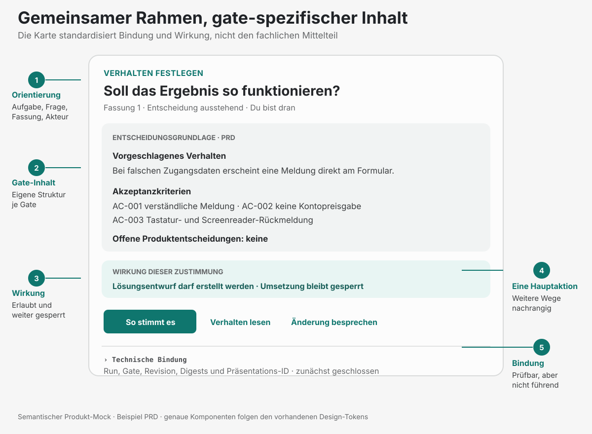

Der stabile Rahmen enthält nicht für jedes Gate denselben generischen Mittelteil. Die folgenden
Produkt-Mocks zeigen die jeweils passende fachliche Komponente:

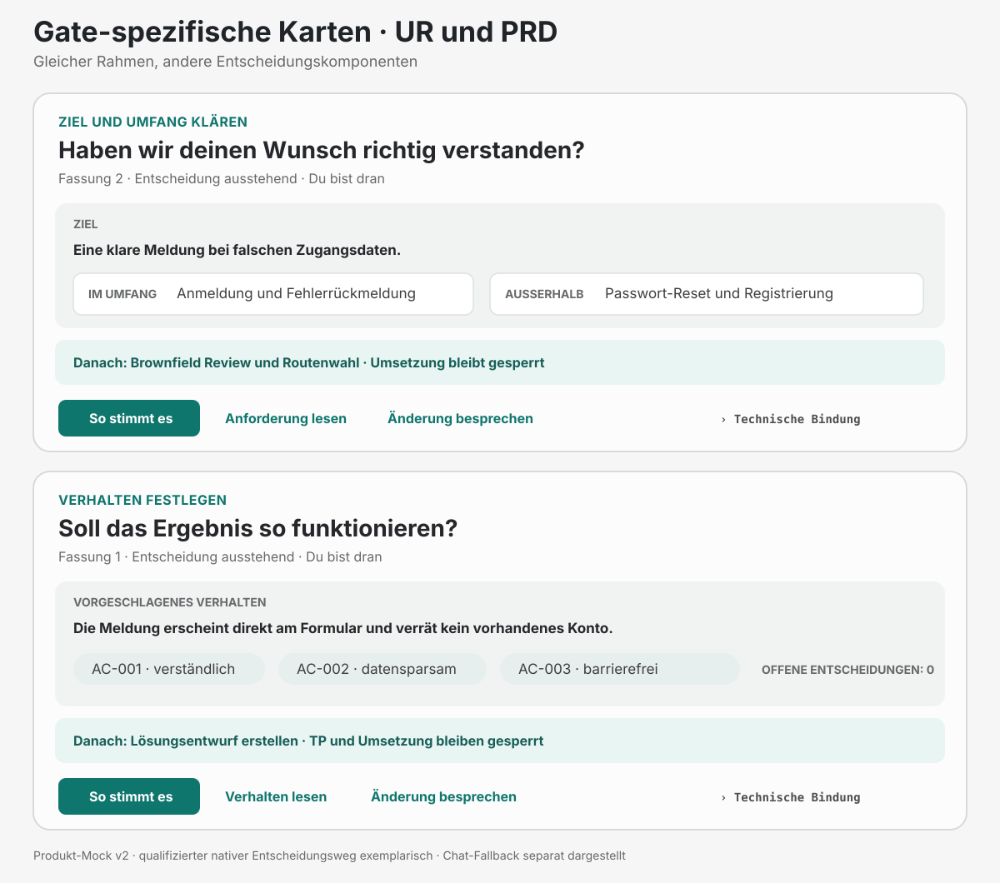

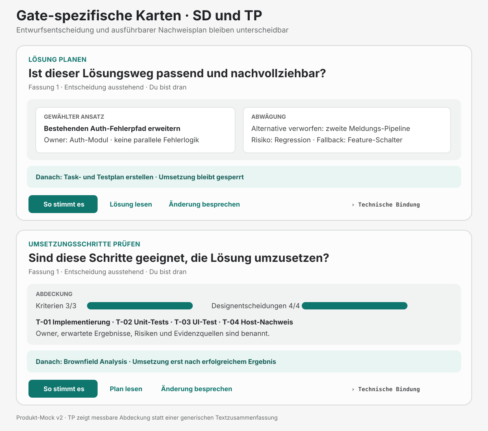

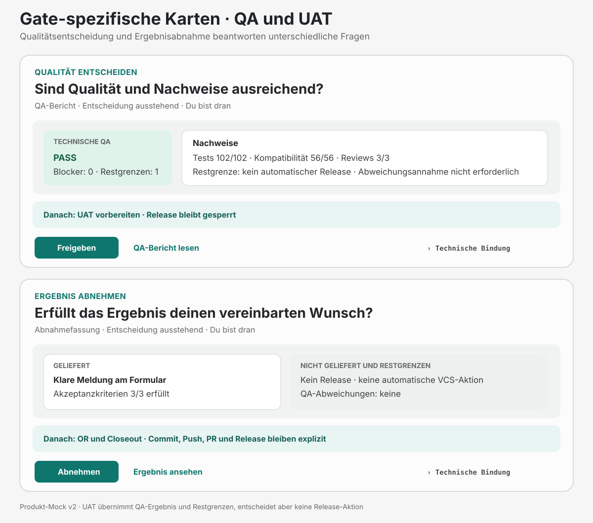

| Gate | Sichtbare Leitfrage | Zwingende Entscheidungszusammenfassung | Zustimmung erlaubt | Bleibt gesperrt |
|---|---|---|---|---|
| `UR` | Haben wir deinen Wunsch richtig verstanden? | Ziel, Umfang, Ausschlüsse, betroffene Nutzer und offene Klärungen | Brownfield Review und proportionale Routenwahl | PRD-Tiefe, Umsetzung, QA und Release |
| `PRD` | Soll das Ergebnis so funktionieren? | Produktverhalten, Akteure, Kriterien, Produktentscheidungen, UX-Auswirkungen und offene Punkte | Lösungsentwurf für die bestätigten Kriterien | TP, Umsetzung, QA und Release |
| `SD` | Ist dieser Lösungsweg passend und nachvollziehbar? | Architektur, Owner, Wiederverwendung, Schnittstellen, Alternativen, Risiken und Fallbacks | Task- und Testplan für den bestätigten Entwurf | Umsetzung, QA und Release |
| `TP` | Sind diese Schritte geeignet, die vereinbarte Lösung umzusetzen? | Aufgaben, Kriterien- und Designabdeckung, Tests, Nachweise, Reihenfolge, Owner und Risiken | Brownfield Analysis; danach Umsetzung nur bei deren erfolgreichem Ergebnis | Ungeprüfte Umsetzung, QA und Release |
| `QA` | Sind Qualität und Nachweise ausreichend? | Technische QA-Entscheidung, Test- und Reviewstand, Befunde, Restgrenzen und gegebenenfalls exakt vorgelegte Abweichung | UAT bei technischem Pass oder ausdrücklich zulässiger gebundener Abweichungsannahme | Behandlung eines `revise` als Pass, Release und automatische VCS-Aktionen |
| `UAT` | Erfüllt das Ergebnis deinen vereinbarten Wunsch? | Geliefert, bewusst nicht geliefert, Akzeptanzkriterien, Restrisiken und übernommene QA-Abweichungen | OR und Closeout | Automatischer Commit, Push, PR oder Release |

Die positive native Aktion folgt der Aufgabe: „So stimmt es“ für UR, PRD, SD und TP,
„Freigeben“ für einen entscheidungsreifen QA-Pass und „Abnehmen“ für UAT. Die kanonische
Chat-Antwort bleibt `Approval: <Gate>`. `revise`, `decline` und `cancel` sind getrennte
bewusste Ergebnisse; sie erteilen keine Berechtigung und werden nicht aus einer Diskussion,
einem Schließen der App oder ausbleibender Antwort abgeleitet.

MCP-App-UI und Portable Markdown verwenden dieselbe Gate-Matrix. Das App-Layout darf Inhalte
gliedern oder technische Bindungen nachrangig zeigen. Portable Markdown ordnet dieselben
Inhalte linear und zeigt die exakte Antwort unmittelbar, wenn das Gespräch der einzige
Entscheidungsweg ist. Eine geänderte Quelle oder Revision entwertet beide Darstellungen
gleichermaßen und verlangt eine neue Präsentation.

#### QA-Abweichung und Übergabe an UAT

QA ist das einzige menschliche Gate mit zwei fachlich verschiedenen positiven Situationen:
gewöhnliche Zustimmung zu einem technischen QA-Pass und ausdrückliche Annahme einer dafür
zugelassenen Abweichung. Die zweite Situation ändert die technische QA-Entscheidung nicht.
Die Karte muss Scope, Risiko, Folgen, Folgearbeit und Owner der Abweichung vollständig zeigen.
UAT und OR übernehmen diese Angaben sichtbar.

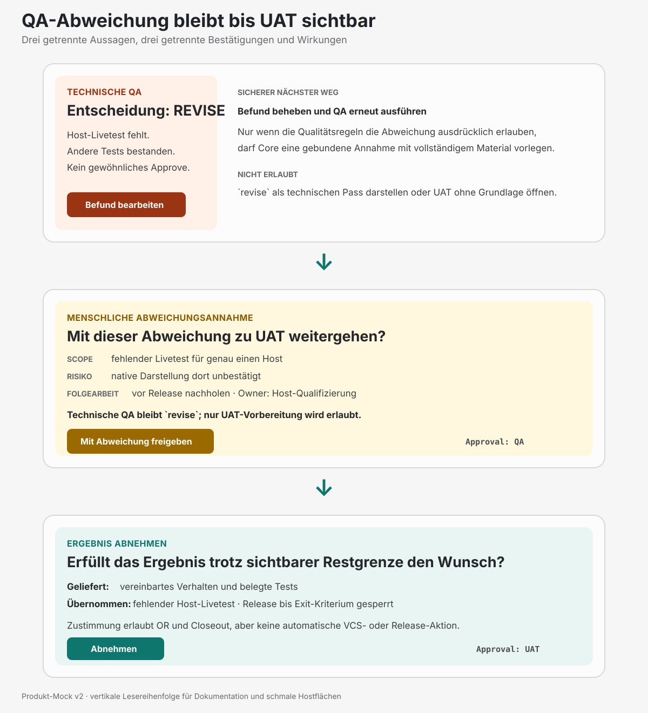

Die [Quelldokumentation der Produkt-Mocks](mockups/human-gate-mocks-v2.md) beschreibt Zweck,
Grenzen und Beispieldaten. Die SVGs konkretisieren Informationshierarchie und Zustände; sie
belegen weder fertige Komponenten noch einen qualifizierten nativen Entscheidungsweg. Die
frühere [v1-Systemübersicht](mockups/human-gate-mocks-v1.md) bleibt historisch nachvollziehbar.

Im schmalen Ablaufbalken können die Kurzformen „Ziel klären“, „System untersuchen“,
„Verhalten festlegen“, „Lösung planen“, „Umsetzen“, „Prüfen“ und „Abnehmen“ stehen. Der
Orientierungskopf nennt die vollständige aktuelle Aufgabe. „Umsetzungsschritte prüfen“ ist
bei Bedarf ein eigener Punkt innerhalb der Planung. Die tatsächliche Folge und Zuständigkeit
kommen aus dem ausgewählten Run; der Balken führt keine zusätzlichen Gates ein und lässt
keine erforderliche Entscheidung aus. Technische Werte und gespeicherte Artefakte werden
durch die verständlichen Anzeigenamen nicht umbenannt.

Die Leseaktion folgt dem Gegenstand: „Anforderung lesen“, „Verhalten lesen“, „Lösung lesen“,
„Plan lesen“, „QA-Bericht lesen“ oder „Ergebnis ansehen“. „Änderung nötig“ führt zur Klärung
des Änderungswunsches und erfasst keine Zustimmung. Vor einer Bestätigung muss die Karte klar
benennen, welche Fassung angenommen wird und was danach erlaubt ist. Die Beschriftungen
aktivieren keine technisch nicht verfügbare Aktion. Ist der native Bestätigungsweg nicht
qualifiziert und der Chat der einzige Entscheidungsweg, steht die exakte Antwortformel direkt
beim Handlungshinweis. Bei verfügbarem qualifiziertem Klickweg darf sie in Details stehen.
Nach bestätigter Speicherung lautet die Rückmeldung zum Beispiel „Anforderung bestätigt ·
Fassung 2“; im Verlauf wird dieselbe Bezeichnung verwendet.

## Gestaltungsgrundlage des vorhandenen Cockpits

Die Mockups übernehmen die Gestaltung des bestehenden Cockpits und ergänzen sie um das
gemeinsame Bedienmodell. Grundlage sind die aktuellen Komponenten und Styles unter
`packages/control-ui/src` sowie die von Pages gemeinsam verwendeten Designwerte. Der
Quellabgleich erfolgte am 12. Oktober 2026. Die [gespeicherte gerenderte Referenz](mockups/reference-cockpit-expanded-20261010.png)
zeigt eine Prüf- und Beispielansicht vom 10. Oktober; sie belegt ihren damaligen Bildstand.
Eine aktuelle native Hostansicht war beim Abgleich nicht geöffnet.

| Merkmal | Bestehende Gestaltung | Verwendung in den neuen Mockups |
|---|---|---|
| Schrift | Lokal geladene Inter für Oberfläche und Texte; JetBrains Mono für technische Angaben | Klare Hierarchie und dieselbe Schriftanmutung; technische Angaben stehen in Herkunft und Details |
| Helle Lesefläche | `#fcfcfc`, ohne Schatten | Ruhige Fläche im eingebetteten Cockpit und in der Dokumentansicht |
| Arbeitsbereich | `#f6f6f6` | Aktueller Schritt und erwartete Handlung liegen auf einer dezenten grauen Fläche |
| Text und Linien | Text `#3c3e40`, Nebenangaben `#66686a`, Linien `#e8e8e8` | Inhalt und Orientierung führen; Linien gliedern ohne zusätzliche farbige Karten |
| Aktionen | Primärbutton und semibold Leselinks in `#0f766e`; sekundäre Aktionen transparent | Eine klare Hauptaktion; Lesen, Verlauf und Navigation erhalten den bestehenden Linkstil |
| Branding | Bestehendes quadratisches AGDF-Logo; dezentes Race-Control-Motiv im Kopf | Branding innerhalb der AGDF-Karte beziehungsweise der großen Appfläche |
| Kopf | Mindestens 72px, Logo 36px; Motiv in Hell etwa 14 Prozent Deckkraft, im Dokumentkopf 8 Prozent | Kompakter wiedererkennbarer Kopf auf beiden Flächen; das Motiv bleibt hinter dem Kopftext |
| Typografische Größen | Kompakttext 14px, Lesetext 16px, Kopf 18px, Schritttitel 20px; Dokumenttitel 24px | Die kompakte Karte bleibt dicht und lesbar; das große Dokument erhält mehr Leseraum |
| Abstände und Radien | Kompakt 16px Innenabstand, größere Arbeitsbereiche 24px; Flächenradius 16px, Aktionen 8px | Gleiche Formensprache mit an die verfügbare Fläche angepasstem Platz |
| Bedienung | Wichtige Aktionen mindestens 44px hoch; Umbruch in schmalen Flächen | Aktionen bleiben erreichbar und werden bei geringer Breite auf mehrere Zeilen verteilt |

Die exakten Designwerte und Schriften bleiben durch die [Pages-Tokens](../../pages/src/design/tokens.json),
[Fonts](../../pages/src/styles/fonts.css), [Flächen und Links](../../pages/src/styles/surfaces.css),
[Aktionen](../../pages/src/styles/actions.css) sowie [Cockpit-Theme](../../packages/control-ui/src/theme.css)
und [Branding](../../packages/control-ui/src/brand.css) bestimmt. Imagegen veranschaulicht ihre
Verwendung als Rasterentwurf. Die dunkle Darstellung bleibt durch die vorhandenen Theme-Regeln
definiert; diese Mockup-Serie zeigt die helle Variante.

### Chatfläche und große Appfläche

Der Host besitzt Gespräch, Eingabefeld und äußere Navigation. AGDF besitzt ausschließlich den
eingebetteten Inhalt. Die Mockups markieren diese Fläche mit „Von AGDF gestaltet“. Das
bestehende Codex-Gespräch erscheint als beschrifteter Platzhalter. Nachrichten, Eingabefeld,
Profilmenü und Host-Navigation werden nicht als selbst gestaltete AGDF-Oberfläche nachgebaut.

| Fläche | Bestehende Grundlage | Ausgestaltung des Zielkonzepts |
|---|---|---|
| Im Chat | `CompactCockpit` ist einspaltig und nimmt die verfügbare Breite ein. Seine Höhe folgt dem Inhalt; der Chat übernimmt das Scrollen. | Kurze Orientierung, aktuelle Entscheidungskarte und passende Aktionen; weitere Inhalte über Leselinks und geschlossene Details |
| Groß im Host | Der eingebettete Adapter blendet die Browser-Seitenleiste aus. Der Brand-Kopf ist bereits sticky. | Run-Orientierung und Handlungserwartung bleiben zusätzlich sichtbar; der aktuelle Inhalt scrollt darunter |
| Dokument groß | Eine gemeinsame zentrierte Lesefläche mit maximal 80ch, ohne weitere Rahmen um den Originaltext | Der aktuelle Gate-Bezug bleibt über dem Lesebereich; der Rückweg führt zur konkreten Entscheidung |
| Hub groß | Bestehende Übersicht, Bereichsauswahl, Suche und zeilenweise Einträge | Suche über den definierten Run-Bestand; Verlauf im verfügbaren Panel unterhalb der Liste, statt einer zusätzlich gedrängten Spalte |

Das große Cockpit rechts ist das angestrebte Bedienlayout. Der heutige Adapter fordert je nach
verfügbarer Host-Fähigkeit `fullscreen` oder `pip` an und prüft die Bestätigung. Diese Anforderung
garantiert keine bestimmte Position im Host. Die Einbindung in den rechten Bereich und der
Erhalt des Gesprächs müssen deshalb bei der konkreten Host-Qualifizierung beobachtet werden.
Die permanente Gate-Orientierung ist eine Ergänzung zum bereits vorhandenen sticky Brand-Kopf.

Die vierte Mockup-Serie übernimmt die klare Trennung von Host und AGDF-Fläche aus der
dritten Serie. Sie verwendet verständliche Aufgaben und Entscheidungsfragen in allen Ansichten. Frühere Bilder bleiben
als Entwürfe erhalten. Die Anordnung der Flächen im Bild ist eine Erläuterung des Konzepts,
kein Nachweis einer von AGDF steuerbaren Codex-Fensteraufteilung.

## Integration in den bestehenden Codex Chat

Ein Run ist ein fachlicher Arbeitsumfang. Ein Codex-Chat ist das vom Host geführte Gespräch.
Das Öffnen eines Runs erzeugt keinen neuen Chat. Der verwendete App-Adapter bietet auch keine
eigene Gesprächsoberfläche, kein Spiegeln der Chatnachrichten und kein Bearbeiten des nativen
Codex-Eingabefelds. Der Anwender diskutiert im vorhandenen Codex-Gespräch weiter.

| Bestandteil | Was AGDF gestalten oder ausführen kann | Was beim Host bleibt |
|---|---|---|
| Kompakte Entscheidungskarte | Run, Schritt, Fassung und Handlungserwartung; begrenzte Lese- und qualifizierte Entscheidungsaktionen | Position im Gespräch, übrige Nachrichten, Eingabefeld und Scrollen des Chats |
| Groß öffnen | Einen angebotenen Anzeigemodus über die App-Bridge anfordern und die Bestätigung prüfen | Verfügbare Modi, Position, Breite und tatsächliche Fensteraufteilung |
| Dokument lesen | Registrierte Quelle laden, innerhalb der App anzeigen und zur gleichen Entscheidung zurückkehren | Zugang zum nativen Gespräch und dessen Bedienung |
| Kontext übergeben | Gebundene Quellen prüfen und bei angebotener `updateModelContext`-Capability ausdrücklich veröffentlichen | Bereitstellung der Capability und bestätigte Aufnahme des Kontexts |
| Nachricht senden | Bei angebotener `message.text`-Capability eine ausdrücklich beauftragte Nachricht an den vorhandenen Gesprächskontext vermitteln | Annahme und Darstellung der Nachricht sowie die tatsächliche Fortsetzung im Host |
| App schließen | Eigene Lesesitzung beim Host-Teardown stilllegen | Schließen des Panels, Tabs oder anderen Hostcontainers |
| Run im Hub auswählen | Den ausgewählten Run lesen und seine Quellen innerhalb der App öffnen | Gesprächswechsel oder Anlegen eines weiteren Codex-Chats |

Der jetzige Adapter verwendet [Host-Capabilities und Anzeigemodus](../../packages/control-ui/src/mcp/EmbeddedEntry.tsx),
die [gebundene Kontext- und Nachrichtenübergabe](../../packages/control-ui/src/mcp/handoff-port.ts)
und eine [eigene Decision-Ansicht](../../packages/control-ui/src/mcp/DecisionCard.tsx).
„Groß öffnen“ verlangt deshalb eine verfügbare Host-Fähigkeit; „rechts öffnen“ ist keine
zugesicherte API-Wirkung. Das Mockup zeichnet auch kein Schließen-X innerhalb des AGDF-Kopfs.
Eine Rückkehr zum Run oder zur Entscheidung ist davon getrennte Navigation innerhalb der App.

### Entscheidung und Diskussion bei fehlender Klickqualifizierung

Die aktuellen Mockups zeigen einen ausdrücklich unqualifizierten Klickweg. Das Lesen ist
verfügbar; „So stimmt es“ bleibt deaktiviert. Die Oberfläche erklärt: „Bestätigung hier noch
nicht verfügbar. Entscheide im bestehenden Codex-Chat.“ Die erforderliche exakte Antwort
steht in den gerenderten v4-Bildern noch unter „Details zur Entscheidung“; bei einer Anforderung
ist sie weiterhin `Approval: UR`. Für die nächste Serie steht sie unmittelbar beim Hinweis
auf das Gespräch, solange dieses der einzige verfügbare Entscheidungsweg ist. Die Antwort
erfolgt im vorhandenen Codex-Chat und wird über die bestehende Bindung geprüft. Die neue
Position ändert die Antwortregel nicht. Das Anzeigen der Formel erzeugt keine Antwort und
keine Freigabe. Änderungswünsche und Ablehnung werden
im bestehenden Gespräch geklärt. Der derzeitige UI-Code rendert nur den Freigabebutton;
separate Klickaktionen für Änderung und Ablehnung sind eine noch umzusetzende Ergänzung.

Bei einem später qualifizierten Klickweg kann die App die erlaubte Entscheidung direkt
vermitteln. Diese Fähigkeit bleibt an den nachgewiesenen Host, die aktuelle Fassung und die
bestehende Core-Operation gebunden. MCP-UI-Unterstützung allein aktiviert sie nicht.

### Run Auswahl und Gesprächskontext

Ein im Hub geöffneter Run ist zunächst eine Leseauswahl. Sie ersetzt nicht automatisch den
Auftrag, den der Agent im Codex-Chat gerade bearbeitet. Soll an einem anderen Run weitergearbeitet
werden, muss die ausdrückliche Beauftragung diesen Run und sein Ziel nennen. Der Agent bindet
die Arbeit frisch an dessen aktuellen Kontrollstand. Eine bestätigte Kontextübergabe kann die
Zuordnung unterstützen; ein bloßer Klick auf einen Listenpunkt bewirkt sie nicht.

„Kontext übergeben“ und „Nachricht senden“ sind getrennte Wirkungen. Eine Bestätigung der
Kontextaufnahme ist noch keine gesendete Frage und keine Antwort der KI. Ohne passende
Capability bleibt die Quelle lesbar; die UI erklärt die Grenze und verweist auf das bestehende
Gespräch. Sie verspricht weder ein automatisch geöffnetes Chatfenster noch ein vorausgefülltes
oder fokussiertes Codex-Eingabefeld.

### Einordnung der offiziellen UI Dokumentation

Der [OpenAI-Quickstart](https://developers.openai.com/plugins/build/app-quickstart#introduction)
beschreibt MCP-Werkzeuge für ChatGPT und Codex, seine optionale iframe-UI jedoch ausdrücklich
für ChatGPT. Die [UI-Guidelines](https://developers.openai.com/plugins/concepts/ui-guidelines)
empfehlen dort kompakte Inline-Karten, wenige Hauptaktionen, keine verschachtelten Scrollbereiche
und keine duplizierten Chat-Eingaben. Diese Hinweise unterstützen die Gestaltung; sie sind kein
Beleg dafür, dass Codex dieselben Hostflächen, Gesprächsübergaben oder Panel-Erweiterungen anbietet.
Die tatsächliche Codex-Integration benötigt jeweils eigene native Beobachtung der konkreten Fassung.

## Das Konzept in fünf Ansichten

Julia arbeitet im Projekt **Kundenportal**. Sie möchte die vorhandene Anmeldung verbessern:
Bei falschen Zugangsdaten soll eine verständliche Meldung erscheinen. Die folgende Geschichte
zeigt, wie sie den Auftrag formuliert, die Anforderung prüft, eine konkrete Formulierung klärt
und die überarbeitete Fassung freigibt. Anschließend findet sie das Vorhaben im Hub wieder.

Die Mockups zeigen ein gemeinsames UI-Zielkonzept mit erfundenem Projekt, Nutzerin und
Run-Verlauf. Sie sind mit Imagegen erzeugte Layoutentwürfe mit markierter AGDF-Fläche und einem
Platzhalter für das bestehende Codex-Gespräch. Der Platzhalter ist keine zusätzliche Chat-UI.
Die große Appfläche ist im Diagramm seitlich angeordnet; ihre tatsächliche Position bestimmt
der Host. Der Ablaufbalken fasst den beispielhaften strukturierten Weg zusammen.
Die konkrete Folge von Schritten und Gates kommt weiterhin aus dem ausgewählten Run.

Die fünf gerenderten Bilder zeigen ausschließlich das Format MCP-App-UI. Sie sind kein
vollständiger Nachweis des Zwei-Format-Konzepts. Die folgende Portable-Markdown-Darstellung
verwendet deshalb denselben Entscheidungsgegenstand wie die erste App-Ansicht. Sie ist kein
sechster fachlicher Zustand, sondern der zweite Renderer derselben gebundenen Präsentation.

### Dieselbe Entscheidung als Portable Markdown

Wenn MCP-App-UI nicht verfügbar oder nicht bestätigt angezeigt ist oder der Host ausdrücklich
Portable Markdown bevorzugt, muss der vollständige Entscheidungsgegenstand im Gespräch
verständlich bleiben. Das folgende Strukturbeispiel zeigt die inhaltliche Entsprechung zur
ersten App-Ansicht; reale Revisionen und Digests werden vollständig aus der gebundenen
Präsentation übernommen.

```text
## Anmeldung verbessern

**Aufgabe:** Ziel und Umfang klären
**Fassung:** 1 · Entscheidung ausstehend
**Du bist dran:** Prüfe Ziel und Umfang dieser Fassung.

### Haben wir deinen Wunsch richtig verstanden?

- Ziel: Klare Meldung bei falschen Zugangsdaten.
- Außerhalb: Passwort-Reset und Registrierung.
- Danach erlaubt: Bestehendes System untersuchen.
- Noch nicht erlaubt: Umsetzung.

### Zulässige Antwort

Antworte im bestehenden Gespräch exakt mit:
`Approval: UR`

### Bindung

- Run: `<run-id>`
- Gate: `UR`
- Revision: `<vollständige revision-id>`
- Dokument-Digest: `sha256:<vollständiger digest>`
```

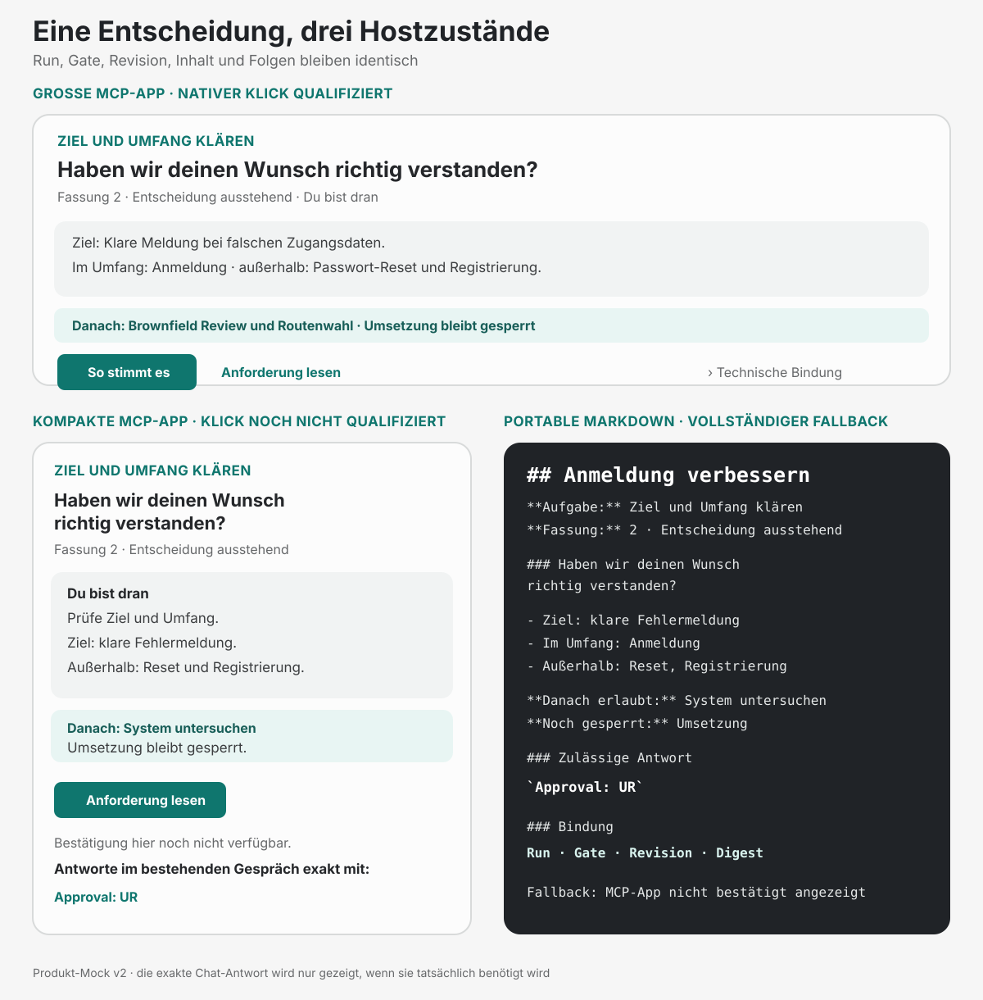

Portable Markdown zeigt die exakte Antwort unmittelbar, wenn das Gespräch der einzige
verfügbare Entscheidungsweg ist. Es darf sie nicht ausschließlich hinter einer
hostabhängigen Aufklappfunktion verbergen. Die menschenverständliche Aufgabe führt weiterhin;
technische Bindungsangaben stehen danach kompakt und vollständig. Unterstützt eine konkrete
Entscheidung ausschließlich einen stärker abgesicherten Eingabekanal, beschreibt Portable
Markdown die Blockade und den erforderlichen Weg, statt eine nutzbare Chat-Antwort vorzutäuschen.

### Ansicht 1 Die Anforderung erscheint im Gespräch

Julia schreibt im Chat: „Verbessere die Anmeldung. Bei falschen Zugangsdaten soll eine klare
Meldung erscheinen.“ Nach der erforderlichen Klärung liegt eine konkrete Anforderung zur
Entscheidung vor. AGDF zeigt das kompakte Run-Cockpit direkt als Teil des Gesprächs.

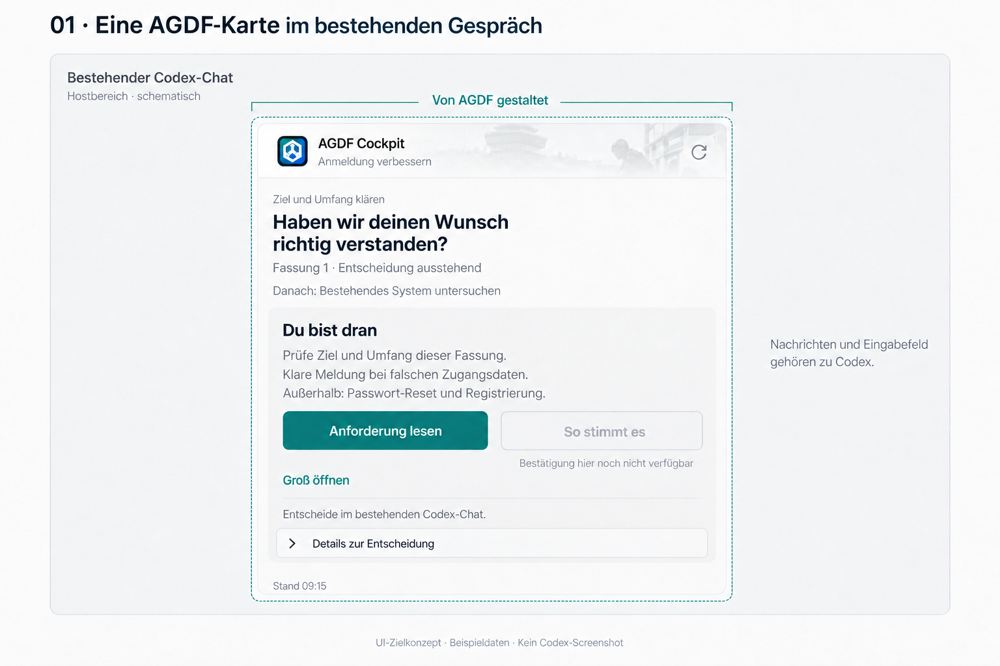

**Was Julia sofort erkennt:** Es geht um „Anmeldung verbessern“, sie klärt Ziel und Umfang und
ist selbst dran. Die Karte benennt Ziel, Umfang und den nächsten Schritt nach einer Freigabe.
Die Frage „Haben wir deinen Wunsch richtig verstanden?“ führt die Karte.
„Anforderung lesen“ ist die Hauptaktion. „Groß öffnen“ fordert die ausführliche Darstellung
desselben Runs an, wenn der Host diesen Modus anbietet. Im gezeigten Zustand ist die
Klickfreigabe deaktiviert. Julia entscheidet durch die bewusste Antwort im vorhandenen Codex-Chat.

Julia erreicht die Entscheidung direkt aus ihrem Auftrag. Vorhaben und aktueller
Entscheidungsgegenstand sind unmittelbar verbunden.

### Ansicht 2 Der Host stellt die große Appfläche bereit

Julia möchte die Anforderung genauer ansehen. Sie wählt „Groß öffnen“. Nach Bestätigung des
Host-Modus erhält das Cockpit mehr Platz für die Entscheidungsgrundlage. Der schematische
Gesprächsbereich erinnert daran, dass die Diskussion weiterhin zu Codex gehört. Die Zeichnung
sagt nicht zu, dass Gespräch und App in jedem Modus gleichzeitig nebeneinander sichtbar bleiben.

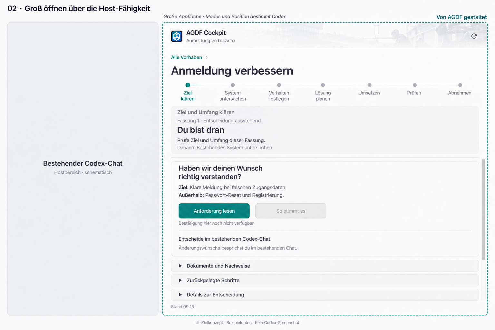

**Was beim Vergrößern erhalten bleibt:** Vorhaben, Anforderungsfassung und Entscheidungsgegenstand.
Der Orientierungskopf zeigt „Ziel und Umfang klären“, „Du bist dran“ und die
konkrete Erwartung „Prüfe Ziel und Umfang dieser Fassung“. Der Ablaufbalken macht die Position
im Run erkennbar. Unterhalb liegen der aktuelle Inhalt sowie die Zugänge zu Dokumenten und Verlauf.

**Was der zusätzliche Platz ermöglicht:** Die erwartete Handlung bleibt sichtbar, während
Julia den Inhalt liest. Der Lesezugang und die Art ihrer bewussten Entscheidung stehen bei der aktuellen Fassung. „Danach“
erklärt den möglichen anschließenden Schritt. „Alle Vorhaben“ ist der Zugang zum Hub. Der
Scrollbereich beginnt unterhalb der Orientierung; der aktuelle Gate-Bezug bleibt stehen.

### Ansicht 3 Das Dokument wird gelesen ohne den Entscheidungsbezug zu verlieren

Julia fragt: „Ist eindeutig festgelegt, welche Meldung angezeigt wird?“ Sie liest den
betreffenden Abschnitt. Die vorgeschlagene Meldung „Anmeldung nicht möglich“ ist ihr zu allgemein.

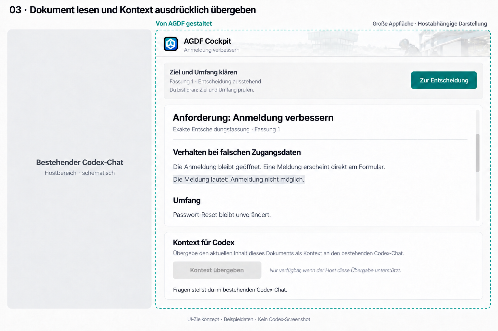

**Während des Lesens bleibt Julia orientiert:** Oberhalb des scrollbaren
Dokuments bleiben Run, Schritt, Fassung und erwartete Handlung sichtbar. Julia sieht sowohl
den konkreten Text als auch den Grund, weshalb sie ihn liest. „Zur Entscheidung“ führt zurück
zur Karte. Der Bereich „Kontext für Codex“ erklärt die ausdrücklich auszulösende Übergabe.
Sie ist im dargestellten Zustand nicht bestätigt und daher deaktiviert. Julia stellt ihre
Frage im bestehenden Codex-Chat; das Mockup baut kein zusätzliches Eingabefeld nach.

Die dezente Auswahl lenkt den Blick auf die Stelle, über die Julia spricht. Die bestehende
Prüfung bestimmt, ob die Frage vor einer Freigabe geklärt werden muss.

Julia konkretisiert im Chat: „Bitte verwende: E-Mail oder Passwort ist nicht korrekt.“ AGDF
überarbeitet die Anforderung und legt Fassung 2 erneut zur Entscheidung vor. Die Zustimmung
zu Fassung 1 würde diese neue Fassung nicht freigeben.

### Ansicht 4 Die Entscheidung ist gespeichert und der nächste Schritt ist klar

Julia prüft die neue Formulierung und gibt Fassung 2 im bestehenden Codex-Chat bewusst frei.
Nach bestätigter Erfassung zeigt das Cockpit das Ergebnis und die nächste zulässige Arbeit.

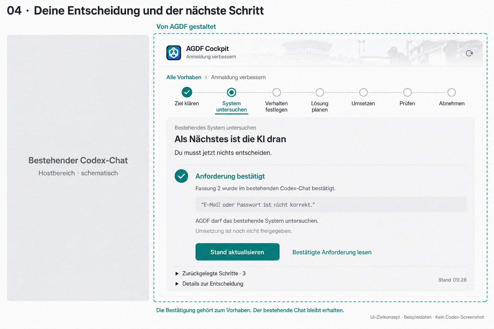

**Was Julia jetzt weiß:** Ihre Entscheidung ist gespeichert, und sie gehört zu Fassung 2.
Der Orientierungskopf wechselt von „Ziel und Umfang klären“ zu „Bestehendes System untersuchen“.
Die Rückmeldung lautet „Anforderung bestätigt“ und benennt die tatsächlich bestätigte Fassung.
„Als Nächstes ist die KI dran“ beschreibt die nächste Aufgabe. Der ursprüngliche Auftrag
umfasst in diesem Beispiel die zulässige Fortsetzung. Eine weitere Beauftragung wird deshalb
nicht verlangt. Die Karte behauptet noch keine beobachtete laufende Ausführung; „Stand
aktualisieren“ liest den aktuellen Kontrollstand neu.

Die Karte erklärt außerdem die Grenze der Entscheidung: Umsetzung ist noch nicht freigegeben.
An die Stelle der alten Entscheidungsbuttons treten bestätigter Effekt, Lesen der freigegebenen
Fassung und die passende Anschlussaktion. Die zurückgelegten Schritte bleiben darunter zugänglich.

### Ansicht 5 Das Vorhaben wird im Hub wiedergefunden und sein Verlauf geöffnet

Später möchte Julia wissen, wie weit die Arbeit ist und welche Fassung sie freigegeben hat.
Sie öffnet den Hub und sucht nach „Anmeldung“. Neben ihrem Vorhaben erscheint ein zweiter Run,
bei dem sie das Verhalten der barrierefreien Anmeldung prüfen und bestätigen soll.

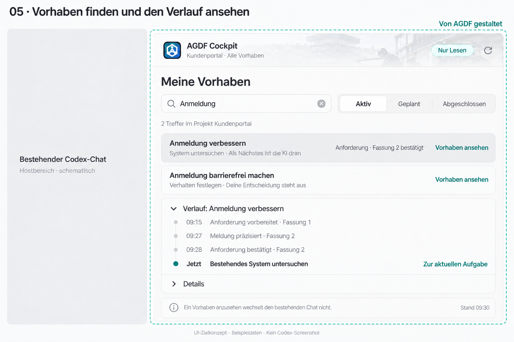

**Was die Übersicht beantwortet:** Welche passenden Runs gibt es, an welchem Schritt stehen
sie und wer ist jeweils dran? Planung, abgeschlossene Arbeit und aktive Runs sind durch
die Bereichsauswahl unterscheidbar. Der Hub bietet den Zugang zur Entscheidung im jeweiligen
Run-Cockpit; er entscheidet kein Gate allein durch Auswahl eines Eintrags.

**Was der geöffnete Verlauf beantwortet:** Unterhalb der Liste sieht Julia die vorbereitete Anforderung,
die Präzisierung und die gespeicherte Freigabe von Fassung 2. Der aktuelle Schritt steht in
einem eigenen Bereich unter dem historischen Verlauf. „Vorhaben ansehen“ führt zur heutigen
Aufgabe. Suche und Auswahl bleiben bei der Rückkehr erhalten. Der Wechsel öffnet keinen
neuen Codex-Chat und ersetzt keinen laufenden Auftrag. Die Verlaufsvorschau im Hub
ist dieselbe fachliche Historie, die im Run-Cockpit über „Verlauf“ erreichbar ist.

### Produkt-Mock-Serie v2

Die v4-Bilder bleiben als gerenderter Stand vom 12. Oktober 2026 erhalten. Die Produkt-Mock-
Serie v2 übernimmt ihre visuelle Richtung, trennt aber gemeinsame Kartenanatomie,
gate-spezifische Inhalte, Darstellungsformate und Recovery-Zustände.

| Ansicht oder Zustand | Umsetzung in v2 |
|---|---|
| Alle App-Ansichten | Der sichtbare Hostname stammt aus der bestätigten Hostidentität. Ohne geeigneten Anzeigenamen lautet der neutrale Text „bestehendes Gespräch“ beziehungsweise „Host“. Codex darf als beschriftetes Beispiel erscheinen, aber nicht fest in die gemeinsame App-Terminologie eingebaut werden. |
| Kompakte Entscheidungskarte | Die Karte priorisiert Frage, Fassung, Wirkung und genau eine verfügbare Hauptaktion. Ein deaktivierter Entscheidungsbutton konkurriert nicht optisch mit „Anforderung lesen“. Ist der Chat der einzige Entscheidungsweg, steht die exakte zulässige Antwort unmittelbar beim Hinweis auf das Gespräch. |
| Große Appfläche | Der Ablaufbalken wird aus der tatsächlichen Route des Runs gebildet. Nicht anwendbare Schritte werden nicht als erwartete Gates dargestellt. Bei vielen Schritten bleibt die aktuelle Aufgabe lesbar, ohne sieben feste Phasen vorauszusetzen. |
| Dokument und Kontext | „Kontext für Codex“ wird hostabhängig oder neutral beschriftet. Die Ansicht unterscheidet angeforderte Übergabe, bestätigte Kontextaufnahme und eine tatsächlich gesendete Nachricht. |
| Bestätigung und Fortsetzung | „Stand aktualisieren“ wird nur gezeigt, wenn eine bewusste Neuladung erforderlich ist, und heißt dann „Aktuellen Stand laden“. Ein passiver Wartezustand besitzt keine dominante Scheinaktion und behauptet keine laufende KI-Arbeit. |
| Hub und Verlauf | Die ausgewählte Zeile ist zusätzlich zu Farbe und Fläche semantisch erkennbar. Suchumfang, Datenquelle und Unvollständigkeit bleiben zugänglich. Der Verlauf trennt historischen Stand und aktuelle Aufgabe. |
| Portable Markdown | Mindestens ein Mock bildet denselben gebundenen Entscheidungsgegenstand wie eine App-Ansicht vollständig als Portable Markdown ab. Reihenfolge, Folgen und zulässige Antwort werden formatübergreifend verglichen. |
| Recovery | Eigene Zustände zeigen mindestens geänderte Fassung, unklare Speicherung und den sichtbaren Wechsel von nicht bestätigter MCP-App-Anzeige zu Portable Markdown. Keine dieser Situationen erhält eine Erfolgsgestalt. |
| Zugänglichkeit | Hilfs- und Metatexte erfüllen die Kontrastanforderungen; die Karte bleibt bei 200 Prozent Vergrößerung und schmaler Hostfläche ohne horizontales Scrollen bedienbar. Deaktivierung wird nicht nur über geringe Deckkraft vermittelt. |

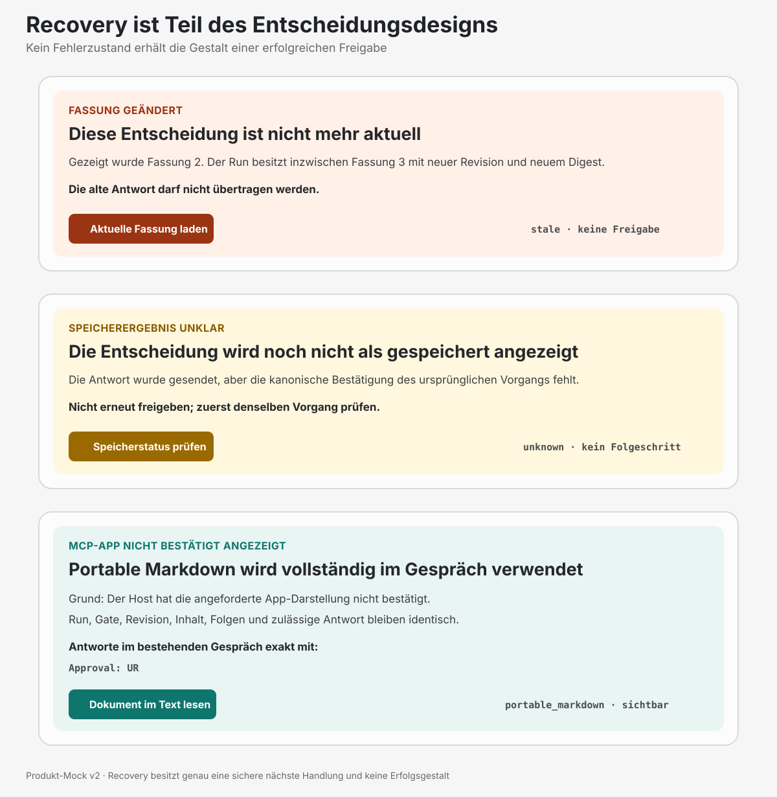

Die v2-Serie verdichtet diese Zustände bewusst nicht in einem einzigen Bild. Normalweg,
Portable-Markdown-Äquivalenz und Recovery bleiben getrennt prüfbar. Dokumentationsrahmen wie
„Von AGDF gestaltet“ und der schematische Hostbereich erklären die Architektur; sie sind
keine Bestandteile der ausgelieferten App. Alle v2-Dateien und ihre Grenzen stehen in der
[Quelldokumentation der Produkt-Mocks](mockups/human-gate-mocks-v2.md).

### Was in allen Ansichten gleich bleibt

Die Geschichte führt immer denselben Beispiel-Run weiter. Inhalt und Entscheidungsgrundlage
ändern sich nur durch die ausdrücklich gezeigte Überarbeitung und bestätigte Entscheidung.
Der Wechsel der Fläche allein verändert weder Fassung noch Freigabe.

| Wechsel | Erhaltene Orientierung | Veränderung für den Anwender |
|---|---|---|
| Chatkarte zur großen Ansicht | Run, aktuelle Fassung und erwartete Entscheidung | Mehr Platz; dauerhafte Orientierung innerhalb der App |
| Entscheidungskarte zum Dokument | Schritt und genaue Entscheidungsgrundlage | Original lesen und einzelne Stellen klären |
| Fassung 1 zur überarbeiteten Fassung 2 | Vorhaben und Änderungswunsch | Neue konkrete Fassung; erneut erforderliche Entscheidung |
| Entscheidung zum nächsten Schritt | Gespeicherte Freigabe und Umfang | Bestätigter Effekt; passende nächste Arbeit statt alter Entscheidungsaktionen |
| Hub-Verlauf zur aktuellen Aufgabe | Ausgewählter Run und nachvollziehbare Historie | Im Cockpit wieder an der heutigen Aufgabe weiterarbeiten |
| MCP-App-UI zu Portable Markdown | Run, Gate, Revision, Digests, Zusammenfassung, Folgen und zulässige Antwort | Andere Darstellung und Interaktion; keine andere fachliche Bedeutung |

Die folgenden Abschnitte vertiefen die Bedienung und ihre architektonischen Zuständigkeiten.
Die [Prompts der verständlichen Mockups](mockups/07-ui-prompts-v4.md) halten die Bildvorgaben
und gezielten Präzisierungen der gerenderten v4-Serie fest. Die dortige Vorgabe, die exakte
Antwort stets hinter geschlossenen Details zu halten, ist für einen allein verfügbaren
Chat-Entscheidungsweg durch die heutige Schärfung ersetzt. Die früheren drei Serien bleiben
historische Entwürfe; ihre gelöschten Prompt-Dateien werden nicht wiederhergestellt. Frühere
Beschriftungen sind keine Vorgaben für die aktuelle Oberfläche.

### Zuordnung der Mockups zum heutigen Implementierungsstand

Die Mockups beschreiben das gewünschte Nutzererlebnis. Die folgende Zuordnung zeigt für jede
Ansicht die bereits vorhandene Grundlage und die konkrete Weiterentwicklung. Dadurch wird
erkennbar, welche Teile wiederverwendet werden können und wo ein vollständiger Nutzerweg fehlt.
**Abgleich: 12. Oktober 2026, aktueller Repository-Arbeitsstand einschließlich uncommitteter
Änderungen.** Die Zuordnung ist ein Quellabgleich; sie bestätigt keine aktualisierte Installation
oder native Codex-Darstellung dieser Fassung.

| Zielansicht im Mock | Heutige Entsprechung | Bereits vorhandene Grundlage | Abstand zum Mock |
|---|---|---|---|
| [1 · Entscheidungskarte im Chat](mockups/01-chat-karte-v4.png) | [Kompaktes Lese-Cockpit](../../packages/control-ui/src/mcp/CompactCockpit.tsx) und separate [Entscheidungskarte](../../packages/control-ui/src/mcp/DecisionCard.tsx) | Das Lese-Cockpit bietet Branding, Vorhaben, Arbeitsstand und Leseaktionen. Die Entscheidungskarte bietet den gebundenen Vorschlag, Dokumentzugang, Freigabe-Verfügbarkeit und Entscheidungszustände. | Die gemeinsame Darstellung beider Funktionen fehlt. Aufgabe, Frage und Aktionen verwenden noch nicht durchgängig die neuen Begriffe. Die exakte Antwortformel steht heute sichtbar im Entscheidungstext, statt nur in Details. |
| [2 · Großes Run-Cockpit](mockups/02-grosse-appflaeche-v4.png) | [Große Leseansicht](../../packages/control-ui/src/App.tsx), [Arbeitsstand](../../packages/control-ui/src/WorkStep.tsx) und [Host-Adapter](../../packages/control-ui/src/mcp/EmbeddedEntry.tsx) | Run-Detail, Dokumentnavigation, Aktualisierung und ein dauerhaft sichtbarer Brand-Kopf sind vorhanden. Der Adapter fordert einen angebotenen größeren Anzeigemodus an und prüft die Bestätigung. | Der zusätzliche dauerhafte Kopf für Schritt, Zuständigkeit und Handlung fehlt. Der aus dem tatsächlichen Run abgeleitete Ablaufbalken und die eingebundene Entscheidungskarte sind noch zu ergänzen. Eine Position rechts ist weiterhin hostabhängig. |
| [3 · Dokument mit Entscheidungsbezug](mockups/03-dokument-und-kontext-v4.png) | [Dokumentansicht](../../packages/control-ui/src/DocumentView.tsx), [Kontextbereich](../../packages/control-ui/src/ContextPanel.tsx) und eigener Dokumentmodus der [Entscheidungskarte](../../packages/control-ui/src/mcp/DecisionCard.tsx) | Registrierte Quellen, Einordnung, Originaltext, Dokumentzustand, Rücknavigation und eine getrennte, capabilityabhängige Kontextübergabe sind vorhanden. Die Entscheidungskarte liest die exakt vorgelegte Fassung und stellt beim Rückweg den Fokus wieder her. | Es gibt zwei unterschiedliche Dokumentwege. Der aktuelle Schritt und die erwartete Entscheidung bleiben beim Scrollen noch nicht wie im Mock sichtbar. Ein gemeinsamer Leseweg mit erhaltenem Aufgabenbezug fehlt. |
| [4 · Bestätigung und nächste Aufgabe](mockups/04-entscheidung-und-fortsetzung-v4.png) | Bestätigungs- und Folgezustände der [Entscheidungskarte](../../packages/control-ui/src/mcp/DecisionCard.tsx) und die [gebundene Fortsetzung](../../packages/control-ui/src/mcp/DecisionEntry.tsx) | Passende gespeicherte Belege führen zum bestätigten Zustand; unklare Antworten werden gesondert behandelt. Die nächste zulässige Operation kann angezeigt und unter den vorhandenen Voraussetzungen an den bestehenden Chat vermittelt werden. | Die verständliche Bestätigung „Anforderung bestätigt · Fassung 2“ ist noch keine gemeinsame Cockpit-Ansicht. Orientierung, Zugang zur bestätigten Fassung und verständlicher Entscheidungsverlauf sind nicht wie im Mock verbunden. |
| [5 · Hub mit Run-Auswahl und Verlauf](mockups/05-hub-mit-run-auswahl-v4.png) | [Vorhabenübersicht](../../packages/control-ui/src/Overview.tsx), [Listeneinträge](../../packages/control-ui/src/BacklogRows.tsx), [Backlog-Leseumfang](../../packages/core/lib/control-inspect/cockpit.js) und [Einordnung früherer Nachweise](../../packages/control-ui/src/FlowEvidence.tsx) im Run-Detail | Bereichsauswahl, lokale Suche, gespeicherte Statusangaben, Herkunft und lesender Wechsel zum Run sind vorhanden. Im Run-Detail werden aktuelle und abgelöste Nachweise bereits getrennt. | Die Übersicht basiert auf Masterbacklog-Einträgen; sie ist kein vollständiges Run-Inventar. Ein verständlicher Entscheidungsverlauf direkt im Hub, die vorgesehenen Aufmerksamkeitsfilter und einheitliche aktuelle Aufgabenbezeichnungen fehlen. Die Nachweisgruppen im Run-Detail sind noch keine Ereignisfolge wie im Mock. |

**Der gemeinsame Entwicklungsbedarf:** Lese-Cockpit und Entscheidungskarte erhalten eine
zusammenhängende visuelle Hülle mit dauerhafter Orientierung und konsistenten Begriffen.
Ihre technischen Zuständigkeiten und erlaubten Operationen bleiben getrennt. Dokumente,
Bestätigungen und Verlauf werden innerhalb dieses Zusammenhangs erreichbar. Für den Hub
muss zusätzlich der vollständige begrenzte Run-Leseumfang definiert werden.

Die [UI-Richtlinien](08-ui-richtlinien.md) liefern die Kriterien für jede dieser Ergänzungen.
Ein vorhandener Baustein bedeutet nicht, dass sein gesamter Nutzerweg bereits umgesetzt ist;
eine spätere Integrationsprüfung verfolgt deshalb den [Aktionsfluss](#welche-aktion-führt-zu-welcher-ansicht)
über die beteiligten Ansichten hinweg.

## 1 Nutzerabsicht und Einstieg

Der normale Einstieg ist ein Auftrag im Gespräch, zum Beispiel: „Verbessere die Anmeldung.“
AGDF ordnet den Änderungswunsch dem richtigen Projekt und Arbeitsumfang zu. Bei einem neuen
Vorhaben klärt und formuliert es die Anforderung. Sobald sie zur Entscheidung bereitsteht,
erscheint das Run-Cockpit mit der Frage „Haben wir deinen Wunsch richtig verstanden?“ im Chat.
Der Anwender muss vorher keinen Run in einer Übersicht suchen und keine Abkürzungen lernen.

Solange Angaben fehlen, benennt AGDF die konkrete Frage. Eine noch unvollständige Anforderung
wird als Klärungsstand gezeigt; eine Freigabeaktion setzt die bestehenden Voraussetzungen voraus.
Passt der Auftrag eindeutig zu einem bestehenden Run, führt der Einstieg zu dessen aktuellem
Schritt. Ist die Zuordnung unklar, wird sie vor einer Entscheidung geklärt.

Der Hub ist der zweite Einstieg. Er dient dem Wiederaufnehmen, Vergleichen und Nachlesen
vorhandener Arbeit. Beide Einstiege führen in denselben Arbeitsbereich für das ausgewählte
Vorhaben.

### Welche Aktion führt zu welcher Ansicht?

Die Kästen zeigen die sichtbaren Ansichten; die Pfeile benennen die auslösende Aktion oder
die erforderliche bestätigte Rückmeldung. Die Nummern entsprechen den fünf Mockups oben.
Der graue Kasten ist der vorhandene Codex-Chat. Die anderen Kästen sind AGDF-Inhalte.

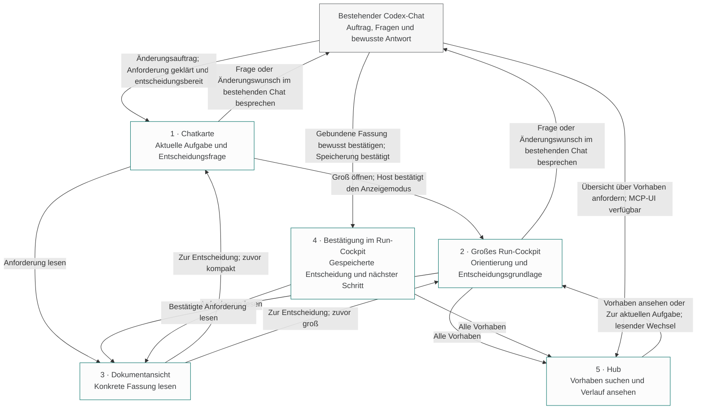

Die Dokumentansicht kehrt zur auslösenden Darstellung und deren aktuellem Inhalt zurück.
Nach dem Lesen einer bestätigten Anforderung ist das die Bestätigung beziehungsweise die
nächste Aufgabe, keine erneute Entscheidung über dieselbe alte Fassung. Ein überarbeiteter
Vorschlag erscheint ebenfalls in der bisher verwendeten Cockpit-Darstellung; der Flow zeigt
den Einstieg über die Chatkarte exemplarisch.

| Aktion des Anwenders | Ausgangspunkt | Sichtbares Ergebnis | Wirkung und Voraussetzung |
|---|---|---|---|
| Änderungswunsch formulieren | Bestehender Codex-Chat | Chatkarte mit „Haben wir deinen Wunsch richtig verstanden?“ — Ansicht 1 | Erst nach notwendiger Klärung und gebundener Entscheidungsbereitschaft; fehlende Angaben führen zunächst zu einer konkreten Rückfrage |
| Groß öffnen | Chatkarte | Großes Run-Cockpit — Ansicht 2 | Host muss den angebotenen Modus bestätigen; ohne Unterstützung bleibt die kompakte Karte verfügbar |
| Anforderung lesen | Chatkarte oder großes Cockpit | Dokumentansicht — Ansicht 3 | Liest die konkret zugeordnete Fassung innerhalb der App; ein erforderlicher größerer Anzeigemodus bleibt hostabhängig |
| Zur Entscheidung | Dokumentansicht | Auslösende Chatkarte oder großes Cockpit — Ansicht 1 beziehungsweise 2 | Erhält Vorhaben, Fassung und Zusammenhang; bei inzwischen geänderter Quelle wird der aktuelle Stand erklärt |
| Frage stellen oder Änderung nötig | Aktuelle Entscheidung oder Dokument | Diskussion im bestehenden Codex-Chat; danach überarbeitete Entscheidungskarte | Öffnet keinen eigenen Chat. Im gezeigten Zustand erfolgt der Änderungswunsch direkt im bestehenden Gespräch; eine Ersatzfassung benötigt erneut eine Entscheidung |
| Entscheidung bewusst bestätigen | Bestehender Codex-Chat; künftig auch qualifizierte Klickaktion | Bestätigung und nächste Aufgabe im Cockpit — Ansicht 4 | Erst nach bestätigter Erfassung; „So stimmt es“ ist in den aktuellen Mocks deaktiviert. Ist der Chat der einzige Weg, steht die exakte Antwort direkt beim Handlungshinweis; bei qualifiziertem Klickweg darf das Protokoll in Details stehen |
| Bestätigte Anforderung lesen | Bestätigung | Dokumentansicht — Ansicht 3 | Zeigt die bestätigte historische Fassung mit ihrem belegten Status; zurück geht es zum auslösenden Aufgabenstand |
| Alle Vorhaben oder Übersicht anfordern | Großes Cockpit oder bestehender Chat | Hub — Ansicht 5 | Zeigt den definierten Projektumfang; Darstellung über MCP-UI setzt die entsprechende Host-Fähigkeit voraus |
| Suchen, filtern oder Verlauf aufklappen | Hub | Treffer und Verlauf innerhalb des Hubs — Ansicht 5 | Ändert die Leseauswahl; bestätigt keine Fassung und beauftragt keine Arbeit |
| Vorhaben ansehen oder Zur aktuellen Aufgabe | Hub | Aktueller Aufgabenstand im großen Cockpit — Ansicht 2 beziehungsweise 4 | Lesender Wechsel zum ausgewählten Run; erhält den bestehenden Codex-Chat und startet keine automatische Fortsetzung |
| Aktuellen Stand laden | Cockpit mit veralteter oder bewusst manuell zu aktualisierender Beobachtung | Frisch gelesener Aufgabenstand in derselben Darstellung | Erscheint nur bei erforderlicher bewusster Neuladung; kann Inhalt und Handlungserwartung ändern, erzeugt aber keine Entscheidung und keinen neuen Chat |

Die große Ansicht kann je nach Host rechts, bildschirmfüllend oder in einem anderen
angebotenen Modus erscheinen. Der Flow beschreibt die Navigation innerhalb des Konzepts,
keine garantierte Codex-Fensteraufteilung. Bei fehlender MCP-App-UI bleiben die gebundenen
Informationen und der unterstützte Entscheidungsweg vollständig als Portable Markdown im
bestehenden Chat verfügbar.

## 2 Hub für Überblick und Wiederaufnahme

Der Hub beantwortet: **„Was läuft, wo werde ich gebraucht und was ist bisher passiert?“**
Er macht die Runs des ausdrücklich ausgewählten Projekts auffindbar. Das Projekt steht
sichtbar im Kopf; ein Projektwechsel ist bewusst. Eine projektübergreifende Gesamtübersicht
benötigt einen gesondert definierten Umfang.

Die Übersicht unterscheidet aktive Runs, abgeschlossene Runs und historische abgelöste oder
abgebrochene Arbeit entsprechend dem gespeicherten Lebenszyklus. Geplante Backlog-Vorhaben
ohne eigenen Run können daneben erscheinen und sind ausdrücklich als geplant erkennbar.
Sie erhalten keine erfundenen Gate-, Freigabe- oder Verlaufsangaben.

### Einträge und Suchmöglichkeiten

Ein Run-Eintrag führt mit dem verständlichen Namen des Vorhabens. Dazu zeigt er den aktuellen
Schritt, den gespeicherten Lebenszyklus, einen möglichen Klärungsbedarf und die nächste
erwartete Handlung. Der letzte verfügbare Datenstand ist zugänglich. Technische IDs und
Quellenpfade stehen in den Herkunftsangaben, damit ähnliche Vorhaben unterscheidbar bleiben.

Die Suche umfasst Namen und Run-ID; Filter helfen nach Lebenszyklus, Schritt und erforderlicher
Aufmerksamkeit. „Meine Entscheidung erforderlich“ und „Klärung erforderlich“ bieten direkte
Zugänge. Ihre Bedeutung wird aus aktuellen Core-Angaben abgeleitet. Ein gespeicherter
Backlog-Status allein bestätigt keine aktuelle Entscheidungsbereitschaft.

Der Hub muss auch Runs ohne Backlog-Eintrag auffindbar machen. Die vorhandene
Masterbacklog-Projektion wird dafür durch einen gesondert definierten, begrenzten Run-Leseumfang
ergänzt. Inventar, Suchabdeckung und Aktualisierung müssen zusammenpassen. Wurde nur ein Teil
gelesen, wird dieser Umfang genannt; „keine Treffer“ darf dann keine vollständige Projektsuche
behaupten. Dieses Ziel erweitert die heutige, zunächst auf Backlog-Einträge begrenzte Übersicht.

### Öffnen und Zurückkehren

Das Öffnen eines Eintrags lädt das Run-Cockpit mit dem aktuellen Stand dieses Runs. Historische
Runs öffnen zunächst ihren Abschluss und Verlauf; daraus entsteht keine neue Arbeitsfreigabe.
Die Rückkehr zum Hub erhält Suche, Filter und Listenposition. Der Anwender kann zwischen
Vorhaben wechseln, ohne seine Orientierung in der Übersicht zu verlieren.

## 3 Run Cockpit als gemeinsamer Arbeitsbereich

Das Run-Cockpit verbindet drei Aufgaben: **Orientierung behalten, den aktuellen Gegenstand
bearbeiten und den bisherigen Verlauf nachvollziehen.** Die Entscheidungskarte ist sein zentraler
Inhalt, wenn eine menschliche Entscheidung ansteht. Während interner Arbeit zeigt derselbe
Bereich die laufende Aufgabe, das letzte bestätigte Ergebnis und mögliche Hindernisse.

Die kompakte und die große Darstellung verwenden dieselbe Run-Identität, dieselbe
Entscheidungsgrundlage und dieselbe Bedeutung der Zustände. Mehr Platz verändert die
Darstellungstiefe. Er erzeugt keine zusätzliche Freigabe, keinen zweiten Run und keine
abweichende Gate-Policy.

### Dauerhafte Orientierung

In der großen Ansicht bleibt ein Orientierungskopf sichtbar, während Dokumente, Nachweise
oder der Verlauf gescrollt werden. Er beantwortet vier Fragen:

| Frage des Anwenders | Sichtbare Antwort |
|---|---|
| Welches Vorhaben bearbeite ich? | Fachlicher Titel und ausgewähltes Projekt; Run-ID bei Bedarf in den Herkunftsangaben |
| Wo stehe ich? | Aktueller Schritt und Einordnung in den für diesen Run geltenden Ablauf |
| Wer ist jetzt dran? | Erwartete Handlung des Anwenders, nächste Arbeit der KI oder konkret benannter Klärungsbedarf |
| Was muss passieren, damit es weitergeht? | Eine verständliche Hauptaussage mit passender Aktion und erklärter Wirkung |

Der Ablauf zeigt erledigte, aktuelle und noch anstehende Schritte. Er folgt dem tatsächlichen
Delivery-Weg des Runs, einschließlich Analysen, Umsetzung und Reviews. Nicht jedes Element
ist ein menschliches Gate. Kürzere Wege werden entsprechend kürzer dargestellt. Eine
Anforderungskarte, ein bestandenes Review und ein freigegebenes Gate bleiben unterscheidbar.
Die UI berechnet daraus keinen pauschalen Fertigstellungsprozentsatz.

Ein beispielhafter Orientierungskopf lautet:

```text
Anmeldung verbessern                                  Hub öffnen
Aktueller Schritt: Ziel und Umfang klären

Du bist dran
Haben wir deinen Wunsch richtig verstanden?
Prüfe Ziel und Umfang dieser Fassung.

Anforderung lesen · So stimmt es · Änderung nötig
Danach: Bestehendes System untersuchen und passenden weiteren Ablauf bestimmen.

Ablauf und bisherige Entscheidungen ansehen
```

Die gezeigten Entscheidungsaktionen setzen die jeweilige Host-Unterstützung voraus. In den
aktuellen Mocks bleibt „So stimmt es“ deaktiviert; Änderungen werden im bestehenden Chat
besprochen. Dieses Textbeispiel beschreibt die Beschriftung des Zielkonzepts.

Während der Umsetzung lautet die Einordnung beispielsweise:

```text
Anmeldung verbessern
Aktueller Schritt: Umsetzung und Tests

Als Nächstes ist die KI dran
Den freigegebenen Plan umsetzen und Ergebnisse prüfen.
Du musst jetzt nichts entscheiden.
```

„Die KI arbeitet“ wird nur angezeigt, wenn der Host tatsächliche laufende Arbeit bestätigt.
Der kanonische nächste Schritt allein belegt keine laufende Ausführung. Ohne entsprechende
Beobachtung lautet die Aussage „Als Nächstes ist die KI dran“ oder „Weiterarbeit beauftragen“.

### Erwartung am aktuellen Schritt

Der Schrittname allein erklärt noch nicht, was der Anwender tun soll. Deshalb gehört eine
konkrete Erwartung zum Orientierungskopf. Sie bleibt auch sichtbar, wenn gerade ein
Unterdokument gelesen wird.

| Situation | Aussage im Cockpit | Passende Handlung |
|---|---|---|
| Eine Anforderung braucht Klärung | „Bitte kläre, welche Nutzer die Änderung betrifft.“ | Die konkrete Frage im Chat beantworten |
| Eine Gate-Fassung ist entscheidungsbereit | „Prüfe die vorgeschlagene Fassung und entscheide.“ | Dokument lesen, freigeben, Änderung verlangen oder ablehnen |
| Die nächste interne Aufgabe ist zulässig | „Als Nächstes wird das bestehende System untersucht.“ | Bereits beauftragte Arbeit fortsetzen lassen oder die erforderliche Fortsetzung beauftragen |
| Ein konkreter Blocker verhindert Fortschritt | Ursache und die zu ihrer Auflösung erforderliche Handlung | Benannte Quelle prüfen oder die zuständige Klärung anstoßen |
| Der aktuelle Stand ist nicht bestätigt | „Diese Beobachtung ist nicht mehr aktuell.“ | Aktuellen Stand laden; bis dahin keine aktuelle Entscheidung behaupten |
| Der Run ist abgeschlossen | Ergebnis, Abschlussgrundlage und mögliche Restgrenzen | Ergebnis und Verlauf ansehen; neue Arbeit ausdrücklich beauftragen |

„Du bist dran“ setzt eine tatsächliche Handlung des Anwenders voraus. Ein bloßer interner
Zwischenschritt wird nicht als zusätzliche Nutzerentscheidung dargestellt. Bei mehreren
offenen Punkten führt die wichtigste aktuell erforderliche Handlung; weitere Punkte bleiben
als zugehörige Nachweise und Klärungen erreichbar.

### Hauptbereich und Vertiefung

Der Hauptbereich zeigt die gegenwärtige Aufgabe. Bei einem entscheidungsreifen Gate führt
er mit dem Vorschlag und den erwarteten Nutzeraktionen. Bei fehlenden Voraussetzungen
führt er mit dem konkreten Klärungsbedarf. Ein technischer Fehler wird mit verständlicher
Ursache und einer passenden Wiederherstellungsaktion erklärt.

Dokumente und Nachweise öffnen aus diesem Zusammenhang heraus. Der Orientierungskopf
bleibt sichtbar; die Rückkehr führt zur auslösenden Karte oder Quelle und erhält deren Fokus.
Der Anwender soll beim Lesen jederzeit erkennen, wozu das Dokument gehört und welche
Entscheidung oder Arbeit es unterstützt.

## 4 Run Cockpit als Teil des Chats

Im Chat ist das Run-Cockpit eine kompakte Gesprächskarte. Jede Karte ist für sich verständlich:
Sie enthält Vorhaben, aktuellen Schritt, erwartete Handlung und Datenstand. Die wichtigsten
Aktionen sind unmittelbar erreichbar. Details zu Quellen und technischen Bindungen können
aufgeklappt oder in der großen Ansicht gelesen werden.

Die kompakte Karte kann denselben Gate-Gegenstand entscheiden, sofern der Host die
qualifizierte Aktion unterstützt. Sie verlangt keinen Wechsel in die große Ansicht, um eine
bewusste Entscheidung abzugeben. „Groß öffnen“ dient der ausführlichen Prüfung und
dauerhaften Orientierung. Umgekehrt kann der Anwender zur Diskussion im bestehenden Codex-Chat zurückkehren,
ohne einen neuen Entscheidungsgegenstand zu erzeugen.

### Gesprächsverlauf und Aktualität

Eine Chat-Karte gehört zum Gespräch und zeigt einen beobachteten Stand. Frühere Karten
bleiben als damalige Stände nachvollziehbar. Das Konzept verlangt keine nachträgliche
Umschreibung alter Chatnachrichten durch die App. Eine Karte führt ihren Datenstand mit;
bei erneuter Interaktion wird ihre Gültigkeit geprüft.

Nach einer bestätigten Entscheidung, einem wesentlichen Ergebnis oder einem neuen Blocker
zeigt AGDF den relevanten aktuellen Stand. Routineprüfungen benötigen keine eigene neue
Karte. Dadurch bleibt der Gesprächsverlauf lesbar und der nächste menschliche Entscheidungspunkt
sichtbar. Alte Karten werden nicht allein wegen ihres Alters als ungültig behandelt; entscheidend
ist die Übereinstimmung mit dem aktuellen Run und der gebundenen Dokumentfassung.

### Wechsel in die große Ansicht

Beim Vergrößern wird der ausgewählte Run ausdrücklich übernommen. Vor einer Handlung
prüft AGDF den aktuellen Stand. Ist die Fassung inzwischen verändert, erklärt die Ansicht
diese Änderung und zeigt den aktuellen Gegenstand; eine alte Freigabeaktion wird nicht
stillschweigend auf die neue Fassung übertragen. Ein gültiger Wechsel erhält die Auswahl
und den Lesezusammenhang, soweit die Host-Fähigkeiten dies ermöglichen.

Unterstützt der Host die Vergrößerung nicht, bleibt die kompakte
Ansicht verwendbar und erklärt ihre Möglichkeiten. Eine angeforderte Vergrößerung darf erst
nach Host-Bestätigung als erfolgt gelten. Fehlt MCP-UI vollständig, zeigt AGDF die gebundene
Entscheidung als verständlichen Chat-Text mit dem bestehenden exakten Antwortweg.

## 5 Entscheidungskarte und menschliche Entscheidung

Die Entscheidungskarte beantwortet: **„Was entscheide ich hier, auf welcher Grundlage und mit welcher
Wirkung?“** Sie enthält eine verständliche Zusammenfassung der konkreten Fassung, den
vereinbarten Umfang, entscheidungsrelevante Risiken und offene Punkte sowie den Zugang zum
exakten Dokument. Ein verlässlicher Vergleich kann relevante Änderungen seit der vorherigen
Fassung zeigen. Fehlt eine vergleichbare Grundlage, wird dies ausdrücklich benannt.

Die Karte erklärt, was eine Freigabe ermöglicht und welche Verpflichtungen danach noch
bestehen. Beispielsweise erlaubt die bestätigte Anforderung die nächste vorgesehene Untersuchung;
sie ist keine pauschale Freigabe für Umsetzung, Veröffentlichung oder weitere Vorhaben.

| Handlung | Bedeutung und sichtbare Rückmeldung |
|---|---|
| Anforderung, beschriebenes Verhalten oder Lösung lesen | Die genaue zur Entscheidung gehörende Fassung öffnen und zur Karte zurückkehren |
| Im bestehenden Codex-Chat besprechen | Fragen klären, Alternativen erörtern und Änderungen präzisieren; eine Diskussion entscheidet das Gate nicht. Eine ausdrückliche Kontextübergabe aus der App setzt die entsprechende Host-Fähigkeit voraus. |
| So stimmt es | Die konkret angezeigte Fassung bewusst bestätigen; erst nach bestätigter Erfassung den Effekt und nächsten Schritt zeigen |
| Änderung nötig | Den konkreten Änderungswunsch klären und den unterstützten Überarbeitungsweg erklären; die Ersatzfassung bleibt erneut zu entscheiden |
| Diese Fassung ablehnen | Diese Fassung nicht freigeben und die tatsächliche Wirkung im bestehenden Ablauf erklären; den Run nicht automatisch löschen oder abbrechen |

### Fortschritt nach der Entscheidung

Während der Erfassung zeigt die Karte „Entscheidung wird gespeichert“. Anschließend zeigt
sie das bestätigte Ergebnis und die frisch bestimmte nächste Aktion. Bei verlorener Antwort
bleibt das Ergebnis unklar, bis der ursprüngliche Vorgang geprüft wurde. Wiederholung oder
Vergrößerung darf keine zweite wirksame Entscheidung erzeugen.

Der nächste zulässige Arbeitsschritt wird sichtbar von der Gate-Freigabe unterschieden.
Wo die bestehende Beauftragung die Fortsetzung bereits umfasst, arbeitet AGDF innerhalb
dieses Umfangs weiter. Benötigt die Fortsetzung einen neuen Auftrag, bietet das Cockpit
eine entsprechende Aktion an. Eine solche Beauftragung ersetzt keine spätere Gate-Entscheidung.

Klick und exakte Textantwort beziehen sich auf denselben Entscheidungsgegenstand. Technische
Host-Berechtigung, bewusste Nutzerentscheidung und bestätigte Speicherung bleiben getrennt.
MCP-UI-Unterstützung allein reicht für eine Freigabe per Klick nicht aus; die im
[Befehlsfluss](core-mcp-command-flow.md#3-wie-der-mensch-die-gebundene-entscheidung-sieht)
beschriebenen Voraussetzungen gelten weiterhin.

### Vom Freigabeklick bis zur erneuten Übernahme durch die KI

Ein Klick auf „So stimmt es“ startet bei verfügbarem, qualifiziertem Klickweg die gebundene
Erfassung dieser konkreten Entscheidung. Erst der passende Speicherbeleg bestätigt die
Freigabe. Danach wird der nächste erlaubte Schritt frisch geprüft und bei unterstützter
Host-Übergabe die Fortsetzung im bestehenden Codex-Chat angefordert. Läuft dort noch eine
KI-Antwort, kann der Host den Start bis zu deren Ende zurückstellen.


[SVG groß ansehen](diagrams/10-freigabe-ki-fortsetzung.svg) ·
[Bearbeitbare DOT-Quelle](diagrams/10-freigabe-ki-fortsetzung.dot)

| Sichtbarer Zustand | Was tatsächlich bestätigt ist | Was der Anwender tun muss |
|---|---|---|
| Entscheidung wird gespeichert | Die bewusste Entscheidung wurde übermittelt; Speicherung noch nicht bestätigt | Ergebnis abwarten; nicht erneut freigeben |
| Anforderung bestätigt · Fassung 2 | Ein passender Speicherbeleg bestätigt genau diese Entscheidung | Die Freigabe nicht wiederholen; den angezeigten nächsten Schritt beachten |
| Fortsetzung wird angefordert oder wartet | Die App vermittelt die bereits zulässige Fortsetzung; der Host kann auf das Ende der laufenden Antwort warten | Bei bestätigter Übergabe ist kein zweiter Freigabeklick nötig |
| Fortsetzung wurde im Chat angefordert | Der Host hat die Nachricht angenommen; der Arbeitsbeginn ist damit noch nicht belegt | Weiteren Aufgabenstand verfolgen |
| KI arbeitet an der nächsten Aufgabe | Der tatsächliche Arbeitsbeginn wurde beobachtet | Auf Ergebnis, nächste Entscheidung oder konkreten Klärungsbedarf warten |
| Freigabe gespeichert, Fortsetzung unbestätigt | Die Entscheidung ist gespeichert; die Übergabe an den Host fehlt oder ist unklar | Aktuellen Run und eine mögliche bereits erfolgte Fortsetzung im bestehenden Chat prüfen |
| Ergebnis der Speicherung unklar | Es fehlt ein bestätigter passender Beleg; daraus folgt weder Erfolg noch sichere Nichtausführung | Den ursprünglichen Vorgang prüfen; keine neue Entscheidung mit neuer Operations-ID erzeugen |

Die KI übernimmt, sobald der Host die Fortsetzung im bestehenden Chat tatsächlich startet.
Sie prüft den ursprünglichen Freigabebeleg und den aktuellen Run erneut, bestimmt den nächsten
zulässigen Schritt und arbeitet innerhalb des bestehenden Auftrags. Bei der nächsten nötigen
menschlichen Entscheidung zeigt sie deren Karte und führt diese Entscheidung nicht selbst aus.
Fehlt eine Voraussetzung oder verlangt die Weiterarbeit einen neuen Auftrag, wird diese
konkrete Verpflichtung sichtbar. Eine bloß gespeicherte Freigabe reicht für „KI arbeitet“ nicht aus.

Die [Erfassung und Zustände der Entscheidungskarte](../../packages/control-ui/src/mcp/DecisionCard.tsx)
und ihre [gebundene Kontext- und Nachrichtenübergabe](../../packages/control-ui/src/mcp/DecisionEntry.tsx)
bilden die technische Grundlage. Die aktuellen Mocks zeigen weiterhin einen deaktivierten
Klickweg; das Diagramm erläutert zusätzlich den Ablauf bei qualifizierter Klickunterstützung.
Es bestätigt keine native Codex-Qualifizierung. Ohne Klickunterstützung bleibt die gebundene
Entscheidung im bestehenden Chat verfügbar; ihre genaue Antwortregel steht in Details.

Der SVG-Export erfolgt aus dem Repository-Wurzelverzeichnis:

```sh
dot -Tsvg docs/architecture/diagrams/10-freigabe-ki-fortsetzung.dot -o docs/architecture/diagrams/10-freigabe-ki-fortsetzung.svg
```

## 6 Dokumente und Nachweise im Arbeitszusammenhang

Dokumente werden mit verständlichem Namen und belegtem Zustand angeboten. Die vorhandenen
Zustände wie „Entwurf“, „Entwurf geprüft“, „Überarbeitung nötig“ und „Freigabe dieser Fassung
nicht bestätigt“ behalten ihre Bedeutung. Ein gespeicherter Freigabevermerk allein belegt
nicht, dass die heute gelesenen Bytes die damalige freigegebene Fassung sind.

Die Dokumentansicht führt mit verständlichem Inhalt. Sie zeigt passende Prüfbefunde und
vorhandene ursprüngliche Freigabeangaben, während Originaltext und Herkunft zugänglich
bleiben. Fehlende oder nicht bestätigte Versionszuordnung wird ausdrücklich genannt.
Eine Entwurfsprüfung kontrolliert die vorhandenen Autorenregeln; sie ersetzt keine
fachliche Entscheidung, semantische Prüfung oder abschließende Qualitätsprüfung.

Die Diskussion bleibt im bestehenden Codex-Chat. Die tatsächlich ausgewählte Quelle kann
über „Kontext übergeben“ bereitgestellt werden, sofern der Host die Capability anbietet
und den Empfang bestätigt. Eine ausdrücklich beauftragte Nachricht kann über den getrennten
Nachrichtenweg folgen, sofern auch dieser unterstützt wird. Öffnen oder Lesen erzeugt
weder eine Frage noch eine Freigabe und legt keinen neuen Chat an.

## 7 Verlauf der zurückgelegten Runden

Der Verlauf zeigt, wie das Vorhaben den heutigen Stand erreicht hat. Ein Run umfasst die
gesamte abgegrenzte Arbeit; eine „Runde“ ist hier ein anschauliches Bild für einen durchlaufenen
Arbeits- und Entscheidungsabschnitt. Sie ist kein zusätzlicher technischer Zustand und kein
neues Gate.

Zum Verlauf gehören beobachtete Arbeitsschritte, Artefaktfassungen, tatsächlich gespeicherte
Entscheidungen, Reviews, Testergebnisse und der Abschluss. Quellenrevisionen bleiben
nachvollziehbar: Frühere Zustimmung gehört zur früheren Fassung und bestätigt keine geänderte
Ersatzfassung. Fehlende historische Angaben werden als Lücke gezeigt.

Der Anwender kann vom aktuellen Schritt in einen früheren Abschnitt wechseln und anschließend
„Zum aktuellen Schritt“ zurückkehren. Die frühere Ansicht ist deutlich als Historie bezeichnet.
Sie bietet keine aktuelle Entscheidung für eine abgelöste Fassung. Das Öffnen eines vergangenen
Abschnitts verändert den Run nicht und setzt ihn nicht zurück.

## 8 Gemeinsame Zuständigkeiten und Datenbasis

Die einheitliche Bedienung verbindet vorhandene Lese- und Entscheidungsfunktionen. Ihre
technischen Zuständigkeiten bleiben erhalten. Das allgemeine Cockpit liefert weiterhin
lesenden Zugriff. Eine zulässige Entscheidung wird über die eigene gebundene Fassade an
die bestehende Core-Operation vermittelt. Die visuelle Zusammenführung darf dem allgemeinen
Lesedienst keine beliebigen Schreibrechte geben.

| Verantwortung | Zuständiger Baustein |
|---|---|
| Wirksamer Run-Zustand, Voraussetzungen, Dokumentzuordnung und nächste erlaubte Aktion | Bestehende Core-Auswertung und kanonischer Zustand unter `.agdf/control/` |
| Erfassung von Artefakten und bewussten Entscheidungen | Bestehende gebundene Core-Operationen und Writer |
| Orientierung, Navigation, Darstellung und Fokus | Gemeinsames UI-Modell für Hub und beide Cockpit-Darstellungen |
| Darstellungsmöglichkeiten, tatsächliche Agentenaktivität und technische Berechtigung | Host und seine jeweils belegten Fähigkeiten |
| Abruf, Identitätsprüfung und Sitzungsgrenzen | Bestehende MCP- beziehungsweise Browser-Adapter mit den dafür zulässigen Operationen |

Die UI benötigt zusammengehörige Angaben zu Projekt, Run, Revision, aktuellem Schritt,
Entscheidungsgrundlage und Datenstand. Eine alte Dokumentfassung darf nicht mit einem neuen
Freigabestatus als scheinbar aktueller Gesamtstand kombiniert werden. Kompakte und große
Ansichten können eigene Lesesitzungen besitzen; ihre Aussagen müssen dennoch dieselbe
gebundene fachliche Grundlage besitzen. Sitzungsablauf, Quellenänderung und unsichere
Ergebnisse bleiben sichtbar.

Für den Hub müssen auch die Herkunft und Aktualität seiner Inventar- und Suchdaten festgelegt
werden. Gespeicherte Backlog-Beobachtung, aktuell geprüfter Run und bestätigte laufende
Agentenarbeit sind unterschiedliche Aussagen. Die Oberfläche darf sie zusammen erklären,
aber nicht gegenseitig als Beweis verwenden.

Eine spätere lesende Anbindung von GitHub Projects kann Planung, Priorität, Zuständigkeit und
verknüpfte Issues oder Pull Requests ergänzen. Sie benötigt explizite stabile Zuordnungen und
sichtbare Herkunft. Ein Board-Status „Done“ ist keine AGDF-Freigabe. Die Anbindung gehört zur
weiteren Entwicklung und ist keine Voraussetzung für dieses Bedienmodell.

## 9 Bestand und erforderliche Weiterentwicklung

| Gegenstand | Vorhandene Grundlage | Ziel dieses Konzepts |
|---|---|---|
| Einstieg über einen Änderungsauftrag | Chat, Skills, Run-Zuordnung und gebundene Gate-Darstellung | Run-Cockpit als unmittelbarer Zugang zum aktuellen Anforderungs- beziehungsweise Entscheidungspunkt |
| Hub | Lesende Masterbacklog-Übersicht mit Suche und Bereichsauswahl | Alle Runs im ausgewählten Projekt auffindbar; Planung und tatsächlicher Run-Bestand unterscheidbar |
| Run-Cockpit | Kompakte und größere Leseansicht sowie separate Decision App | Zusammenhängender Arbeitsbereich mit dauerhaftem Orientierungskopf und passendem zentralem Inhalt |
| Dokumente und Prüfungen | Registrierte Quellen, Dokumentzustände und bewusste Entwurfsprüfung | Aus Karte, Diskussion und Verlauf im erhaltenen Run-Zusammenhang erreichbar |
| Entscheidungen | Bestehender exakter Textweg und Entwicklungsstand der gebundenen App | Unterstützte, qualifizierte Klickaktionen mit derselben Wirkung und verständlicher Bestätigung |
| Verlauf | Gespeicherte Run-Zustände, Quellenrevisionen, Belege und Berichte | Verständlicher Verlauf mit eindeutiger Trennung zwischen historischer und aktueller Fassung |
| Host-Darstellung | Einzelne datierte Browser-, Protokoll- und native Beobachtungen | Qualifizierung der jeweils ausgelieferten Gesamtdarstellung und ihrer tatsächlichen Interaktionen |

Die bestehenden Referenzen behalten ihre eigene Beschreibung des Implementierungsstands.
Dieses Kapitel ist die gemeinsame fachliche Beschreibung der UI-Weiterentwicklung. Es
definiert keine neuen Gate-Regeln, keine zusätzliche Kontrollquelle und keinen Auftrag zur
Aktualisierung einer Installation. Konkrete Layouts, Leseumfänge, Operationen und Host-Nachweise
müssen bei der Umsetzung mit den vorhandenen Eigentümern abgestimmt werden.

## 10 Beobachtbare Nutzererlebnisse

Das Konzept ist in folgenden Situationen nachvollziehbar zu prüfen:

1. Ein neuer Änderungsauftrag führt nach der erforderlichen Klärung zur Karte „Haben wir deinen
   Wunsch richtig verstanden?“ im Schritt „Ziel und Umfang klären“.
   Der Anwender erkennt Vorhaben, offene Fragen und Wirkung einer möglichen Freigabe.
2. Ein bestehender Run ist im Hub auffindbar, auch wenn kein Backlog-Eintrag vorhanden ist.
   Unvollständige Suchabdeckung wird erklärt; ein geplantes Vorhaben wird nicht als aktiver Run gezeigt.
3. Beim Lesen eines langen Dokuments in der großen Appfläche bleiben aktueller Schritt und erwartete Handlung
   sichtbar. Die Rückkehr erhält den Entscheidungsgegenstand und den auslösenden Fokus.
4. Vergrößern aus dem Chat erhält Run und geprüfte Fassung. Eine inzwischen geänderte Quelle
   führt zu einer Erklärung und erneuter aktueller Darstellung, nicht zur Übertragung alter Zustimmung.
5. Freigabe, Änderungswunsch und Ablehnung haben die jeweils unterstützten, verständlich
   bestätigten Wirkungen. Doppelklick und verlorene Antwort erzeugen keinen zweiten Effekt.
6. Nach einer Entscheidung zeigt AGDF die nächste tatsächliche Verpflichtung. Interne Arbeit
   erzeugt keine zusätzlichen menschlichen Gates und behauptet ohne Host-Beobachtung keine Aktivität.
7. Frühere Chat-Karten und ältere Dokumente bleiben als damalige Stände lesbar. Aus dem Verlauf
   führt ein klarer Weg zur aktuellen Aufgabe.
8. Fehlende UI-Fähigkeit, abgelaufene Sitzung und fehlende aktuelle Quelle bieten verständliche
   Wiederherstellung. Der gebundene Weg bleibt vollständig als Portable Markdown verfügbar,
   soweit ihn der bestehende Ablauf unterstützt; der Fallback-Grund ist sichtbar.
9. Die Auswahl eines anderen Runs im Hub erzeugt keinen Chat und keine automatische
   Fortsetzung. Eine neue Arbeitsbeauftragung benennt den ausgewählten Run und sein Ziel.
10. Die App gestaltet keine Host-Nachrichten, kein natives Eingabefeld und kein Host-Schließen.
    Kontextaufnahme, Nachrichtenzustellung und bestätigte Entscheidung bleiben getrennte beobachtbare Wirkungen.
11. Eine gebundene Entscheidung wird einmal als MCP-App-UI und einmal als Portable Markdown
    dargestellt. Run, Gate, Revision, Digests, Zusammenfassung, Folgen und zulässige Antwort
    stimmen überein; nur Darstellung und verfügbare Interaktion unterscheiden sich.

Tastaturbedienung, Fokus, schmale und große Flächen sowie tatsächliches Host-Verhalten gehören
zur Prüfung dieser Situationen. Sichtbarer Fortschritt, wirksame menschliche Entscheidung und
technische Ausführung werden dabei jeweils anhand ihrer eigenen Grundlage beurteilt.
