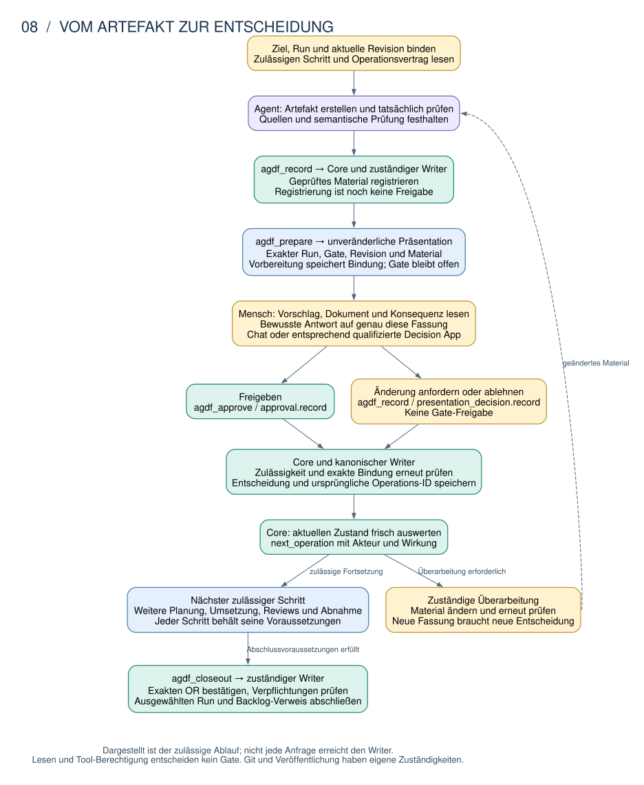
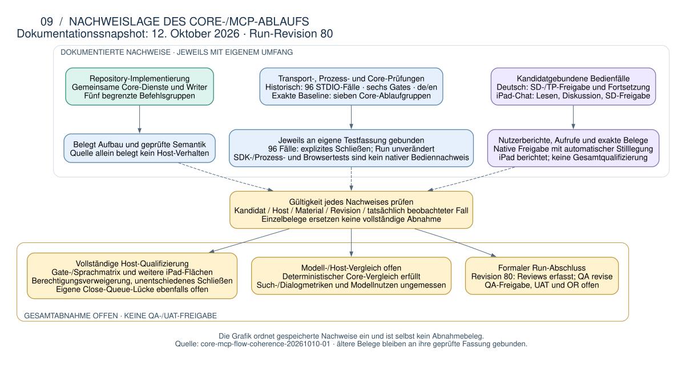

# Befehlsfluss zwischen Core und MCP

Diese Seite erklärt, wie ein Agent Artefakte erfasst, eine menschliche Entscheidung vorbereitet
und den ausgewählten Run abschließt. CLI und MCP verwenden dafür dieselben Core-Dienste.
Der Core prüft die Zulässigkeit und delegiert Änderungen an die zuständigen Writer;
der Transport und die UI besitzen keine eigene Gate-Policy.

**Dokumentrolle: Vertiefung des Befehls- und Entscheidungsablaufs, nicht normativ.**
**Abgleich: 12. Oktober 2026, Repository und gespeicherte Run-Nachweise.** Die fünf begrenzten
Befehlsgruppen und die Decision App sind im Entwicklungsstand vorhanden. Für isolierte
Testkandidaten liegen native Freigabe-/Fortsetzungsbeobachtungen und ein deutscher iPad-Chatfall vor;
die vollständige Qualifizierung der aktuellen Fassung
und die Gesamtabnahme sind offen. Abschnitt 5 ordnet die jeweiligen Nachweise ein. Diese Beschreibung
bestätigt keine Veröffentlichung oder Installation. Klickentscheidungen bleiben ohne passende
native Qualifizierung deaktiviert; isolierte experimentelle Bedienprüfungen sind eigene Nachweise.
Das allgemeine Cockpit bleibt eine Leseansicht.

Der [Architektur-Einstieg](README.md) ordnet diese Seite ein. Die
[Systemarchitektur](01-systemarchitektur.md#32-mcp-werkzeugweg) beschreibt den Aufrufweg, der
[Dispatcher-Katalog](02-dispatcher.md) die Auswahl des nächsten Arbeitsschritts. Hier folgt dessen
Erfassung und Entscheidung. Die [Cockpit-Referenz](06-agdf-cockpit.md) erklärt die allgemeine
Leseansicht; die [MCP-Schnittstellenfragen](04-mcp-schnittstellen.md) behandeln die verbleibenden
Fragen des [gemeinsamen Zielbilds](03-agentenkontrolle-zielbild.md).
Verbindliche Semantik bleibt bei den unten verlinkten Verträgen und Core-Diensten.

Das [UI-Zielkonzept für Hub und Run-Cockpit](07-ui-konzept.md) ordnet die Entscheidungskarte
in den gemeinsamen Arbeitsbereich des Anwenders ein. Es verbindet den Einstieg im bestehenden
Codex-Chat, die hostabhängige große Appfläche und die Übersicht über alle Runs; die hier beschriebenen Bindungen,
Schreibgrenzen und Qualifizierungsvoraussetzungen bleiben erhalten. Sichtbare Aufgaben wie
„Ziel und Umfang klären“, „Verhalten festlegen“ und „Lösung planen“ sowie „So stimmt es“ als
Bestätigung sind verständliche Beschriftungen. Die gebundene Core-Operation und die exakten
Antwortregeln werden dadurch nicht geändert; die technische Zuordnung steht in Details.

Für den fachlichen Zusammenhang genügen zunächst die Abschnitte 1 bis 3. Abschnitt 4 erklärt
unklare Ergebnisse und Wiederherstellung; Abschnitte 5 und 6 vertiefen Nachweisgrenzen und Quellen.

## 1. Vom Artefakt zur Entscheidung und zum Abschluss

Der Ablauf beginnt mit einem eindeutig gebundenen Ziel und Run. Jede Operation bezieht sich auf
die erwartete Revision und ihren gelesenen Vertrag. Eine Registrierung hält tatsächliche Ergebnisse
fest; sie erzeugt weder ein Review noch ein QA-Urteil. Die bewusst erteilte Antwort
`Approval: <gate>` und die zuvor vorbereitete Darstellung bleiben getrennt.

### Beispiel: Einen PRD-Entwurf zur Entscheidung bringen

Das Beispiel setzt einen bereits gebundenen Run voraus, für den die PRD-Erstellung zulässig ist.
Die Auftragszuordnung und vorgelagerten Entscheidungen beschreibt der Dispatcher-Katalog.

1. Der Agent liest mit `agdf_inspect` den Vertrag für `agdf_record/artefact.record`, erstellt den
   PRD-Entwurf und hält die tatsächliche semantische Prüfung seiner Quellen separat fest.
2. `agdf_record` registriert das geprüfte Material über den zuständigen Core-Dienst. Ein lesender
   Bereitschaftstest allein ersetzt weder diese Registrierung noch die semantische Prüfung.
3. `agdf_prepare` bindet eine unveränderliche Präsentation an genau diesen Run, das PRD-Gate,
   die aktuelle Revision und das Material. Der Mensch liest Ziel, Inhalt und Entscheidungsfolge.
4. Eine neue bewusste Freigabe wird mit `agdf_approve` erfasst. Eine entsprechend qualifizierte
   Decision App kann denselben Entscheidungsgegenstand bedienen. Eine Änderungsanforderung oder
   Ablehnung ist eine eigene Entscheidung und erteilt keine Freigabe.
5. Erst die anschließende Core-Auswertung bestimmt den nächsten zulässigen Schritt. Umsetzung,
   Prüfung und Abnahme folgen ihrem jeweiligen Ablauf; `agdf_closeout` schließt den Run erst mit
   dem exakten OR und erfüllten Verpflichtungen ab.



Die Grafik zeigt den erlaubten Ablauf und seine Verantwortlichkeiten. Eine Änderungsanforderung
oder Ablehnung führt zur erneuten Bearbeitung; jede folgende Entscheidung braucht ihre eigene
aktuelle Bindung. Die Darstellung behauptet keinen abgeschlossenen Run.
[Bearbeitbare DOT-Quelle](diagrams/08-core-mcp-command-flow.dot).

### Wer verantwortet welchen Teil?

| Beteiligter | Verantwortung |
|---|---|
| Mensch | Beauftragt den Umfang und trifft die erforderliche Entscheidung über das dargestellte Material. |
| Agent | Erstellt und prüft Artefakte, zeigt die gebundene Präsentation und übermittelt tatsächliche Ergebnisse oder die bewusste Antwort. |
| Core und kanonische Writer | Prüfen Ziel, Run, Revision, Voraussetzungen und Quellen; speichern den zulässigen Effekt und seinen Beleg. |
| CLI und MCP | Vermitteln dieselben Verträge und Ergebnisse; Host-Tool-Berechtigung ersetzt keine Gate-Entscheidung. |
| Decision App | Zeigt eine gebundene Entscheidung und vermittelt qualifizierte Aktionen über dieselben Core-Dienste. |
| Allgemeines Cockpit | Zeigt Kontrollstand und Quellen; seine Lesesitzung trifft keine Entscheidung. |

Die vollständige Run-Vorbereitung stellt den gespeicherten Zustand, vorgeschlagene
Transaktionsergebnisse und die unveränderliche Historie bereit. Das Routing verwendet das typisierte
`next_operation` einschließlich Akteur und Operationsschlüssel; Anzeigetexte können keine Berechtigung
erteilen. Bei einem Abschluss mit erfüllten Verpflichtungen gibt es keine nächste Gate-Operation.
Eine widersprüchlich gespeicherte Kennzeichnung `completed` gilt als unbestätigt, nicht als
automatische Wiedereröffnung oder erfolgreicher Abschluss.

## 2. Welche Operation vermittelt welches Tool?

Der reguläre Server bietet Dispatch und lesende Inspektion sowie die aktivierten begrenzten
Befehlsgruppen. Die fünf Gruppen sind feste Berechtigungsbereiche mit festgelegten Operationen.
Ihre Namen sind keine frei wählbaren internen Funktionsaufrufe. Welche Gruppe in einer konkreten
Verbindung verfügbar ist, bestimmt deren Laufzeitkonfiguration.

| Tool | Festgelegte Auswirkungen | Konkrete Grenze der Handlungsabsicht |
|---|---|---|
| `agdf_prepare` | `presentation.prepare` | Die Vorbereitung lässt das Gate unentschieden |
| `agdf_record` | `step.record`, `artefact.record`, `presentation_decision.record`, `runtime_generation.replace`, `operation.recover` | Tatsächliche Ergebnisse und geprüfte Quellenzuordnung; bewusste Ablehnung/Änderungsanforderung; separat bestätigter Austausch der eigenen Runtime |
| `agdf_approve` | `approval.record` | Neue, bewusst erteilte Antwort auf das exakte Gate und aktuelle Präsentation |
| `agdf_revise` | Quellenvorschau, Anwendung und Wiederherstellung, frühe PRD-Wiedereröffnung, Wiederherstellung im eigenen Zuständigkeitsbereich | Anwendung und Wiedereröffnung erfordern den exakten Bestätigungsselektor für das Material |
| `agdf_closeout` | Exakte OR-Registrierung und Abschluss, Wiederherstellung im eigenen Zuständigkeitsbereich | Exakte Bestätigung von Run, Revision, UUID und OR sowie tatsächlich erfüllte Verpflichtungen |

`runtime_generation.replace` betrifft ausschließlich die eigene bedienende Runtime-Verbindung.
Die Operation benötigt einen exakt bestätigten Kandidaten und den zuständigen Runtime-Controller;
sie verändert ausschließlich diese Verbindung und schreibt weder Run noch Gate.
Die übrigen Erfassungsoperationen delegieren an die jeweiligen Zustands- und Entscheidungseigentümer.

### Vertrag lesen und Anfrage binden

`agdf_dispatch` leitet weiterhin benannte Skills weiter; `agdf_inspect` liest Zustand und Verträge.
Die Inspect-Operation `operation-contract` verwendet `module: "<group>/<kind>"`; das optionale `gate`
grenzt die Erstellungsformate ein. Die Inspect-Operation `operation-status` verwendet
`module: "<original UUID>"`. Beide erfordern ein explizites Ziel, einen ausgewählten Run und die
erwartete Revision. Das Lesen eines Vertrags zeigt unterstützte Formen, Quellenbindungen, Grenzen
und den aktuellen Zustand, ohne eine Bestätigung `reviewed=true` oder eine Reparatur auszuführen.

Jede Anfrage an die fünf Befehlsgruppen verwendet dieselbe strikt definierte Anfragestruktur
der Version 1:
`schema_version`, `presentation_language`, `working_directory`, `target_source`, `primary_target`,
`target_id`, `run_id`, `expected_revision_id`, `operation_id`, `assurance: "cooperative_local"` und
`command: {kind, payload}`. Unbekannte Felder, Auswirkungen außerhalb der jeweiligen Befehlsgruppe
und unsichere oder fremde Quellpfade werden abgewiesen. Referenzen enthalten einen Pfad innerhalb
des zulässigen Run-Verzeichnisses und dessen kanonischen Text-Digest; Nachweise über das Lesen von
Dokumenten binden die Rohbytes separat. Beliebiger Run-Text, Shell-Befehle, Callbacks oder Validatoren
werden nicht als Eingabe zugelassen.

### CLI, verfügbare Gruppen und Berechtigungen

Die entsprechenden CLI-Befehle akzeptieren `--command-file <regular JSON file>` und delegieren an
denselben Dienst. Bestehende Befehle behalten ihre dokumentierten Flags und Zuständigkeiten.
`AGDF_MCP_COMMAND_GROUPS` aktiviert bei einer exakten, kommagetrennten Liste ausschließlich die
aufgeführten Gruppen; ein leerer Wert deaktiviert alle fünf. Ist die Variable nicht gesetzt, sind
alle fünf aktiviert. Unbekannte oder doppelte Namen sowie durch Leerraum veränderte Namen sind
ungültig. Das Deaktivieren des Transports macht eine bereits erfasste Auswirkung niemals rückgängig.

Die Ausführungsberechtigung des Hosts, die bewusste Absicht einer Gate-Entscheidung und die vom Core
geprüfte Zulässigkeit sind getrennte Voraussetzungen. Eine gespeicherte Tool-Berechtigung erlaubt
weder eine weitere Gate-Entscheidung noch ein anderes Ziel. Schreib-Tools deklarieren read-only,
idempotent und open-world jeweils als false; nur die Vorbereitung ist nicht destruktiv.
Annotationen beschreiben das Verhalten und sind keine Autorisierung. Diese lokalen Angaben beruhen
auf kooperativen Annahmen und sind kein unabhängig authentifizierter Nachweis dafür, dass ein Mensch
eine Eingabe erzeugt hat.

## 3. Wie der Mensch die gebundene Entscheidung sieht

Die Decision App führt den Menschen von der Entscheidungsübersicht zum exakten Dokument und
zurück zur selben Entscheidung. Lesen, Aufklappen und Zurückkehren ändern den Gate-Status nicht.
Eine fehlende Vergleichsfassung wird als nicht verfügbar ausgewiesen. Die vorbereitete Darstellung
und ihre bewusste Beantwortung bleiben getrennte Vorgänge.

Im Codex-Zweig des regulären Servers ergänzt die Decision-Runtime die Vorbereitung um eine
MCP-App-Resource und eine eigene Lesesitzung. Unterstützt der Host die Darstellung nicht, wird der
vollständige vorbereitete Chat-Text geliefert. UI-Unterstützung allein qualifiziert keine Klickaktion.
Die separate allgemeine Cockpit-Verbindung bleibt davon unabhängig.

### Entscheidungsaktionen und ihre Grenze

`agdf_decision_action` ist eine zusätzliche, ausschließlich für die App vorgesehene Fassade, keine
sechste Befehlsgruppe für das Modell. Ihre strikt definierte Eingabe aus Sitzung, Präsentation,
Revision und UUID erlaubt auf Vertragsebene nur approve, request_change und reject.
**Die aktuelle Karte bietet ausschließlich den Freigabebutton an.** Der Sitzungsdienst begrenzt
die sichtbaren `enabled_actions` auf approve; Änderungen und Ablehnung werden im bestehenden
Chat geklärt. Vertragsunterstützung und frühere Drei-Aktionen-Tests belegen keine drei heute
verfügbaren UI-Buttons. Diese Bediengrenze entspricht dem
[UI-Konzept](07-ui-konzept.md#integration-in-den-bestehenden-codex-chat).
Eine Änderungsanforderung über den zuständigen Vertrag benötigt
einen Kommentar, der nicht leer ist oder nur aus Leerraum besteht; Kommentare sind auf 8 KiB
begrenzt und bleiben Daten. Ein geänderter Kommentar oder eine entgegengesetzte Aktion ist eine
andere Anfrage, kein erneuter Versuch derselben Anfrage. Freigaben nutzen dieselbe Capability
wie die Freigabeoperation; die
anderen Aktionen nutzen dieselbe Capability wie die Erfassung. Sind beide Capabilities deaktiviert,
ist die Fassade nicht verfügbar. Metadaten zur Modellsichtbarkeit, Sitzungs-Nonce und `ui/initialize`
beweisen für sich genommen keinen menschlichen Ursprung. Die für Auslieferung und UI zuständigen
Komponenten prüfen vor dem Dispatch erneut die aktuelle Bindung, den Ablauf, die verfügbare
Capability und die Zulässigkeit der Version.

Die eigene Entscheidungskarte verwendet standardmäßige MCP-Apps-Bridge-Aufrufe und den bestehenden
passiven Dokument-Renderer. Ihr exaktes Dokument bietet eine ausdrückliche Rückkehr in denselben
Entscheidungskontext. Fehlende Nachweise werden niemals durch inzwischen geänderte aktuelle Bytes
ersetzt. Ohne eine nachgewiesene, zuvor geltende Version wird der Vergleich als nicht verfügbar
ausgewiesen. Eine verbindlich gespeicherte Ablehnung oder Änderungsanforderung schützt das betreffende
Material auch dann, wenn eine weitere Präsentation vorbereitet wird; geändertes registriertes
Material erfordert eine neue Entscheidung.

Den Übergang von der bestätigten Speicherung zur erneuten KI-Arbeit erklärt der
[Freigabe- und Fortsetzungsablauf](07-ui-konzept.md#vom-freigabeklick-bis-zur-erneuten-übernahme-durch-die-ki)
mit einem [DOT-basierten SVG-Diagramm](diagrams/10-freigabe-ki-fortsetzung.svg).
Er trennt Speicherbeleg, frisch bestimmte nächste Operation, gebundene Kontextaufnahme,
Nachrichtenzustellung und tatsächlichen Start durch den Host. Eine angenommene
Fortsetzungsnachricht allein belegt keine laufende Agentenarbeit.

### Sitzungen, Schließen und native Qualifizierung

Allgemeine `agdf_cockpit_read`-Sitzungen können keine Entscheidungen treffen. Entscheidungssitzungen
verwenden eine separate, kurzlebige Identität auf dem bestehenden begrenzten Lesedienst. Vier
gleichzeitige Ansichten, Ablauf bei Inaktivität und nach maximaler Lebensdauer, Generationsprüfungen
und die Erfassung fehlgeschlagener Stilllegungen verhindern, dass veraltete Ansichten oder verspätete
Ergebnisse erneut Handlungsbefugnis erhalten. Das Schließen einer Ansicht erteilt keine Freigabe und
macht einen unabhängig davon zulässigen Text nicht ungültig. Browser- und Protokolltests sind keine
Nachweise für einen nativen Host. Der für den Produktionseinsatz vorgesehene Entwicklungsstand lässt
Klickaktionen deaktiviert, solange die native Vermittlung ausschließlich über die App nicht
qualifiziert ist; die bloße Ankündigung einer UI-Capability kann sie nicht aktivieren. Installation
oder Host-Neustart erfolgen niemals automatisch.

Der Entscheidungseinstieg legt seine lokale Ansicht synchron still und sendet für seinen eigenen
Lesedienst genau eine bestehende Schließoperation über `agdf_cockpit_read`. Das SDK-Resource-Teardown,
das Aushängen der React-Komponente und das Browser-Ereignis `pagehide` verwenden dieselbe
Stilllegung; überlappende Signale warten auf denselben Schließvorgang, statt doppelte Anfragen zu
senden. Gewöhnliche Änderungen der Sichtbarkeit, Scrollen und Änderungen des Anzeigemodus legen
eine aktive Ansicht nicht still. Verspätete Tool-Ergebnisse können sie nicht wieder öffnen. Eine
vom Host gesteuerte Navigation sollte das MCP-Resource-Teardown abwarten, bevor sie das Dokument
ersetzt: Eine asynchrone Zustellung über die Bridge ist nach abrupter Navigation nicht garantiert.
Die [erneuerte TP-Prüfung](../../.agdf/control/artefacts/core-mcp-flow-coherence-20261010-01/evidence/renewed-tp-15/remaining-qa-34/TP_REVIEW_42.md)
benennt eine noch offene Grenze dieses Implementierungsstands: Bei gesättigter Lese-Queue kann
der eigene Close-Aufruf vor Dispatch scheitern. Die gemeinsame Stilllegungslogik und positive
Einzelfälle belegen deshalb keine erfolgreiche Backend-Stilllegung unter dieser Last.
Nachweise aus dem Entfernen eines Browser-Iframes müssen weiterhin mit dem tatsächlichen
Schließverhalten des nativen Hosts abgeglichen werden; das Verschwinden eines Sidebar-Tabs oder
das Einklappen einer Karte allein beweist keine Stilllegung im Backend.

Die bestehende MCP-Runtime-Markierung im eigenen Zuständigkeitsbereich kann private Metadaten
`decision_app_qualification` enthalten. Die für die Herkunftsnachweise zuständige Komponente prüft
den exakten Client-Namen und die Version, Betriebssystem und Architektur, die Digests von Server,
Dispatcher, SDK und Resource, die erforderlichen nativen Beobachtungen sowie die innerhalb des
zulässigen Ablagebereichs gespeicherten und mit Hashes versehenen Nachweisdateien. Jede Ansicht und
jede Aktion prüft diese Qualifizierung erneut. Fehlende, geänderte oder nicht zugängliche Nachweise
deaktivieren Klickaktionen. Dieser Eintrag ist ein Qualifizierungsnachweis auf kooperativer Grundlage,
keine unabhängig authentifizierte menschliche Geste, keine Gate-Freigabe und keine Tool-Eingabe.
Synthetische Einträge testen diesen Lader; sie qualifizieren niemals einen realen Host. Ein separat
gekennzeichneter, an das Ziel gebundener und entsorgbarer nativer Probeaufbau bereitet tatsächliche
Beobachtungen vor, ohne sich selbst zu installieren.

## 4. Was bei einer fehlenden Antwort oder Unterbrechung gilt

Nach einer ausgebliebenen Antwort bleiben die ursprüngliche UUID und die exakte Anfrage erhalten.
`accepted` und `already_applied` kennzeichnen bestätigte Auswirkungen; `rejected`,
`recovery_required` und `effect_unknown` bleiben voneinander getrennt. Eine Antwort trennt ihren
historischen Beleg von einer neu ermittelten, verfügbaren oder nicht verfügbaren Beobachtung
`current`. Ein fehlendes Ergebnis von operation-status nach einem unklaren Ausgang beweist nicht,
dass die Operation nicht ausgeführt wurde. Keine weitere Freigabe oder UUID erfinden, um eine
ausstehende Entscheidung aufzulösen.

| Ergebnis | Bedeutung für die weitere Bearbeitung |
|---|---|
| `accepted` | Der angefragte Effekt ist bestätigt; den aktuellen Zustand separat auswerten. |
| `already_applied` | Die ursprüngliche Operation ist bereits bestätigt; keine zweite Entscheidung anlegen. |
| `rejected` | Die Anfrage wurde abgewiesen; den konkreten Grund prüfen. |
| `recovery_required` | Eine gebundene Wiederherstellung ist erforderlich; den ausgewiesenen Wiederherstellungsweg verwenden. |
| `effect_unknown` | Die Wirkung ist unklar; exakte Anfrage und ursprüngliche UUID erhalten und den Operationsstatus prüfen. |

### Belege und Transaktionsgrenze

Die kanonischen Belege bleiben in der Zuständigkeit von Approval Operations, Artefact Bindings und
Source Revisions. Die nur ergänzbare Erweiterung Run Operations verknüpft andere begrenzte
Auswirkungen; Evidence Bindings binden neu erfasste Berichte an ihre tatsächlichen Quellen und
Ergebnisse. Es gibt kein paralleles Entscheidungsregister.

Sperren werden zuerst für den Run, danach für das Backlog erworben. Das Journal im eigenen
Zuständigkeitsbereich speichert die Absicht dauerhaft, bereitet deklarierte Ausgaben vor und
veröffentlicht sie. Sein Commit-Punkt ist die verbindliche Speicherung des versiegelten Runs
zusammen mit dem Beleg. Vor diesem Punkt stellt die Wiederherstellung die vorherigen Bytes der
Ausgaben im eigenen Zuständigkeitsbereich wieder her; danach überprüft sie den gespeicherten Beleg
und schließt die Backlog-Synchronisierung ab. Veränderliche Vorschläge können einen verbindlich
gespeicherten Beleg einer Quellrevision nicht ungültig machen. Unbekannte Zuständigkeit, Eingriffe
in Quellen oder eine gemeinsame Backlog-Operation eines anderen Runs blockieren den Vorgang.
Bestehende v1-Quick-Journale und v2-Quellrevisionsjournale behalten ihre eigene Wiederherstellung;
neue begrenzte Ausgaben verwenden v3. Nachweise aus Prozessunterbrechungen belegen weder die
Beständigkeit bei einem tatsächlichen Stromausfall noch die Persistenz auf nativem Windows.

Der Abschluss prüft die tatsächlich registrierten Review-/QA-Entscheidungen, Freigaben, anwendbaren
Nachweise, Quellenreferenzen, den Kontext und die Verpflichtungen, statt OR-Fließtext als
maßgebliche Grundlage zu akzeptieren. Der Abgleich mit übergeordneten Runs und die Aggregation auf
Programmebene delegieren an die dafür bereits zuständige Komponente. Eine erforderliche, noch
offene Übergabe blockiert den Abschluss; eine ausdrücklich als offen akzeptierte Übergabe bleibt
ausgewiesen und schließt niemals ihren übergeordneten Run. Quick Task behält OR-lite und die
verpflichtende CR; strukturierte Modi erfordern OR-full. Git, Veröffentlichung und der Abschluss
eines übergeordneten Runs bleiben separate Vorgänge mit eigenen Zuständigkeiten.

## 5. Was die Beschreibung belegt und welche Grenzen gelten

### Konkrete Nachweise aus dem Coherence-Run

Der Run `core-mcp-flow-coherence-20261010-01` enthält Implementierungsprüfungen und native
Einzelbeobachtungen. Der **Dokumentationssnapshot vom 12. Oktober 2026** ordnet gespeicherte Dateien
ein; er ist keine neue Host-Prüfung oder Gate-Auswertung. Gelesener Haupt-Run: Revision 80,
`102b9b94-88a2-4c3b-ba64-92a4c8b807b0`, aktualisiert am 12. Oktober um 16:49:53 UTC.
Links auf Run-Zustand und fortgeschriebene Indizes können später neuere Stände zeigen; die hier
angegebenen Revisionen und Kandidaten bleiben die Snapshot-Bindung.



[Bearbeitbare DOT-Quelle](diagrams/09-core-mcp-flow-evidence.dot).

| Gespeicherter Nachweis | Was er konkret belegt | Was offen bleibt |
|---|---|---|
| [TP-15-Prüfindex mit späteren Ergänzungen](../../.agdf/control/artefacts/core-mcp-flow-coherence-20261010-01/evidence/renewed-tp-15/QA_INDEX.json) | Automatisierte Core-, CLI-/MCP-, UI-, Paket- und Generationenprüfungen; getrennte kandidatgebundene Beobachtungen. | Fortgeschriebene Sammlung: Einträge und deren eigene Bindungen prüfen; die neuere iPad-Teilbeobachtung steht separat unten. |
| [Native Freigabe, Stilllegung und Fortsetzung](../../.agdf/control/artefacts/core-mcp-flow-coherence-20261010-01/evidence/renewed-tp-15/post-approval-retirement-30/NATIVE_FLOW_33.md) | Deutsche SD-/TP-Freigaben, automatische Stilllegung der gebundenen Entscheidungssitzung und Fortsetzung über frisches Core-Routing; der Testablauf stoppt am dokumentierten Zielblocker. | Exakter isolierter Kandidat; kein Nachweis aller Gates, Sprachen oder unentschiedener Host-Schließvorgänge. |
| [Deutscher iPad-Chatfall](../../.agdf/control/artefacts/core-mcp-flow-coherence-20261010-01/evidence/renewed-tp-15/remaining-qa-34/IPAD_DISCUSSION_APPROVAL_39.md) | Vollständiges SD-Dokument, bestätigte Lesbarkeit, Diskussion ohne Freigabewirkung, spätere exakte SD-Freigabe und automatische TP-Vorbereitung bis zur nächsten menschlichen Entscheidung. | Gerät vom Menschen berichtet; keine unabhängig instrumentierte Geräteidentität oder native Darstellung. Weitere Flächen-/Sprach-/Navigationsfälle bleiben offen. |
| [Exakter Core-Vergleich](../../.agdf/control/artefacts/core-mcp-flow-coherence-20261010-01/evidence/renewed-tp-15/matched-flow-41/COMPARISON.md) | 574 originale Baseline-Quelldateien vollständig wiedergewonnen; sieben feste Core-Ablaufgruppen tatsächlich in beiden Varianten ausgeführt. Im deterministischen Treiber 12 manuelle Kontrolltabellenänderungen vorher, 0 nachher. | Kein nativer Host-/Modellbenchmark. CLI-Zähler schließen zusätzliche direkte Core-Aufrufe nicht ein; Modell-Such-/Dialogmetriken bleiben unbekannt. |
| [Englische native SD-Freigabe und Schließbeobachtung](../../.agdf/control/artefacts/core-mcp-flow-coherence-20261010-01/evidence/renewed-tp-15/remaining-qa-34/NATIVE_CLOSE_AND_HANDOFF_41.md) | Exakte Freigabe, automatische bestätigte Stilllegung und TP-Vorbereitung. Beim zuvor gemeldeten Schließen der unentschiedenen Ansicht blieb dieselbe Core-Sitzung verfügbar; keine Close-Anfrage kam an. | Der negative Schließfall bleibt offen; erfolgreiche Stilllegung nach Freigabe ersetzt ihn nicht. |
| [Erneuerte TP-Prüfung](../../.agdf/control/artefacts/core-mcp-flow-coherence-20261010-01/evidence/renewed-tp-15/remaining-qa-34/TP_REVIEW_42.md) | Erfüllte Core-/Chat-Teilfälle und verbleibende Anforderungen getrennt; zusätzlich konkrete Implementierungslücke `TP42-CLOSE-QUEUE`. | Bei acht offenen Leseanfragen kann die eigene Close-Anfrage vor Dispatch mit `busy` scheitern. Diese offene Transportlücke ist von der externen Host-Schließgrenze zu unterscheiden. |
| [QA-Bericht](../../.agdf/control/artefacts/core-mcp-flow-coherence-20261010-01/QA_REPORT.md) und [Run-Zustand](../../.agdf/control/runs/core-mcp-flow-coherence-20261010-01/RUN_STATE.md) | Snapshot Revision 80: UR, PRD, SD und TP freigegeben; CD+Tests und Reviews erfasst. TP Review und QA melden `revise`; QA ist das aktuelle Gate. | Keine QA-Freigabe, UAT-Abnahme, OR oder Gesamtqualifizierung. Spätere Teilnachweise ändern den gespeicherten QA-Entscheid nicht automatisch. |

### Historische Nachweise mit eigener Bindung

| Gespeicherter Nachweis | Belegter historischer Umfang | Grenze |
|---|---|---|
| [Deutscher SD-Meilenstein](../../.agdf/control/artefacts/core-mcp-flow-coherence-20261010-01/evidence/NATIVE_DE_DECISION_MILESTONE_01.md) | Bewusste native Freigabe, Änderungsanforderung und Ablehnung mit Nutzerberichten, nativen Aufrufen und je einem Beleg; Änderung und Ablehnung erzeugen keine Freigabe. | Frühere isolierte Drei-Aktionen-Testfassung; keine Übertragung auf die heutige Ein-Button-UI oder alle Gates. |
| [Weitere deutsche/englische Bedienfälle](../../.agdf/control/artefacts/core-mcp-flow-coherence-20261010-01/evidence/NATIVE_DECISION_PROGRESS_02.md) | Englische SD-Freigabe und Änderungsanforderung sowie eine mit ursprünglicher UUID fortgesetzte Ablehnung; einzelne Dokument- und Tastaturbeobachtungen. | Die erste englische Ablehnung blieb ohne Wirkung; ihre Ursache ist ungeklärt. Späterer Erfolg ersetzt keine vollständige Bedien-/Teardown-Prüfung. |
| [96 generierte STDIO-Fälle](../../.agdf/control/artefacts/core-mcp-flow-coherence-20261010-01/evidence/NATIVE_GATE_MATRIX_PREFLIGHT_04.json) | Sechs Gates, Deutsch/Englisch, zwei Protokollvarianten: Vorbereitung, exakte Dokumentreads, CLI-/MCP-Parität und explizites Schließen; unveränderte Run-Digests. | Synthetische Tests, keine 96 menschlichen Entscheidungen oder native Host-Abnahme. |
| [TP-09-Implementierungsprüfungen](../../.agdf/control/artefacts/core-mcp-flow-coherence-20261010-01/IMPLEMENTATION_PROGRESS_09.md) und [TP-09-Index](../../.agdf/control/artefacts/core-mcp-flow-coherence-20261010-01/evidence/renewed-tp-09/QA_INDEX.json) | SDK-/Prozessprüfungen zu Generationen, Kapazität und verlorener Schreibbestätigung; generierte Abläufe. Historischer Run-Stand Revision 42: CD+Tests in Arbeit. | Kein aktueller QA-Status; Browserprüfungen mit synthetischer Bridge sind keine native Bedienung. |
| [Früherer Vergleich](../../.agdf/control/artefacts/core-mcp-flow-coherence-20261010-01/evidence/FLOW_COMPARISON_02.md) und [TP-09-Korpus](../../.agdf/control/artefacts/core-mcp-flow-coherence-20261010-01/evidence/renewed-tp-09/RENEWED_FLOW_COMPARISON.json) | Geprüfte Zustände, einzelne Übergänge und Teilabdeckung. | Keine vollständige vergleichbare Messung oder nachgewiesene Modellverbesserung. |

**Die Bindung gehört zum Beleg.** Der deutsche Meilenstein nennt die konsumierte Revision
`29bb4d4d-1f4f-4b23-bd45-f599eb9eac53`; der ältere Vergleich bezieht sich auf
`089a504e-29b4-42a9-8b1c-3558cfa34996`. Der Dokumentationsstand der TP-09-Prüfungen war
Revision 42, `9063bc02-1fa7-4d00-95e2-b3dc05e0d44f`; sein inzwischen fortgeschriebener Index
muss anhand seiner eigenen Quellenbindung gelesen werden. Neuere native und Chat-Belege nennen
eigene Test-Runs, Präsentationen, Kandidaten und Operations-IDs. Kein positives Einzelresultat
wird pauschal auf Revision 80 oder spätere Builds übertragen. Die Bedienfälle belegen kooperative
lokale Herkunft, keinen unabhängigen kryptografischen Nachweis menschlicher Identität.

Der [Fortschrittsbericht](../../.agdf/control/artefacts/core-mcp-flow-coherence-20261010-01/evidence/renewed-tp-15/remaining-qa-34/QA_PROGRESS_38.md)
und der nachfolgende iPad-Beleg unterscheiden erfüllte Teilfälle und offene Verpflichtungen.
Der neuere Core-Vergleich erfüllt den deterministischen Korpusteil; die frühere fehlende
Baseline-Quelle ist wiedergewonnen. Offen bleiben tatsächliche Modell-Traces für die weitergehenden
Such-/Dialogbehauptungen, die vollständige native Gate-/Sprach-/Bedienmatrix, weitere iPad-Flächen
und Navigation, Host-Berechtigungsverweigerung und geordnetes Schließen einer unentschiedenen Ansicht.
Die erneuerte TP-Prüfung nennt zusätzlich die eigene Close-Queue-Lücke als Implementierungsbefund. Die beobachtete automatische Stilllegung
nach Freigabe ersetzt keinen Nachweis unentschiedener Host-Stilllegung. Die Architektur-Dokumentation
erteilt keine Freigabe und schreibt keinen Kontrollzustand fort.

### Historie und Anwendbarkeit

Aktuelle, nachgewiesene Zuordnungen erscheinen zuerst. Abgelöste Einträge und Einträge mit unklarer
Anwendbarkeit bleiben separat einsehbar. Fehlende Angaben in Altbeständen können keine aktuelle
Herkunft belegen. Zählwerte allein belegen weder ein positives QA-Ergebnis noch einen sauberen
Abschluss. Ältere Clients können diese ergänzenden Projektionen weglassen; ein älterer ausführender
Core ist für die neue Semantik nicht qualifiziert.

### Größenbudgets und getrennte Prüfungen

Die vollständige Inspect-Definition bleibt innerhalb von 5.000 Bytes, jede Schreibdefinition
innerhalb von 8.192 Bytes und alle fünf zusammen mit der Fassade innerhalb von 24.576 Bytes.
Befehlseingaben sind auf 64 KiB, referenziertes Material auf 128 KiB und serialisierte
Control-Ergebnisse auf 1 MiB begrenzt. Ein Größen- oder Worker-Fehler nach dem Dispatch meldet einen
unklaren Ausgang mit der ursprünglichen UUID, keinen Rollback. Die tatsächlichen Identitäten von
Quelle, Build und ausgelieferter Resource, die gerenderte Sprachabdeckung sowie native Beobachtungen
zu Berechtigungen, Aktionen und Teardown müssen vor der QA des gesamten Ablaufs separat erfasst
werden. Aus Unit-Tests wird kein Leistungsvorteil für schwächere Modelle abgeleitet.

## 6. Maßgebliche Quellen und weiterer Leseweg

Die Diagramme werden aus ihren DOT-Quellen erzeugt. Vom Repository-Wurzelverzeichnis aus:

```sh
dot -Tsvg docs/architecture/diagrams/08-core-mcp-command-flow.dot -o docs/architecture/diagrams/08-core-mcp-command-flow.svg
dot -Tsvg docs/architecture/diagrams/09-core-mcp-flow-evidence.dot -o docs/architecture/diagrams/09-core-mcp-flow-evidence.svg
```

| Frage | Zuständige Quelle |
|---|---|
| Welche Operationen und Eingaben sind je Befehlsgruppe erlaubt? | [Befehlsvertrag](../../packages/core/lib/control-state/run-command-contract.js) |
| Wie werden Befehle geprüft und an Writer delegiert? | [Befehlsdienst](../../packages/core/lib/control-state/run-command-service.js) |
| Welche lesenden Abfragen und Bindungen sind erlaubt? | [Inspect-Vertrag](../../packages/core/lib/control-inspect/contract.js) |
| Wie werden Tools, verfügbare Gruppen und Decision App zusammengesetzt? | [MCP-Runtime](../../packages/cli/lib/mcp-dispatch-runtime.js), [Server-Einstieg](../../packages/mcp-server/src/main.js) und [Server](../../packages/mcp-server/src/server.js) |
| Welche Aktionen kann die App übermitteln und wann bleibt eine Ansicht gültig? | [Aktionsvertrag](../../packages/core/lib/control-state/decision-action-contract.js) und [Entscheidungssitzungen](../../packages/core/lib/control-inspect/decision-session.js) |
| Wie bleiben Operationsstatus und unterbrochene Änderungen nachvollziehbar? | [Operationsstatus](../../packages/core/lib/control-state/run-operation-status.js) und [Schritttransaktionen](../../packages/core/lib/control-state/run-step-transaction.js) |

Befehlsaufrufe erläutert die [CLI-Referenz](../../packages/cli/README.md), Servervorbereitung die
[MCP-Paketdokumentation](../../packages/mcp-server/README.md). Für die Einordnung weiterer
Ausführungskontrollen und stärkerer Herkunftsnachweise geht der Leseweg zum
[gemeinsamen Zielbild](03-agentenkontrolle-zielbild.md) zurück.
