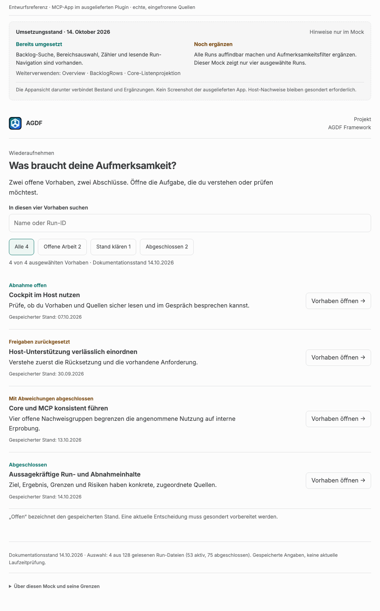
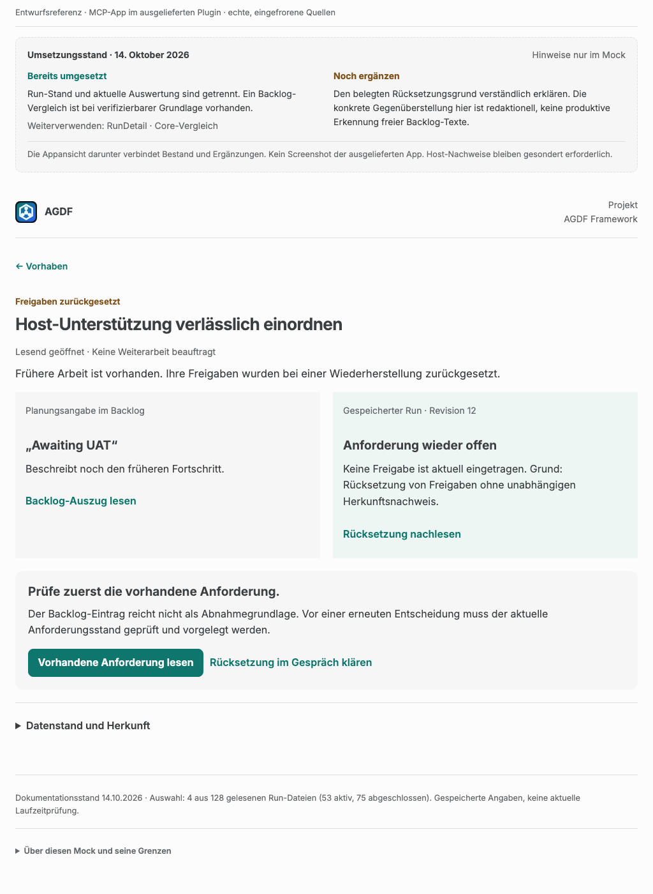
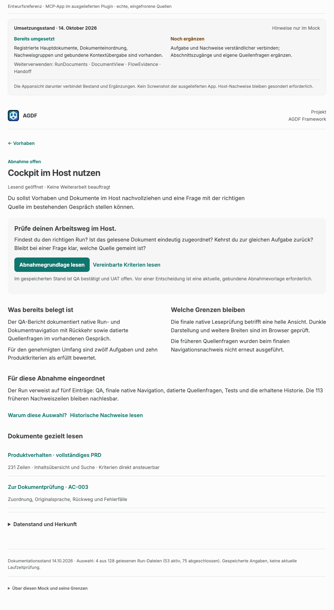
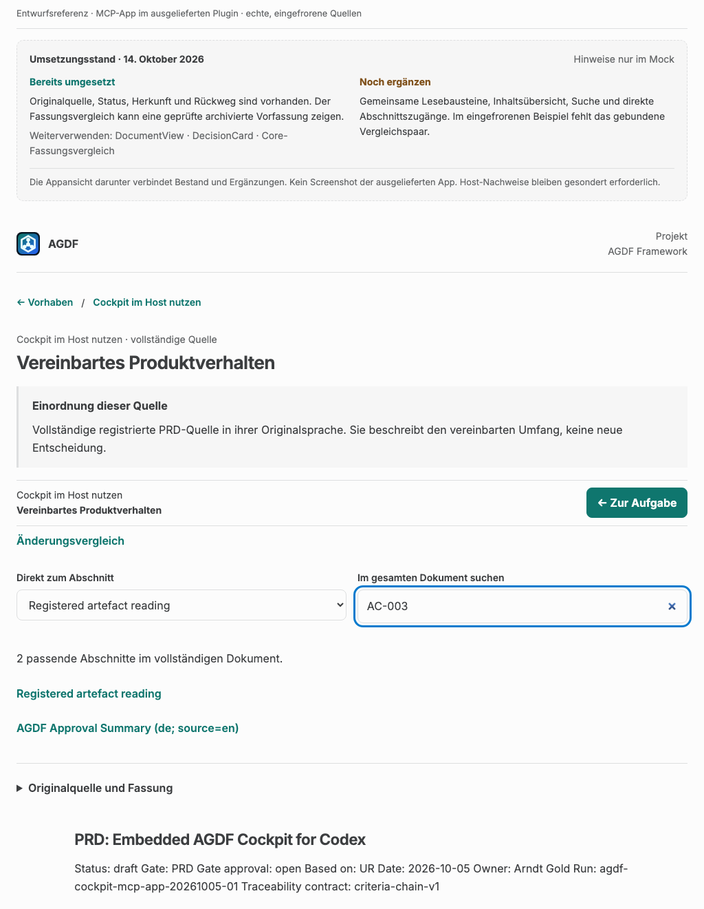
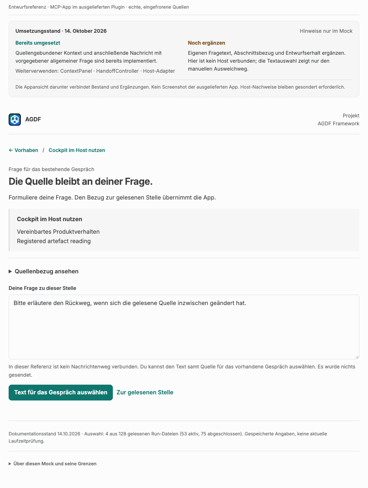
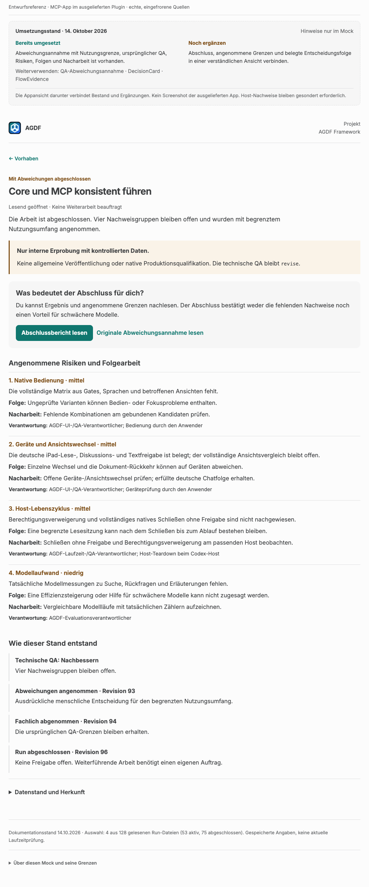

# Plugin-Mock: Vier echte Vorhaben verstehen und wiederaufnehmen

[Interaktiven Mock öffnen](cockpit-erlebnis.html) · [UI-Konzept](../07-ui-konzept.md#praxisreferenz-vier-echte-vorhaben-in-derselben-mcp-app)

Der Mock zeigt Hub, Aufgabe, Dokument und Rückfragevorbereitung innerhalb derselben mit dem
Plugin ausgelieferten MCP-App. Er ersetzt das synthetische Login-Beispiel als führende
Praxisreferenz. Die HTML-Datei ist eine eigenständig lesbare Entwurfsreferenz; für den Anwender
entsteht daraus keine zusätzliche Installation, kein neuer Webdienst und kein zweiter Chat.

## Umsetzungsstand: Bestand übernehmen, gezielt ergänzen

Abgleich: **14. Oktober 2026**. Der Hinweisbereich oberhalb der Appansicht wechselt bei der
Navigation mit und trennt „Bereits umgesetzt“ von „Noch ergänzen“. Er gehört ausschließlich
zum Entwurfsreview. Der eigentliche Nutzerweg bleibt frei von Implementierungsdetails.

| Ansicht | Bereits umgesetzt | Ergänzung, die der Mock veranschaulicht |
|---|---|---|
| Vorhabenübersicht | Backlog-Suche, Bereichsauswahl, Zähler, Run-Auswahl und Rückweg | Vollständiges begrenztes Run-Inventar und Aufmerksamkeitsfilter; die vier Beispiele belegen keinen solchen Dienst. |
| Aufgabe und Abnahmegrundlage | Registrierte Hauptdokumente, Dokumenteinordnung, aktuelle/historische Nachweisgruppen | Verständliche Zusammenführung und gezielter Einstieg in einen Dokumentabschnitt. |
| Rücksetzung | Trennung von gespeichertem Run und aktueller Auswertung; Backlog-Vergleich bei verifizierbarer Grundlage | Erklärung von Grund und Folge am konkreten Fall. Die gezeigte Gegenüberstellung ist redaktionell und behauptet keine generische Auswertung freier Backlog-Texte. |
| Abschluss mit Abweichungen | Kanonische Annahme mit Nutzungsgrenze, ursprünglicher QA, Risiko, Folgen und Nacharbeit | Abschluss, Grenzen und belegte Entscheidungsfolge in einer verständlichen Ansicht verbinden. |
| Ergebnis und frühere QA | Konkrete Ergebnis-/Abnahmeinhalte aus maßgeblichen Quellen; getrennte historische Dokumentangaben | Ergebnis, vorhandene Prüfschritte und Nachweise gemeinsam zugänglich machen. |
| Dokument | Original, Einordnung, Herkunft, Rückweg und geprüfter archivierter Vergleich, falls verfügbar | Gemeinsame Lesebausteine, Inhaltsübersicht, Dokumentensuche und Abschnittszugänge. Das fehlende Vergleichspaar ist eine Grenze dieser Beispieldaten. |
| Rückfrage | Gebundene Kontextübergabe und Nachricht mit einer vorgegebenen allgemeinen Quellenfrage | Eigener Fragetext, Abschnittsbezug und Erhalt des Entwurfs. Die Textauswahl demonstriert ausschließlich den manuellen Ausweichweg bei fehlendem Nachrichtenkanal. |

Die [verbindliche Zuordnung zu den bestehenden Komponenten](../07-ui-konzept.md#9-bestand-und-erforderliche-weiterentwicklung)
steht im Konzept. Die HTML-Datei ist keine Grundlage für einen zweiten Inventardienst,
Statusrechner, Freigabespeicher oder Chat-Transport. Ihre lokale Beispieldaten- und
Navigationslogik wird nicht in die Runtime übernommen. Die vorhandene Entscheidungskarte
bleibt Grundlage der Entscheidungssituationen; im Praxis-Mock gibt es keine aktive Freigabe.

## Datenstand und Herkunft

Lesesnapshot: **14. Oktober 2026, 13:21:21 UTC / 15:21:21 Europe/Berlin**.
Gelesen wurden 128 Run-Dateien mit 53 gespeicherten aktiven und 75 abgeschlossenen Lebenszyklen.
Der Mock enthält **vier ausgewählte Runs**, nicht das vollständige Projektinventar.
Suchergebnisse und Filter beziehen sich ausdrücklich nur auf diese Auswahl.

Die fachlichen Titel und deutschen Einordnungen sind redaktionelle Zusammenfassungen echter
Quellen. Sie sind keine neu gespeicherten Run-Titel oder Gate-Entscheidungen. Die Originaltexte
werden unverändert in ihrer Originalsprache dargestellt. Jede der 14 eingebetteten Quellbindungen
enthält Pfad, SHA-256 der damals gelesenen Datei sowie ursprüngliche Abschnitts- und Zeilenzuordnung.
Neun Dokumente sind vollständig enthalten; vier Run-Dateien und der Backlog-Eintrag sind als
Auszüge gekennzeichnet. Technische Belegblöcke der Run-Dateien werden nicht als Lesedokument kopiert.

| Vorhaben im Mock | Gespeicherter Run | Grundlage der Darstellung |
|---|---|---|
| Cockpit im Host nutzen | [agdf-cockpit-mcp-app-20261005-01](../../../.agdf/control/runs/agdf-cockpit-mcp-app-20261005-01/RUN_STATE.md), Revision 118, UAT offen | [QA](../../../.agdf/control/artefacts/agdf-cockpit-mcp-app-20261005-01/QA_REPORT.md), vollständiges [PRD](../../../.agdf/control/artefacts/agdf-cockpit-mcp-app-20261005-01/PRD.md), [Nachweisauswahl](../../../.agdf/control/artefacts/agdf-cockpit-mcp-app-20261005-01/UAT_EVIDENCE_PREPARATION-32.md) und [Historie](../../../.agdf/control/artefacts/agdf-cockpit-mcp-app-20261005-01/UAT_EVIDENCE_HISTORY-32.md) |
| Host-Unterstützung verlässlich einordnen | [agdf-host-adapter-compatibility](../../../.agdf/control/runs/agdf-host-adapter-compatibility/RUN_STATE.md), Revision 12, UR offen | Rücksetzung im Run, erhaltene [UR](../../../.agdf/control/artefacts/agdf-host-adapter-compatibility/UR.md), abweichende Planungsangabe im [Backlog](../../../.agdf/control/MASTER_BACKLOG.md) |
| Core und MCP konsistent führen | [core-mcp-flow-coherence-20261010-01](../../../.agdf/control/runs/core-mcp-flow-coherence-20261010-01/RUN_STATE.md), Revision 96, abgeschlossen | [OR](../../../.agdf/control/artefacts/core-mcp-flow-coherence-20261010-01/OR.md), ursprüngliches technisches revise und vollständiger Abweichungsvorschlag in [QA](../../../.agdf/control/artefacts/core-mcp-flow-coherence-20261010-01/QA_REPORT.md) |
| Aussagekräftige Run- und Abnahmeinhalte | [run-uat-content-readiness-20261014-01](../../../.agdf/control/runs/run-uat-content-readiness-20261014-01/RUN_STATE.md), Revision 21, abgeschlossen | [Geliefertes Ergebnis](../../../.agdf/control/artefacts/run-uat-content-readiness-20261014-01/OR.md) und unveränderter [QA-Bericht aus der früheren Prüfphase](../../../.agdf/control/artefacts/run-uat-content-readiness-20261014-01/QA_REPORT.md) |

Die Links führen zum jeweiligen Repository-Bestand und können sich nach dem Snapshot ändern.
Beim abschließenden Abgleich waren 13 Quelldateien noch bytegleich. Der vollständige Backlog
hatte sich während der Bearbeitung anderweitig geändert; sein eingebetteter Auszug war weiterhin
wortgleich vorhanden. Der Mock behält seinen ursprünglichen Snapshot und dessen Prüfsumme.
Das illustriert zusätzlich, warum eine gespeicherte Ansicht keine aktuelle Entscheidung trägt.

## Durchklickbare Wege

1. **Wiederaufnehmen:** Nach fachlichem Namen oder Run-ID suchen; offene Arbeit, Klärungsbedarf
   und Abschlüsse filtern. Ein Vorhaben öffnen und mit erhaltenem Filter und Suchtext zurückkehren.
2. **Abnahme verstehen:** „Cockpit im Host nutzen“ → „Abnahmegrundlage lesen“. Die Ansicht
   erklärt bestätigte QA, offene UAT und Grenzen der nativen und der Browser-Nachweise.
3. **Die richtige Stelle finden:** Im selben Vorhaben „Zur Dokumentprüfung · AC-003“ öffnen.
   Das vollständige PRD hat 231 Zeilen und 24 ansteuerbare Abschnitte. Die Suche nach AC-003
   findet sowohl das Kriterium als auch dessen Erwähnung in der deutschen Zusammenfassung.
4. **Gezielt fragen:** Am Abschnitt „Zu diesem Abschnitt fragen“ wählen. Nur die Frage wird
   eingegeben; Quellenbezug und Prüfsumme werden getrennt mitgeführt. „Text für das Gespräch
   auswählen“ stellt den vollständigen Text zur manuellen Übernahme bereit und meldet ausdrücklich,
   dass noch nichts gesendet wurde. Lesen, Frage und anderer Run behalten getrennte Entwürfe.
5. **Einen Widerspruch verstehen:** „Host-Unterstützung verlässlich einordnen“ zeigt Backlog
   und zurückgesetzten Run nebeneinander. Die Hauptaktion führt zur vorhandenen Anforderung.
   Der Klärungsweg bindet die Frage an den dokumentierten Rücksetzungsgrund.
6. **Einen begrenzten Abschluss lesen:** „Core und MCP konsistent führen“ zeigt interne
   Erprobung, ursprüngliche technische QA, vier Risiken mit Folgen, Nacharbeit und Verantwortung
   sowie die gespeicherte Reihenfolge von Abweichungsannahme, UAT und Abschluss.
7. **Historische Aufforderungen einordnen:** Im abgeschlossenen Inhalts-Run den früheren
   QA-Bericht öffnen. „Gate approval: open“ bleibt im Original erhalten; die Einordnung erklärt
   den späteren Abschluss. Daraus wird keine neue Freigabeaktion.
8. **Fehlende Vergleichbarkeit erkennen:** In einem Dokument „Änderungsvergleich“ wählen.
   Ohne gebundenes Dokumentpaar wird die fehlende Grundlage erklärt. Eine Run-Revision wird
   nicht zur erfundenen Dokumentfassung.

Unter „Über diesen Mock und seine Grenzen“ lässt sich zusätzlich eine inzwischen geänderte
Quelle simulieren. Diese Simulation ist **kein beobachtetes Ereignis der vier Runs**. Sie erhält
den Entwurf, erklärt die überholte Bindung und entfernt die ungeprüfte Textübernahme. Zurücksetzen
stellt nur den eingefrorenen Dokumentationsstand wieder her; es führt keine Live-Abfrage aus.

## Was tatsächlich interaktiv ist

Die lokale Navigation, Filter, Quellsuche, Abschnittssprünge, Rückwege, Frageentwürfe und
Textauswahl funktionieren. Auf größeren Flächen bleibt der Lesekontext beim Scrollen sichtbar.
Bei schmalen Flächen werden Inhalte umgebrochen; umfangreiche Quelltabellen dürfen lokal scrollen.

Es gibt keine aktuelle Gate-Prüfung, keine wirksame Entscheidung, keinen Modellaufruf und keine
Nachrichtenzustellung. Die vier eingefrorenen Fälle erhalten deshalb keine Freigabebuttons und
keine aktiven exakten Freigabeformeln. Originaldokumente können solche Formeln als Quelltext
enthalten. Die produktive Entscheidung bleibt an die bestehende Core-Fassade und ihre aktuelle
Präsentation gebunden. Die [v3-Serie](human-gate-mocks-v3.md) ergänzt diese Entscheidungssituationen,
Speicherbelege und Portable Markdown weiterhin mit ausdrücklich synthetischen Beispieldaten.

Schrift, Logo und Quellen sind eingebettet. Die Datei benötigt kein Netzwerk und verwendet
weder Browser-Storage noch URL-Parameter für Entwürfe. Navigation und Entwürfe bleiben nur im
Arbeitsspeicher der geöffneten Seite. Ein Neuladen oder Schließen verwirft sie. Der Mock ist kein
neuer Datenbesitzer und schreibt weder ins Projekt noch nach `.agdf/control`.

## Gerenderte Referenzen

## Lokale Prüfung und verbleibende Qualifizierung

Die folgenden 32 Verhaltens- und 56 Layoutprüfungen gehören zum ersten Praxis-Mock.
Die Prüfung der anschließend ergänzten Umsetzungskennzeichnung wird getrennt dokumentiert.

Am 14. Oktober 2026 wurden 32 Verhaltensprüfungen erfolgreich durchlaufen: Suchumfang,
Rücksetzung, Abweichungsabschluss, zeitliche Einordnung, vollständiges PRD, Abschnittssuche,
Quellenbezug, Entwurfserhalt über Run-Wechsel, fehlender Vergleich, geänderte Quelle, Tastatur
und Rückkehrfokus. Es traten keine JavaScript-Ausnahmen auf. Die eingebetteten vollständigen
Quelltexte wurden zeilenweise mit ihren Quelldateien abgeglichen.

56 Layoutfälle deckten Übersicht, vier Run-Ansichten, Dokument und Rückfrage bei 1024, 736,
360 und 320 Pixeln mit normaler sowie 200 Prozent Schrift ab. Nach Korrektur langer Umbrüche
und des Sprungabstands am Lesekopf blieb die Seite ohne horizontalen Überlauf. Die dunkle
schmale Rücksetzungsansicht wurde zusätzlich gerendert und visuell geprüft. Breite Tabellen
besitzen ihren eigenen Scrollbereich; das ist keine Behauptung vollständiger Barrierefreiheit.

Diese Prüfungen belegen den lokalen Entwurf. Tatsächliche native Darstellung, Nachrichtenweg,
Entscheidungswirkung, Haltbarkeit von Entwürfen im Host und Entlastung echter Anwender benötigen
die im [Konzept festgelegte spätere Qualifizierung](../07-ui-konzept.md#verbindliche-praxisfälle-für-konzept--und-implementierungsreview).

### Nachprüfung der Umsetzungskennzeichnung am 14. Oktober 2026

Nach Ergänzung der Hinweise wurden die 32 Verhaltensprüfungen und 56 Layoutfälle erneut
erfolgreich durchlaufen. Weitere 40 Prüfungen bestätigen die passende Bestands-/Ergänzungsangabe
in allen sieben HTML-Ansichten, deren Trennung von der Produktansicht, die ausdrücklich
erhaltene produktive Host-Übergabe sowie Kennzeichnung und Textgrenzen aller neun v3-SVGs.
Keine JavaScript-Ausnahmen und kein horizontaler Seitenüberlauf in den geprüften HTML-Fällen.

Die sechs PNG-Referenzen wurden neu gerendert. Übersicht, Dokument, Rückfrage, dunkle schmale
Rückfrage und ein SVG mit Hinweisbereich wurden zusätzlich visuell geprüft. Die eingebetteten
vier Runs und alle 14 Quellbindungen stimmen weiterhin mit dem eingefrorenen Fixture überein.
Die lokalen Dateiverweise der vier bearbeiteten Begleitdokumente wurden auf Existenz geprüft.
Diese Nachprüfung betrifft die Dokumentation und Mocks; sie ist kein neuer Test der Runtime.
