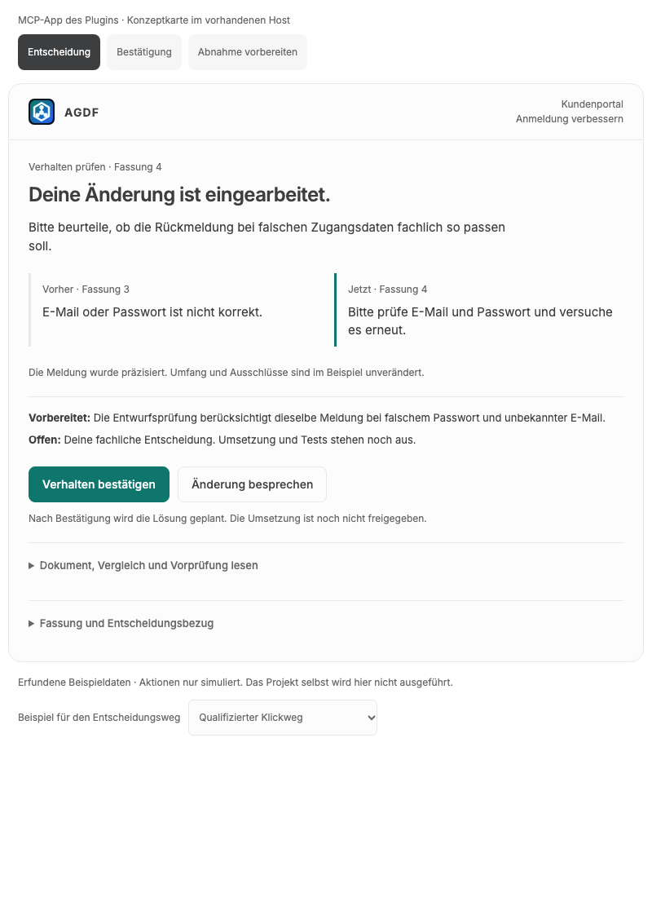
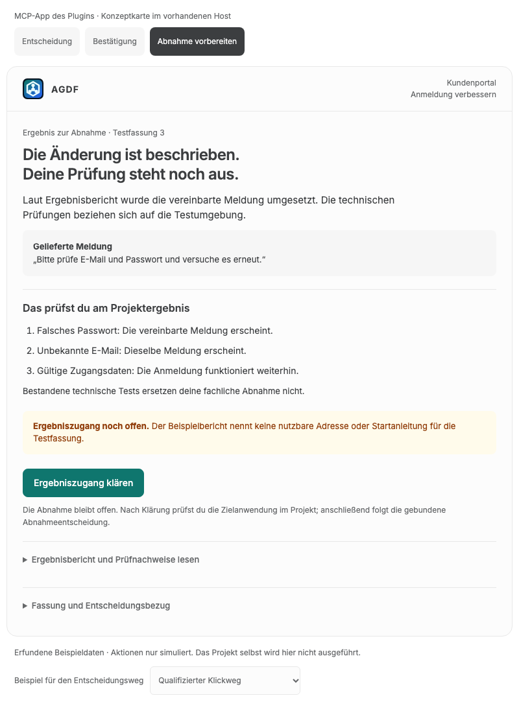

# Plugin-Mock: vorbereitete Entscheidung im vorhandenen Host

Stand: 14. Oktober 2026. Korrigierte Referenz zum
[UI-Konzept](../07-ui-konzept.md#produktgrenze-mcp-app-und-mcp-server-im-plugin).

[Mock öffnen](cockpit-erlebnis.html)

MCP-App und MCP-Server gehören zum vorgesehenen Plugin-Lieferumfang. Der Mock zeigt eine
kompakte, generische AGDF-Karte im vorhandenen Host. Die HTML-Datei ist eine Entwurfsreferenz;
sie ist weder ein zusätzliches Produkt noch eine separate Installation für den Anwender.
Die zuvor gezeigte eingebettete Anmeldung mit eigenen Test- und Variantenfunktionen wurde
entfernt. Die Zielanwendung gehört zum bearbeiteten Projekt.

## Drei Zustände derselben Plugin-Oberfläche

| Zustand | Was die App zeigt | Nutzen |
|---|---|---|
| Entscheidung | Änderungswunsch übernommen, alter und neuer Dokumentausschnitt, Vorprüfung, offene fachliche Frage, verfügbare Handlung und Folge | Die relevante Änderung und Entscheidung sind ohne erneutes vollständiges Lesen verständlich. |
| Bestätigung | Gespeicherte Entscheidung für die konkrete Fassung und nächster Schritt; Statusabgleich bei unbestätigter Übernahme | Der Nutzer erkennt, was gespeichert ist und ob die Weiterarbeit bestätigt wurde. |
| Abnahme vorbereiten | Ergebnisbericht, zugeordnete Prüfschritte, Nachweise und fehlender Ergebniszugang | Der Nutzer erkennt, was er am Projektergebnis prüfen muss und welche Voraussetzung noch fehlt. |

Die Auswahl oberhalb der Karte wechselt zwischen erfundenen Beispielzuständen. Sie gehört
zum Mock. Sie überspringt keine tatsächlichen Gates. Die untere Auswahl zeigt entweder einen
qualifizierten Klickweg oder die exakte Antwort im bestehenden Gespräch. Der Textweg benötigt
keinen deaktivierten Bestätigungsbutton.

„Änderung besprechen“ und „Ergebniszugang klären“ zeigen den Bezug für das bestehende Gespräch.
Der Mock sendet keine Nachricht und enthält keinen zweiten Chat. Die spätere App verwendet
den jeweils unterstützten, bestätigten Hostweg. „Status prüfen“ simuliert den Abgleich des
ursprünglichen Vorgangs und erzeugt keine zweite Zustimmung.

## Beispielinhalt

- Vorhaben: Anmeldung verbessern im Kundenportal; Beispielrun `ui-example-plugin`.
- Entscheidung: Produktverhalten, Fassung 4; Bezug `prd-example-4`.
- Vorher: „E-Mail oder Passwort ist nicht korrekt.“
- Jetzt: „Bitte prüfe E-Mail und Passwort und versuche es erneut.“
- Die Entwurfsprüfung berücksichtigt eine gemeinsame Meldung für falsches Passwort und
  unbekannte E-Mail. Die fachliche Entscheidung bleibt offen; Umsetzung und Tests stehen aus.
- Die Bestätigung erlaubt den Lösungsentwurf. Sie gibt noch keine Umsetzung frei.
- Der spätere Beispielzustand bezieht sich auf Testfassung 3 in der Testumgebung und setzt
  die dazwischen notwendigen Freigaben und Prüfungen voraus. Der Ergebnisbericht enthält
  noch keinen nutzbaren Ergebniszugang; deshalb führt die Karte zur Klärung und behauptet
  keine mögliche oder bereits erfolgte Abnahme.

Alle Daten und Nachweise sind synthetisch. Das Plugin erzeugt keine projektspezifische
Login-Oberfläche, Testumgebung oder automatisch ausgeführte Abnahme. Tatsächlich vorhandene
Ergebnisadressen oder Startanleitungen können aus den registrierten Quellen angezeigt werden.
Die produktive Bindung und Prüfung bleiben bei den bestehenden Core- und MCP-Verträgen.

## Gerenderte Referenzen

Die [v3-Serie](human-gate-mocks-v3.md) ergänzt die übrigen Gates, den Run-Wechsel,
Portable Markdown sowie Recovery-Zustände. Sie bleibt die Detailreferenz ihrer Inhalte.

## Prüfgrenze

Die lokale Browserprüfung am 14. Oktober 2026 hat drei Zustände, Klick- und Textweg,
Quellenzugang, Kontextanzeige, Tastaturaktivierung mit Fokusübergabe, Rückkehr, bestätigte
Speicherung und Statusabgleich geprüft. Die 24 Layoutfälle bei 1024, 736, 360 und 320 Pixeln
mit normalem und auf 200 Prozent vergrößertem Text blieben ohne horizontalen Überlauf.
Dunkle Darstellung wurde ebenfalls gerendert. Es traten keine JavaScript-Fehler auf.
Der Mock belegt keine Plugin-Installation, native Hostintegration oder wirksame Freigabe.

Schrift und vorhandenes AGDF-Logo sind eingebettet. Es gibt keine Netzwerkabrufe und keinen
Zugriff auf eine reale Runtime oder ein Projekt. Ohne Visualisierungshost besteht der Zustand
nur im Arbeitsspeicher der Seite; im Visualisierungshost kann dessen Widget-Zustand die
Beispielauswahl erhalten. Die Datei verwendet dafür weder URL-Parameter noch Local Storage.
