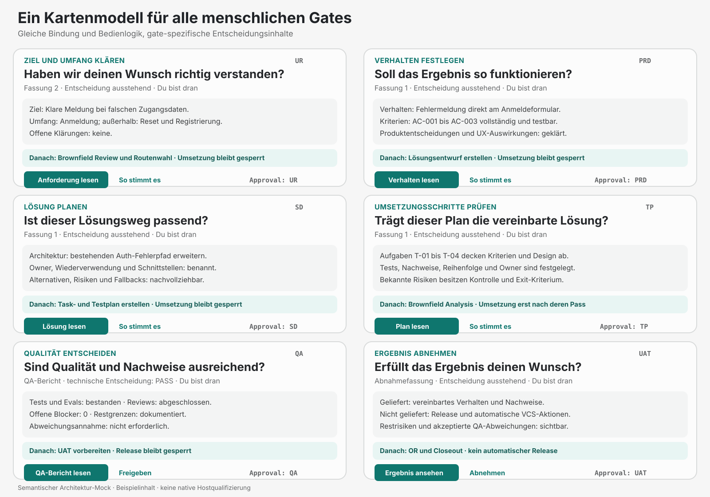
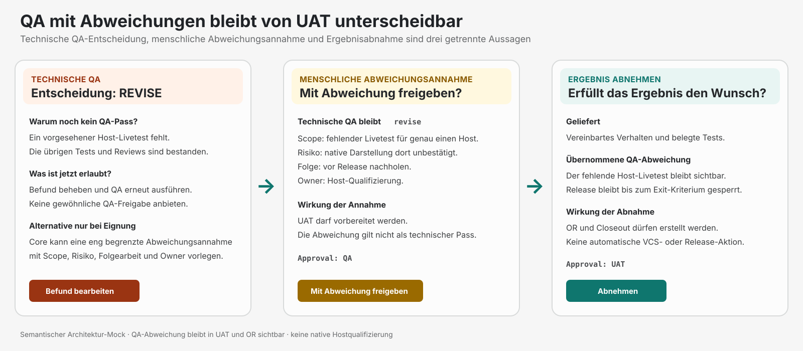

# Semantische Mockups für menschliche Gates

Diese Mockups ergänzen die gerenderte v4-Cockpit-Serie um die bislang fehlende
gateübergreifende Entscheidungssystematik. Sie wurden am 13. Oktober 2026 als
handgeführte SVG-Architektur-Mocks erstellt. Sie sind keine Screenshots, keine Aussage
über den heutigen Implementierungsstand und keine native Hostqualifizierung.

> **Historischer Stand:** Die [Produkt-Mock-Serie v2](human-gate-mocks-v2.md) ersetzt diese
> großformatige Systemübersicht als aktuelle visuelle Referenz. Die v1-Dateien bleiben zur
> Nachvollziehbarkeit der semantischen Ausgangsstufe erhalten.

## Sechs menschliche Gates

Datei: `human-gates-overview-v1.svg`

Die Übersicht zeigt für `UR`, `PRD`, `SD`, `TP`, `QA` und `UAT` dieselbe Kartenanatomie:

1. verständliche Aufgabe und Leitfrage,
2. genaue Fassung und Zuständigkeit,
3. gate-spezifische Entscheidungszusammenfassung,
4. sichtbare Wirkung und weiterhin gesperrte Arbeit,
5. Lesezugang und bewusste Entscheidung,
6. exakte Chat-Antwort als technischer Fallback.

Die dargestellten Inhalte sind Beispieldaten. Reale Karten werden aus dem gebundenen
Präsentationsmodell des konkreten Runs erzeugt. Ein Run zeigt nur die tatsächlich
anwendbaren menschlichen Gates seiner Route.

## QA-Abweichung und UAT

Datei: `qa-deviation-uat-v1.svg`

Der Sonderfall hält drei Aussagen getrennt:

- Die technische QA-Entscheidung bleibt `revise`.
- Eine zulässige menschliche Abweichungsannahme bindet Scope, Risiko, Konsequenz,
  Folgearbeit und Owner; sie macht aus `revise` keinen technischen `pass`.
- UAT übernimmt die akzeptierte Abweichung sichtbar und erlaubt nach Zustimmung nur
  OR und Closeout, keine automatische VCS- oder Release-Aktion.

## Darstellungsgrenzen

- Die SVGs zeigen die fachliche Informationshierarchie, nicht pixelgenaue Komponenten.
- Farben unterstützen die Orientierung, tragen aber keine Aussage allein.
- Die endgültige MCP-App verwendet vorhandene Tokens und Komponenten.
- Portable Markdown erhält dieselben Inhalte in linearer Lesereihenfolge.
- Freigabebuttons in den Mockups belegen weder Verfügbarkeit noch Qualifizierung eines
  nativen Klickwegs.
