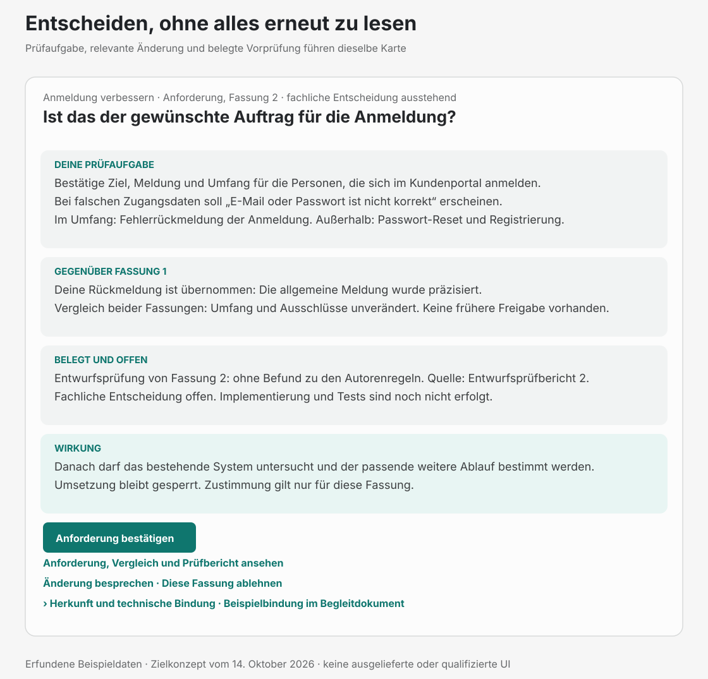
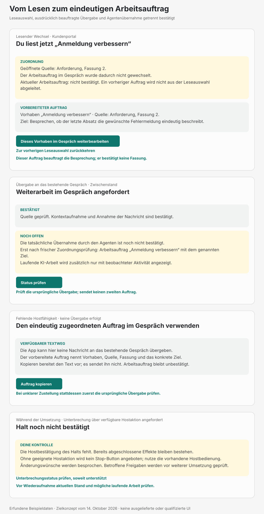
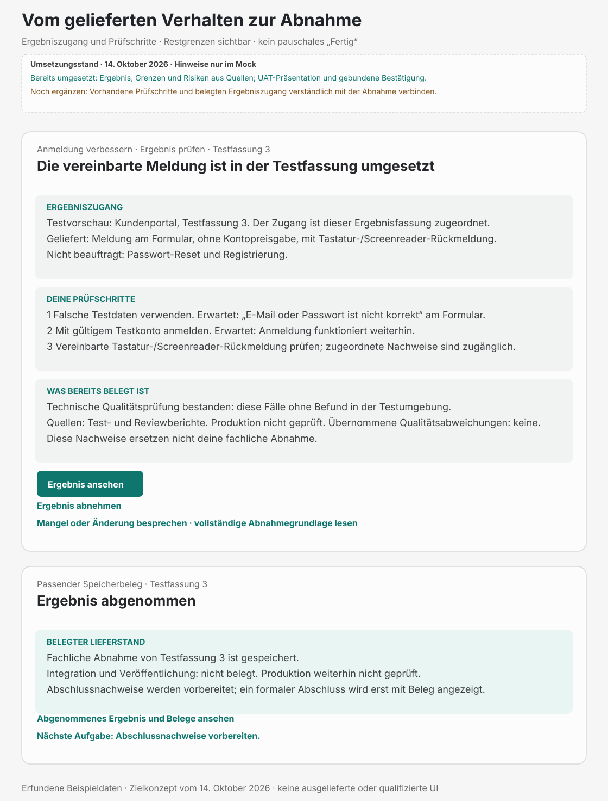

# Produkt-Mocks v3: vorbereitete Entscheidungen und prüfbare Ergebnisse

Stand: 14. Oktober 2026. Die SVG-Serie schärft die vorhandene Gestaltung des
[UI-Konzepts](../07-ui-konzept.md) anhand der Anwenderbewertung. Sie zeigt Zielzustände mit
erfundenen Beispieldaten, keine Screenshots der Implementierung. Qualifizierter Klickweg,
Kontextaufnahme, Nachrichtenvermittlung und Statusabgleich sind jeweils Voraussetzungen,
keine durch den Mock belegten Hostfähigkeiten. Die aktuellen UI-Richtlinien gelten weiterhin.

Die verdichtete Einstiegsreferenz ist der [Plugin-Mock](cockpit-erlebnis.html)
mit [Produktgrenze und Prüfhinweisen](cockpit-erlebnis.md). Er zeigt die generische MCP-App
des Plugins im bestehenden Host. Diese SVG-Serie bleibt die Detailreferenz
für Gate-Inhalte, Bindungen, Format-Fallback und Recovery. Ihre Informationsdichte ist keine
Vorgabe für den normalen Einstieg.

## Ansichten und Änderungszweck

| Datei | Was die Ansicht konkretisiert |
|---|---|
| [Kartenanatomie](gate-card-anatomy-v3.svg) | Verdichtete Orientierung, konkrete Prüfaufgabe, berücksichtigte Rückmeldung und belegte Vorprüfung mit Aussagegrenze. |
| [Schmale Karte](compact-decision-v3.svg) | Eine konkrete Frage, relevanter Vergleich, Vorprüfungsgrenze und eine verfügbare Hauptaktion auf 480px Kartenbreite. |
| [Anforderung und Verhalten](gate-cards-ur-prd-v3.svg) | Auftrag bestätigen und Produktverhalten beurteilen sind unterschiedliche fachliche Aufgaben. |
| [Entwurf und Plan](gate-cards-sd-tp-v3.svg) | Benötigte technische Zuständigkeit, konkrete Abwägung, Owner, geplante Nachweise und verbleibende Risiken. |
| [Qualität und Abnahme](gate-cards-qa-uat-v3.svg) | Technische QA und fachliche Abnahme bleiben getrennt; beide zeigen ihre Nachweis- und Umgebungsgrenzen. |
| [Darstellungsformate](presentation-formats-responsive-v3.svg) | Derselbe UR-Gegenstand als MCP-App mit Klick oder Textweg und als Portable Markdown. Kopieren entscheidet nichts. |
| [Run-Wechsel und Arbeitsübergabe](run-context-handoff-v3.svg) | Nur lesen, bewusst weiterbeauftragen, Nachricht angenommen und tatsächlich übernommen bleiben getrennte Zustände. Zusätzlich: fehlender Nachrichtenweg und unbestätigter Halt. |
| [Ergebnis und Abnahme](result-acceptance-v3.svg) | Tatsächliche Änderung, zugeordnete Ergebnisfassung, konkrete Prüfschritte, Restgrenzen und belegter Lieferzustand. |
| [Recovery](recovery-states-v3.svg) | Veraltete Quelle, unklare Speicherung, gespeicherte Freigabe mit unbestätigter Fortsetzung und Format-Fallback. |

Die v2-Serie bleibt als historischer Entwurf erhalten. Ihr
[QA-Abweichungsfluss](qa-deviation-uat-v2.svg) ergänzt weiterhin die v3-Karten: technische
Entscheidung, zulässige Abweichungsannahme und Ergebnisabnahme behalten eigene Aussagen.
Die historischen v4-Rasterbilder zeigen den ursprünglichen Einstieg über die Anforderung;
ihre deaktivierten „So stimmt es“-Buttons und nachrangigen Antwortformeln sind keine aktuelle
Gestaltungsvorgabe. Die folgende Serie verwendet Gegenstandsbezeichnungen.

## Entscheidungsvorbereitung



Die Karten verdichten Orientierung, statt Schritt, Zuständigkeit, Frage und Erwartung
mehrfach zu wiederholen. Die vollständige Quelle bleibt zugänglich. Die
[schmale Karte](compact-decision-v3.svg) zeigt dieselbe UR-Beispielbindung auf 480px Breite. Risiken gehören in den
Hauptinhalt. Ein Vergleich nennt Änderung und Behandlung der Rückmeldung; bei fehlender
Vergleichsgrundlage muss die produktive Ansicht dies erklären, statt eine unveränderte
Fassung oder einen unveränderten Umfang zu behaupten.

## Leseauswahl und Arbeitsauftrag



Die erste Karte zeigt unbekannte Gesprächszuordnung. Ein früherer Auftrag darf nur benannt
werden, wenn er aktuell belegt ist. Die Weiterarbeitsaktion benennt Run, Quelle und Ziel und
beauftragt in diesem Beispiel eine Besprechung. Sie bestätigt kein Gate. Kontextaufnahme und
Nachrichtenannahme belegen noch keine Agentenübernahme. Bei unklarer Zustellung wird zuerst
der ursprüngliche Vorgang geprüft; bei fehlendem Nachrichtenweg kann der eindeutig zugeordnete
Textauftrag kopiert werden. Ein Halt bleibt bis zur Hostbestätigung unbestätigt.

## Ergebnis und Abnahme



Die Beispielabnahme bezieht sich auf Testfassung 3 in der Testumgebung. Ihr QA-Pass wird nicht
als Produktionsnachweis oder menschliche Abnahme ausgegeben. Die gezeigten Prüfschritte sind
Beispiele für die vereinbarten Kriterien, kein universeller Abnahmekatalog. Es gibt keinen
erfundenen Vorschau-Link. Ein produktiver Zugang müsste tatsächlich verfügbar und gebunden sein.
Der positive Folgezustand setzt einen passenden gespeicherten Abnahmebeleg voraus.

## Gemeinsame UR-Beispielbindung für beide Formate

Die SVGs zeigen die Informationshierarchie und den Zugang zu technischen Details. Die
vollständige lineare Portable-Markdown-Referenz folgt hier. Alle UR-Karten mit Fassung 2
verwenden dieselben folgenden Beispieldaten; sie gehören zu keinem realen Kontrollstand.
Die späteren PRD-/SD-/TP-/QA-/UAT-Beispiele besitzen eigene Entscheidungsgegenstände.

- Vorhaben: Anmeldung verbessern, Projekt Kundenportal.
- Run: `ui-example-login`.
- Gate: `UR`.
- Revision: `ui-example-revision-2`.
- Präsentation: `ui-example-ur-presentation-2`.
- Dokument-Digest: `sha256:aaaaaaaaaaaaaaaaaaaaaaaaaaaaaaaaaaaaaaaaaaaaaaaaaaaaaaaaaaaaaaaa`.
- Vergleichsquelle Fassung 1: `sha256:bbbbbbbbbbbbbbbbbbbbbbbbbbbbbbbbbbbbbbbbbbbbbbbbbbbbbbbbbbbbbbbb`.
- Prüfbericht-Digest: `sha256:cccccccccccccccccccccccccccccccccccccccccccccccccccccccccccccccc`.
- Zulässige positive Chat-Antwort: `Approval: UR`.

Die Digests sind ausdrücklich synthetische Platzhalter mit vollständiger Länge. Die native
Ansicht führt eine gegenstandsbezogene Klickaktion und hält die exakte Antwort in Details
zugänglich. Die App ohne Klickweg bietet die Formel unmittelbar und optional „Antwort
kopieren“. Portable Markdown benötigt keinen Kopierbutton. Jede Darstellung enthält dieselbe
Prüfaufgabe, Änderung, Vorprüfung, offene Grenze und Zustimmungswirkung. Herkunft und Bindung
werden in der App über Details, im Text linear angeboten. Eine kompakte App verwendet dieselben
Inhalte mit Umbruch, ohne eigenen Scrollcontainer; die SVG-Serie allein beweist noch keine
responsive Komponente oder Zugänglichkeit bei 200 Prozent Textvergrößerung.

```text
## Anmeldung verbessern

Projekt: Kundenportal
Aufgabe: Ziel und Umfang klären
Fassung: 2 · fachliche Entscheidung ausstehend

### Ist das der gewünschte Auftrag für die Anmeldung?

Deine Prüfaufgabe:
Bestätige Ziel, Meldung und Umfang für die Personen, die sich im Kundenportal anmelden.
Bei falschen Zugangsdaten soll „E-Mail oder Passwort ist nicht korrekt“ erscheinen.
Im Umfang: Fehlerrückmeldung der Anmeldung.
Außerhalb: Passwort-Reset und Registrierung.

Gegenüber Fassung 1:
Deine Rückmeldung ist übernommen: Die allgemeine Meldung wurde präzisiert.
Vergleich beider Fassungen: Umfang und Ausschlüsse unverändert.
Keine frühere Freigabe vorhanden.

Belegt und offen:
Entwurfsprüfung von Fassung 2: ohne Befund zu den Autorenregeln.
Quelle: Entwurfsprüfbericht 2.
Fachliche Entscheidung offen. Implementierung und Tests sind noch nicht erfolgt.

Wirkung:
Danach darf das bestehende System untersucht und der passende weitere Ablauf bestimmt werden.
Umsetzung bleibt gesperrt. Zustimmung gilt nur für diese Fassung.

### Zulässige Antwort

Antworte im bestehenden Gespräch exakt mit:
Approval: UR

Änderungswünsche oder Ablehnung werden im bestehenden Gespräch geklärt.
Die vollständige Anforderung, ihr Vergleich und der Prüfbericht bleiben zugänglich.

### Bindung

Run: ui-example-login
Gate: UR
Revision: ui-example-revision-2
Präsentation: ui-example-ur-presentation-2
Dokument-Digest: sha256:aaaaaaaaaaaaaaaaaaaaaaaaaaaaaaaaaaaaaaaaaaaaaaaaaaaaaaaaaaaaaaaa
Vergleichsquelle: sha256:bbbbbbbbbbbbbbbbbbbbbbbbbbbbbbbbbbbbbbbbbbbbbbbbbbbbbbbbbbbbbbbb
Prüfbericht-Digest: sha256:cccccccccccccccccccccccccccccccccccccccccccccccccccccccccccccccc

Fallback-Grund in diesem Beispiel: MCP-App nicht bestätigt angezeigt.
```

## Prüfgrenzen

Die SVGs sind editierbare Architektur-Mocks mit der vorhandenen Farb- und Schriftanmutung.
Sie enthalten keine operative Freigabe, keinen neuen Runtime-Vertrag und keine zusätzliche
Schreibberechtigung. Layout- und Linkprüfungen ersetzen weder Komponentenprüfung noch native
Hostqualifizierung. Die Verständnis- und Entlastungsprüfung steht im
[UI-Konzept](../07-ui-konzept.md#10-beobachtbare-nutzererlebnisse).
