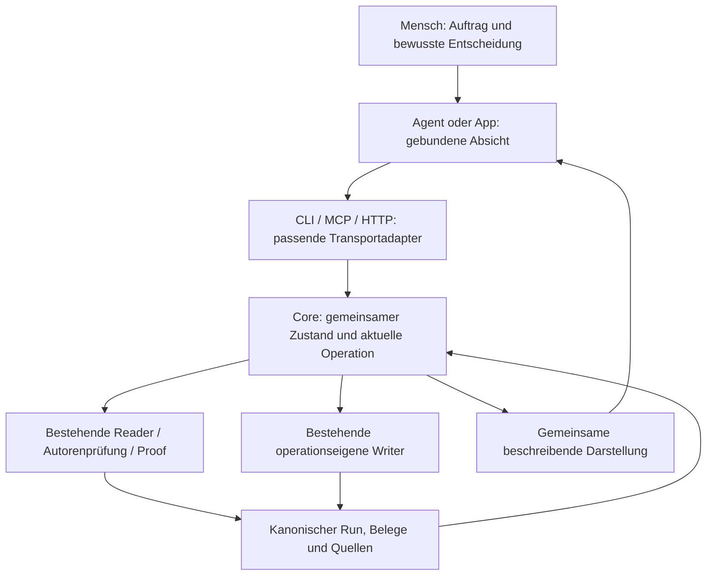

# Architektur- und Flow-Bewertung der MCP-Kandidaten

**Stand: 10. Oktober 2026. Dokumentrolle: nicht normative Architektur-Bewertung und Entscheidungsvorlage.** Direkt auf Nutzerauftrag erstellt, ohne AGDF-Aufruf, Gate-Artefakt, neuen Run oder Kontrollzustandsänderung. Diese Bewertung erteilt keinen Umsetzungsauftrag.

## 1. Gesamturteil

Die Kandidaten beschreiben überwiegend Lücken zwischen bereits vorhandenen Core-Funktionen, ihren öffentlich beschriebenen Verträgen und dem tatsächlich durchgängigen Arbeitsablauf. Sie rechtfertigen keine Sammlung neuer, unabhängig entworfener MCP-Tools.

Der größte Architekturbedarf ist **ein konsistenter Zustands- und Operationsvertrag vom Lesen über das Schreiben bis zum Abschluss**. MCP soll diesen Vertrag zugänglich machen. Es darf widersprüchliche Core-Ergebnisse weder durch eigene Regeln korrigieren noch unvollständige Core-Fähigkeiten durch Adapterlogik ergänzen.

Vier zusammenhängende Probleme sind erkennbar:

1. Leser und Writer bauen teilweise unterschiedliche Zustandsmodelle für dieselbe Gate-Policy auf. Daraus entstehen falsche Folgeangaben nach erfolgreichen Freigaben.
2. Beschreibungstext dient an einer Stelle als technische Fortsetzungsbedingung. Eine semantisch gleiche Formulierung kann die Ausführung unterbrechen.
3. Der strukturierte Abschluss ist als menschlicher Prozess vorhanden, aber weder als begrenzter Schreibvorgang noch als konsistente abgeschlossene Kontrollprojektion vollständig abgedeckt.
4. Formate, Nachweiszuordnung und Laufzeitqualifikation sind teilweise nur durch Quellcode-Suche verständlich. Einige dieser Suchen sind vermeidbare Schnittstellenarbeit; andere sind notwendige Architektur- und Reviewarbeit.

Die bereits implementierte Core-Projektion für Dokumentzustand, exakte lesbare Fassung und gebundene Entwurfsbefunde ist ein brauchbares Muster: bestehende fachliche Eigentümer wiederverwenden, beschreibende Ergebnisse liefern und UI-/Transportlogik davon trennen. Sie ist kein Beleg, dass der gesamte Schreib- und Abschlussflow bereits geschlossen wäre.

## 2. Umfang, Quellen und Nachweisgrenzen

Bewertet wurden sämtliche Beobachtungen der beiden Kandidatensammlungen:

- [Entwurfsprüfung: Kandidaten und Nachträge](../../.agdf/control/artefacts/cockpit-draft-check-integration-20261009-01/MCP_CANDIDATES.md), einschließlich nativer Qualifikation, Freigaben und Abschlussprojektion.
- [Dokumentübersicht: Kandidaten und Nachträge](../../.agdf/control/artefacts/cockpit-documented-approvals-20261009-01/MCP_CANDIDATES.md), einschließlich erneuerter Quellen, Umsetzung, QA, UAT und Abschluss.

Ähnliche Einträge sind in Abschnitt 5 zusammengeführt. Die dortigen IDs sind nur Verweise innerhalb dieser Bewertung, keine neuen Operations- oder Backlog-IDs.

Die Quellprüfung umfasst Core-Leser, Gate-Policy, Freigabe- und Artefakt-Writer, Quellenrevision, Presenter, Dispatcher, CLI- und MCP-Adapter sowie die aktuelle Cockpit-Projektion. Beobachtungen aus den Runs wurden mit dem jetzigen Repository-Code abgeglichen. Historische Notizen bleiben zeitgebundene Nachweise; Aussagen wie „Design pending“ in frühen Einträgen werden durch spätere Umsetzung nicht zu aktuellen offenen Aufgaben.

**Nachweisklassen:** „Quellbestätigt“ bezeichnet einen heute nachvollziehbaren Codepfad. „Im Run beobachtet“ bezeichnet die dokumentierten damaligen Aufrufe/Ergebnisse. Ein „Vorschlag“ ist eine Architekturfolgerung. In dieser Bewertung wurden keine Core-Funktionen, Validatoren oder MCP-Werkzeuge ausgeführt, keine neuen Laufzeit-/Hosttests durchgeführt und keine vorhandenen Fehler durch einen neuen Test reproduziert. Eine bessere Leistung schwächerer Modelle ist eine plausible Hypothese, kein gemessenes Ergebnis.

## 3. Einordnung in das vorhandene Gesamtkonzept

Ein gemeinsames Zielbild existiert bereits: [Agentenkontrolle, Abschnitt 7 und 10](../architecture/03-agentenkontrolle-zielbild.md). Die [MCP-Schnittstellenbeschreibung](../architecture/04-mcp-schnittstellen.md) ordnet die Operationen diesem Konzept zu. Diese Bewertung ergänzt den aktuellen Abgleich; sie ersetzt weder dessen Operationskatalog noch dessen Roadmap.

| Vorhandener Bezug | Kandidaten dieser Bewertung | Bedeutung |
|---|---|---|
| OP-01 Kontrolle/Verträge einsehen | K-02, K-08, K-09, K-12 | Aktuelle Zustände, unterstützte Formate, begrenzte Orientierung |
| OP-02 Nachweis/Artefakt einsehen | K-07, K-09, K-11 | Dokumentidentität, aktuelle versus historische Nachweise, qualifizierte Quellen |
| OP-04 aktuelle Arbeit fortsetzen | K-01, K-02, K-06 | Kanonische Folgeoperation statt proseabhängiger oder wiederholter Abschlussaufforderung |
| OP-05 Darstellung vorbereiten | K-04 | Gespeicherte Präsentationsbindung; vorbereitendes Schreiben ohne Freigabe |
| OP-06 menschliche Entscheidung aufzeichnen | K-01, K-04 | Bestehender Freigabebefehl und neue bewusste Antwort |
| OP-07 internen Schritt/Nachweis aufzeichnen | K-03, K-05, K-06 | Analysen, Artefaktbezüge, Revision und Abschluss über bestehende Writer-Verantwortung |
| OP-09 Arbeitsergebnis erfassen/prüfen | K-08, K-09, K-10 | Tatsächliche Test-/Qualifikationsnachweise; keine automatisch erzeugte QA-Entscheidung |
| R-04 zusammenhängender MCP-Lebenszyklus | K-01 bis K-06, K-11, K-12 | Hauptbezug für die konsistente Vertrags- und Transportgestaltung |
| R-05 native Adapter qualifizieren | K-09, K-10 | Getrennter Bezug für tatsächliche Host-Beobachtung |

OP-03, OP-08 und OP-10 bleiben angrenzende vorhandene Verantwortlichkeiten. Die Kandidaten begründen keine eigene neue Anfragezuordnung, Berechtigungsinstanz oder Ereignispolicy. Ebenso liefern sie keinen Nachweis der im Gesamtkonzept diskutierten stärkeren Host-Durchsetzung oder unabhängig bestätigten menschlichen Eingabe.

## 4. Ist-Architektur und konkrete Ursachen

### 4.1 Gute bestehende Grenzen

Der reguläre MCP-Zugang projiziert Dispatch und Inspect aus Core-Verträgen. Die private Cockpit-Verbindung nutzt gebundene Leser und dieselbe React-Anwendung wie der geschützte HTTP-Weg. Das Cockpit ist kein Gate- oder Approval-Writer. Entwurfsprüfung und dokumentgenaue Freigabebeschreibung verwenden ihre vorhandenen Core-Eigentümer.

Ein typisierter Freigabebefehl ist bereits vorhanden: `executeApprovalCommand`, Vertrag `record_gate_approval`. Er besitzt Ziel-/Run-/Gate-/Revisions-/Präsentationsbindung, Operations-UUID, Nutzlastkonfliktprüfung, Belege und Wiederherstellung. Er unterscheidet einen historischen Effekt von einer frisch beobachteten aktuellen Lage. Die CLI benutzt diesen Weg bei `--operation`; ohne diese Angabe nutzt sie weiterhin `approveRunGate`. Der reguläre MCP-Runtime-Katalog stellt derzeit Dispatch und Inspect bereit, diesen Freigabebefehl jedoch nicht.

**Folgerung:** Ein MCP-Zugang darf den bestehenden Befehl zugänglich machen. Ein neuer Freigabe-Writer wäre unnötige doppelte Verantwortung. Die zwei CLI-Wege und ihre Kompatibilität müssen ausdrücklich in die spätere Migration einbezogen werden.

### 4.2 Falsche Folgeangaben nach Freigaben: Ursache im Quellpfad

Im dokumentierten Run meldete `run-approve` nach PRD, SD, QA und UAT erneut PRD/UX-Neubewertung. Der unmittelbar frische Dispatcher ermittelte dagegen SD, TP, UAT beziehungsweise OR.

Die heutige Quellprüfung zeigt eine konkrete Erklärung:

- `prepareGateApproval` in `run-recording.js` parst den Zustand nach der Freigabe mit einer eigenen verkürzten Liste interner Schritte. `UX Intent Definition` fehlt darin.
- `parseControlState` nimmt nur ausdrücklich übergebene Artefakttypen in seine Artefakt-Map auf. Die vorhandene, als `done` registrierte UX-Analyse verschwindet daher aus diesem Writer-Modell.
- `gate-policy.js` prüft nach einer Quellenrevision den Reassessment-Beleg und die registrierte UX-Analyse. Im verkürzten Modell erscheint die bereits erledigte Analyse erneut als fehlend.
- `readRunState` berücksichtigt dagegen den vollständigen vorhandenen Katalog einschließlich UX und bestimmt zusätzlich die quellengebundene UX-Anforderung. Der reguläre Leser kann somit korrekt weiterleiten.

Das ist eine **quellbestätigte Inkonsistenz der Zustandsaufbereitung**, keine alleinige MCP-Transportstörung. Beide Freigabewege verwenden die gemeinsame Vorbereitung; allein der Wechsel zum typisierten Befehl behebt die Ursache deshalb nicht. Dessen getrenntes `current` kann die tatsächliche Lage zwar nochmals beobachten, die inkonsistente vorberechnete Wirkung bleibt dennoch erklärungsbedürftig. Ein Regressionstest der ganzen Kette steht für eine spätere Umsetzung noch aus.

Auch `reconcileStoredNextAction` in `run-recording.js` verwendet die verkürzte Liste. Die Reparaturgrenze muss deshalb die zuständigen Zustandsaufbereitungen untersuchen, statt nur ein einzelnes Rückgabefeld umzubenennen.

### 4.3 Proseabhängige Fortsetzung

Der Dispatcher verlangt beim Übergang zu CD+Tests zusätzlich den exakten Text `CD_TESTS_NEXT_ALLOWED_ACTION`. Die Kandidatensammlung dokumentiert, dass ein semantisch gleiches gespeichertes „Next action“ die Fortsetzung verhinderte. Der Stringvergleich ist im aktuellen Quellpfad vorhanden.

Ein typisierter Writer allein löst das nicht. Der Evaluator muss eine maschinenlesbare Operation mit stabiler Bedeutung liefern, und der Dispatcher muss diese Bedeutung konsumieren. Angezeigter Text folgt daraus; er darf keine weitere Policy-Eingabe werden. Eine zusätzliche Operationstabelle im MCP-Adapter würde denselben Fehler nur an eine neue Stelle verschieben.

### 4.4 Strukturierter Abschluss bleibt unvollständig projiziert

`run-step closeout` weist andere Routen als `quick_task` ausdrücklich zurück. Der strukturierte Abschluss erforderte deshalb manuelle, revisiongebundene Änderungen an Run State und Backlog mit dem bestehenden `run-update`.

Zusätzlich liefert der strukturierte UAT-Zweig der Gate-Policy stets `OR/open`. Anders als der Quick-Task-Zweig bewertet er einen bereits abgeschlossenen Lebenszyklus zusammen mit einem erledigten OR nicht als abgeschlossene Kontrolllage. Die Statuskarte bildet `lifecycle=completed` plus `currentGate=OR` pauschal auf `completed_closeout_pending` ab. Damit kann ein gespeicherter Abschluss neben einer erneut offenen Abschlussaufforderung stehen.

Die Abschlussfunktion und die Abschlussprojektion gehören in denselben Entwurf. Ein MCP-Tool, das nur die heutigen manuellen Edits automatisiert, würde die widersprüchliche Bedeutung erhalten. Governance-Abschluss, VCS-Handoff und tatsächliche Veröffentlichung müssen ausdrücklich verschiedene Zustände beziehungsweise Aufträge bleiben; ein Completed-Run erzwingt keinen Commit.

### 4.5 Formate und aktuelle Evidenz

Die Kriterienextraktion der Traceability-Prüfung und die Kriterienextraktion des Präsentations-Renderers akzeptieren unterschiedliche Deklarationsformen. SD-Entscheidungen benötigen konkrete Bullet- und Feldsyntax. Das erklärt einen Teil der wiederholten Parser-Suche. Es reicht nicht, zusätzliche Beispiele an MCP anzuhängen: Formatbeschreibung und tatsächlich akzeptierte Formen müssen aus den zuständigen Autoren-/Parserverträgen übereinstimmend entstehen.

Die UAT-Präsentation verwendet derzeit die ersten drei Evidence-Zeilen als Kurzfassung und stellt anschließend alle Zeilen dar. Sie ermittelt dabei keine aktuelle, versionsgebundene Teilmenge und markiert keine ersetzten historischen Stände. Eine neue schönere Tabelle allein würde diese Zuordnungsfrage nicht beantworten.

## 5. Vollständige Bewertung der Kandidatengruppen

| Gruppe | Zusammengeführte Beobachtungen | Bewertung und vorhandener Eigentümer | Konsequenz |
|---|---|---|---|
| K-01 Zustandsmodell und Folgeoperation nach Writes | Wiederholte PRD-/SD-/QA-/UAT-Folgefehler; eigene Zustandsaufbereitung | Core-Lücke; `run-recording`, `run-state`, `gate-policy` und bestehender Befehlsdienst | Gemeinsame vollständige Zustandsaufbereitung und frische kanonische Folgeprojektion zuerst; kein Adapter-Fix |
| K-02 Technische Fortsetzung und Capability-Beschreibung | Exakter CD+Tests-Textvergleich; `continue_delivery` nur bei gate-check; fehlende Eingabe-/Routenorientierung | Core-/Vertragslücke; Evaluator, Dispatch-Vertrag und Dienst | Typisierte Operationsbedeutung; aktuelle anwendbare Eingabeform beschreiben; Prosetext nicht auswerten |
| K-03 Analysen, interne Schritte und Artefaktbindung | UX `decision=ready` versus Registrierung `status=done`; Vorbereitung, Brownfield-Route, CR/Evidenz; PRD-/SD-/TP-Mapping; QA-Neuerfassung mit vorgeschalteter Versiegelung | Vorhandene Writer plus beschreibende Vertragslücke; `run-steps`, `run-artefact-recording`, `run-recording` | Begrenzte operationseigene Eingaben und Ablaufbeschreibung; keine generischen Tabellen-Edits, kein erfundener semantischer Review |
| K-04 Präsentation und Freigabe | CLI-Argument-Suche; gebundene Präsentation; bewusste Antwort; Operations-UUID | Core-Funktion vorhanden, MCP-Erreichbarkeit offen; `run-presentation`, `approval-command` | Bestehende Vorbereitung und Entscheidung getrennt anbieten; kooperative Herkunft sichtbar; kein neuer Approval-Owner |
| K-05 Quellenrevision | Suche nach Proposal-/Impact-Schema und Preview/Apply; historische frühe UR-Revisionsgrenze | Vorhandene begrenzte Revision plus Capability-Fragen; `run-revision`, `run-source-revisions` | Vorschau und Anwendung des bestehenden Writers zugänglich machen; nicht unterstützte Zustände ausdrücklich melden; keine Policy-Erweiterung im Adapter |
| K-06 Strukturierter Abschluss | Handedits an State/Backlog; closeout nur Quick Task; completed versus offene OR-Projektion | Fehlende Core-Abschlussfähigkeit und Auswertung; bestehende Writer, Gate-Policy, Backlog-Writer | Zusammenhängende Registrierung von OR/Lifecycle/Pointer und konsistente Abschlusssemantik; eigener Testumfang vor MCP-Exposition |
| K-07 Dokumentzustand und aktuelle Prüfung | Freigabe der gelesenen Rohbytes; Entwurfsbefunde; Verlust beim Öffnen, später begrenzter Erhalt | Im erneuerten Umfang bereits implementiert; bestehender Proof-, Readiness- und Cockpit-Leser | Als Referenz und Regression erhalten; keine zweite Dokumentzustandsfunktion oder App-Prüfpolicy |
| K-08 Test-/Build-/Owner-Orientierung | Suche nach Scripts, Templates, Tests, Fixtures und zuständigen Quellbereichen | Teilweise sinnvolle Lesefunktion; vorhandene Paket-/Test-/Dokumentationsquellen | Begrenzte Beschreibung bestehender Verantwortlichkeiten und Prüfwege; geplante, vorhandene und ausgeführte Checks unterscheiden |
| K-09 Runtime-/UI-Identität und Lifecycle-Diagnose | Direkte Runtime-/Resource-Aufrufe; SDK-/Buildqualifikation; Initialize/Interaktion/Teardown; verschwundene Seitenleiste versus Backend-Close | Diagnosebedarf; bestehende Build-, Provenienz-, Session-, Resource- und Hostadapter-Eigentümer | Identität und tatsächliche Beobachtungsklasse beschreiben; Ansichtsschließen nicht mit bestätigtem Sessionabbau gleichsetzen |
| K-10 Isoliertes Testprofil | Synthetisch erzeugte Busy-/Retry-Sitzung über Context prepare/invalidate/complete/close | Testinfrastruktur, kein allgemeiner Produkt-MCP-Befehl | Nur bei eigenem Bedarf ein explizites Testprofil mit disposable Ziel-/Output-Bindung; kein Testzustand in produktiver Steuerung |
| K-11 Aktuelle Evidenz gegenüber Historie | UAT beginnt mit Run-Anlage/UR; historische offene/ersetzte Angaben erscheinen unmarkiert | Core-Lese-/Presenter-Lücke; Revisionen, Bindungen und Evidence-Eigentümer | Versionsgebundene aktuelle Entscheidungsgrundlage plus ausdrücklich getrennte Historie; unstrukturierte Zuordnung als unbekannt zeigen |
| K-12 Autorenformat und hilfreiche Diagnosen | Kriterien-ID-Bullets versus Tabellen, SD-Spalten und SDD rationale/consequence, Summary-Parser | Autoren-/Parservertrag und Diagnose-Lücke; vorhandene Prüf- und Präsentationseigentümer | Unterstützte Formate, Pflichtfelder und Fehlerbezug aus tatsächlichen Owners liefern; gemeinsame Kriterieninterpretation entscheiden |
| K-13 Normale Architektur-/Code-/Testreads | Snapshot, Worker, Session, App-State, Transport, Navigation, Regressionen und reale Diffprüfung | Notwendige Engineering-Arbeit, kein automatisch fehlendes MCP-Feature | Quellen weiterhin prüfen; kein universeller „Code verstehen“-Dienst als neue Architekturautorität |

Alle Nachträge beider Sammlungen sind darin enthalten. Bei K-08/K-09 muss ein späterer Entwurf zwischen reinem Inventar, ungefährlicher Diagnose und tatsächlicher Build-/Fixture-Vorbereitung unterscheiden: Vorbereitung kann Dateien erzeugen und ist deshalb keine Lesefunktion.

## 6. Empfohlenes gemeinsames Zielbild

### 6.1 Verantwortung und Fluss

Die Zeichnung beschreibt fachliche Verantwortung, keinen beschlossenen neuen zentralen Prozess. Der gemeinsame Zustands- und Ergebnisvertrag soll in den vorhandenen Core-Verantwortlichkeiten umgesetzt werden. Ein zusätzlicher Orchestrator neben Dispatcher/Fortsetzungsdienst wäre keine automatische Voraussetzung.

Eine Operation verbindet zwei unterschiedliche Bindungen: die **erwartete Lage vor dem Vorgang** und die **tatsächlich beobachtete Lage nach dem Vorgang**. Ein Schreibbeleg beschreibt die bestätigte Wirkung. Der neue Kontrollstand beschreibt, was jetzt gilt. Ein wiederholter historischer Beleg darf die aktuelle Lage nicht überschreiben.

### 6.2 Vertragsregeln für alle zugänglichen Operationen

Der folgende Rahmen ist ein Gestaltungsvorschlag. Exakte Feldnamen und neue Tool-Namen sind noch nicht beschlossen.

| Aspekt | Gemeinsame Anforderung | Zuständigkeit |
|---|---|---|
| Bindung | Zielherkunft, Run und erwartete Revision explizit; Gate/Quelle/Präsentation je Operation; Sitzung und Snapshot nur bei sitzungsgebundenen Reads | Core prüft; Adapter transportiert |
| Wirkung | Lesen, vorbereitendes Schreiben, interne Erfassung, menschliche Entscheidung und externe Ausführung getrennt kennzeichnen | Operationseigener Core-Vertrag |
| Schema | Eine kanonische Beschreibung je Operation; unterstützte Formen/Capabilities aus derselben Version wie die Ausführung | Bestehende Vertrags-/Autoren-Owners |
| Ergebnis | Bestätigter Effekt, Beleg, neue Revision, aktuelle Beobachtung und nächste typisierte Operation getrennt | Writer und kanonischer Evaluator |
| Frische | Zustand unter den bestehenden Sperr-/Snapshotgrenzen erneut validieren; Antwort trägt ihre beobachtete Revision | Bestehende Leser-/Transaktions-Owners |
| Wiederholung | Operationsidentität und Nutzlastkonflikt je Writer; verlorene Antwort ist weder Erfolg noch Nichterfolg; identisch wiederholen oder bestehenden Beleg inspizieren | Bestehende Transaktions-/Recovery-Owners |
| Quellen | Registriert, lesbar, geprüft und freigegeben bleiben verschiedene Eigenschaften | Bestehende Quellen-/Proof-Owners |
| Unsicherheit | Nicht unterstützte Capability, fehlende Evidenz, Integritätsproblem, blockierte Voraussetzung und technischer Fehler unterscheiden | Fachlicher Owner; UI zeigt dies |
| Entscheidung | Präsentation vorbereiten, anzeigen, neue Antwort erhalten und erfassen bleiben getrennte Schritte | Präsentations-/Freigabe-Owner und qualifizierter Hostweg |
| Abschluss | Governance vollständig, OR erfasst und Lebenszyklus abgeschlossen; VCS/Release nur auf eigenen Auftrag | Core-Abschluss/Backlog; VCS außerhalb dieser Erfassung |

Neue Befehle dürfen vorhandene Sperren, Belege und Revisionen nicht umgehen. Gleichzeitig darf eine Sammel-API keine nicht vorhandene Idempotenz beliebiger Schritte behaupten: K-03/K-06 brauchen vor ihrer Exposition eine ausdrückliche Entscheidung und Qualifikation dafür.

### 6.3 Welche MCP- und App-Integration folgt daraus?

Lesende Verträge und Diagnosen sollen möglichst die bestehenden Inspect-/Cockpit-Wege ergänzen. Schreibende Vorgänge erhalten eine klar begrenzte, typisierte Befehlsgrenze zu den bestehenden Writers. Ob diese später ein kleiner gemeinsamer Befehlszugang mit unterschiedlichen Schemas oder mehrere Tools wird, entscheidet sich an Konsumenten, Wirkungen und Auffindbarkeit. Dreizehn Kandidatengruppen bedeuten nicht dreizehn Tools.

Die App kann Zustände, Leselinks, Entwurfsbefunde und begrenzte Diagnosen darstellen. Ein App-Button für neue Schreib-/Freigabeoperationen wäre ein eigener Funktions- und Hostumfang. Der private Cockpit-Leser erhält durch diese Bewertung keine Schreibfähigkeit. CLI und MCP verwenden dieselben fachlichen Entscheidungen; ein Adapter-Fallback bleibt an dieselbe Operation, Version und Autorität gebunden.

## 7. Zusammenhängender Arbeitsablauf und Fehlerpfade

| Schritt | Erwarteter Flow | Wesentliche Fehlergrenze |
|---|---|---|
| 1. Orientierung | Aktuellen gebundenen Run, Revision und kanonische nächste Operation lesen; passende Format-/Capability-Information abrufen | Keine automatische Run-Auswahl aus cwd; keine Aktion aus altem Text |
| 2. Erstellen und prüfen | Agent verfasst den fachlichen Inhalt; bestehende Autorenprüfung liefert gebundene Befunde und konkrete Formaterwartungen | Formale Readiness ersetzt weder semantischen Review noch QA |
| 3. Erfassen | Semantischen Review und Quelle über den zulässigen vorhandenen Writer aufzeichnen; erhaltene Revision übernehmen | Gleiche Revision mit veränderten Quelldateien ebenfalls prüfen; QA-Neuerfassung nicht durch erfundene update_draft-Ausnahme abkürzen |
| 4. Entscheiden | Exakte Präsentation vorbereiten, zeigen, auf neue bewusste Antwort warten und denselben Gegenstand erfassen | Keine Übertragung einer früheren Antwort auf eine neue Präsentation; kein Default/Timeout als Zustimmung |
| 5. Fortsetzen | Aktuelle neue Lage und typisierte Operation konsumieren; erforderlichen Review oder nächsten Arbeitsschritt ausführen | Beleg eines historischen Effekts ist keine aktuelle Arbeitsfreigabe; unbestätigte Lage führt zu Recovery |
| 6. Quellen ändern | Bestehende Revisionsfähigkeit prüfen, Auswirkung und Historie vorschauen; erst gebunden anwenden | Neue Quelle kann abhängige Belege/Approvals entwerten; nicht unterstützte Lebenszyklusfälle bleiben unzulässig |
| 7. Qualifizieren | Tatsächliche Quellen-/Runtime-/UI-Identität, ausgeführte Prüfungen und Host-Beobachtungen erfassen | Build, STDIO, Browser und native Darstellung sind verschiedene Nachweise |
| 8. Abschließen | Nach QA/UAT den OR und den strukturierten Abschluss über konsistente vorhandene Zuständigkeiten erfassen; Backlog-Pointer synchronisieren | Unterbrechung zwischen Run und Backlog sichtbar wiederherstellen; Completed verlangt keinen Commit |

Parallelität wird innerhalb derselben Core-Semantik behandelt: Ändert ein anderer Vorgang Run oder Quelle, wird die alte Bindung zurückgewiesen. Die App verwirft alte Ergebnisse. Bei unterbrochenen Writes bestimmt ein vorhandener Beleg oder Recoveryzustand die weitere Behandlung; Adapter und Modell raten nicht, ob geschrieben wurde.

## 8. Geordneter Übergang mit messbaren Abschlusskriterien

Die folgenden Etappen konkretisieren den Bezug zu R-04/R-05, ohne eine zweite Roadmap-Autorität einzuführen. Gemeinsam geplant und bewertet werden sollten die ganze Vertragskette und ihre Kompatibilität. Umgesetzt werden kann sie anschließend in begrenzten abhängigen Schritten.

| Etappe | Inhalt und Abhängigkeit | Abschlusskriterium | Rücknahme/Kompatibilität |
|---|---|---|---|
| A: Semantik vereinheitlichen | K-01/K-02/K-06; gemeinsame vollständige Zustandsaufbereitung, typisierte nächste Aktion, klare strukturierte Abschlussbedeutung | Writer, Inspect, Dispatcher, Backlog und Cockpit beschreiben für dieselbe Revision dieselbe aktuelle Lage; abgeschlossene Runs erzeugen keine erneute OR-Arbeit | Bestehende Quellen/Belege bleiben erhalten; alte Rückgabefelder werden aus dem gemeinsamen Modell abgeleitet, nicht unabhängig berechnet |
| B: Bestehende Funktionen beschreiben | K-12/K-02 sowie begrenzter Teil von K-08; aktuelles Format und Capability-Metadaten aus Owners | Fachlich gültige UR/PRD/SD/TP-Formate bestehen Autorenprüfung und Präsentationsvorbereitung; unzulässige Formen liefern konkrete Hinweise ohne Parser-Suche | Additive Metadaten; alte lesende Konsumenten bleiben möglich |
| C: Schreibflow vollständig gestalten | K-03/K-04/K-05/K-06; auf A aufbauend vorhandene Aufnahme-, Revisions-, Präsentations-, Approval- und Abschlussoperationen verbinden | Positiver Ablauf und sämtliche Wiederherstellungsfälle über die vorhandenen Writers; keine Handedits zur routinemäßigen Steuerung und keine unbelegte Review-/QA-Aufwertung | Vorhandene CLI-Wege erhalten oder mit explizitem Ablöseplan auf dieselben Owner führen; Belegkompatibilität testen |
| D: MCP und gezielte App-Nutzung | Qualifizierte C-Verträge zugänglich machen; K-11 aktuelle Entscheidungsgrundlage aus A und Quellenbindungen | Reale MCP-Aufrufe verhalten sich wie derselbe Core-/CLI-Weg; fremde/veraltete Bindungen scheitern; UI zeigt genau diese Ergebnisse | Neue Schreibzugänge gezielt deaktivierbar; keine App-eigene Gate-Policy oder zweite Quelle |
| E: Diagnose und Testkomfort | K-08/K-09; K-10 nur bei gesondertem begründetem Bedarf | Qualifikation trennt Bestand, Build, geladene Identität und tatsächliche Hostbeobachtung; Testprofil bleibt isoliert | Diagnoseinventar von ausführender Vorbereitung getrennt; temporäre Fixtures entfernbar ohne produktive Zustandswirkung |

**Regressionsanker für die gesamte Kette:** erneuerte UR mit erledigter UX-Analyse und anschließenden PRD-/SD-/QA-/UAT-Freigaben; Ablauf ohne Quellenrevision; Quick Task und beide strukturierten Modi; gleiche Bedeutung bei anderer Textformulierung; erfüllter versus fehlender OR; historischer Beleg nach neuer Revision; verlorene Antwort; gleicher Operationsschlüssel mit anderer Nutzlast; konkurrierende Run-/Quellenänderung; unterbrochene Backlog-Synchronisierung; historische UAT-Evidenz; alter lesender Client; technische Prüfnichtverfügbarkeit; Session-/Worker-Ende.

Spätere Änderungen dürfen keine neue Schnittstelle exponieren, solange ihre Core-Bedeutung und Recovery nicht entschieden sind. Keine Etappe gilt als fertig, wenn ein anderer Konsument denselben Stand weiterhin widersprüchlich beschreibt. Vorhandene erfolgreiche Dokument-/Entwurfsprojektion bleibt dabei als Regression geschützt.

## 9. Entscheidungen vor einer Umsetzung

Folgende Punkte müssen im gemeinsamen Entwurf ausdrücklich beantwortet werden:

1. Welcher bestehende Core-Einstieg bereitet sowohl gespeicherten als auch vorgesehenen Zustand vollständig auf, einschließlich Quellenrevision, UX-Anforderung und Artefaktkatalog? `policyForRunContent` liefert bereits einen verwandten Ansatz; seine Eignung für alle Writer muss geprüft werden. Kein neuer zentraler Dienst allein wegen seines Namens.
2. Welche typisierten Operationsbedeutungen ersetzen die Textabhängigkeit? Wie werden alte Textfelder kompatibel daraus abgeleitet und Revisions-/Snapshotfrische beschrieben?
3. Wie unterscheiden sich erforderlicher OR, erledigter Governance-Abschluss und freiwilliger VCS-Handoff? Welche transaktionale Erfassung und Recovery verbindet Run, OR und Backlog?
4. Welche Kriterien-/Entscheidungsformen sind kanonisch unterstützt, und wie teilen sich Autorenprüfung und Präsentation deren Interpretation? Metadaten dürfen nicht eine dritte Parserwahrheit werden.
5. Welche bestehenden Writer werden über MCP angeboten, mit welchen spezifischen Schemas und welchem nachgewiesenen Wiederholungsverhalten? Welche zwei heutigen Freigabewege bleiben bestehen oder werden zusammengeführt?
6. Wie wird aktuelle UAT-/QA-Evidenz aus exakten Bindungen abgeleitet, während freie historische Zeilen erkennbar bleiben? Was bleibt mangels strukturierter Zuordnung ausdrücklich unbekannt?
7. Welche Host-/Antwortabsicherung wird tatsächlich angeboten? Ein kooperativer Antwortkanal darf nicht als unabhängig bestätigte menschliche Eingabe beschrieben werden.
8. Welche Diagnose ist rein lesend, welche Vorbereitung erzeugt Dateien, und welche Testoperation bleibt ausschließlich in disposable Fixtures?

## 10. Quellenanker für die wichtigsten Befunde

Die Zeilen beziehen sich auf den am 10. Oktober gelesenen Repository-Stand und dienen der Wiederauffindbarkeit, nicht als neue Vertragsdefinition.

| Befund | Quellanker |
|---|---|
| Unterschiedliche Zustandsaufbereitung nach Approval | `packages/core/lib/control-state/run-recording.js:196`, `run-state-parser.js:192`; vollständiger Leser `packages/core/lib/control-evaluation/run-state.js:91`; UX-Reassessment `gate-policy.js:69` |
| Vorhandener typisierter Approval-Befehl | `packages/core/lib/control-state/approval-command-contract.js:49`, `approval-command.js:33`; CLI-Verzweigung `packages/cli/lib/cli/validation-handlers.js:172` |
| Regulärer MCP-Toolbestand | `packages/cli/lib/mcp-dispatch-runtime.js:172`; Server projiziert vorhandene Definitionen in `packages/mcp-server/src/server.js:48` |
| Proseabhängige CD+Tests-Fortsetzung | `packages/core/lib/skill-dispatch/service.js:468` |
| Strukturierter Abschluss/Status | `packages/core/lib/control-state/run-steps.js:222`, `packages/core/lib/control-evaluation/gate-policy.js:311`, `gate-check.js:215` |
| Bestehende Zustandsaufbereitung für interne Writes | `packages/core/lib/control-evaluation/run-step-policy.js:8` |
| Autorenprüfung und Quellenbindung | `packages/core/lib/control-inspect/artifact-readiness.js:36`, `packages/core/lib/control-state/run-artefact-recording.js:13` |
| Kriterien-/Summary-Formate | `packages/core/lib/control-evaluation/traceability-readiness.js:36`, `packages/core/lib/control-state/run-presentation-render.js:78` |
| UAT-Evidence-Darstellung | `packages/core/lib/control-state/run-presentation-render.js:286` |
| Bereits realisierte Dokument-/Prüfprojektion | `packages/core/lib/control-inspect/cockpit.js:127`, `:159`, `:197`; Bestand in `docs/architecture/06-agdf-cockpit.md` |

## 11. Bewertung des Nutzens

Die erwartete Hilfe für schwächere Modelle liegt in weniger Schema- und Pfadsuche, weniger widersprüchlichen Folgeschritten und klarer Wiederherstellung nach Fehlern. Das hilft auch stärkeren Modellen und der App. MCP allein verbessert diese Eigenschaften nicht; eine zugängliche inkonsistente Core-Antwort würde den Fehler nur leichter verbreiten.

Eine spätere Wirksamkeitsprüfung sollte identische definierte Abläufe vor und nach dem zusammenhängenden Übergang vergleichen: notwendige Such-/Shellschritte, abgewiesene Schemaaufrufe, falsche Gate-/Runzuordnungen, zusätzliche Fortsetzungsaufforderungen und erfolgreiche Recovery. Modell, Quell-/Runtime-Version und Host sind dabei konstant oder ausdrücklich getrennt zu halten. Weniger Aufrufe bei schwächerer Absicherung zählt nicht als Verbesserung.

**Empfehlung:** Diese Bewertung als aktuellen Bestandsabgleich in das vorhandene R-04-Zielbild einordnen und zuerst die acht offenen Entwurfsentscheidungen gemeinsam schließen. Erst daraus einen begrenzten Umsetzungsumfang für A bis D ableiten. Diagnose-/Testkomfort separat begründen. Keine Kandidatenliste ungeprüft in einzelne Fixes oder Tools umwandeln.
